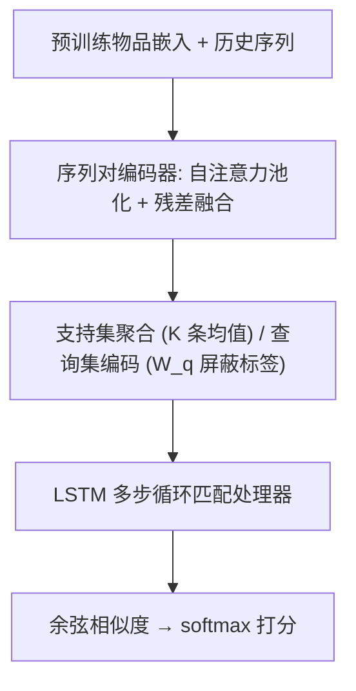
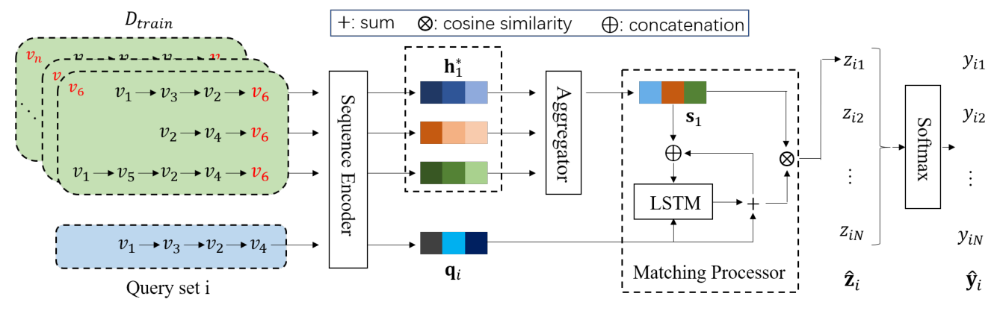

# Cold-start Sequential Recommendation via Meta Learner (基于元学习器的冷启动序列推荐)

- **会议/期刊**: AAAI 2021
- **作者与机构**: Yujia Zheng, Siyi Liu, Zekun Li, Shu Wu（电子科技大学 / 中科院大学 / 中科院自动化所）
- **推荐链路定位**: 召回（Next-Item 序列召回，冷启动物品场景）
- **研究方向**: 冷启动与长尾推荐 / 序列与会话推荐
- **论文原文**: [https://arxiv.org/abs/2012.05462v1](https://arxiv.org/abs/2012.05462v1)
- **开源代码**: 暂未开源

## TL;DR (1分钟核心速览)

序列推荐模型严重依赖物品的历史交互量，新上架物品（cold-start item）几乎无法被召回；而既有冷启动方法（内容特征、跨域迁移、MeLU/MAMO 等）都依赖用户画像、物品属性等辅助信息，在"仅有点击序列"的场景直接失效。Mecos 将冷启动物品推荐重构为元学习少样本匹配任务：用序列对编码器抽取用户偏好，用循环匹配处理器在多步对齐中学习"查询序列 ↔ 冷启动物品支持集"的相关性。在 Steam/Electronic/Tmall 三个数据集、1 正 127 负的采样排序协议下，HR@10 相对最强基线平均提升 98.6%/91.1%/69.6%。

## Background & Motivation (背景与核心矛盾)

- **主流范式**: GRU4Rec/NARM/Caser/STAMP/SASRec/SR-GNN 等以用户交互序列建模动态兴趣，物品嵌入质量完全由交互频次决定。
- **前人局限**: ① 冷启动物品交互极少，嵌入欠训练，打分天然塌陷；② 内容/跨域/画像类冷启动方法在序列推荐设定下不可用，因为该场景**唯一稳定可得的数据只有 user–item 交互**，元学习方法（MeLU、MAMO、s²Meta）同样绑定辅助信息。
- **核心洞察 (Key Insight)**: 冷启动物品虽缺"物品级"交互，但仍有少量（K 条）"物品—用户序列"共现证据；若能把这 K 条证据当作支持集、把目标用户序列当作查询，则推荐退化为一个可学习的**度量匹配**问题，且匹配器可跨物品迁移、对新物品零微调。
- **本文切入点**: 元训练构造 `N 个候选冷启动物品 × K 条序列对` 的任务，学习一个可迁移的匹配函数而非物品 ID 嵌入。

## Method (核心方法设计)

### 1. 整体框架 (Overall Architecture)

Mecos 以任一序列推荐模型预训练好的物品嵌入为输入（保证与基线用同样的嵌入质量、同样的数据量，公平对比）。先由序列对编码器把"历史序列 + 下一跳物品"压成定长向量；支持集侧对 K 条序列对做均值聚合得到候选冷启动物品的原型表示，查询集侧因下一跳未知只能编码历史序列（用投影矩阵 $W_q$ 屏蔽标签防泄漏）；最后由 LSTM 循环匹配处理器多步迭代地把支持集信息注入查询表示，用余弦相似度对 N 个候选打分并 softmax。整个流程在元训练任务集上端到端优化，推理时对新物品无需任何微调。

<figure class="paper-figure" markdown="span">
  <figcaption>图 2：Mecos 的框架。绿色方块表示支持集，其中包含候选冷启动物品（红色）的少样本训练序列。我们的目标是为查询序列（蓝色方块）推荐冷启动物品。该框架首先生成序列对表示（式 1、2），然后聚合少样本序列表示以生成支持集表示（式 3）。最后，它采用匹配网络（式 4）计算查询集与所有支持集之间的相似度分数（式 5）。将第 i 个查询集与 N 个不同支持集匹配后，我们可以得到一个</figcaption>
</figure>

### 2. 关键设计拆解 (Key Designs)

1. **末位点击感知的序列对编码器（Sequence Pair Encoder）**：平均池化会抹平"当前兴趣"，直接拼 next-item 又噪声大。作者以**最后一个点击**为注意力锚点，联合末位项、候选位项与序列均值计算注意力权重：$e_j=\mathbf{p}^\top(W_1^a\mathbf{v}_{i,n}+W_2^a\mathbf{v}_{i,j}+W_3^a\mathbf{v}_{i,\mathrm{avg}}+\mathbf{b})$，$\alpha_j=\mathrm{softmax}(e_j)$，$R(\zeta_i)=\sum_{j}\alpha_j\mathbf{v}_{i,j}$。再把 next-item 拼上并走带残差的前馈层$h_i=h_i^0+\mathrm{ReLU}(W^lh_i^0+b^l)$，$h_i^0=[R(\zeta_i);\mathbf{v}_{i,n+1}]$。直觉：显式区分"用户当下意图"与"序列整体习惯"，让序列对表示同时编码"看什么"和"接着买什么"。
2. **可学习的循环匹配处理器 + 支持集聚合**：欧氏/余弦距离衡量的是绝对位置，无法表达"该用户与该冷启动物品是否真的相关"。支持集表示取 $s_i=\mathrm{MeanPool}(\{h_{i,k}\}_{k=1}^{K})$（K 条少样本证据的鲁棒原型）；查询侧$h_i^0=W_qR(\zeta_i)$，$W_q\in\mathbb{R}^{2d\times d}$既对齐维度又物理上阻断标签泄漏。匹配步迭代$\hat{q}_i^t,c_t=\mathrm{LSTM}(q_i,[q_i^{t-1};s_j],c_{t-1})$，$q_i^t=\hat{q}_i^t+q_i$，最终$z_{ij}=\cos(q_i^t,s_j)$。直觉：把支持集当作"可查询的记忆"，逐步而非一次性写入查询向量，从而捕获非线性的真实相关性；残差保证信息不退化。
3. **训练目标、负采样与推理效率**：每个任务采样 $N=128$个候选冷启动物品（1 正 + 127 随机负），监督信号为候选维上的交叉熵$\mathcal{L}_T=-\sum_{i}\sum_{j}y_{ij}\log\hat{y}_{ij}+(1-y_{ij})\log(1-\hat{y}_{ij})$，$\hat{y}_i=\mathrm{softmax}(\hat{z}_i)$，BPTT 反传、Adam 优化。采用**任务级（episode）随机负采样**而非 in-batch 负采样。推理只需一次前向 + 覆盖 N 个候选的相似度计算，匹配步固定为 2，开销与 K、N 线性，无梯度更新。

## Experimental Setup & Evaluation Protocol (实验设置与评估协议)

- **数据集与预处理**: 三个公开数据集均沿用 SASRec/Caser 的预处理与序列数据增强（前缀切分，如 $(v_0,v_1,v_2,v_3)\to(v_0,v_1),(v_0,v_1,v_2),(v_0,v_1,v_2,v_3)$）。依据帕累托 80/20 法则，把**交互数最少的 20% 下一跳物品**定义为少样本任务（冷启动物品），其对应序列即 meta-sequences。

| 数据集 | #Sequences | #Items | #冷启动候选(ground-truth)物品 | meta-sequences 占比 | 场景说明 |
| :--- | :---: | :---: | :---: | :---: | :--- |
| Steam | 358,228 | 11,969 | 9,496 | 0.12 | 在线游戏评论/购买 |
| Electronic | 443,589 | 63,002 | 50,331 | 0.31 | Amazon 电子产品 |
| Tmall | 918,358 | 624,221 | 219,560 | 0.20 | 阿里电商行为日志 |

- **数据划分与防穿越 (Splitting Strategy)**: **任务级划分**，训练/验证/测试任务 = 7:1:2；$Y_{test}\cap Y_{train}=\varnothing$，测试冷启动物品在元训练中完全不可见；预训练嵌入所用序列中被移除含目标任务 ground-truth 的样本，避免信息穿越。
- **排名评测协议 (Ranking Protocol)**: **Sampled Ranking**，每个 ground-truth 下一跳物品配 127 个从 $Y_{test}$随机采样的负例（$N=128$），报告 HR@5/10/20、NDCG@5/10/20、MRR。
- **对比基线与超参设置**: 6 个纯交互基线分四族——RNN（GRU4Rec、NARM）、CNN（Caser）、Attention（STAMP、SASRec）、Graph（SR-GNN）；分别报告原始（w/o）与接入 Mecos（w）的结果。默认 $d=100$、$K=3$、匹配步$t=2$，5 次随机种子取均值。

## Key Experimental Results (实验关键数据)

### 1. 主实验对比 (Main Results)

| 数据集 | 模型 | HR@10 (w/o → w) | NDCG@10 (w/o → w) | MRR (w/o → w) |
| :--- | :--- | :---: | :---: | :---: |
| Steam | GRU4Rec | 0.1498 → 0.3066 | 0.0737 → 0.1639 | 0.0720 → 0.1412 |
| Steam | NARM | 0.1578 → 0.3002 | 0.0760 → 0.1561 | 0.0543 → 0.1380 |
| Steam | Caser | 0.1508 → **0.3136** | 0.0732 → **0.1651** | 0.0728 → **0.1456** |
| Steam | SASRec | 0.1113 → 0.2358 | 0.0557 → 0.1245 | 0.0676 → 0.1138 |
| Steam | SR-GNN | **0.1885** → 0.3085 | **0.0947** → 0.1650 | **0.0936** → 0.1454 |
| Electronic | GRU4Rec | 0.1357 → 0.2431 | 0.0652 → 0.1180 | 0.0684 → 0.1061 |
| Electronic | NARM | **0.1604** → 0.2546 | 0.0751 → 0.1277 | 0.0699 → 0.1131 |
| Electronic | Caser | 0.0870 → 0.2285 | 0.0393 → 0.0975 | 0.0440 → 0.0903 |
| Electronic | SASRec | 0.0796 → 0.1858 | 0.0359 → 0.0890 | 0.0514 → 0.0915 |
| Electronic | SR-GNN | 0.1935 → **0.2591** | **0.0950** → **0.1324** | **0.0921** → **0.1243** |
| Tmall | GRU4Rec | 0.3437 → 0.4666 | 0.2655 → 0.3641 | 0.2580 → 0.3477 |
| Tmall | NARM | 0.3860 → **0.4727** | 0.2957 → **0.3680** | 0.2848 → **0.3510** |
| Tmall | Caser | 0.1724 → 0.4023 | 0.0870 → 0.3107 | 0.0799 → 0.2996 |
| Tmall | SASRec | 0.1307 → 0.3694 | 0.0721 → 0.3040 | 0.0659 → 0.2984 |
| Tmall | SR-GNN | **0.4081** → 0.4624 | **0.2921** → 0.3609 | **0.2956** → 0.3635 |
| **均值提升** | HR@10 | Steam **+98.61%** / Electronic **+91.10%** / Tmall **+69.59%** | NDCG@5 最高 +147.48%(Tmall) | — |

### 2. 消融实验 (Ablation Study)

以下均在**随机初始化物品嵌入**（Mecos R）下进行，以剥离预训练骨干的贡献：

| 数据集 | 配置 | HR@10 | NDCG@10 | MRR |
| :--- | :--- | :---: | :---: | :---: |
| Steam | Mecos R（完整） | **0.1606** | **0.0805** | **0.0551** |
| Steam | Variant 1: w/o 序列对编码器 | 0.0933 | 0.0445 | 0.0405 |
| Steam | Variant 2: w/o 匹配处理器（t=0） | 0.1163 | 0.0555 | 0.0476 |
| Steam | Variant 3: 二者皆去除 | 0.0716 | 0.0339 | 0.0294 |
| Electronic | Mecos R（完整） | **0.1382** | **0.0665** | **0.0658** |
| Electronic | Variant 1 | 0.0832 | 0.0382 | 0.0355 |
| Electronic | Variant 2 | 0.1207 | 0.0572 | 0.0505 |
| Electronic | Variant 3 | 0.0770 | 0.0329 | 0.0314 |
| Tmall | Mecos R（完整） | **0.3481** | **0.2915** | **0.2891** |
| Tmall | Variant 1 | 0.3135 | 0.2787 | 0.2461 |
| Tmall | Variant 2 | 0.3230 | 0.2737 | 0.2503 |
| Tmall | Variant 3 | 0.2921 | 0.2552 | 0.2324 |

### 3. 关键实验发现 (Key Findings)

1. **匹配处理器是主增益引擎**：去掉多步匹配（Variant 2）在 Steam 上 HR@10 从 0.1606 跌至 0.1163（−27.6%），跌幅明显小于去掉序列对编码器的 −41.9%，说明"学到的距离函数"确实比静态余弦更能表达真实相关性；两者全去（Variant 3, 0.0716）甚至低于原始 SR-GNN 之外的多数基线，但**仍高于多数 w/o 基线**，证明框架价值不依赖骨干网络。
2. **框架对 top 位置收益最大**：Tmall 上 NDCG@5 提升 147.48% 远高于 NDCG@20 的 90.36%，Steam 同样是 NDCG@5 (+129.23%) > HR@20 (+70.70%)，即收益集中在推荐列表前几位，对首屏曝光场景更有价值。
3. **K 单调增、匹配步存在最优点**：$K$从 1 增至 5 时 HR@10 持续上升（$K=1$单样本即已显著优于 SR-GNN, 见图 4），但$t>3$后性能回落（hubness 现象，图 5 的 t-SNE 显示 Mecos 的查询嵌入按目标物品聚成更紧簇）；同时$K$ 增大时与基线的差距收窄，说明 Mecos 定位在**少样本区间**，物品交互丰富后增益递减（Tmall 冷启动占比最低，故提升最小）。

## Highlights & Limitations (亮点、对比与审稿批判)

- **与代表作对比 (vs. Prior Work)**: 相较 MeLU / MAMO / s²Meta，本质区别是**彻底放弃用户画像、物品属性与跨域知识**，仅用交互序列构造 episode，因此是首个可直接套在任意神经序列推荐器上的冷启动插件；相较 Caser/SR-GNN 等纯骨干，它不改进序列编码本身，而是把"评分"换成"少样本度量匹配"，从而对新物品零微调。
- **可迁移亮点**: ① 用 $W_q$ 投影在查询侧物理屏蔽标签，是少样本推荐里干净便捷的防泄漏写法；② "任务级 N 路候选 + 支持集聚合"的 episode 构造范式可平移到 POI 冷启动、短视频新物料冷启与跨域冷启动。
- **审稿级局限批判**: ① 仅报告 1:127 的采样排序，未做全库 Full-Ranking，冷启动物品在百万级物品库中的真实竞争力（尤其位置偏置）仍不明；② 冷启动物品定义基于"交互数最少 20%"，属于可控的离线构造，与线上真实零交互新品的分布存在 gap；③ 匹配步对 $t$敏感（2–3 最优，超出即过拟合/hubness），且 LSTM 逐候选匹配使推理成本随$N$ 线性增长，大规模候选集下延迟压力未评估。

## Rating (四维评分)

- **方法创新性 (Novelty)**: ⭐⭐⭐⭐ （首次把"仅交互"的序列冷启动建模为元学习支持集匹配，问题定义本身即是主要贡献；但编码器与匹配器组件均为既有模块的组合）
- **评估协议与实验扎实度 (Protocol & Experiments)**: ⭐⭐⭐ （三数据集 × 六基线 × 三指标的覆盖完整，消融与超参分析充分，但仅有 1:127 采样排序、无全库排序与显著性检验）
- **写作与数学规范度 (Clarity & Rigor)**: ⭐⭐⭐⭐ （公式链条清晰、符号自洽，episode 构造与防泄漏处理交代明确；缺复杂度分析与 t-SNE/hubness 只有定性解释）
- **工业落地与复现价值 (Industrial & Practical Value)**: ⭐⭐⭐⭐ （即插即用、新物品无需微调，工程改造成本低；但代码未开源，且逐候选匹配的推理开销需在大候选集下另行优化）

