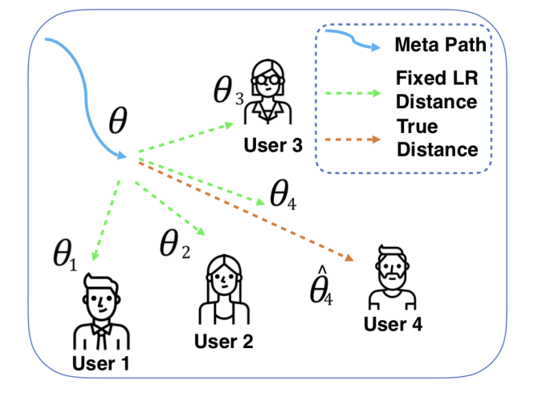
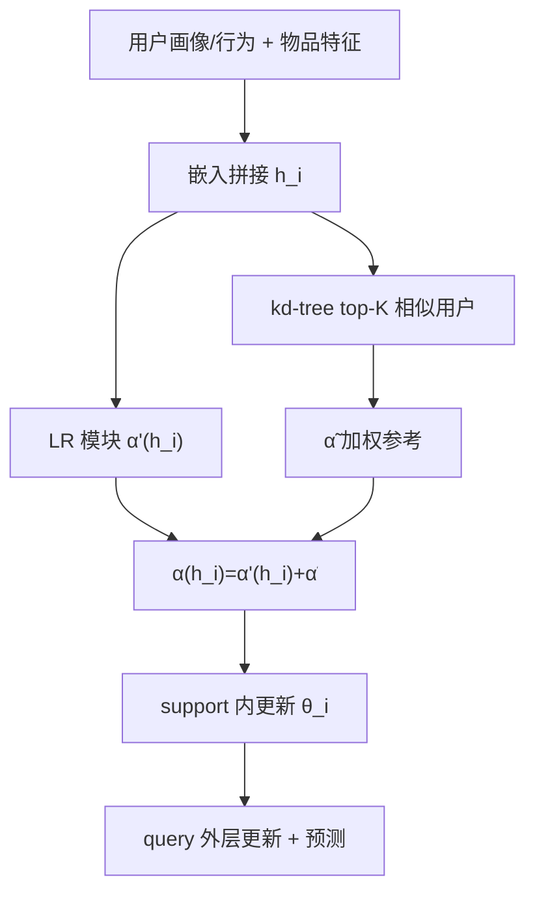
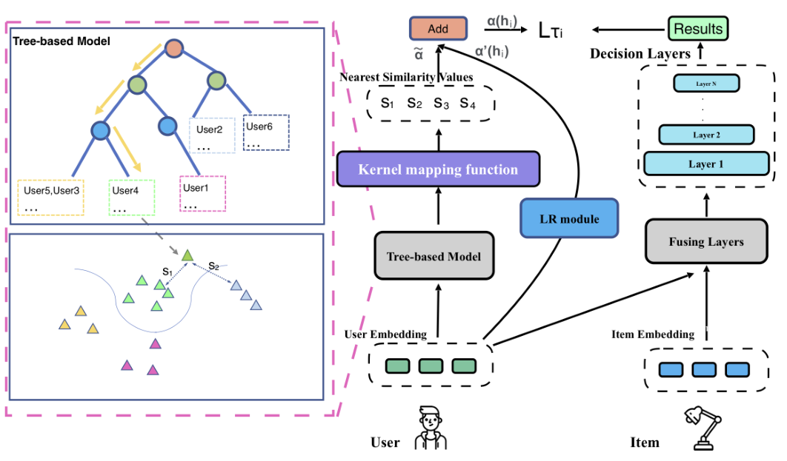

# Personalized Adaptive Meta Learning for Cold-start User Preference Prediction（面向冷启动用户偏好预测的个性化自适应元学习）

- **会议/期刊**: AAAI 2021
- **作者与机构**: Runsheng Yu, Yu Gong, Xu He, Bo An, Yu Zhu, Qingwen Liu, Wenwu Ou；南洋理工大学、阿里巴巴
- **推荐链路定位**: 精排/用户偏好预测（评分与 CTR）
- **研究方向**: 冷启动与长尾推荐
- **论文原文**: [https://arxiv.org/abs/2012.11842v1](https://arxiv.org/abs/2012.11842v1)
- **开源代码**: [检测链接](https://github.com/mjacar/pytorch-nec)（疑似非官方，论文未声明代码）

## TL;DR (1分钟核心速览)

针对冷启动推荐中用户分布不均衡、MAML 固定内学习率偏向 major users 的任务过拟合，本文提出 PAML：用用户嵌入映射个性化学习率，并以相似用户 kd-tree 检索和常数空间正则器降低开销。在 MovieLens-1M、BookCrossing 与淘宝生产集上，按最少日志 80% 用户为冷启动、用户 7:1:2 划分、支持/查询 80:20 评估，REG-PAML 将 MSE 从 1.308 降至 1.210，生产 AUC 达 0.5882。

## Background & Motivation (背景与核心矛盾)

- **主流范式**: 将每个用户视为 few-shot task、物品为类，用 MAML 在 support 集内做梯度更新，学新用户快速适应。
- **前人局限**: 用户特征与行为长尾，major users 主导均值损失，固定 LR 对远离元策略的 minor users 更新不足；存储每用户嵌入/学习率又带来线性空间开销。
- **核心洞察 (Key Insight)**: MovieLens 上 MAML 类方法 major MSE 1.413、minor MSE 1.506；Age/Gender/Zipcode/Occup 的 Top30% 特征值占比达 72.4%/71.7%/56.7%/64.0%。Lemma 1 在两组密度 $p_1\ge p_2$下给出$(\theta_1^*-x_1)^2\le(\theta_2^*-x_2)^2$，即固定 LR 优先优化 major；Lemma 2 证明存在$\alpha_1,\alpha_2$使$L^*\ge L^{*\prime}$。
- **本文切入点**: 学习用户嵌入到学习率的映射 $\alpha(h_i)$，让 minor users 也获得足够步长。

<figure class="paper-figure" markdown="span">
  <figcaption>图 1：一个示例，说明 MAML 在冷启动用户不平衡数据集上存在局限性。用户 1、2、3 为主要用户，用户 4 为次要用户。</figcaption>
</figure>
图 1：MAML 在用户不均衡冷启动数据中偏向 major users 的示意。

## Method (核心方法设计)

### 1. 整体框架 (Overall Architecture)

用户画像/行为嵌入 $h_i$与物品嵌入拼接后输入决策 MLP 产生偏好分；LR 模块（两层 FC+ReLU）由$h_i$产生$\alpha'(h_i)$。AT-PAML 再从 kd-tree 检索 top-K 相似用户的学习率加权得$\tilde{\alpha}$；内层用 support 集更新$\theta_i$，外层用 query 集更新$\theta,\psi$。REG-PAML 去掉树，仅用$\alpha(h_i)$与正则器，推理$O(1)$；AT-PAML 检索约$O(\sqrt{n})$。

<figure class="paper-figure" markdown="span">
  <figcaption>图 2：基于树的 PAML 的网络结构。右侧部分为用于内部更新的网络，左侧部分为基于树的模块。具体而言，Fusing Layer 表示用户嵌入和物品嵌入的拼接，Add 为加法函数：α′(hi) + ˜α。Layer1, . . . N 表示全连接层，S1, . . . S4 为相似度值。</figcaption>
</figure>
图 2：基于树的 PAML 网络结构；左侧为相似用户检索与学习率融合。

### 2. 关键设计拆解 (Key Designs)

1. **个性化自适应学习率 (PAML)**：痛点根源是 MAML 对所有用户用同一 $\alpha$，minor users 被均值损失淹没。本文改为$\theta_i=\theta-\alpha(h_i)\nabla_\theta L_{\tau_i}(\theta)$，其中$\alpha(h_i)$由用户嵌入端到端学习；直觉是不同$\alpha$ 可把远离元策略的用户拉回，Lemma 2 给出更低总损失上界。
2. **相似用户参考 + 近似 kd-tree**：FC 层难以记忆大量用户，本文用相似用户学习率作参考：
$\alpha(h_i)=\alpha'(h_i)+\sum_k\frac{s_k}{\sum_j s_j+\sigma}\alpha(h_k)$，$s_k=\exp(-\delta\|h_i-h_k\|_2^2)$。kd-tree 存$h_k$与$\alpha(h_k)$，动态更新节点，把暴力检索$O(n)$降至约$O(\sqrt{n})$。
3. **记忆无关正则器 (REG-PAML)**：为免存每用户嵌入，作者优化 pairwise loss 差的上界，得到
$\mathcal{L}=\sum_i L_{\tau_i}+\gamma\sum_i\|\partial L_{\tau_i}/\partial\theta\|_2\|\alpha(h_i)\|$。
该正则迫使元策略“记住”已见用户，同时保持常数空间；$\gamma$ 控制记忆强度。

**训练目标、负采样与推理效率**：评分任务用 MSE，CTR 用 softmax 交叉熵；按用户 support/query 训练，无负采样排序。内层 $\alpha$、外层$\beta$ 用 ADAM。MovieLens 单卡 1080Ti 上 REG-PAML 约 669MB/2h，AT-PAML 约 2.12GB/4h。

## Experimental Setup & Evaluation Protocol (实验设置与评估协议)

- **数据集与预处理**: 取日志最少 80% 用户为冷启动；剔除年龄 <10/>100、乱码位置、交互 <2 的用户/物品；每用户 support/query 按 80%:20% 划分。

| 数据集 | #Users | #Items | #Interactions | 稀疏度/密度 | 特征/场景说明 |
| :--- | :---: | :---: | :---: | :---: | :--- |
| MovieLens-1M | 6,040 | 3,706 | 1,000,209 | 4.47% | 评分+用户画像；原始公开规模 |
| BookCrossing | 278,858 | 271,379 | 1,149,780 | 0.0015% | 图书评分；原始公开规模 |
| Taobao 生产集 | 未披露 | 未披露 | 未披露 | 未披露 | CTR；阿里电商日志 |

- **数据划分与防穿越**: 用户随机按 7:1:2 分训练/验证/测试；每用户内部再切 support/query，测试用户不参与元训练。
- **Major/Minor 划分**: 用户有超过 2 个特征落在 Top30% 最大特征值集合为 major，否则 minor；MovieLens 65%/35%，BookCrossing 72%/28%，Taobao 71%/29%。
- **排名评测协议**: 评分任务报告 MSE 与 Avg nDCG@3/5（query 集排序），CTR 报告 AUC/NEL；未采用全库 Full-Ranking，也不是采样负例排序；显著性用双尾 t-test，$p<0.05$。
- **对比基线与超参**: 原文主表仅 3 个基线——MeLU、Meta-SGD、Transfer-Learning；默认 $\gamma=10^{-3}$，3 次独立实验；嵌入维度与层数正文未披露。

## Key Experimental Results (实验关键数据)

### 1. 主实验对比 (Main Results)

| 方法 | ML MSE↓ | ML nDCG@3↑ | ML nDCG@5↑ | BC MSE↓ | BC nDCG@3↑ | BC nDCG@5↑ |
| :--- | :---: | :---: | :---: | :---: | :---: | :---: |
| MeLU | 1.451 | **0.793** | 0.800 | 4.019 | 0.864 | 0.914 |
| Meta-SGD | 1.340 | 0.773 | 0.794 | 5.197 | 0.867 | 0.921 |
| Transfer-Learning | 1.308 | 0.778 | 0.796 | 4.522 | 0.862 | 0.919 |
| AT-PAML | 1.322 | 0.788 | **0.806** | 3.991 | 0.852 | **0.930** |
| REG-PAML | **1.210** | 0.779 | 0.803 | **3.928** | **0.868** | 0.917 |

REG-PAML 相对最强基线 MSE 降低 7.5%（MovieLens）/2.3%（BookCrossing）。淘宝生产集 AUC：REG-PAML 0.5882、AT-PAML 0.5806，优于 SOTA 0.5796；NEL：-0.5382/-0.5426，优于 SOTA -0.5080（越低越好）。

### 2. 消融实验 (Ablation Study)

| 变体 | MSE↓ | nDCG@3↑ | nDCG@5↑ | MAU MSE↓ | MU MSE↓ | p |
| :--- | :---: | :---: | :---: | :---: | :---: | :---: |
| PAML | 1.520 | 0.787 | 0.809 | 1.471 | 1.569 | 0.038 |
| AT-PAML | 1.322 | 0.788 | 0.806 | 1.284 | 1.382 | 0.018 |
| REG $\gamma=10^{-5}$ | 1.509 | 0.773 | 0.799 | 1.464 | 1.601 | 0.008 |
| REG $\gamma=10^{-4}$ | 1.227 | 0.779 | 0.803 | 1.210 | 1.255 | 0.226 |
| REG $\gamma=10^{-3}$ | 1.210 | **0.791** | **0.814** | 1.196 | **1.183** | **0.738** |
| REG $\gamma=10^{-2}$ | **1.191** | 0.777 | 0.803 | **1.194** | 1.236 | 0.312 |

### 3. 关键实验发现 (Key Findings)

1. **主指标全面领先**：REG-PAML 在 MovieLens/BookCrossing 取得最低 MSE（1.210/3.928），AT-PAML 取得最高 nDCG@5（0.806/0.930），说明“个性化 LR + 相似参考/正则”均有效。
2. **缓解 minor user 过拟合**：默认 $\gamma=10^{-3}$时 REG-PAML 的 MAU/MU MSE 为 1.196/1.183，$p=0.738$，无显著组间差；MeLU 的 MU 1.506 vs MAU 1.413，Meta-SGD$p=0.024$，仍偏向 major。
3. **正则强度敏感但方向明确**：vanilla PAML MSE 1.520，AT-PAML 1.322，REG 1.210；$\gamma=10^{-5}$时 MSE 1.509 且$p=0.008$，记忆不足、重新偏向 major；$\gamma=10^{-3}$ 在 nDCG 与组间平衡上最优。

## Highlights & Limitations (亮点、对比与审稿批判)

- **与代表作对比 (vs. Prior Work)**: MeLU 用固定内学习率，Meta-SGD 做参数级 LR 但不依赖用户嵌入，Transfer-Learning 仅全局预训练+微调；本文首次把 LR 建成用户嵌入函数，并用相似用户检索和正则器兼顾 minor users。
- **可迁移亮点**: 用户嵌入到超参的端到端映射可迁移到冷启动重排/出价；用 kd-tree 缓存“相似任务超参”适合任务数量大的元学习；pairwise loss 上界正则可在常数空间下做任务记忆。
- **审稿级局限批判**: major/minor 用 Top30% 特征值规则划分，依赖数据集且非因果定义；评估未做全库 Full-Ranking，主表仅 3 个基线；AT-PAML 检索使内存升至 2.12GB、训练约 4h，$\gamma$ 过小会退化为 major 主导。

## Rating (四维评分)

- **方法创新性 (Novelty)**: ⭐⭐⭐⭐ （首次在推荐冷启动中把 MAML 内学习率建成用户嵌入函数，并有 Lemma 支撑）
- **评估协议与实验扎实度 (Protocol & Experiments)**: ⭐⭐⭐ （含淘宝生产集与 t-test，但主表基线仅 3 个、缺少全库排序协议）
- **写作与数学规范度 (Clarity & Rigor)**: ⭐⭐⭐⭐ （PAML/AT/REG 三条线公式清楚，证明在附录，复杂度分析明确）
- **工业落地与复现价值 (Industrial & Practical Value)**: ⭐⭐⭐⭐ （REG-PAML 常数空间、生产 CTR 验证；但树结构开销与非官方代码降低复现便利性）

