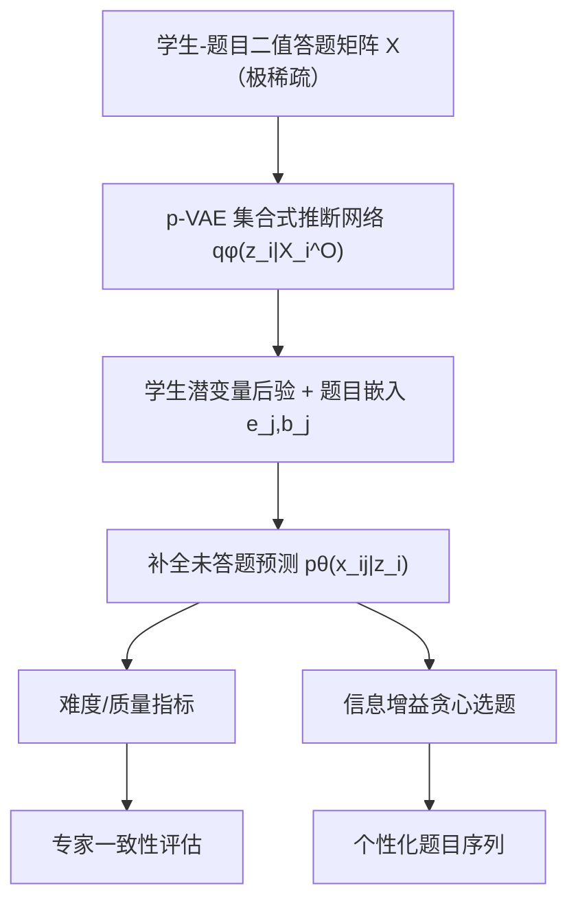
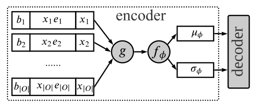
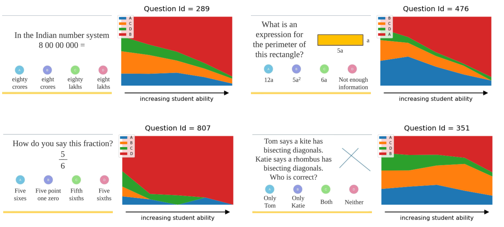

# Educational Question Mining At Scale: Prediction, Analysis and Personalization（大规模教育题目挖掘：预测、分析与个性化）

- **会议/期刊**: AAAI 2021（AAAI-EAAI）
- **作者与机构**: Zichao Wang、Richard G. Baraniuk（Rice University）；Sebastian Tschiatschek（University of Vienna）；Simon Woodhead（Eedi）；José Miguel Hernández-Lobato（University of Cambridge）；Simon Peyton Jones、Cheng Zhang（Microsoft Research Cambridge）
- **推荐链路定位**: 重排/自适应选题（学生-题目矩阵补全 + 序列选题）
- **研究方向**: 协同过滤与双塔召回（矩阵补全/个性化选题）
- **论文原文**: [https://arxiv.org/abs/2003.05980v2](https://arxiv.org/abs/2003.05980v2)
- **开源代码**: 暂未开源（数据集已开放：https://eedi.com/projects/neurips-education-challenge）

## TL;DR (1分钟核心速览)

本文针对在线教育题目海量、学生-题目矩阵极稀疏、教师难逐题评估的痛点，用 p-VAE 概率补全缺失答题，再以学生后验定义题目难度、信息论质量与贪心信息增益选题。在 Eedi 12.4 万学生、2.76 万题、1700 万答题上按学生 80:10:10 划分；p-VAE 达 0.739 准确率/0.343 MAE，难度排序与专家 Spearman 0.738，质量判断最高 72% 一致。

## Background & Motivation (背景与核心矛盾)

- **主流范式**: 教育数据挖掘多用 IRT/Rasch、SVD/SVD++、NMF、SPARFA 等对学生-题目答题矩阵做因子分解或知识追踪。
- **前人局限**: 其一，每个学生只答极小部分题目且不同学生答题子集不同，直接用观测数据比较题目难度会产生选择偏差；其二，传统贝叶斯 IRT/SPARFA 计算复杂，难扩展到 $10^5$学生$\times$ $10^4$ 题规模，而推荐系统 VAE 常需零填补，扭曲原始分布。
- **核心洞察 (Key Insight)**: p-VAE 的 amortized 推断可直接处理部分观测矩阵，并给出学生潜变量后验；该后验的不确定性可自然转化为“题目是否区分学生能力”的信息量。
- **本文切入点**: 用 p-VAE 补全缺失答题，再基于后验设计题目难度、质量指标与贝叶斯实验设计式个性化选题。

## Method (核心方法设计)

### 1. 整体框架 (Overall Architecture)

模型先把 $N\times M$二值答题矩阵的观测部分$X^O$编码为学生潜变量后验，再以 Bernoulli 解码器预测未答题；题目嵌入$[e_j,b_j]$与学生嵌入$z_i$在同一 p-VAE 中联合学习。训练只对观测条目计算部分 ELBO，推理时用 amortized 集合网络一次得到$q_\phi(z_i|X_i^O)$，从而支持全矩阵补全、难度/质量指标和逐步选题。

<figure class="paper-figure" markdown="span">
  <figcaption>图 2：p-VAE 模型架构示意图。</figcaption>
</figure>

### 2. 关键设计拆解 (Key Designs)

1. **p-VAE 部分观测补全（Partial ELBO + 集合式编码）**：普通 VAE 要求完整输入，零填补又会改变分布；p-VAE 只在观测条目上优化
   $\mathcal{L}_{\text{partial}}=\mathbb{E}_{q_\phi(z|X^O)}[\log p_\theta(X^O|z)+\log p(z)-\log q_\phi(z|X^O)]$。
   推断网络把每个观测答题增强为 $s_{ij}=[x_{ij},x_{ij}e_j,b_j]$，经置换不变聚合$g(\cdot)$ 后输出
   $[\mu_\phi,\sigma_\phi]=f_\phi(g(s_{i1},...,s_{i|O|}))$。这样既不伪造缺失值，又能一次前向得到学生后验，支撑后续信息论计算。

2. **题目难度与质量指标（用后验 KL 衡量信息量）**：难度用补全后的预测正确率衡量（越高越易）；质量则定义为“看到该题答案后，学生后验相对先验的期望 KL”：
   $R(j)=\mathbb{E}_{x_{ij}\sim p_\theta(x_{ij})}[D_{\mathrm{KL}}(p_\phi(z_i|x_{ij})\|p(z))]\approx\frac{1}{S}\sum_{s=1}^{S}D_{\mathrm{KL}}(q_\phi(z|x_{ij}^{(s)})\|p(z))$。
   高 $R(j)$ 表示该题最能区分学生能力；若题目过易/过难或选项混乱，后验几乎不移动，质量自然低。

<figure class="paper-figure" markdown="span">
  <figcaption>图 4：我们的框架判定的两个高质量题目示例（上排）和两个低质量题目示例（下排）。对于每一对，左图显示实际题目，右图显示堆叠比例图，表示回答 A、B、C 或 D 的学生百分比，其中顶部（红色）部分始终表示答对学生的百分比。上排：高质量题目可区分学生能力。左下：该低质量题目过于简单；无论学生能力如何，他们往往都会答对。右下</figcaption>
</figure>

3. **个性化选题（贝叶斯实验设计 + 贪心信息增益）**：为每个学生逐步选题，选当前最能降低学生状态不确定性的题：
   $R_i(j,x^O)=\mathbb{E}_{x_j\sim p(x_j|x^O)}D_{\mathrm{KL}}(p(z_i|x^O,x_j)\|p(z_i|x^O))$。
   每步取 $\arg\max_j R_i(j,x^O)$，揭示答案后更新$x^O$，重复至 10 题。训练损失为负部分 ELBO；无负采样，未观测条目只在推理时由解码器补全。集合编码为$O(|O|)$，选题每步对候选题目做 Monte Carlo 近似，成本约$O(M\cdot S)$。

## Experimental Setup & Evaluation Protocol (实验设置与评估协议)

- **数据集与预处理**: Eedi 2018–2019 学年数学四选一诊断题；删除答题数少于 50 的题目与学生，同一学生同题多次作答保留最新记录。

| 数据集 | #Users | #Items | #Interactions | 稀疏度/密度 | 特征/场景说明 |
| :--- | :---: | :---: | :---: | :---: | :--- |
| Eedi 2018–19 | 123,889 | 27,613 | >17M | 密度约 0.50% | 4 选项数学诊断题，含 topic 标签 |

- **数据划分与防穿越 (Splitting Strategy)**: 按学生做 80:10:10 划分，测试学生在训练中完全未出现；测试时给模型该学生一部分观测答题，预测其余答题。不是 Leave-One-Out。
- **排名评测协议 (Ranking Protocol)**: 非传统 Top-N Full-Ranking/Sampled Ranking；主评估是补全 Accuracy/MAE，难度用 Spearman 排序相关，质量用 5 位教师 pairwise agreement，选题用逐步 MAE。
- **对比基线与超参设置**: 主实验对比 Random、IRT/Rasch、SVD、SVD++、Co-clustering、NMF；p-VAE 训练 50 epochs，Adam lr=0.001，Bernoulli 似然。正文未给潜变量维度与显著性检验。

## Key Experimental Results (实验关键数据)

### 1. 主实验对比 (Main Results)

| Method | Accuracy ↑ | MAE ↓ |
| :--- | :---: | :---: |
| Random | 0.534 | 0.471 |
| IRT | 0.735 | 0.359 |
| SVD | 0.734 | 0.358 |
| SVD++ | 0.737 | 0.352 |
| Co-clustering | 0.731 | 0.351 |
| NMF | 0.737 | 0.382 |
| **p-VAE (Ours)** | **0.739** | **0.343** |
| Improv. | +0.3% | +2.3% |

### 2. 消融与替代实验 (Ablation / Component Analysis)

原文无标准“移除模块”消融；以下为关键指标与策略的替代对比（质量列为 5 位教师平均一致率）。

| 分析项 | 方法 | 指标 | 数值 |
| :--- | :--- | :---: | :---: |
| 难度排序 | 仅用观测 | Spearman ↑ | 0.395 |
| 难度排序 | 多数填补 | Spearman ↑ | 0.076 |
| 难度排序 | p-VAE 补全 | Spearman ↑ | **0.738** |
| 质量判断 | Random | Agreement ↑ | 0.456 |
| 质量判断 | Entropy | Agreement ↑ | 0.644 |
| 质量判断 | Ours | Agreement ↑ | **0.676** |
| 选题 | RAND / SING | 逐步 MAE ↓ | 均高于 Ours |
| 选题 | Ours | 逐步 MAE ↓ | 每步最低 |

### 3. 关键实验发现 (Key Findings)

- 补全精度提升虽小（0.739 vs 0.737，+0.3%；MAE 0.343 vs 0.351，+2.3%），但只有 p-VAE 同时给出学生后验；后续质量/选题收益来自不确定性，而非点估计矩阵分解。
- 难度排序从仅观测的 0.395 提升到 0.738（+86.8%），说明观测子集选择偏差被全矩阵补全显著纠正；多数填补仅 0.076，几乎失效。
- 质量指标在 5 位教师上平均 0.676，高于熵基线 0.644（+5.0%）与随机 0.456；且在 T1/T3/T5 领先、T2/T4 持平。个性化选题在 10 步中每步 MAE 低于 RAND/SING，不同学生得到明显不同的题目序列。

## Highlights & Limitations (亮点、对比与审稿批判)

- **与代表作对比 (vs. Prior Work)**: Rasch/IRT 只给标量能力与难度且无不确定性；SPARFA 可给多维分析但计算昂贵；p-VAE 推荐系统与 EDDI 已用部分 VAE/信息增益，本文将 p-VAE 扩展到教育题目挖掘，并新增无目标变量的题目质量指标与选题策略。
- **可迁移亮点**: 用后验 KL 作为 item 信息量/区分度指标；用全矩阵补全消除观测暴露偏差；集合式编码天然适配稀疏用户-物品矩阵。
- **审稿级局限批判**: 补全精度增益较小；仅建模二值正确性，忽略 A/B/C/D 选项语义；学生状态静态、无时间演化；人工评估仅 80 对/5 位教师；选题仅离线 10 步，无在线 A/B；代码未开源。

## Rating (四维评分)

- **方法创新性 (Novelty)**: ⭐⭐⭐⭐ （将 p-VAE 与信息论题目质量/难度/选题结合，教育场景增量明确，但核心模型非全新。）
- **评估协议与实验扎实度 (Protocol & Experiments)**: ⭐⭐⭐ （有真实大规模数据与专家评估，但无标准 Top-N 协议、无显著性检验，人工评估样本小。）
- **写作与数学规范度 (Clarity & Rigor)**: ⭐⭐⭐⭐ （p-VAE 与信息增益公式清楚，难度定义处有轻微歧义。）
- **工业落地与复现价值 (Industrial & Practical Value)**: ⭐⭐⭐ （amortized 推理可扩展，数据集开放；但代码未开源、静态模型限制线上自适应。）

