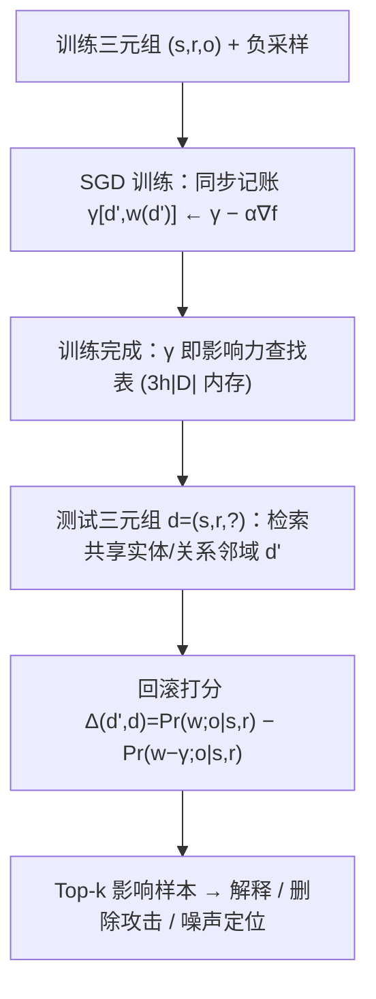

# Explaining Neural Matrix Factorization with Gradient Rollback (基于梯度回滚的神经矩阵分解解释方法)

- **会议/期刊**: AAAI 2021
- **作者与机构**: Carolin Lawrence, Timo Sztyler, Mathias Niepert (NEC Laboratories Europe)
- **推荐链路定位**: 召回/评分（MF 双塔内积）模型的**事后解释与训练样本归因**
- **研究方向**: 协同过滤与双塔召回 / 可信推荐（去偏与可解释）
- **论文原文**: [https://arxiv.org/abs/2010.05516v4](https://arxiv.org/abs/2010.05516v4)
- **开源代码**: [https://github.com/carolinlawrence/gradient-rollback](https://github.com/carolinlawrence/gradient-rollback)

## TL;DR (1分钟核心速览)

神经矩阵分解（MF / KGE）在推荐与链接预测中被广泛使用，但其预测是黑盒，用户无法判断"为何推荐该物品"。现有影响力函数法需二阶 Hessian、规模不可扩展，CRIAGE 又只允许同尾实体的邻居且仅支持 sigmoid。本文提出**梯度回滚 (Gradient Rollback, GR)**：训练时把每条训练三元组引起的参数增量累加到查找表 $\gamma$，测试时把$\gamma$从参数中"回滚"即可近似"删掉该样本后重训"的效果，无需重训。理论上证明其近似误差严格小于 SGD 稳定性上界$\Lambda_{\text{stab-nc}}$。在 NATIONS / FB15K-237 / MovieLens 的 ROAR 重训协议下，GR-1 的概率下降率 (PD%) 达 93%/77%/68%，较随机邻域基线提升 15–39 个点。

## Background & Motivation (背景与核心矛盾)

- **主流范式**: 推荐与 KG 补全主流用 DistMult/ComplEx 等神经矩阵分解，以 $\phi(w;d)=\langle\boldsymbol{s},\boldsymbol{r},\boldsymbol{o}\rangle$ 打分 + softmax 交叉熵训练；精度高但完全不可解释。
- **前人局限**: (1) 影响力函数 (Koh & Liang 2017) 依赖 Hessian 逆、对 $|D|$ 与参数量立方级扩展，在 KGE 上被证明不可用；(2) CRIAGE (Pezeshkpour 2019) 只把"同尾实体"的三元组当候选解释、只支持 sigmoid、且 MovieLens 上取一次解释需 3 小时。
- **核心洞察 (Key Insight)**: 训练集上的"影响力"本质是"删掉它后重训，参数会差多少"。而对嵌入查表类模型，一次 SGD 更新只触碰 $O(h)$ 个参数——因此可以把每条样本造成的参数位移**逐次记账**，事后直接减掉，替代昂贵重训。
- **本文切入点**: 用训练期的参数增量账本 $\gamma$把"重训$|D|$ 次"降为"一次前向回滚"，并把近似误差与 SGD 稳定性理论挂钩。

## Method (核心方法设计)

### 1. 整体框架 (Overall Architecture)

输入为三元组集合 $D=\{(s,r,o)\}$（推荐场景即 (用户, 评分, 物品)），实体/关系共享嵌入矩阵$E\in\mathbb{R}^{|E|\times h}$、$R\in\mathbb{R}^{|R|\times h}$。训练采用 batch size = 1 的 SGD/Adam，在每步反向传播后，把该样本$d'$造成的参数增量累加进专属账本$\gamma[d',\cdot]$；训练结束后$\gamma$成为一张"影响力查找表"。测试时对目标三元组$d$只检索与之共享实体或关系的邻域样本$d'$，把$\gamma[d',w(d)]$从当前参数中减掉、重新前向打分，得到概率变化量$\Delta(d',d)$，排序即得解释（Top-k 影响样本）、删除攻击集合或标注噪声候选。

### 2. 关键设计拆解 (Key Designs)

1. **梯度回滚记账 (Gradient Rollback)**：痛点是要评估样本 $d'$的影响必须重训$|D|$ 次（FB15K-237 需 2 个月）。GR 改为在训练中同步累加该样本引起的全部参数位移：

$$\gamma[d',w_{t+1}(d')]\leftarrow\gamma[d',w_t(d')]-\alpha\nabla f(w_t;d')$$

测试时以 $f(w;d)-f(w-\gamma[d',w(d)];d)$近似$f(w;d)-f(w';d)$（$w'$为去掉$d'$后的重训参数）。直觉：若模型稳定，则"逐次位移之和"≈"终点位移"，故减掉账本即可复原反事实模型。由于$\gamma[d',w(d)]\neq 0$仅当两三元组共享实体或关系，测试期只需$adj_{\text{avg}}+1$ 次前向。

2. **近似误差的理论界定**：先证 DistMult 打分满足 $|\phi(w;d)-\phi(w';d)|\le 2C^2\|w-w'\|$与$\|\nabla\phi(w;d)-\nabla\phi(w';d)\|\le 4C\|w-w'\|$（$C$ 为嵌入范数上界），再证回滚轨迹与真实重训轨迹的偏差递推严格小于 SGD 稳定性递推，得到：

$$\mathbb{E}\big|f(w_T-\gamma[d',w_T(d)];d)-f(w'_T;d)\big|<\Lambda_{\text{stab-nc}}$$

其中 $\Lambda_{\text{stab-nc}}=\frac{1+1/\beta c}{n-1}(cL^2)^{\frac{1}{\beta c+1}}T^{\frac{\beta c}{\beta c+1}}$。物理含义：**模型越稳定（Lipschitz 常数$L$ 越小、正则越强），GR 的解释越可信**——这一命题在实验中通过范数约束被定量验证。

3. **训练目标、负采样与开销**：损失为 $\mathcal{L}(w;D)=\sum_{d\in D}-\log\Pr(w;o\mid s,r)$，$\Pr=\frac{\exp(\phi(w;(s,r,o)))}{\sum_{o'}\exp(\phi(w;(s,r,o')))}$，负样本数 13（NATIONS）/500（FB15K-237、MovieLens）。训练开销$O(h|D|)$计算 +$3h|D|$内存（头/关系/尾各一份，约等于模型本身参数量）；测试期每条解释需$adj_{\max}+1$、平均$adj_{\text{avg}}+1$ 次前向，MovieLens 上约 3 分钟 vs CRIAGE 3 小时。

## Experimental Setup & Evaluation Protocol (实验设置与评估协议)

- **数据集与预处理**:

| 数据集 | #Entities | #Relations | #Train | #Dev/#Test | 负采样/维度 | 场景说明 |
| :--- | :---: | :---: | :---: | :---: | :---: | :--- |
| NATIONS | 14 | 55 | 1,592 | 199 / 201 | 13 / $d$=10 | 国家关系 KG，小规模稠密 |
| FB15K-237 | 14k | 237 | 272k | 17.5k / 20.5k | 500 / $d$=100 | 通用知识库补全 |
| MovieLens-100k | 949 | 1.7k | 90k | 5k / 4.4k | 500 / $d$=200 | (用户, 星级, 电影) 三元组，星级当关系 |

- **数据划分与防穿越**: NATIONS / FB15K-237 用官方划分；MovieLens 用 `ua.base` 训练、`ua.test` 前 5k 作验证、其余作测试，全程固定随机种子 42 与同一负样本集合，避免重训时的额外随机性。
- **排名评测协议**: 本文不评 Top-N 排序，而是采用 **ROAR (RemOve And Retrain)** 因果式协议——删除 GR/基线选出的集合 $S$ 后**完全从零重训**，观测目标三元组概率变化。两个指标：`PD%`（概率下降比例，随机基线≈50%）与 `TC%`（Top-1 预测翻转比例）。为控制重训成本，FB15K-237 与 MovieLens 只对 100 条随机测试查询的 Top-1 三元组做解释，NATIONS 用全测试集。基座模型精度：DistMult MRR 58.88/25.84/61.81，ComplEx 60.41/25.11/61.76。
- **对比基线与超参**: 基线为 `NH-k`（从邻域随机删 k 条）与 `NH-ALL`，以及 CRIAGE 与消融版 `GR-O`（仅同尾实体，与 CRIAGE 同邻域）；Adam，lr=0.001 衰减，NATIONS 训练 10 epoch，另两个 1 epoch；统计显著性用近似随机化检验 $p\le 0.01$。

## Key Experimental Results (实验关键数据)

### 1. 主实验对比 (Main Results)

DistMult 下 ROAR 重训结果（PD% / TC%，k=1/10/ALL，GR 选样 vs 随机邻域 NH）：

| 数据集 | 指标 | NH-1 | NH-10 | NH-ALL | GR-1 | GR-10 | GR-ALL | Δ(k=1) |
| :--- | :--- | :---: | :---: | :---: | :---: | :---: | :---: | :---: |
| NATIONS | PD% | 54 | 66 | 82 | **93** | **97** | **100** | +39 |
| NATIONS | TC% | 18 | 36 | 70 | **38** | **83** | **97** | +20 |
| FB15K-237 | PD% | 59 | 67 | 83 | **77** | **82** | **96** | +18 |
| FB15K-237 | TC% | 35 | 45 | 59 | **38** | **58** | **85** | +3 |
| MovieLens | PD% | 53 | 52 | 92 | **68** | **82** | **100** | +15 |
| MovieLens | TC% | 3 | 14 | 72 | **20** | **38** | **100** | +17 |

与 CRIAGE 的直接对比（NATIONS + DistMult + sigmoid，$k\in\{1,10\}$）：

| 方法 | PD@1 | PD@10 | TC@1 | TC@10 |
| :--- | :---: | :---: | :---: | :---: |
| NH（随机邻域） | 49 | 60 | 3 | 20 |
| CRIAGE | 91 | 95 | 16 | 68 |
| GR-O（同尾实体邻域） | **92** | **97** | **25** | 68 |
| GR（全邻域） | **92** | **98** | **27** | **73** |

ComplEx 呈现同构趋势：NATIONS GR-1 PD 90 vs NH 59，MovieLens GR-ALL 达 PD 100 / TC 100。

### 2. 消融实验 (Ablation Study)

| 配置 | 邻域/正则约束 | PD@1 | TC@1 | 估计-重训相关性 $r$ |
| :--- | :--- | :---: | :---: | :---: |
| NH-1（随机） | 全邻域 | 54 | 18 | — |
| GR-O（w/o 跨实体聚合） | 仅同 object | 92 | 25 | — |
| GR-1（完整） | 全邻域 | 92 | 27 | 0.81 |
| GR-1 + MaxNorm 3.0 | 弱正则 | 92 | 27 | 0.85 |
| GR-1 + MaxNorm 2.0 | 中正则 | 92 | 27 | 0.92 |
| GR-1 + UnitNorm | 强正则 | 92 | 27 | **0.97** |

（PD/TC 为 NATIONS+DistMult(sigmoid)；$r$为 GR 估计概率与真实重训概率的 Pearson 相关，FB15K-237 上$r=0.94$，MovieLens 上$r=0.79$。）

### 3. 关键实验发现 (Key Findings)

1. **单条样本即可撬动预测，且 GR 定位极准**：NATIONS 上随机删 1 条邻域三元组 PD 仅 54%（接近随机的 50%），而 GR 选出的 Top-1 样本使 PD 跃至 93%、TC 达 38%，说明单条高影响力样本足以显著改变概率，但通常不足以翻转 Top-1——解释需要 Top-k 集合（k=10 时 TC 升至 83%）。
2. **理论中的"稳定性—误差"关系被定量证实**：FB15K-237 模型稳定性最差（NH-1 的 TC 已达 35，接近随机扰动上限），对应 GR-1 的 TC 增益仅 +3 点、GR-ALL 仅 85（未达 100）；而 NATIONS 施加 UnitNorm 后 Lipschitz 常数下降、$r$从 0.81 单调升至 0.97，直接验证$L$ 越小 GR 近似误差越小的定理。
3. **邻域假设是 CRIAGE 的主要瓶颈，而非估计公式**：把 GR 限制到与 CRIAGE 相同的"同尾实体"邻域（GR-O）后，PD@1 仍为 92 与 GR 持平，但 TC@10 由 73 降至 68，说明跨实体/跨关系邻居贡献了关键的 Top-1 翻转信号；同时 GR 取解释约 3 分钟，CRIAGE 约 3 小时（约 60×）。

## Highlights & Limitations (亮点、对比与审稿批判)

- **与代表作对比 (vs. Prior Work)**: 相较影响力函数 (Koh & Liang)，GR 无需 Hessian 逆、训练开销仅 $O(h|D|)$ 且可在线累积；相较 CRIAGE，GR 放开"同 object"邻域限制、兼容 softmax 与 sigmoid 两种损失，并在相同邻域下（GR-O）仍稳定优于 CRIAGE（TC@1 25 vs 16）；相较 GNNExplainer 等图解释方法，GR 面向的是链接预测/矩阵分解而非节点分类，且提供**重训级因果验证**而非注意力/子图近似。
- **可迁移亮点**: (1) "训练期参数增量记账"可直接移植到双塔召回模型的**样本归因与标注噪声清洗**，代价仅一份与模型等大的查找表；(2) 用范数约束提升模型稳定性来换取解释保真度的思路，可作为可解释性友好正则项写入训练目标。
- **审稿级局限批判**: (1) 为精确记账必须 batch size = 1，mini-batch 下梯度在样本间不可分解，实际工业训练几乎无法满足，论文未给出近似方案与误差分析；(2) $\gamma$需$3h|D|$ 存储，对千万级交互的推荐场景显存/内存不可承受，且实验仅在 1.6k–272k 三元组的学术数据集上验证，无线上 A/B 或大规模延迟数据；(3) ROAR 评估需对每个配置重训模型（Step 3 成本 = 训练时间 × 测试集规模），导致 FB15K-237/MovieLens 只评估 100 条查询且每组只跑一次，统计效力有限；(4) 仅适用于"每次更新只触碰少量参数"的查表型模型，对含稠密 MLP/注意力交叉的现代 CTR 模型不成立。

## Rating (四维评分)

- **方法创新性 (Novelty)**: ⭐⭐⭐⭐ （把"反事实重训"转化为训练期增量账本，机制极简却直击痛点，并首次给出影响力估计与 SGD 稳定性的严格误差界）
- **评估协议与实验扎实度 (Protocol & Experiments)**: ⭐⭐⭐⭐ （ROAR 删样本重训属强因果协议、显著性检验与范数约束验证到位，但每配置仅单次运行、大模型仅抽样 100 条查询）
- **写作与数学规范度 (Clarity & Rigor)**: ⭐⭐⭐⭐⭐ （DistMult 的 Lipschitz/平滑性引理与定理 1–2 推导完整、附录自洽，复杂度与内存开销逐项给出）
- **工业落地与复现价值 (Industrial & Practical Value)**: ⭐⭐⭐ （代码开源、训练开销低，但 batch=1 与 $3h|D|$ 存储是硬约束，需进一步做 mini-batch 近似才能上生产）

