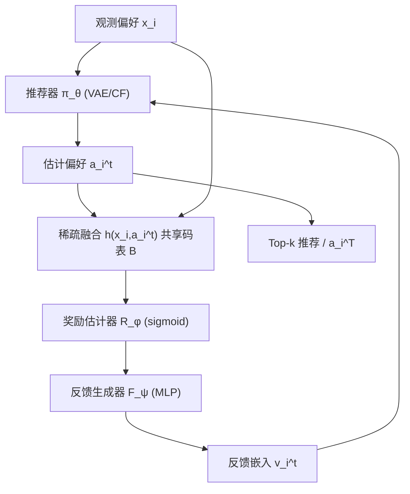
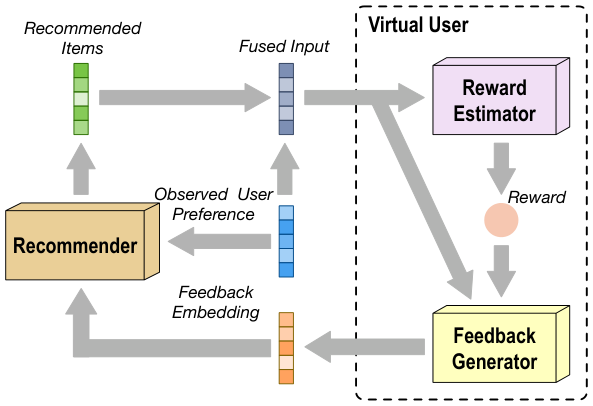

# Learning to Recommend from Sparse Data via Generative User Feedback (基于生成式用户反馈的稀疏数据推荐学习)

- **会议/期刊**: AAAI 2021
- **作者与机构**: Wenlin Wang, Hongteng Xu, Ruiyi Zhang, Wenqi Wang, Piyush Rai, Lawrence Carin（Duke ECE / 中国人民大学高瓴人工智能学院 / Facebook / IIT Kanpur）
- **推荐链路定位**: 召回（隐式反馈 CF 表征学习）
- **研究方向**: 协同过滤与双塔召回 / 强化学习与动态探索推荐
- **论文原文**: [arXiv:1910.12735v2](https://arxiv.org/abs/1910.12735v2)
- **开源代码**: 暂未开源

## TL;DR (1分钟核心速览)

隐式反馈极度稀疏时，纯静态拟合 $X$的 CF 模型（VAE/MF/CDAE）容易过拟合，且训练与验证阶段根本拿不到真实用户反馈。本文提出 CF-SFL：在推荐器外挂一个「虚拟用户」（奖励估计器 + 反馈生成器），以奖励为条件生成反馈嵌入$v_i^{t+1}$拼进用户状态$s_i^t=[x_i;v_i^t]$，把推荐-反馈回路展开$T$ 步联合优化，并将该回路解释为带对抗正则的逆强化学习（IRL）。在 ML-20M / Netflix / MSD 上沿用 Mult-VAE 的留一划分与全库排序协议，NDCG@100 相对提升约 2.1%~2.2%，接入 MF/WARP 等骨架最高增益 +27.59×10⁻³。

## Background & Motivation (背景与核心矛盾)

- **主流范式**: 以 VAE（Mult-VAE）、WMF、CDAE、aWAE 为代表，把用户-物品二值矩阵 $X$ 当作静态观测直接做重构/排序拟合，辅以评论等 side information 作为**静态知识**。
- **前人局限**: ① 物品搜索空间远大于用户-物品对与反馈量，静态拟合在稀疏区间严重过拟合；② 训练与验证阶段真实反馈不可得（无人真正看过被推荐物品），模型无任何闭环修正能力，冷启动初期性能劣化明显。
- **核心洞察 (Key Insight)**: 真实系统本质是一个反馈回路 $a_i^t=\pi(x_i,v_i^t),\ v_i^{t+1}=f(x_i,a_i^t)$；缺的不是更多静态特征，而是**缺失的那半个状态$v_i$**——它可由一个学出来的「虚拟用户」合成。
- **本文切入点**: 用奖励估计器判「推荐是否契合偏好」、用反馈生成器把 (融合输入, 奖励) 变成反馈嵌入，回灌推荐器，形成可展开、可反向传播的闭环。

## Method (核心方法设计)

### 1. 整体框架 (Overall Architecture)

分成三阶段：先单独预训练推荐器（VAE 骨架，150/75 epoch），再预训练奖励估计器，最后交替训练三者。每个时间步 $t$：推荐器以$s_i^t=[x_i;v_i^t]$输出打分向量$a_i^t$并取 top-k 作为推荐结果；融合函数$h(x_i,a_i^t)$把「已观测偏好」与「估计偏好」压进同一物品嵌入空间；奖励估计器给标量奖励，反馈生成器据此产出$v_i^{t+1}$，如此展开$T$步，损失只挂在最后一步$a_i^T$上；推理同样展开$T$步取$a_i^T$。

<figure class="paper-figure" markdown="span">
  <figcaption>图1：我们提出的用于协同过滤的CF-SFL框架示意图。</figcaption>
</figure>

### 2. 关键设计拆解 (Key Designs)

1. **虚拟用户 = 奖励估计 + 反馈生成（补全隐状态）**：以往只能靠 BPR/重构拟合已观测项，无法表达“未观测偏好”。本文定义 $R_\phi(s_i,a_i)=\mathrm{sigmoid}(g(h(x_i,a_i)))$判契合度，再令$v_i^{t+1}=F_\psi(h(x_i,a_i^t),\,R_\phi(s_i^t,a_i^t))$，把标量奖励与向量化融合输入一起映射为$d$维反馈。直觉：标量奖励只给“好坏”，向量$h$ 携带“哪里好”，二者结合才能生成有方向的梯度信号，等效于把缺失的 MDP 状态补上，使回路可展开。

2. **稀疏共享码表融合函数（工程关键）**：直接 concat $x_i\in\mathbb{R}^M$与$a_i\in\mathbb{R}^M$会因$M$巨大而不可行。本文用共享查找表$B\in\mathbb{R}^{M\times d}$ 做加权稀疏聚合：
$$h(x_i,a_i)=\frac{1}{|x_i|}\sum_{j=1}^{M}\delta(x_{ij})B_j+\sum_{k=1}^{M}a_{ik}B_k$$
已观测项取均值池化、估计项取打分加权，两者共用同一 $B$，天然构造“已有偏好—潜在偏好”统一空间；计算只涉及非零项，省参数又省算力，且对全库排序的$a_i$ 稠密向量仍可线性聚合。

3. **训练目标、对抗正则与推理开销**：总目标为 min-max
$$\min_{\pi_\theta,F_\psi}\max_{R_\phi}\ \sum_i \mathcal{L}_{\text{rec}}(a_i,x_i)-\mathbb{E}_{a\sim\pi_\theta}[\log R_\phi(s,a)]-\mathbb{E}_{a\sim\mathcal{D}}[1-\log R_\phi(s,a)]$$
第一项是 VAE 的 ELBO 重构（非负采样，靠多项似然隐式加权），后两项让奖励器区分“策略生成”与“专家观测”（Ho & Ermon 的对抗正则 IRL，附带熵正则 $\lambda H(\pi)$）。$\pi_\theta$与$F_\psi$共用一个损失、交替与$R_\phi$做 SGD。推理开销随$T$ **线性**增长，无边负采样、无 ANN 索引需求。

## Experimental Setup & Evaluation Protocol (实验设置与评估协议)

- **数据集与预处理**: 沿用 Liang et al. (Mult-VAE) 的预处理，仅保留至少有交互的用户/物品（等价 `5-core` 风格过滤），交互二值化为 $\{0,1\}$：

| 数据集 | #Users | #Items | #Interactions | 稀疏度/密度 | 特征/场景说明 |
| :--- | :---: | :---: | :---: | :---: | :--- |
| ML-20M | 136,677 | 20,108 | 10.0M | 0.36% | 电影隐式反馈，留出 10K 用户 |
| Netflix | 463,435 | 17,769 | 56.9M | 0.69% | 电影评分转隐式，留出 40K 用户 |
| MSD | 571,355 | 41,140 | 33.6M | 0.14% | 音乐听歌行为，留出 50K 用户 |

- **数据划分与防穿越 (Splitting Strategy)**: `Leave-One-Out`（每个用户留最后一次交互为测试、倒数第二次为验证；MSD 因存在重复播放采用随机留出）。留出用户（held-out-users）与训练用户完全不重叠，用于验证泛化。
- **排名评测协议 (Ranking Protocol)**: 无偏 `Full-Ranking (全库未交互排序)`，在全部 $M$ 个物品上排序，**不采用负采样排序**；报告 Recall@20 / Recall@50 / NDCG@100，对所有测试用户取平均。
- **对比基线与超参设置**: 线性类 SLIM、WMF；深度类 CDAE、aWAE、VAE（Mult-VAE），以及作者自跑的 VAE\*（同协议重实现）与 VAE†（仅接奖励器、无闭环）。嵌入维度：推荐器输入 $\mathbb{R}^M$→ 600 → 200 采样 → 600 →$M$softmax；奖励器输入$\mathbb{R}^{64}$、生成器$\mathbb{R}^{65}$。$\ell_2$惩罚 0.01，Adam，batch=500；$T=8$（ML-20M/Netflix）、$T=6$（MSD）。

## Key Experimental Results (实验关键数据)

### 1. 主实验对比 (Main Results)

| 方法 | ML-20M R@20 | ML-20M R@50 | ML-20M NDCG@100 | Netflix R@20 | Netflix R@50 | Netflix NDCG@100 | MSD R@20 | MSD R@50 | MSD NDCG@100 |
| :--- | :---: | :---: | :---: | :---: | :---: | :---: | :---: | :---: | :---: |
| SLIM | 0.370 | 0.495 | 0.401 | 0.347 | 0.428 | 0.379 | – | – | – |
| WMF | 0.360 | 0.498 | 0.386 | 0.316 | 0.404 | 0.351 | 0.211 | 0.312 | 0.257 |
| CDAE | 0.391 | 0.523 | 0.418 | 0.343 | 0.428 | 0.376 | 0.188 | 0.283 | 0.237 |
| aWAE | 0.391 | 0.532 | 0.424 | 0.354 | 0.441 | 0.381 | – | – | – |
| VAE (Mult-VAE) | 0.395 | 0.537 | 0.426 | 0.351 | 0.444 | 0.386 | 0.266 | 0.364 | 0.316 |
| VAE† (仅奖励器) | 0.396 | 0.536 | 0.426 | 0.352 | 0.445 | 0.387 | 0.263 | 0.360 | 0.314 |
| **CF-SFL (本文)** | **0.404** | **0.542** | **0.435** | **0.355** | **0.449** | **0.394** | **0.273** | **0.369** | **0.323** |
| **Improv. (相对 VAE)** | +2.28% | +0.93% | +2.11% | +1.14% | +1.13% | +2.07% | +2.63% | +1.37% | +2.22% |

### 2. 消融与可插拔性实验 (Ablation & Plug-in)

| 配置 | 指标（NDCG@100，ML-20M） | 说明 |
| :--- | :---: | :--- |
| VAE\*（基线，T=0） | 0.425 | 无闭环 |
| VAE†（仅接 $R_\phi$反传） | 0.426 | 去掉$F_\psi$ 与展开，几乎无增益 |
| CF-SFL，T=2 | ≈0.430 | 已见明显提升 |
| CF-SFL，T=8 | **0.435** | 最优设置 |
| CF-SFL，T=12 | 略降/饱和 | 推理时间线性上升 |

| 骨架（主表 Table 4） | w/o CF-SFL | w/ CF-SFL | Gain (×10⁻³) |
| :--- | :---: | :---: | :---: |
| WARP | 0.31228 | 0.33987 | **+27.59** |
| MF | 0.41587 | 0.41902 | +3.15 |
| DAE | 0.42056 | 0.42307 | +2.51 |
| VAE | 0.42546 | 0.43472 | **+9.26** |
| VAE-Gaussian | 0.42019 | 0.42751 | +7.32 |
| VAE-Linear | 0.41563 | 0.41597 | +0.34 |

### 3. 关键实验发现 (Key Findings)

1. **收益来自“回路”而非“奖励器”**：VAE† 与 VAE\* 几乎等价（0.426 vs 0.425），说明仅用奖励做辅助反传无效；必须由 $F_\psi$生成反馈嵌入并展开$T$ 步，NDCG@100 才升到 0.435（+9.26×10⁻³），证实“补隐状态”而非“加辅助损失”才是机制核心。
2. **骨架越弱、增益越大**：WARP 从 0.31228→0.33987（+27.59×10⁻³）远超 VAE 的 +9.26×10⁻³，MF/DAE 约 +3×10⁻³；表征容量越受限的模型越依赖合成反馈带来的额外监督信号。
3. **$T$与稀疏度耦合，存在性能-时延拐点**：$T\le 8$时三数据集单调提升且 ML-20M/MSD 对$T$更敏感（Netflix 较鲁棒），$T>8$后饱和，推理时间随$T$线性增长，故取$T=8/6$ 折中；MSD（0.14% 稀疏度）收益最明显（R@20 +2.63%），印证稀疏场景是主要受益区间。

## Highlights & Limitations (亮点、对比与审稿批判)

- **与代表作对比 (vs. Prior Work)**: 与 Mult-VAE（Liang et al. 2018）相比，本文不引入任何真实 side information，而是**生成**反馈补全状态；与 bandit/POMDP 类 CF（Zhao et al. 2013；Sunehag et al. 2015）相比，不需要在线交互或真实奖励，纯离线训练即可模拟回路；与标准 IRL 相比，多了反馈生成器以向量化信息增强标量奖励。
- **可迁移亮点**: ① 共享查找表的稀疏融合函数 $h(\cdot)$，可作为任何双塔/自编码器中「用户历史 + 候选打分向量」低成本交互的标准算子；② 「奖励 + 融合向量」双通道驱动生成器，比单标量奖励带来更丰富梯度，可迁移到对话推荐与序列推荐的反馈建模。
- **审稿级局限批判**: ① 反馈嵌入由对抗式奖励器自产，缺乏与真实反馈的对齐验证，存在「自我强化偏差」风险，且三家数据集均为传统评分数据（非真实闭环日志），无法证明线上收益；② 推理需展开 $T$步前向、开销线性增长，且$T$ 需按数据集调参（ML-20M/MSD 敏感），工程可复现性受超参与三阶段预训练/交替训练流程影响；③ 未报告显著性检验与方差，增益绝对幅度（NDCG +0.009）偏小。

## Rating (四维评分)

- **方法创新性 (Novelty)**: ⭐⭐⭐⭐ （首次把「虚拟用户 + 合成反馈回路」引入 CF，并给出对抗正则 IRL 的等价推导，视角新颖，但对抗训练范式本身承袭 GAIL）
- **评估协议与实验扎实度 (Protocol & Experiments)**: ⭐⭐⭐⭐ （三数据集 + Full-Ranking + 留出用户 + 7 种骨架的可插拔性验证较充分，缺显著性检验与稀疏度分桶分析）
- **写作与数学规范度 (Clarity & Rigor)**: ⭐⭐⭐⭐ （闭环展开、IRL 推导与融合函数公式清晰，Table 2 给出完整网络结构；奖励器/生成器输入维度 $64/65$ 的取舍解释略简）
- **工业落地与复现价值 (Industrial & Practical Value)**: ⭐⭐⭐ （模块化强、可与任意 CF 骨架组合，且推理仅线性开销；但三阶段交替训练与对抗稳定性调参成本高，暂无开源代码与线上 A/B 佐证）

