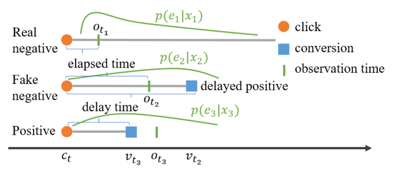
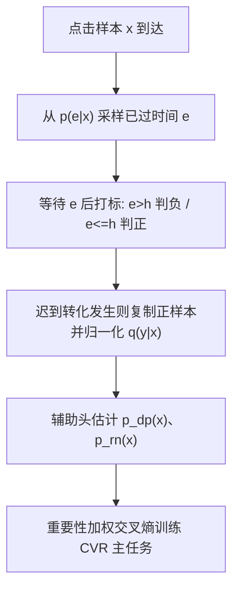

# Capturing Delayed Feedback in Conversion Rate Prediction via Elapsed-Time Sampling (基于已过时间采样的转化率延迟反馈建模)

- **会议/期刊**: AAAI 2021
- **作者与机构**: Jia-Qi Yang, Xiang Li, Shuguang Han, Tao Zhuang, De-Chuan Zhan, Xiaoyi Zeng, Bin Tong（南京大学 LAMDA + 阿里巴巴）
- **推荐链路定位**: 精排（CVR 预估）
- **研究方向**: CTR/CVR 预估与特征交叉 / 去偏与工业架构
- **论文原文**: [arXiv:2012.03245](https://arxiv.org/abs/2012.03245v4)
- **开源代码**: [ThyrixYang/es](https://github.com/ThyrixYang/es)

## TL;DR (1分钟核心速览)

流式训练下，转化往往在点击后数小时乃至数天发生，导致「等待真实标签（模型过时）」与「立即判负（大量假负样本）」之间的两难，而 DFM/FNW/FSIW 均把等待时长当成被动设定。本文把等待时长显式建模为已过时间采样分布 $p(e|x)$，在采样分布上做重要性加权修正，并复制迟到正样本使权重被约束在$[1+p_{dp}]$与$[1+p_{dp}]p_{rn}$ 的有界区间；在两数据集的小时级流式协议上，AUC 相对最优基线提升 0.26%（Criteo）与 0.44%（Taobao），填补 Oracle 差距的 35.6%/49.5%。

## Background & Motivation (背景与核心矛盾)

- **主流范式**: 工业 CVR 模型以小时级在线学习更新，DFM 联合建模「CVR × 延迟时间指数分布」，FNW 到达即判负并在转化后插入正样本副本，FSIW 固定等待窗口后再打标。
- **前人局限**: ①FNW 的假负样本在被修正前持续污染模型，促销期点击暴涨时偏差被放大；②FSIW 虽保证标签正确，却牺牲模型新鲜度，且事后到来的转化无法回填修正。
- **核心洞察 (Key Insight)**: 等待时长不是被动常量，而是一个可以设计的分布——它既决定假负比例，也决定由此引入的重要性采样偏差大小，因而构成可控的性能旋钮。
- **本文切入点**: 将 $e\sim p(e|x)$ 纳入概率框架，复制迟到正样本后重新归一化观测分布，得到有界、低方差的重要性权重，再配两个辅助分类器估计权重。

<figure class="paper-figure" markdown="span">
  <figcaption>图1：延迟反馈任务中不同类型时间信息的示意图。</figcaption>
</figure>
图 1：延迟反馈任务中的三类时间点（点击 $c_t$、转化$v_t$、观测$o_t$）与已过时间$e$、延迟时间$h$。

## Method (核心方法设计)

### 1. 整体框架 (Overall Architecture)

每个 batch 按小时滑动，样本到达时从 $p(e|x)$抽一个已过时间$e$，等待$e$后打标；若在等待后仍未观测到转化，则记为负，且日后真实转化发生时再插入一条正样本副本。观测分布$q(y|x)$由此偏离真实分布$p(y|x)$，模型用估计出的两个概率$p_{dp}(x)$（延迟正样本概率）与$p_{rn}(x)$（真负样本概率）加权交叉熵训练，权重与 CVR 预测网络共享底层、联合训练。推理阶段无需$f_{dp}/f_{rn}$参与打分，只在被$p(e|x)$ 决定的打标时刻重训。

### 2. 关键设计拆解 (Key Designs)

1. **已过时间采样与分布重归一化**：痛点在于 FNW 判负后不再回填、FSIW 回填不了。本文先复制迟到正样本，得到
$q(y{=}0)=\frac{p(y{=}0)+p(y{=}1)p(h>e\mid y{=}1)}{1+p(y{=}1)p(h>e\mid y{=}1)},\; q(y{=}1)=\frac{p(y{=}1)}{1+p(y{=}1)p(h>e\mid y{=}1)}$分母正是新增副本数。直觉：把「等待」变成对观测分布的显式重加权，$e$越长$p(h>e)$ 越小、假负越少。

2. **有界重要性权重与加权损失**：由 $p(y{=}0)/q(y{=}0)=[1+p_{dp}]p_{rn}$、$p(y{=}1)/q(y{=}1)=1+p_{dp}$，得
$\mathcal{L}_{\text{iw}}=-\sum_{(x_i,y_i)\in\tilde{D}} y_i[1{+}p_{dp}(x_i)]\log f_\theta(x_i)+(1{-}y_i)[1{+}p_{dp}(x_i)]p_{rn}(x_i)\log(1{-}f_\theta(x_i))$两项均落在$[0,2]$内，避免了朴素$p/q$除法在$q\ll p$ 时的方差爆炸。

3. **权重估计与偏差分析**：$f_{dp}$以「迟到正样本=1、其余=0」为标签，$f_{rn}$剔除观测正样本后以「负=1、迟到正=0」为标签，共享网络联合流式训练（标签靠 30 天延迟队列获得）。理论收敛值$f(x)=\frac{p(y{=}1|x)}{p(y{=}1|x)+p_{neg}(x)f_{rn}(x)}$显示：$f_{rn}$估计误差、绝对 CVR 水平、以及$p(e|x)$ 三者共同决定偏差，可反推「等待更久 → 假负更少 → 偏差更小」。总损失即上述加权交叉熵（免负采样、全库样本）。

## Experimental Setup & Evaluation Protocol (实验设置与评估协议)

- **数据集与预处理**: Criteo 匿名展示日志与淘宝真实日志；各取一半做预训练，另一半做流式模拟。

| 数据集 | #Users | #Items | 类别/连续特征 | #Interactions | 平均 CVR | 特征/场景说明 |
| :--- | :---: | :---: | :---: | :---: | :---: | :--- |
| Criteo | - | 5,443 | 9 / 8 | 15,898,883 | 0.2269 | 60 天点击-转化日志，含点击/转化时间戳 |
| Taobao | 2.5 亿 | 8 亿 | 12 / 10 | 9.8×10⁹ | 0.03273 | 14 天淘宝展示广告全量日志 |

- **数据划分与防穿越 (Splitting Strategy)**: 全局时间戳切分 + **小时级流式滑动**——用第 $t$小时数据训练、第$t+1$ 小时测试，逐小时滚动；训练集按假负重建，评测集保持原始标签，最终按各小时评测集加权汇总（严格防止未来信息泄漏，贴合工业在线学习）。
- **排名评测协议 (Ranking Protocol)**: 全库未交互样本的 `Full-Ranking` 式 CVR 打分评估（无负采样），指标为 AUC、PR-AUC（对稀疏正例更敏感）、NLL（对概率绝对值敏感，直接决定出价），并额外报告相对指标 R-AUC/R-PR-AUC/R-NLL = (方法-Online Baseline)/(Oracle-Online Baseline)，衡量对「延迟反馈差距」的填补比例。
- **对比基线与超参设置**: Pre-trained / Vanilla Finetune / DFM / FNW / FNC / FSIW，外加不作基线的 Oracle*（点击时刻即知真标签的上界）；统一 MLP $[256,256,128]$、LeakyReLU+BatchNorm、Adam$lr=10^{-3}$、$L_2=10^{-6}$；显著性用 t-test，$p<0.05$。

## Key Experimental Results (实验关键数据)

### 1. 主实验对比 (Main Results)

| 方法 | Criteo AUC | Criteo PR-AUC | Criteo NLL↓ | Criteo R-AUC | Taobao AUC | Taobao PR-AUC | Taobao NLL↓ | Taobao R-AUC |
| :--- | :---: | :---: | :---: | :---: | :---: | :---: | :---: | :---: |
| Pre-trained | 0.8307 | 0.6251 | 0.4009 | -0.9212 | 0.8731 | 0.6525 | 0.1156 | -1.0374 |
| Vanilla Finetune | 0.8376 | 0.6288 | 0.4047 | 0.0000 | 0.8842 | 0.6645 | 0.1141 | 0.0000 |
| Oracle* (上界) | 0.8450 | 0.6469 | **0.3868** | 1.0000 | 0.8949 | 0.6875 | **0.1079** | 1.0000 |
| DFM | 0.8132 | 0.5784 | 1.2599 | -3.2581 | 0.8702 | 0.6471 | 0.1271 | -1.3084 |
| FSIW | 0.8290 | 0.6189 | 0.4099 | -1.1432 | 0.8735 | 0.6591 | 0.1149 | -0.9971 |
| FNC | 0.8373 | 0.6267 | 0.4382 | -0.0393 | **0.8851** | 0.6669 | 0.1142 | 0.0841 |
| FNW | 0.8373 | 0.6313 | 0.4033 | -0.0308 | 0.8845 | 0.6672 | 0.1137 | 0.0280 |
| **ES-DFM (本文)** | **0.8402\*** | **0.6393\*** | **0.3924\*** | **0.3560** | **0.8895\*** | **0.6762\*** | **0.1112\*** | **0.4953** |
| **Improv. (vs 最优基线)** | +0.26% | +1.27% | -2.7% | — | +0.44% | +1.35% | -2.2% | — |

### 2. 消融实验 (Ablation Study)

原文未设传统「w/o 模块」消融，而以**标签修正策略变体对照**（等价于逐组件剥离）与**超参敏感性**论证：

| 变体 | 含迟到正样本复制 | 含重要性加权 | Criteo AUC | Criteo NLL↓ | Taobao AUC | 说明 |
| :--- | :---: | :---: | :---: | :---: | :---: | :--- |
| Vanilla Finetune | ✗ | ✗ | 0.8376 | 0.4047 | 0.8842 | 纯观测标签，假负未纠 |
| FNW | ✓ | ✓（$1/r$ 无界） | 0.8373 | 0.4033 | 0.8845 | 复制但不设采样分布 |
| FSIW | ✗ | ✓（等窗等待） | 0.8290 | 0.4099 | 0.8735 | 等待但不回填正例 |
| ES-DFM $p(e|x)=\delta(c)$,$c=15$min | ✓ | ✓（有界） | **0.8402** | **0.3924** | **0.8895** | 最佳$c$，观测到约 35% 转化 |
| ES-DFM $c>1$h | ✓ | ✓ | 明显下降 | 明显下降 | — | 新鲜度损失主导（图 2） |

### 3. 关键实验发现 (Key Findings)

1. **等待时长在 15 分钟附近取到峰值**：Criteo 上最优 $c\approx 15$min（约 35% 转化可被观测），$c$偏小的下降更缓和、偏大（>1h）下降更快——说明小等待时重要性权重偏差本身不大，而大等待时新鲜度损失才是主要矛盾，这与偏差分析中「$e$增大 →$f_{rn}\to 1$ → 偏差减小」的结论互为印证。
2. **相对 Oracle 差距的填补率比绝对 AUC 更有说服力**：ES-DFM 在 Criteo 填补 35.6% 的延迟反馈差距，Taobao 填补 49.5%；而 FSIW/DFM 甚至为负值（-1.14 / -3.26），即比不修正还差，说明「不复制正样本」或「联合建模延迟分布」在流式场景会失效。Taobao 上 CVR 更稀疏（0.033 vs 0.227），差距可填补空间更大，提升幅度也更大。
3. **抗扰动能力显著更稳**：在将 $d$比例正样本与随机负样本互换标签的鲁棒性实验中，ES-DFM 曲线在$d$增大时仍优于 FNW/FSIW，NLL 上差距尤为明显——有界权重$[1+p_{dp}]p_{rn}$ 抑制了误标样本的梯度放大；线上 7 天 A/B 中 AUC +0.3%、CVR +0.7%、GMV +1.8%，与离线结论一致。

## Highlights & Limitations (亮点、对比与审稿批判)

- **与代表作对比 (vs. Prior Work)**: DFM 只优化「观测窗口内」的联合概率，天然有偏；FNW 用无界 $1/r$权重且不允许设计等待时长，方差大且对分布漂移敏感；FSIW 用固定窗口换取标签正确性，却永久放弃事后修正。本文的关键增量是把 FNW 的「复制正例」与 FSIW 的「等待」统一进一个概率归一化式子，并证明二者由同一超参$p(e|x)$ 连续调节，同时让权重天然有界。
- **可迁移亮点**: ①「有界重要性权重」范式可迁移到延迟转化回归（GMV/LTV）、延迟退款、曝光延迟归因等任何标签晚到场景；②小时级「训 t 测 t+1」+ Oracle 相对差距 R-AUC 的评测设计，可直接复用为流式训练的标准化基准。
- **审稿级局限批判**: ①$p(e|x)$在实践中退化为 Dirac 常数$c$，与文中宣称的「依赖特征（如价格越高等待越久）」不符，个性化采样分布未做实验验证；②$f_{dp}/f_{rn}$依赖 30 天延迟标签队列，冷启动期或新品类上权重估计噪声大，而偏差公式表明$f_{rn}$ 误差会被绝对 CVR 水平放大；③每个样本需插入正副本，正例稀少时开销可忽略，但促销期正例稠密时样本量膨胀，长期留存效应（多次点击→多次转化）亦未讨论。

## Rating (四维评分)

- **方法创新性 (Novelty)**: ⭐⭐⭐⭐ （把「等待时长」从被动超参升级为可优化的采样分布，并用归一化+有界权重给出闭式无偏修正与收敛偏差解析，理论完成度高）
- **评估协议与实验扎实度 (Protocol & Experiments)**: ⭐⭐⭐⭐ （小时级流式训测、Oracle 相对差距指标与线上 A/B 齐备，但缺少标准逐组件消融，$p(e|x)$ 个性化设计未验证）
- **写作与数学规范度 (Clarity & Rigor)**: ⭐⭐⭐⭐⭐ （$q(y|x)$重归一化与偏差$f(x)$ 推导链条清晰，公式与实现一一对应）
- **工业落地与复现价值 (Industrial & Practical Value)**: ⭐⭐⭐⭐⭐ （阿里/淘宝全量日志验证，代码与数据副本开源，推理期零额外开销，A/B 直接给出 GMV 收益）

