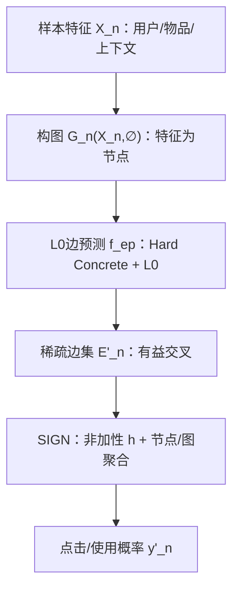
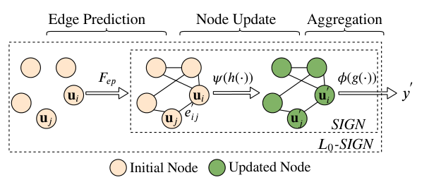

# Detecting Beneficial Feature Interactions for Recommender Systems (面向推荐系统的有益特征交叉检测)

- **会议/期刊**: AAAI 2021
- **作者与机构**: Yixin Su, Rui Zhang, Sarah Erfani, Zhenghua Xu；University of Melbourne / Tsinghua University / Hebei University of Technology
- **推荐链路定位**: 精排（CTR/使用概率预估）
- **研究方向**: CTR/CVR预估与特征交叉 / 图神经网络与知识图谱推荐
- **论文原文**: [论文原文链接](https://arxiv.org/abs/2008.00404v6)
- **开源代码**: [开源代码仓库链接](https://github.com/ruizhang-ai/SIGN-Detecting-Bene)

## TL;DR (1分钟核心速览)

针对全量二阶特征交叉引入噪声的问题，L0-SIGN将每个样本建模为特征图，用L0边预测自动筛选有益交叉，再由SIGN聚合统计交互；在Frappe/MovieLens随机划分的AUC/ACC评测中，Frappe ACC较最强基线提升2.50%相对值。

## Background & Motivation (背景与核心矛盾)

- **主流范式**: FM/AFM/NFM/DeepFM/xDeepFM/AutoInt枚举或隐式建模所有二阶交叉，注意力或门控只给每个交叉赋权，仍保留全量交叉。
- **前人局限**: 无益交叉在有限样本下引入噪声与过拟合；逐交叉注意力无法评价“一组交叉”的整体贡献，且未与最终预测目标联合稀疏。
- **核心洞察 (Key Insight)**: 有益交叉应是一组稀疏边，既最大保留与标签相关的信息，又最小化输入信息，形式化上对应信息瓶颈（IB）的“相关部分”。
- **本文切入点**: 样本→无向特征图，节点=特征，边=待检测交叉；L0边预测选边，SIGN只聚合被选中的边。

## Method (核心方法设计)

### 1. 整体框架 (Overall Architecture)

每个样本被表示为无边特征图$G_n(X_n,\varnothing)$。L0边预测器$f_{\mathrm{ep}}$对任意特征对输出边存在概率，经Hard Concrete重参数化与L0正则后得到稀疏边集$E'_n$；SIGN仅对$E'_n$中的边计算非加性交互$h(\boldsymbol{u}_i,\boldsymbol{u}_j)$，先聚合为节点更新，再图级聚合为点击/使用概率。训练端到端联合优化预测损失、边稀疏项与交互表征L2项；推理端先选边再分类。形式化地，$f_{\mathrm{LS}}(G;\omega,\theta)=\phi(\{g(\psi(\{f_{\mathrm{ep}}(\boldsymbol{v}^{e}_{i},\boldsymbol{v}^{e}_{j})h(\boldsymbol{u}_{i},\boldsymbol{u}_{j})\}_{j\in X}))\}_{i\in X})$。

<figure class="paper-figure" markdown="span">
  <figcaption>图1：L0-SIGN 概览。</figcaption>
</figure>
图1：L0-SIGN整体架构：特征为节点，L0边预测筛边，SIGN聚合被选交互。

### 2. 关键设计拆解 (Key Designs)

1. **L0边预测与Hard Concrete稀疏化**：离散边不可导，无法端到端选边。将边存在概率参数化为$e'_{ij}\sim\mathrm{Bern}(\pi_{ij})$，用Hard Concrete重参数化$e'_{ij}=\mathrm{HC}(f_{\mathrm{ep}}(\boldsymbol{v}^{e}_{i},\boldsymbol{v}^{e}_{j}))$，使梯度可回传；L0项$\lambda_1\sum_{i,j}\pi_{ij}$把无益边概率压向0。Hard Concrete在$\pi\to0$时惩罚更强、在$\pi\to1$时保持有限惩罚，避免Bernoulli KL在1处发散。

2. **SIGN统计交互聚合**：仅对$e'_{ij}=1$的边计算非加性$h(\boldsymbol{u}_i,\boldsymbol{u}_j)$，$s_{ij}=e'_{ij}h(\boldsymbol{u}_i,\boldsymbol{u}_j)$；节点更新$v'_{i}=\psi(\{s_{ij}\}_{j\in X})$，最终$y'=\phi(\{g(x_i v'_{i})\}_{i\in X})$。由于$h$不可分解为$f_1(\boldsymbol{u}_i)+f_2(\boldsymbol{u}_j)$，定理1保证“边存在”当且仅当模型标记统计交互，从而把选边与建模交互对齐。

3. **联合目标与IB解释**：总损失$\mathcal{R}=\frac1N\sum_n[\mathcal{L}(y'_n,y_n)+\lambda_1\sum_{i,j}\pi_{ij}+\lambda_2\|\boldsymbol{z}_n\|_2]$。L0项近似$\mathrm{KL}[\mathrm{Bern}(0),p(e'_n)]$的线性上界，L2项对应$\mathrm{KL}[\mathcal{N}(0,I),p(z_n)]$，故训练是IB的变分近似：在最小化交叉数的同时最大化预测信息。训练无额外负采样，逐样本二分类；推理复杂度$O(q^2(M_e+M_h+2d)+qd)$，$q=|X_n|$。

## Experimental Setup & Evaluation Protocol (实验设置与评估协议)

- **数据集与预处理**: 原文未使用5-core过滤；每个样本是一张特征图。统计如下：

| 数据集 | #Features | #Graphs/样本 | #Nodes/Graph | 场景 |
| :--- | ---: | ---: | ---: | :--- |
| Frappe | 5,382 | 288,609 | 10 | 上下文感知App推荐 |
| MovieLens-tag | 90,445 | 2,006,859 | 3 | 电影标签推荐 |
| Twitter | 1,323 | 144,033 | 4.03 | 推文情感图分类 |
| DBLP | 41,324 | 19,456 | 10.48 | 论文领域图分类 |

- **数据划分与防穿越 (Splitting Strategy)**: 所有数据集按70%/15%/15%随机划分训练/验证/测试；非Leave-One-Out、全局时间切分或冷启动划分。验证集选模时要求预测边数稳定。
- **排名评测协议 (Ranking Protocol)**: 逐样本二分类，报告AUC/ACC/F1；非Full-Ranking或Sampled Ranking，不做全库候选排序，本质是CTR式分类精度而非Top-K排序质量；无额外负采样。
- **对比基线与超参设置**: 对比FM/AFM/NFM/DeepFM/xDeepFM/AutoInt；嵌入维度$d=8$，隐层32；$\lambda_1,\lambda_2$在$[10^{-5},10^{-1}]$调优；论文未报告显著性检验。

## Key Experimental Results (实验关键数据)

### 1. 主实验对比 (Main Results)

| 模型 | Frappe AUC | Frappe ACC | MovieLens AUC | MovieLens ACC |
| :--- | ---: | ---: | ---: | ---: |
| FM | 0.9263 | 0.8729 | 0.9190 | 0.8694 |
| AFM | 0.9361 | 0.8882 | 0.9205 | 0.8711 |
| NFM | 0.9413 | 0.8928 | 0.9342 | 0.8903 |
| DeepFM | 0.9422 | 0.8931 | 0.9339 | 0.8895 |
| xDeepFM | 0.9435 | 0.8950 | 0.9347 | 0.8906 |
| AutoInt | 0.9432 | 0.8947 | 0.9351 | 0.8912 |
| SIGN（全边） | 0.9448 | 0.8974 | 0.9354 | 0.8921 |
| **L0-SIGN** | **0.9580** | **0.9174** | **0.9407** | **0.8970** |
| **Improv. vs 最强基线** | **+1.54%** | **+2.50%** | **+0.60%** | **+0.65%** |

F1也一致最优：Frappe 0.8906，MovieLens 0.8771。

### 2. 消融实验 (Ablation Study)

用GCN/Cheby/GIN替换SIGN并比较有/无L0边预测；SIGN（全边）等价于w/o L0。

| 变体 | Twitter AUC | Twitter ACC | DBLP AUC | DBLP ACC |
| :--- | ---: | ---: | ---: | ---: |
| GCN | 0.7049 | 0.6537 | 0.9719 | 0.9289 |
| L0-GCN | 0.7053 | 0.6543 | 0.9731 | 0.9301 |
| Cheby | 0.7076 | 0.6522 | 0.9717 | 0.9291 |
| L0-Cheby | 0.7079 | 0.6519 | 0.9719 | 0.9297 |
| GIN | 0.7149 | 0.6559 | 0.9764 | 0.9319 |
| L0-GIN | 0.7159 | 0.6572 | 0.9787 | 0.9328 |
| SIGN（全边/无L0） | 0.7201 | 0.6615 | 0.9761 | 0.9316 |
| **L0-SIGN** | **0.7231** | **0.6670** | **0.9836** | **0.9427** |

### 3. 关键实验发现 (Key Findings)

- **边筛选直接降噪**：Frappe上L0-SIGN相较全边SIGN，AUC 0.9448→0.9580（+1.40%相对），ACC 0.8974→0.9174（+2.23%相对）；MovieLens仅+0.57%/+0.55%，说明特征数更多、噪声交叉更多时收益更大。
- **L0边预测可迁移且与SIGN协同**：Twitter上L0-GIN较GIN ACC 0.6559→0.6572；DBLP上AUC 0.9764→0.9787。SIGN受益最大，L0-SIGN在DBLP ACC 0.9427，较SIGN 0.9316绝对提升0.0111。
- **稀疏化与解释性同步出现**：训练中边比例大幅下降时ACC/AUC仍上升并趋稳；预测边始终优于反转边，反转边比例超过0.6后ACC不再提升；Gmail案例中Workday正交互、Home负交互、Cloudy-Morning无边，说明模型能丢弃无关交叉。

## Highlights & Limitations (亮点、对比与审稿批判)

- **与代表作对比 (vs. Prior Work)**: FM/DeepFM/xDeepFM/AutoInt把全部二阶交叉送入模型；AutoFIS/AutoCross做选择但非GNN+IB理论。本文用L0边预测+统计交互聚合，直接优化交叉集合而非逐交叉权重。
- **可迁移亮点**: Hard Concrete L0可用于任意离散边/特征门控；非加性$h$+置换不变聚合可作为“先选边再聚合”的通用模块。
- **审稿级局限批判**: 每样本$O(q^2)$边预测，特征数大时开销高；仅验证pairwise、随机划分非时间切分，且未报告显著性检验；MovieLens节点仅3，检测难度偏低，结论外推需谨慎。

## Rating (四维评分)

- **方法创新性 (Novelty)**: ⭐⭐⭐⭐ （首次形式化“有益交叉检测”，L0边预测与IB解释有理论支撑）
- **评估协议与实验扎实度 (Protocol & Experiments)**: ⭐⭐⭐ （四数据集+多基线充分，但随机划分、无排序协议、无显著性检验）
- **写作与数学规范度 (Clarity & Rigor)**: ⭐⭐⭐⭐ （定理、IB推导与Hard Concrete近似清晰，符号略密）
- **工业落地与复现价值 (Industrial & Practical Value)**: ⭐⭐⭐ （代码开源，但$O(q^2)$边预测在超大规模特征场景需工程裁剪）

