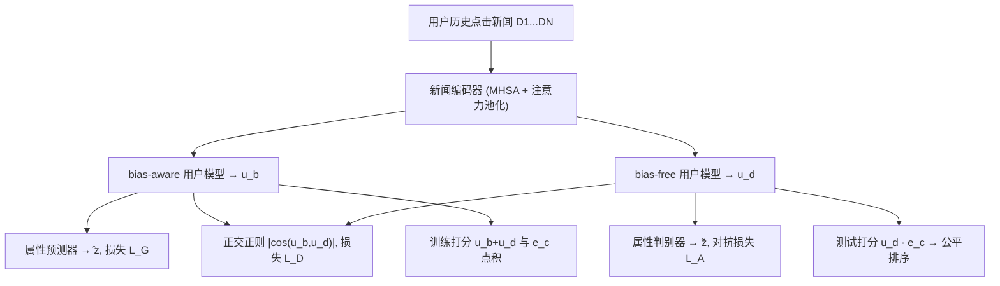
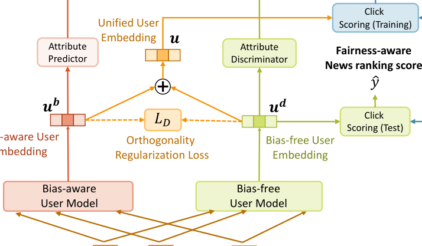

# FairRec: Fairness-aware News Recommendation with Decomposed Adversarial Learning (基于分解式对抗学习的公平感知新闻推荐)

- **会议/期刊**: AAAI 2021
- **作者与机构**: Chuhan Wu, Fangzhao Wu, Xiting Wang, Yongfeng Huang, Xing Xie（清华大学电子工程系 & 微软亚洲研究院）
- **推荐链路定位**: 精排（候选新闻排序打分）
- **研究方向**: 去偏公平、可信隐私与工业架构 / 序列与会话推荐
- **论文原文**: [https://arxiv.org/abs/2006.16742v2](https://arxiv.org/abs/2006.16742v2)
- **开源代码**: 暂未开源

## TL;DR (1分钟核心速览)

新闻推荐模型会从点击日志中复制“男性爱体育、女性爱时尚”的群体先验，使 top-K 结果可高精度反推用户性别，跨群体兴趣用户因而拿不到多元信息。FairRec 把用户兴趣拆成承载偏置的 $\boldsymbol{u}_b$与只编码属性无关兴趣的$\boldsymbol{u}_d$，前者接属性预测、后者接对抗判别器与正交正则，仅用$\boldsymbol{u}_d$ 排序。在性别平衡重采样 + 全库排序 + 属性预测器独立重训的协议下，性别预测准确率（K=10）由 NRMS 的 70.12% 降至 53.40%（逼近随机 50.02%），AUC 仅从 62.89 降至 61.95。

## Background & Motivation (背景与核心矛盾)

- **主流范式**: NRMS 类模型以新闻标题的词级多头自注意力 + 注意力池化编码新闻，再对用户历史点击序列做注意力聚合得到统一用户向量，端到端用点击日志训练。
- **前人局限**: ① 同敏感属性群体的点击分布高度重合，用户模型会把群体先验编码进表征，使推荐结果可被反推性别（图 1 示例：男用户即便点了 Golden Globes 新闻，时尚类新闻仍被压到低分）；② 现有用户侧公平工作（unfairness 正则 MR、PSL 评分平衡、LinkedIn 用户重排）面向商品/评分或“排用户”场景，其“不同群体评分差”指标与“排新闻”的任务形态不匹配，难以直接迁移。
- **核心洞察 (Key Insight)**: 作者将公平操作化为「top-K 推荐结果对敏感属性的可推断性」——用属性预测准确率/宏 F 衡量，越低越公平；于是去偏被转化为表征层面的**敏感属性信息删除**问题。
- **本文切入点**: 单塔对抗会让“主任务必需信息”和“待删偏置”纠缠在同一向量中互相误伤，故显式拆成两路，让属性预测与对抗各司其职，再用正交正则挤出残余偏置。

## Method (核心方法设计)

### 1. 整体框架 (Overall Architecture)

FairRec 沿用 NRMS 的新闻编码器（词级 MHSA + 注意力池化得到候选新闻 $\boldsymbol{e}_c$），但把用户模型复制为两支：bias-aware 支输出$\boldsymbol{u}_b$，bias-free 支输出$\boldsymbol{u}_d$。训练时两者相加$\boldsymbol{u}=\boldsymbol{u}_b+\boldsymbol{u}_d$与$\boldsymbol{e}_c$点积算点击分，同时挂三个辅助任务——属性预测器读$\boldsymbol{u}_b$、属性判别器读$\boldsymbol{u}_d$、以及$\boldsymbol{u}_b$与$\boldsymbol{u}_d$之间的余弦正交惩罚。推理阶段完全弃用$\boldsymbol{u}_b$，仅用$\boldsymbol{u}_d$ 与候选新闻点积排序，因此线上前向开销与 NRMS 基本持平。全流程用单一损失联合训练，无交替优化、无需 GRL 梯度反转层。

<figure class="paper-figure" markdown="span">
  <figcaption>图2：我们的FairRec方法的架构。</figcaption>
</figure>

### 2. 关键设计拆解 (Key Designs)

1. **分解式双路建模 + 属性预测（Bias-aware Branch）**：单塔对抗中“主任务信息”与“要删的偏置”混在一起，负梯度会一并损伤有用兴趣信号。本文改让 $\boldsymbol{u}_b$专职承载性别信息，并用分类器强监督：$\hat{z}=\mathrm{softmax}(\mathbf{W}_b\boldsymbol{u}_b+\mathbf{b}_b)$，$\mathcal{L}_G=-\frac{1}{U}\sum_{j=1}^{U}\sum_{i=1}^{C}z_i^j\log\hat{z}_i^j$。属性预测越准，说明群体先验被“吸走”得越彻底，$\boldsymbol{u}_d$ 需要承担的偏置残余就越少——这是解耦有效的前提。

2. **对抗去除 + 正交正则（Bias-free Branch）**：判别器 $\tilde{z}=\mathrm{softmax}(\mathbf{W}_d\boldsymbol{u}_d+\mathbf{b}_d)$试图从$\boldsymbol{u}_d$推断性别，主模型以$-\lambda_A\mathcal{L}_A$反向更新，逼迫$\boldsymbol{u}_d$对性别不可辨。但判别器决策边界与真实属性分布存在偏移，$\boldsymbol{u}_d$只需“骗过判别器”并不等于真正剔除偏置，故追加正交惩罚$\mathcal{L}_D=\frac{1}{U}\sum_{i=1}^{U}\left|\frac{\boldsymbol{u}_b^i\cdot\boldsymbol{u}_d^i}{\|\boldsymbol{u}_b^i\|\,\|\boldsymbol{u}_d^i\|}\right|$，迫使两路表征占据近正交子空间，把仍与偏置子空间重叠的分量挤压出去。

3. **训练目标、负采样与推理效率**：点击分 $\hat{y}=\boldsymbol{u}\cdot\boldsymbol{e}_c$；每个 session 内为每条点击新闻随机采$T$条未点击新闻，用 session 内 softmax 交叉熵$\mathcal{L}_R$（免全局 softmax，O(T) 复杂度）。总损失为$\mathcal{L}=\mathcal{L}_R+\lambda_G\mathcal{L}_G+\lambda_D\mathcal{L}_D-\lambda_A\mathcal{L}_A$，三项系数统一取 0.5。对无性别标签用户自动关闭$\mathcal{L}_G$与$\mathcal{L}_A$（仅 4,228/10,000 用户有标签），不引入额外前向。推理只保留 bias-free 支，参数量与 NRMS 同级。

## Experimental Setup & Evaluation Protocol (实验设置与评估协议)

- **数据集与预处理**: 基于 Wu et al. 2019d 发布的新闻曝光日志，未做 5-core 过滤；原始数据存在曝光侧系统性性别偏置，故在公平性评估时对男性用户下采样以平衡性别。

| 数据集 | #Users | #Items | #Interactions | 稀疏度/密度 | 特征/场景说明 |
| :--- | :---: | :---: | :---: | :---: | :--- |
| 原始新闻日志 | 10,000（4,228 有性别标签：2,484 男 / 1,744 女） | 42,255 | 360,428 曝光 / 503,698 点击 / 9,970,795 未点击 | 极稀疏（点击/曝光 ≈ 1.4%） | 2018.12.13–2019.01.12，仅标题文本 + 用户性别 |
| 公平性评估子集 | 性别下采样后平衡 | 42,255（全量） | 同上 | 同上 | 全新闻库候选排序，无曝光偏置 |

- **数据划分与防穿越 (Splitting Strategy)**: 主任务采用**全局时间戳切分**——最后一周日志作测试集，其余按时间作训练集，并从训练集随机抽 10% 作验证；公平性评估的属性预测器另行按**用户级 80%/10%/10% 划分**并独立重训，避免“模型自评”。
- **排名评测协议 (Ranking Protocol)**: 公平性采用**无偏 Full-Ranking（全新闻库 42,255 候选）**；性能指标 AUC/MRR/nDCG@5/nDCG@10 在测试 session 的候选集上计算。训练负采样为同 session 内均匀采样 $T$ 个未点击新闻。所有实验独立重复 10 次，报告均值 ± 标准差。
- **对比基线与超参设置**: 基线分三类——纯精度模型 LibFM、EBNR、DKN、DAN、NPA、NRMS；公平方法 MR（unfairness 正则）、AL（单塔对抗）、ALGP（对抗 + 梯度投影）；以及 Random（理想公平参照）。词向量用预训练 GloVe 初始化，Adam 优化器 lr=0.001，dropout=0.2，$\lambda_G=\lambda_D=\lambda_A=0.5$（在验证集上调得）。

## Key Experimental Results (实验关键数据)

### 1. 主实验对比 (Main Results)

公平性指标（Acc / Macro-F）**越低越好**，性能指标越高越好：

| 方法 | Top-1 Acc↓ | Top-1 Macro-F↓ | Top-10 Acc↓ | Top-10 Macro-F↓ | AUC↑ | MRR↑ | nDCG@10↑ |
| :--- | :---: | :---: | :---: | :---: | :---: | :---: | :---: |
| Random（理想参照） | **50.11** | **50.09** | **50.02** | **50.01** | — | — | — |
| LibFM | 59.78 | 59.34 | 66.42 | 66.25 | 56.83 | 24.20 | 35.64 |
| EBNR | 61.65 | 61.31 | 68.65 | 68.49 | 60.94 | 28.22 | 39.60 |
| DKN | 61.88 | 61.54 | 69.12 | 68.98 | 60.34 | 27.51 | 38.79 |
| DAN | 62.54 | 62.29 | 69.74 | 69.57 | 61.43 | 28.62 | 39.81 |
| NPA | 62.67 | 62.31 | 69.85 | 69.62 | 62.33 | 29.46 | 40.71 |
| NRMS（骨干） | 63.13 | 62.75 | 70.12 | 69.94 | **62.89** | **29.93** | **41.28** |
| MR（不公平性正则） | 60.75 | 60.55 | 67.24 | 67.01 | — | — | — |
| AL（单塔对抗） | 58.86 | 58.51 | 66.70 | 66.39 | — | — | — |
| ALGP（对抗 + 梯度投影） | 57.93 | 57.64 | 65.52 | 65.30 | — | — | — |
| **FairRec** | **51.11** | **50.99** | **53.40** | **53.12** | 61.95 | 29.01 | 40.24 |
| Improv.（vs. NRMS） | ↓12.02 | ↓11.76 | ↓16.72 | ↓16.82 | ↓1.49% | ↓3.07% | ↓2.52% |

### 2. 消融实验 (Ablation Study)

原文以图 3 形式给出 K=10 的公平性结果（无精确数值表），此处按图中趋势整理：

| 变体 | 公平性 Acc (K=10)↓ | 相对完整模型 | 说明 |
| :--- | :---: | :---: | :--- |
| FairRec（完整） | 最低 | — | 三组件协同 |
| w/o Attribute Prediction ($\lambda_G=0$) | 显著升高（退化最大） | ↑↑↑ | 失去将偏置“吸”入$\boldsymbol{u}_b$ 的驱动力 |
| w/o Adversarial Learning ($\lambda_A=0$) | 升高 | ↑↑ |$\boldsymbol{u}_d$ 仍保留可推断性别分量 |
| w/o Orthogonality Regularization ($\lambda_D=0$) | 升高 | ↑ | 判别器边界偏移导致的残余偏置未被清除 |

### 3. 关键实验发现 (Key Findings)

1. **去偏幅度大且性能代价小**：Top-10 性别可推断率从 NRMS 的 70.12% 降到 53.40%（−16.72 pp），距随机排序仅 3.38 pp；同时 AUC 只降 0.94 点（62.89→61.95）、nDCG@10 降 1.04 点，FairRec 的 AUC/nDCG@10 仍高于 DAN（61.43/39.81）与 DKN、EBNR，说明公平与精度并非零和。
2. **解耦优于单塔对抗**：AL（66.70）与 ALGP（65.52）虽比 NRMS 好，但远不及 FairRec 的 53.40；原因是单塔中“骗过判别器”即可通过，决策边界偏移使残余偏置未被清除，正交正则正是补齐这一步的关键增益。
3. **超参需取中间值而非越大越好**：$\lambda_G$超过 0.5 后公平性增益饱和而 AUC 加速下滑；$\lambda_A$过小（对抗不足）或过大（对抗失衡、属性标签泄漏回$\boldsymbol{u}_d$）都会使公平性变差，三项系数同取 0.5 即可兼顾，工程上调参成本低。案例研究（图 7）显示 FairRec 能把时尚类新闻推给男用户、NFL 新闻推给女用户。

## Highlights & Limitations (亮点、对比与审稿批判)

- **与代表作对比 (vs. Prior Work)**: 与 NRMS 的区别是用户表征由单塔变双塔且训练期叠加属性预测/对抗/正交三损失；与 AL、ALGP 的本质差异是把“待删偏置”显式隔离到一个可被强监督的专用子空间，并用正交约束防止两路表征重叠，从而绕开对抗判别器的决策边界偏移问题；与 MR 的“在损失上加不公平性惩罚”相比，本文在表征层面而非打分层面动刀，去偏更彻底（67.24 vs 53.40）。
- **可迁移亮点**: ① “专用偏置通道 + 主通道对抗”的解耦范式可直接搬到曝光偏置、位置偏置、流行度偏置的工业去偏中；② 用**独立重训的属性预测器准确率**作为公平性代理指标，比依赖人工标注的公平性度量更易在大流量日志上规模化。
- **审稿级局限批判**: ① 仅单数据集、仅性别一个敏感属性，且只有 4,228/10,000 用户有标签，用户侧公平的泛化性未经跨域验证；② 公平性指标完全依赖属性预测器的可靠性，而预测器本身又由用户行为训练，存在指标与被评模型“同源”的循环风险，作者只做了重采样与独立重训的缓解；③ $\boldsymbol{u}_b$ 是否只装偏置而不吞掉部分有用兴趣（作者在脚注中亦承认无偏兴趣可能同时存在于两路），缺乏定量分析；④ 未报告参数量与线上时延的实测对比，工业落地收益仍属推断。

## Rating (四维评分)

- **方法创新性 (Novelty)**: ⭐⭐⭐⭐ （首个显式面向新闻推荐公平性的框架；“分解双路 + 属性预测 + 对抗 + 正交正则”的组合有清晰的信息论直觉，但单点技术均为已有模块的重组）
- **评估协议与实验扎实度 (Protocol & Experiments)**: ⭐⭐⭐⭐ （全库排序 + 性别重采样 + 属性预测器独立重训 + 10 次重复带标准差，协议相当克制规范；扣分在单数据集、单敏感属性、消融仅以图呈现无精确数值） 
- **写作与数学规范度 (Clarity & Rigor)**: ⭐⭐⭐⭐ （四个损失与打分式定义清晰、符号一致，$\lambda$ 敏感性分析完整；欠缺对解耦是否信息无损的理论刻画与复杂度分析）
- **工业落地与复现价值 (Industrial & Practical Value)**: ⭐⭐⭐⭐ （推理期只用 bias-free 支，线上开销与 NRMS 持平，超参统一取 0.5 易部署；但代码未开源、缺少与真实线上 A/B 的公平性收益验证）

