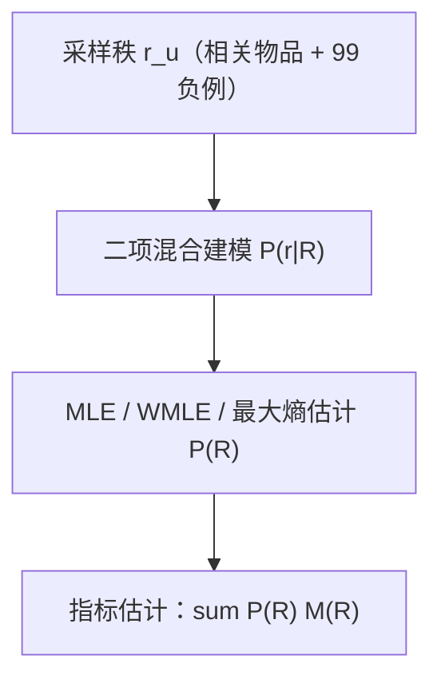
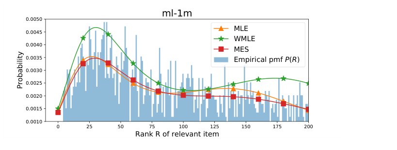

# On Estimating Recommendation Evaluation Metrics under Sampling (采样下推荐评估指标估计)

- **会议/期刊**: AAAI 2021
- **作者与机构**: Ruoming Jin, Dong Li, Benjamin Mudrak（Kent State University）；Jing Gao, Zhi Liu（iLambda）
- **推荐链路定位**: 离线评测（召回/排序指标）
- **研究方向**: 去偏公平、可信隐私与工业架构 / 评测基准与采样估计
- **论文原文**: [论文原文链接](https://arxiv.org/abs/2103.01474v2)
- **开源代码**: 暂未开源

## TL;DR (1分钟核心速览)

本文针对“采样 top-k 评估与全库评估不一致”的痛点，提出先学习经验秩分布 $P(R)$，再由其统一估计 Recall/NDCG/AP 的框架；用二项混合 MLE/WMLE 与最大熵约束恢复$P(R)$。在 ml-1m、citeulike 上以$n=100$ 采样、100 次重复评估，WMLE 将 AP@10 平均绝对偏差较 BV0.01 降低约 15.9%。

## Background & Motivation (背景与核心矛盾)

- **主流范式**: 推荐评估常为每用户采样 99 个负例，与相关物品组成 $n=100$ 的候选集，直接在该采样集上算 Recall/NDCG/AP。
- **前人局限**: Krichene & Rendle 的 BV 估计器需假定 $P(R)$ 均匀，且要为每个指标单独求解；Li et al. 的映射函数只适用于 Recall/Hit-Ratio，难以推广到 NDCG/AP。
- **核心洞察 (Key Insight)**: 任意 top-$K$指标可写成秩分布的线性泛函：$metric@K=\sum_{R=1}^{K}P(R)M_{metric}(R)$。因此只需从采样秩中恢复$P(R)$，即可“一次估计、多指标复用”。
- **本文切入点**: 将采样秩建模为二项分布的混合，把评估指标估计转化为混合分布参数学习问题。

## Method (核心方法设计)

### 1. 整体框架 (Overall Architecture)

输入是每个用户在采样候选集 $I_u$中的相关物品秩$r_u$；先假设真实全库秩$R$决定采样秩$r$的条件分布，再用 MLE/WMLE 或最大熵约束反推经验秩分布$\hat P(R)$；最后将$\hat P(R)$代入指标权重函数，得到任意 top-$K$ 指标的估计。整个流程不训练推荐模型，只做评估端分布估计。

### 2. 关键设计拆解 (Key Designs)

1. **经验秩分布的二项混合建模**：采样秩 $r$的条件分布来自“从全库中随机抽到比相关物品更高排名的负例数”，故$r-1\sim B(n-1,\theta_R)$，其中$\theta_R=(R-1)/(N-1)$。于是$P(r|\Pi)=\sum_{R=1}^{N}\pi_R \mathrm{Bin}(r-1;n-1,\theta_R)$，$\pi_R=P(R)$。这样把“全库秩$R$”与“采样秩$r$”通过可解释的二项抽样机制连接起来。

2. **WMLE 与最大熵约束**：MLE 用 EM 最大化 $\sum_u\log\sum_R\pi_R p(r_u|\theta_R)$，更新为$\pi_R^{new}=\frac{1}{M}\sum_u\frac{\pi_R^{old}p(r_u|\theta_R)}{\sum_j\pi_j^{old}p(r_u|\theta_j)}$。WMLE 对头部采样秩加权，$w(r)$可取$M_{NDCG}(r/C)$，使小$R$的$P(R)$更准；MES 则解$\max_{\Pi}\eta H(\Pi)-E$，$E=\sum_{r=1}^{n}\tilde P(r)(\sum_R P(r|R)\pi_R-\tilde P(r))^2$，用熵正则加分布距离约束，避免仅拟合采样边缘分布。

3. **指标估计与效率**：得到 $\hat P(R)$后，$\hat{metric}@K=\sum_{R=1}^{K}\hat P(R)M_{metric}(R)$。训练无需负采样；评估采样为每用户均匀抽 99 负例。EM 复杂度约$O(kNn)$，优于 BV 最小二乘的$O(n^2N)$，且一次估计可复用于不同指标与不同$K$。

<figure class="paper-figure" markdown="span">
  <figcaption>图1：学习经验秩分布 P(R)</figcaption>
</figure>

## Experimental Setup & Evaluation Protocol (实验设置与评估协议)

- **数据集与预处理**: 正文主表使用 ml-1m 与 citeulike；原文称共四个数据集，其余统计在附录。正文未明示 5-core 等过滤，按统一测试集评估。

| 数据集 | #Users | #Items | #Interactions | 稀疏度/密度 | 特征/场景说明 |
| :--- | :---: | :---: | :---: | :---: | :--- |
| ml-1m | 6,040 | 3,706 | 1,000,209 | 4.47% | 电影评分，正文表2 |
| citeulike | 5,551 | 16,980 | 204,687 | 0.22% | 学术文献，正文表3 |

- **数据划分与防穿越 (Splitting Strategy)**: 按“每用户单一相关物品”的测试设定评估；正文未展开划分细节，相关设置见附录。
- **排名评测协议 (Ranking Protocol)**: Exact 为 `Full-Ranking`（全库 $N$个物品排序）；采样为 `Sampled Ranking`，相关物品 + 99 个均匀负例，$n=100$，重复 100 次，报告均值±标准差。
- **对比基线与超参设置**: 推荐模型含 itemKNN、ALS、EASE、NeuMF、MultiVAE；估计器含 CLS、BV（$\gamma=0.1/0.01$）、MLE、WMLE（$C=10$）、MES（$\eta=0.001$）。正文未做显著性检验。

## Key Experimental Results (实验关键数据)

### 1. 主实验对比 (Main Results)

下表为 ml-1m、$n=100$ 下 AP@10 的估计结果；加粗为最接近 Exact 的估计器（按绝对偏差），Exact 为目标值不参与加粗。

| 推荐模型 | Exact | CLS | BV $\gamma=.1$| BV$\gamma=.01$ | MLE | WMLE | MES |
| :--- | :---: | :---: | :---: | :---: | :---: | :---: | :---: |
| EASE | 10.63 | 16.81 | 10.88 | 10.53 | 10.32 | **10.59** | 10.35 |
| MultiVAE | 3.81 | 13.97 | 7.53 | 5.77 | 5.74 | 5.86 | **5.72** |
| NeuMF | 8.26 | 15.29 | 9.44 | 9.08 | 9.15 | 9.37 | **9.06** |
| itemKNN | 13.89 | **14.35** | 10.32 | 11.73 | 12.68 | 13.21 | 12.38 |
| ALS | 5.21 | 14.84 | 8.59 | 7.23 | **7.06** | 7.27 | 7.08 |

五模型平均绝对偏差：CLS 6.69、BV0.1 2.42、BV0.01 1.41、MLE 1.24、WMLE 1.19、MES 1.27；WMLE 较 BV0.01 降低约 15.9%。Recall/NDCG 趋势与 AP 一致，完整见原文表2–3。

### 2. 消融实验 (Ablation Study)

下表为 ml-1m 上 100 次采样中“正确预测全局冠军”的次数（$K=10$），用于比较估计器变体对模型排序结论的影响。

| 指标@10 | CLS | BV0.1 | BV0.01 | MLE | WMLE | MES |
| :--- | :---: | :---: | :---: | :---: | :---: | :---: |
| Recall | 0 | 21 | 54 | 58 | **59** | 58 |
| NDCG | 0 | 24 | 56 | 60 | **61** | 59 |
| AP | 0 | 27 | 56 | **61** | **61** | 59 |

### 3. 关键实验发现 (Key Findings)

1. **分布学习显著优于逐指标修正**：在 AP@10 上，WMLE 将五模型平均绝对偏差从 BV0.1 的 2.42 降至 1.19，较 BV0.01 的 1.41 仍降 15.9%，说明先恢复 $P(R)$ 再算指标更稳。
2. **WMLE 最利于“选对模型”**：$K=10$ 时 WMLE 在 NDCG@10 与 AP@10 上均达 61/100 次正确预测冠军，CLS 为 0；采样评估若方法得当，仍可支撑模型比较。
3. **单体 $P(R)$噪声大，但累积 CDF 可靠**：原文图2显示各估计器对单个$P(R)$并不精确，但 CDF/Recall 曲线接近；这解释了为何 top-$K$ 聚合指标估计有效，也提示不应直接解读采样秩分布。

## Highlights & Limitations (亮点、对比与审稿批判)

- **与代表作对比 (vs. Prior Work)**: Krichene & Rendle 的 BV 需假定均匀 $P(R)$且逐指标求解；Li et al. 仅给 Recall 的近似线性映射。本文把问题统一为“学习$P(R)$”，一次估计可服务 Recall/NDCG/AP 与不同$K$，信息量更大。
- **可迁移亮点**: 二项混合 + EM 的秩分布恢复可迁移到其他采样评估场景；WMLE 的头部加权思路适合 top-$K$ 敏感指标。
- **审稿级局限批判**: 其一，新估计器方差高于 BV，且单体 $P(R)$估计不准，$N$很大时 EM 的$N$维参数仍是负担；其二，实验主要报告$n=100$、@10 与两个数据集，缺少显著性检验和大规模工业验证。

## Rating (四维评分)

- **方法创新性 (Novelty)**: ⭐⭐⭐⭐ （把采样评估转成经验秩分布学习，指标无关且可复用；但二项混合/EM 本身是经典工具）
- **评估协议与实验扎实度 (Protocol & Experiments)**: ⭐⭐⭐⭐ （5 个推荐模型×2 数据集×100 次重复，Exact 与采样对照清晰；仅 @10、$n=100$，未做显著性检验）
- **写作与数学规范度 (Clarity & Rigor)**: ⭐⭐⭐⭐ （从抽样机制到 MLE/MES 推导完整，公式清楚；数据集与划分细节多放附录）
- **工业落地与复现价值 (Industrial & Practical Value)**: ⭐⭐⭐ （无需重训推荐模型、估计一次多指标复用，适合离线评测；但方差与 $N$ 维混合限制大规模部署）

