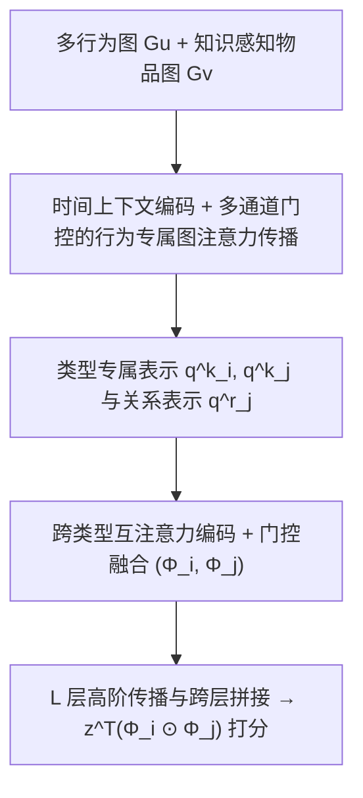
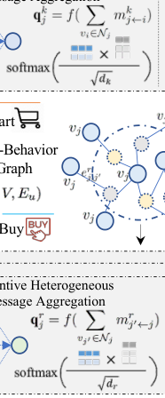

# Knowledge-Enhanced Hierarchical Graph Transformer Network for Multi-Behavior Recommendation (知识增强分层图Transformer多行为推荐网络)

- **会议/期刊**: AAAI 2021
- **作者与机构**: Lianghao Xia, Chao Huang, Yong Xu, Peng Dai, Xiyue Zhang, Hongsheng Yang, Jian Pei, Liefeng Bo（华南理工、京东金融美国、SFU）
- **推荐链路定位**: 召回（用户/物品表征学习）
- **研究方向**: 图神经网络与知识图谱推荐 / 多任务学习与列表级重排
- **论文原文**: [https://arxiv.org/abs/2110.04000v1](https://arxiv.org/abs/2110.04000v1)
- **开源代码**: [https://github.com/akaxlh/KHGT](https://github.com/akaxlh/KHGT)

## TL;DR (1分钟核心速览)

真实电商中"浏览/收藏/加购/购买"多类型行为互为辅助信号，但主流 CF/GNN 只建模单一行为，且无法区分哪种行为对目标行为更有用。KHGT 用**分层的图 Transformer**统一编码「多行为用户-物品图 + 知识感知物品-物品图」：底层做时间感知、行为专属的注意力消息传播，上层用跨类型互注意力 + 门控融合判别行为贡献。在 Yelp/ML10M/Retail 三套数据、时间感知 Leave-One-Out + 1:99 采样排序协议下，NDCG@10 相对最优基线提升 4.9%–29.9%，Retail HR@10 提升 23.1%。

## Background & Motivation (背景与核心矛盾)

- **主流范式**: NGCF/MBGCN 类工作在同构或行为感知二分图上做邻域聚合；NMTR/DIPN 用多任务级联或双向 RNN 建模"浏览→购买"的转化路径。
- **前人局限**: ① NMTR/DIPN 只在**标量维度做级联**，把行为关系当作局部、独立的序列先验，无法刻画高阶多路（multiplex）依赖；② MBGCN/NGCF 完全丢弃物品侧知识关系，KGAT 则只做单一行为的知识图，二者互斥；③ 上述模型均无时间编码，行为动态性丢失。
- **核心洞察 (Key Insight)**: 不同行为类型应各自占据**独立的表征子空间**（避免语义混淆），但在预测目标行为时又必须相互"看齐"——即需要"先分离、再对齐、后加权"的分层结构。
- **本文切入点**: 一层用行为专属参数 + 时间编码捕获类型内模式，二层用互注意力 + 门控融合显式建模跨类型依赖，并将知识图谱的物品-物品关系作为同构边并入同一消息传递。

## Method (核心方法设计)

### 1. 整体框架 (Overall Architecture)

输入是两张图：多行为交互图 $\mathcal{G}_u=(\mathcal{U},\mathcal{V},\mathcal{E}_u)$（边带行为类型$k$与时间戳）与知识感知物品图$\mathcal{G}_v=(\mathcal{V},\mathcal{E}_v)$（元关系$r$：同类别、同地域、同用户同行为共现）。第一阶段在图注意力框架下做时间感知的异质消息传播，得到每个行为类型$k$专属的用户/物品表示$q^k_i,q^k_j$以及每种元关系$r$的物品表示$q^r_j$；第二阶段用多头互注意力让各类型表示互相注意，再由门控融合层按"对目标行为（如购买）的贡献"加权成唯一表示$\Phi_i,\Phi_j$；最后堆叠$L$层并跨层拼接，用$z^\top(\Phi_i\odot\Phi_j)$ 打分，pairwise 损失优化。

<figure class="paper-figure" markdown="span">
  <figcaption>图1：KHGT框架的模型架构。</figcaption>
</figure>

### 2. 关键设计拆解 (Key Designs)

1. **时间感知 + 多通道门控的行为专属传播**：痛点是无时间信号则无法区分"先浏览后购买"的因果顺序，且 $K$种行为各建一套$Q/K/V$会参数爆炸。做法：把交互时间戳$\tau(t^k_{i,j})$用正弦函数编码并投影为$\bar{T}^k_{i,j}=T^k_{i,j}W_k$，直接**加性注入节点表示**$p_j=e_j\oplus\bar{T}^k_{i,j}$；再用$M(\ll K)$个共享基变换做门控生成：$Q^h_k=\sum_{m=1}^{M}\alpha^k_m\bar{Q}^h_m$（$K$、$V$同理）。注意力权重为$\bar\omega^h_{i,j,k}=(Q^h_k p_i)^\top(K^h_k p_j)/\sqrt{d/H}$，仅在**同类型边**内 softmax。直觉：基变换共享跨行为的"全局上下文"，门控系数保留类型特异性，参数量从$O(K)$降到$O(M)$。

2. **跨类型互注意力 + 门控融合**：类型内聚合后的表示彼此孤立，无法表达"加购与购买强相关、点踩与购买互斥"。用标准 scaled dot-product 让第 $k$类表示去注意所有$k'$类：$\tilde{q}^k_i=\bigparallel_{h=1}^{H}\sum_{k'=1}^{K}\lambda^{i,h}_{k,k'}\tilde{V}^h q^{k'}_i$，其中$\lambda$由$( \tilde{Q}^h q^k_i )^\top(\tilde{K}^h q^{k'}_i)/\sqrt{d/H}$归一化得到；随后软融合$\Phi_j=\sum_k\eta^k_j\tilde{q}^k_j\oplus\sum_r\xi^r_j\tilde{q}^r_j$，$\eta^k_j=\sigma(\bar\eta^k_j)$、$\bar\eta^k_j=a_0^\top f(\tilde{q}^k_j)+c^u_0$。这相当于把"哪个行为/哪种知识关系更重要"变成可学习的、样本级（per-node）的权重，也是论文解释性可视化的直接来源。

3. **训练目标、负采样与推理效率**：目标行为正样本 $v_{p_s}$与随机负样本$v_{n_s}$各采$S$个，用边际 pairwise 损失$\mathcal{L}=\sum_{i=1}^{I}\sum_{s=1}^{S}\max(0,1-\mathrm{Pr}_{i,p_s}+\mathrm{Pr}_{i,n_s})+\lambda\|\Theta\|_F^2$。大规模图训练用随机游走子图采样（按邻接相关性维护权重向量），复杂度$O(K(I+J)d^2+|\mathcal{E}|d)$，与 GNN 类多行为模型同阶。

## Experimental Setup & Evaluation Protocol (实验设置与评估协议)

- **数据集与预处理**（无 5-core 过滤，保留全量；显式评分按阈值切分为行为类型）：

| 数据集 | #Users | #Items | #Interactions | 密度 | 行为类型（目标行为加粗） |
| :--- | :---: | :---: | :---: | :---: | :--- |
| Yelp | 19,800 | 22,734 | 1.4×10⁶ | 3.1e-3 | Tip / Dislike / Neutral / **Like** |
| ML10M | 67,788 | 8,704 | 9.9×10⁶ | 1.7e-2 | Dislike / Neutral / **Like** |
| Online Retail | 805,506 | 584,050 | 6.4×10⁷ | 1.4e-4 | PageView / Favorite / Cart / **Purchase** |

- **数据划分与防穿越**: **时间感知 Leave-One-Out**——每个用户最后一次交互作为测试集，其余全部训练。
- **排名评测协议**: **Sampled Ranking**，每个正样本随机配 **99 个未交互负样本**（1:99），指标 HR@N / NDCG@N（主表 N=10，Yelp 额外报告 K=1…9）。
- **对比基线与超参**: 覆盖 BiasMF、AutoRec/CDAE、DMF/NCF 三变体、NADE/CF-UIcA、ST-GCN/NGCF、多行为 NMTR/DIPN/NGCFM/MBGCN/MATN、知识图 KGAT 共 18 个基线；隐维 $d$在 {4,8,16,32} 调优（最优 16），头数 2，基通道$M=2$，GNN 层数 2，学习率 1e-3（衰减 0.96），batch 32，权重衰减 {0.1,0.05,0.01,0.005,0.001}；未报告显著性检验。

## Key Experimental Results (实验关键数据)

### 1. 主实验对比 (Main Results)

| 模型 | Yelp HR@10 | Yelp NDCG@10 | ML10M HR@10 | ML10M NDCG@10 | Retail HR@10 | Retail NDCG@10 |
| :--- | :---: | :---: | :---: | :---: | :---: | :---: |
| NCF-G | 0.755 | 0.487 | 0.787 | 0.502 | 0.290 | 0.167 |
| NGCF | 0.789 | 0.500 | 0.790 | 0.508 | 0.302 | 0.185 |
| ST-GCN | 0.775 | 0.465 | 0.738 | 0.444 | 0.347 | 0.206 |
| NMTR | 0.790 | 0.478 | 0.808 | 0.531 | 0.332 | 0.179 |
| MBGCN | 0.796 | 0.502 | 0.826 | 0.553 | 0.369 | 0.222 |
| MATN | 0.826 | 0.530 | 0.847 | 0.569 | 0.354 | 0.209 |
| KGAT | 0.835 | 0.543 | 0.817 | 0.514 | 0.377 | 0.214 |
| NGCFM | 0.793 | 0.492 | 0.825 | 0.546 | 0.374 | 0.221 |
| **KHGT** | **0.880** | **0.603** | **0.861** | **0.597** | **0.464** | **0.278** |
| **Improv.** | **+5.4%** | **+11.1%** | **+1.7%** | **+4.9%** | **+23.1%** | **+25.2%** |

（Improv. 相对各列最强基线：Yelp↔KGAT，ML10M↔MATN，Retail HR↔KGAT、NDCG↔MBGCN。Top-K 扫描表中 Yelp HR@1 从 KGAT 0.291 升至 0.355，全 K 值域一致领先。）

### 2. 消融实验 (Ablation Study)

| 变体（NDCG@10，≈读图3） | Yelp | ML10M | Retail |
| :--- | :---: | :---: | :---: |
| **KHGT 完整版** | **0.603** | **0.597** | **0.278** |
| w/o 时间编码 (-Ti) | ≈0.552 | ≈0.545 | ≈0.235 |
| w/o 图注意力→GCN (-GA) | ≈0.563 | ≈0.560 | ≈0.248 |
| w/o 跨类型互注意力 (-MR) | ≈0.576 | ≈0.571 | ≈0.255 |
| w/o 门控融合（均值池化, -BF） | ≈0.558 | ≈0.552 | ≈0.240 |
| w/o 物品-物品知识关系 (-KG) | ≈0.570 | ≈0.566 | ≈0.252 |

### 3. 关键实验发现 (Key Findings)

1. **时间编码是最大单一增益来源**：去掉 -Ti 后三个数据集 NDCG@10 分别掉约 0.05/0.05/0.04，降幅甚至超过去掉知识图（-KG）；且周级时间槽（week）分辨率最优，比日/月/季都好，说明"周期性消费节律"比精确时刻更有信号。
2. **多行为辅助信号越多越好，且稀疏用户受益最大**：行为集成实验中移除任一辅助行为（-tip/-neutral/-pv/-fav/-cart）均下降，全类型输入最佳；在 Retail 按交互量分桶后，最稀疏桶（<36 次交互）上 KHGT 与 KGAT/MBGCN 的 HR@10 差距显著大于最稠密桶，验证异质传播对长尾用户的补偿作用。
3. **性能-成本可通过采样解耦**：训练子图 3 万节点 + 测试子图 13 万节点即达 HR 0.478（全量 0.481），而测试耗时仅 70.3s vs 351.7s（约 1/5），说明推理阶段才需要更大图上下文，训练阶段小图 + dropout 反而抑制过拟合。

## Highlights & Limitations (亮点、对比与审稿批判)

- **与代表作对比 (vs. Prior Work)**: 相比 NMTR（标量级联多任务）与 MATN（行为记忆注意力），KHGT 把行为关系抬到**图上的高阶传播 + 跨类型 Transformer 注意力**，不再是局部序列先验；相比 MBGCN，多出物品-物品知识图与时间编码；相比 KGAT，把知识图从"单一行为"扩展到"多行为辅助 + 目标行为预测"，Retail 上相对 KGAT 的 +23.1% HR 差距正是这两项增量的合力。
- **可迁移亮点**: ① 用 $M\ll K$个共享基变换 + 门控生成类型专属$Q/K/V$，任何"多关系/多场景/多任务"模型都可直接套用以控制参数量；② 把时间戳以加性方式注入消息传递的节点表示（而非只做序列位置编码），对非序列 GNN 建模动态性极为轻量通用。
- **审稿级局限批判**: ① 评测采用 1:99 采样排序而非 Full-Ranking，HR 绝对值被显著抬高（Retail 全库 58 万物品下 99 负样本远不足以反映真实排序难度），且 Yelp/ML10M 上相对 MATN 的增益仅 1.7%/4.9%，缺乏方差与显著性报告；② 物品-物品图的元关系之一为"同一用户在同一行为 $k$下共同交互"，若$k$即目标行为（buy/like），存在**目标标签信息回流的泄漏风险**，ablation 中 -KG 的下降可能部分来自该捷径而非纯知识增益；此外$O(K(I+J)d^2)$ 的变换开销随行为类型线性增长，在行为数多、物品数百万级的工业场景仍需依赖子图采样与负采样训练，论文未给出线上 A/B 与延迟数据。

## Rating (四维评分)

- **方法创新性 (Novelty)**: ⭐⭐⭐⭐ （"行为专属子空间 + 跨类型互注意力 + 门控软融合"的三段式分层图 Transformer 结构清晰，时间编码与多通道基变换组合有新意）
- **评估协议与实验扎实度 (Protocol & Experiments)**: ⭐⭐⭐ （三套跨域数据 + Top-K 扫描 + 稀疏分桶 + 采样规模研究较完整，但仅 1:99 采样排序、无全库排序与显著性检验，Retail 增益与小数据集增益落差未被充分解释）
- **写作与数学规范度 (Clarity & Rigor)**: ⭐⭐⭐⭐ （公式与符号体系紧凑、模块职责边界明确，复杂度分析到位；缺点是门控中 $\sigma(\cdot)$ 与 softmax 表述前后不一致，部分消融只给柱状图未给数值表）
- **工业落地与复现价值 (Industrial & Practical Value)**: ⭐⭐⭐⭐ （代码开源、Random-Walk 子图采样使 80 万用户级 Retail 可训练，实测测试耗时可按采样规模缩放；但多行为参数与构图开销在超大规模下仍需工程裁剪）

