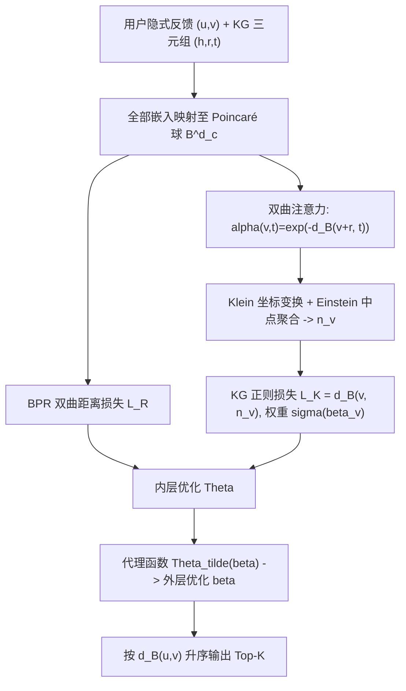
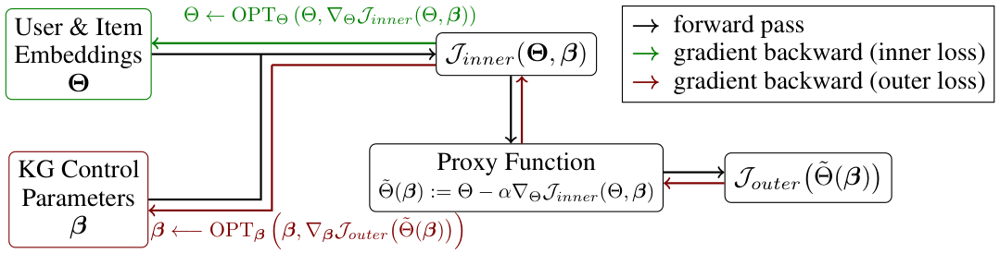

# Knowledge-Enhanced Top-K Recommendation in Poincaré Ball (双曲球空间中的知识增强 Top-K 推荐)

- **会议/期刊**: AAAI 2021（第 35 届 AAAI 人工智能会议）
- **作者与机构**: Chen Ma, Liheng Ma, Haolun Wu, Xue Liu, Mark Coates（McGill University）；Yingxue Zhang（Huawei Noah's Ark Lab Montreal）
- **推荐链路定位**: 召回（Top-K 全库排序）
- **研究方向**: 图神经网络与知识图谱推荐 / 协同过滤与双塔召回（度量学习）
- **论文原文**: [arXiv:2101.04852v2](https://arxiv.org/abs/2101.04852v2)
- **开源代码**: 暂未开源

## TL;DR (1分钟核心速览)

现有 KG 增强推荐全部在欧氏空间学习实体表征，难以刻画知识图谱天然的**层次（树状）结构**；同时所有物品共用同一个固定的正则系数 $\beta$，无法区分不同物品邻居信息的有用程度。本文提出 Hyper-Know：把用户、物品、KG 实体与关系统一映射到 Poincaré 球，用**双曲注意力 + Einstein 中点**聚合物品邻居，并把$\beta$ 的学习写成**双层优化**（内层学表征、外层学正则强度）。在 Amazon-book / Last-FM / Yelp2018（10-core、Full-Ranking 协议）上，NDCG@20 相对最强基线 KGAT 提升 3.46%–16.70%。

## Background & Motivation (背景与核心矛盾)

- **主流范式**: KG 增强推荐分两支——路径支（RippleNet、KPRN 抽取 meta-path / 路径做高阶连通建模）与正则支（CKE、CFKG、KGAT 用额外损失项把 KG 结构约束进物品表征）。
- **前人局限 1**: 所有方法都在欧氏空间做嵌入。双曲空间能以指数级容量容纳树状结构（Sala et al. 2018），欧氏嵌入在浅层节点拥挤、深层节点被压缩，天然学不好 KG 的层级与父子关系。
- **前人局限 2**: CKE / CFKG / RippleNet 对物品的**所有邻居实体一视同仁**做平均聚合，导致邻居信息被"糊成一团"；KGAT 虽加了图注意力，但 ot 仍在欧氏空间、且无法表达双曲距离下的语义接近性。
- **前人局限 3**: 正则系数 $\beta$全局固定。不同数据集、不同物品、不同训练阶段所需的 KG 正则力度本就不同，固定值需逐数据集网格搜索，且次优$\beta$ 会造成最高 10% 的性能衰减（见图 2）。
- **核心洞察 (Key Insight)**: KG 的层级性 + 各物品邻居重要性异质 + 正则强度应随训练演进，这三件事分别由**双曲几何**、**双曲注意力**、**双层优化**针对性解决。
- **本文切入点**: 首个把知识增强推荐整体搬进 Poincaré 球的工作，且不改动 BPR 的 pairwise 框架，仅替换度量空间与聚合算子。

## Method (核心方法设计)

### 1. 整体框架 (Overall Architecture)

输入是用户隐式反馈对 $\mathcal{D}=(u,v)$与物品 KG 三元组$(h,r,t)$；四类嵌入（用户、物品、实体、关系）全部初始化在半径$1/\sqrt{c}$的 Poincaré 球$\mathcal{B}^d_c$内。对每个物品$v$，先以其为头实体的邻居三元组集合$\mathcal{N}_v$计算双曲注意力权重，再经 Klein 模型用 Einstein 中点聚合得到邻域表征$\mathbf{n}_v$；物品表征$\mathbf{v}$与$\mathbf{n}_v$之间的双曲距离即构成 KG 正则项。推荐打分直接用双曲距离$d_{\mathcal{B}}(u,v)$衡量偏好，越近越可能被点击。训练时外层用 BPR 损失更新$\boldsymbol{\beta}$、内层用联合损失更新全部嵌入，形成"表征-正则"交替优化闭环。

### 2. 关键设计拆解 (Key Designs)

**① 双曲度量替代欧氏内积（把打分函数换成测地线距离）**：欧氏内积打分无法表达"层级越深、容量越大"的几何先验。本文把偏好打分改成 Poincaré 球内测地线距离（Möbius 加法 $\oplus_c$ 定义位移）：

$$d_{\mathcal{B}}(x,y)=\frac{2}{\sqrt{c}}\tanh^{-1}\!\big(\sqrt{c}\,\|(-x)\oplus_c y\|\big)$$

直觉：$\tanh^{-1}$ 在靠近球边界处急剧放大距离，使少量"深层/细粒度"实体获得与浅层实体同等甚至更大的表征空间，天然契合 KG 的树状扩张。

**② 双曲注意力 + Einstein 中点聚合（区分邻居重要性）**：平均聚合会抹平邻居差异。本文用 TransE 式打分在双曲空间里算注意力，再借 Klein 模型（同一空间、不同坐标，$x_K=2x_B/(1+c\|x_B\|^2)$）把加权平均变成合法的双曲聚合：

$$\alpha_{(v,t)}=\exp\!\big(-d_{\mathcal{B}}(\mathbf{v}\oplus_c\mathbf{r},\ \mathbf{t})\big),\qquad \mathbf{n}_v=f_{K\to B}\!\Big(\frac{\sum_{t}\alpha_{(v,t)}\gamma(\mathbf{t})\,f_{B\to K}(\mathbf{t})}{\sum_{t'}\alpha_{(v,t')}\gamma(\mathbf{t'})}\Big)$$

其中 $\gamma(\mathbf{t})=1/\sqrt{1-c\|\mathbf{t}\|^2}$是 Lorentz 因子，越靠边界的实体权重被自动放大。直觉：几何上更"接近"$v\oplus_c r$ 的尾实体获得更高权重，聚合结果仍落在球内且保持双曲语义。

**③ 双层优化驱动的自适应细粒度正则**：把 $\beta$变成逐物品参数$\sigma(\beta_v)$会有一个致命问题——若直接最小化总损失，优化器会把所有$\beta_v$ 压到 0（因为减小正则项总能降 loss）。本文因此将其写成内外两层（见 图 1）：

$$\min_{\boldsymbol{\beta}}\ J_{\text{outer}}\big(\Theta^*(\boldsymbol{\beta})\big)=\sum_{\mathcal{D}} \mathcal{L}_R\big(u,v,v';\Theta^*(\boldsymbol{\beta})\big),\quad \text{s.t.}\ \Theta^*(\boldsymbol{\beta})=\arg\min_{\Theta} J_{\text{inner}}(\Theta,\boldsymbol{\beta})$$

为避免二阶梯度，用一步梯度展开构造代理函数 $\tilde{\Theta}(\boldsymbol{\beta}):=\Theta-\alpha\nabla_{\Theta}J_{\text{inner}}(\Theta,\boldsymbol{\beta})$，以$\nabla_{\boldsymbol{\beta}}J_{\text{outer}}(\tilde{\Theta}(\boldsymbol{\beta}))$近似真实超梯度。直觉：$\beta_v$ 只由**泛化目标**（外层 BPR）监督，若某物品的 KG 邻居对该用户偏好预测无益，外层梯度自然压低其正则强度。

<figure class="paper-figure" markdown="span">
  <figcaption>图1：控制细粒度参数 β 学习的双层优化流程。</figcaption>
</figure>

**④ 训练目标、负采样与推理开销**：内层总损失为 $\mathcal{L}=\mathcal{L}_R+\sigma(\beta_v)\mathcal{L}_K+\lambda\|\Theta\|_F^2$，其中$\mathcal{L}_R=-\ln\sigma(d_{\mathcal{B}}(u,v')-d_{\mathcal{B}}(u,v))$、$\mathcal{L}_K=d_{\mathcal{B}}(\mathbf{v},\mathbf{n}_v)$。负采样采用**朴素均匀采样**（作者刻意如此，以便干净地隔离双曲/注意力/自适应正则三项贡献），优化器 Adam。推理阶段对候选集逐物品算$d_{\mathcal{B}}(u,v)$并取距离最小的 K 个，复杂度与 MF 同阶；曲率固定$c=1$、维度$d=64$、batch 4096。

## Experimental Setup & Evaluation Protocol (实验设置与评估协议)

- **数据集与预处理**（全部沿用 KGAT 的公开版本，统一 `10-core` 过滤，即每个用户与物品至少 10 次交互）：

| 数据集 | #Users | #Items | #Interactions | 密度 | #Entities / #Relations / #Triplets |
| :--- | :---: | :---: | :---: | :---: | :--- |
| Amazon-book | 70,679 | 24,915 | 847,733 | 0.048% | 88,572 / 39 / 2,557,746 |
| Last-FM | 23,566 | 48,123 | 3,034,796 | 0.268% | 58,266 / 9 / 464,567 |
| Yelp2018 | 45,919 | 45,538 | 1,185,068 | 0.057% | 90,961 / 42 / 1,853,704 |

- **数据划分与防穿越**: 比例划分——每个用户交互随机取 80% 为训练、20% 为测试，再从训练集随机取 10% 作验证集调参。**注意：这是逐用户随机划分，而非全局时间戳切分**，存在未来交互泄漏到训练集的风险。
- **排名评测协议**: 无偏 **Full-Ranking**（对全库物品算距离，剔除该用户训练集已交互物品后取 Top-K），指标 Recall@20 与 NDCG@20。
- **对比基线与超参**: 8 个基线覆盖三类——因子分解类 FM / NFM；KG 正则类 CKE / CFKG；KG 图传播类 RippleNet / GC-MC / KGAT。所有模型嵌入维度统一 $d=64$，学习率搜 [1e-4, 1e-2]，L2 系数搜 [1e-4, 0.1]，实验重复 5 次取均值，并用 paired t-test 在$p\le 0.01$ 下检验显著性。

## Key Experimental Results (实验关键数据)

### 1. 主实验对比 (Main Results)

| Method | Amazon R@20 | Amazon N@20 | Last-FM R@20 | Last-FM N@20 | Yelp R@20 | Yelp N@20 |
| :--- | :---: | :---: | :---: | :---: | :---: | :---: |
| FM | 0.1345 | 0.0886 | 0.0778 | 0.1181 | 0.0627 | 0.0768 |
| NFM | 0.1366 | 0.0913 | 0.0829 | 0.1214 | 0.0660 | 0.0810 |
| CKE | 0.1343 | 0.0885 | 0.0736 | 0.1184 | 0.0657 | 0.0805 |
| CFKG | 0.1142 | 0.0770 | 0.0723 | 0.1143 | 0.0522 | 0.0644 |
| RippleNet | 0.1336 | 0.0910 | 0.0791 | 0.1238 | 0.0664 | 0.0822 |
| GC-MC | 0.1316 | 0.0874 | 0.0818 | 0.1253 | 0.0659 | 0.0790 |
| KGAT | 0.1489 | 0.1006 | 0.0870 | 0.1325 | **0.0712** | 0.0867 |
| **Hyper-Know** | **0.1534\*** | **0.1075\*** | **0.0949\*** | **0.1533\*** | 0.0683 | **0.0897\*** |
| **Improv. vs best baseline** | +3.23% | +6.86% | +9.08% | +16.70% | N/A | +3.46% |

### 2. 消融实验 (Ablation Study)

| 配置 (E=欧氏, H=双曲; Att=注意力, Avg=平均) | Amazon R@20 | Amazon N@20 | Last-FM R@20 | Last-FM N@20 |
| :--- | :---: | :---: | :---: | :---: |
| (1) BPR + E | 0.1017 | 0.0729 | 0.0604 | 0.1112 |
| (2) BPR + H | 0.1167 | 0.0833 | 0.0656 | 0.1191 |
| (3) BPR + Att + E | 0.1121 | 0.0812 | 0.0746 | 0.1319 |
| (4) BPR + Att + H | 0.1447 | 0.1025 | 0.0885 | 0.1453 |
| (5) BPR + Avg + H | 0.1250 | 0.0897 | 0.0775 | 0.1358 |
| (6) Hyper-Know（+自适应正则） | **0.1534** | **0.1075** | **0.0949** | **0.1533** |

### 3. 关键实验发现 (Key Findings)

1. **双曲几何是增益主发动机，且与注意力强耦合**：(1)→(2) 仅换度量空间，Amazon R@20 从 0.1017 升到 0.1167（+14.7%）；但引入 KG 注意力后，(3)→(4) 从 0.1121 跃至 0.1447（+29.1%），Last-FM R@20 更是从 0.0746 到 0.0885（+18.6%）——说明注意力权重在双曲距离下才具备区分度，欧氏空间里注意力收益被压缩。
2. **注意力聚合显著优于平均聚合**：(4) vs (5)，Last-FM R@20 0.0885 vs 0.0775（+14.2%），Amazon N@20 0.1025 vs 0.0897（+14.3%），验证"物品邻居异质重要性"这一动机成立。
3. **自适应正则贡献稳定且不可被固定 $\beta$替代**：(4)→(6) Amazon N@20 0.1025→0.1075（+4.9%）、Last-FM N@20 0.1453→0.1533（+5.5%）；而图 2 的$\beta$扫描显示，任选固定值都无法达到自适应版本水平，次优$\beta$ 最高带来约 10% 衰减。
4. **训练效率反而更优**：单 epoch 训练时间 Amazon-book 15s / Last-FM 22s / Yelp2018 20s，远低于 KGAT 的 457s / 137s / 352s（约 7–30×），原因是未把用户节点塞进 KG，图谱规模大幅缩小；参数量 8.3M 亦少于 CKE 的 11.4M。

## Highlights & Limitations (亮点、对比与审稿批判)

- **与代表作对比 (vs. Prior Work)**: 与 **KGAT** 的本质区别在于"空间 + 正则方式"：KGAT 在欧氏空间以图注意力传播并共用固定正则；Hyper-Know 在 Poincaré 球用 Einstein 中点聚合并把正则强度交给双层优化。与 **CKE** 的区别是 CKE 用 TransR 语义嵌入 + 固定 $\beta$约束，本文则完全以双曲距离做正则、$\beta$ 逐物品自适应。与 **HyperML** 相比，本文额外引入 KG 与注意力，而非纯度量学习。
- **可迁移亮点**: ①"代理函数一步展开近似超梯度"（$\tilde{\Theta}=\Theta-\alpha\nabla_\Theta J_{\text{inner}}$）可直接套用到任何"损失权重需自适应"的场景（多任务加权、对比学习温度、正则系数），只需一次额外前向。②用 Klein 模型做双曲加权平均，是绕开"双曲空间无线性结构"这一障碍的通用工程技巧。
- **审稿级局限批判**: ① **Yelp2018 上 Recall@20 反而低于 KGAT**（0.0683 vs 0.0712），作者归因于该 KG 多为 `HasTV` 类泛化属性、KG 信息量低，但这暴露模型在"低价值 KG"上的鲁棒性不足，且未给出降噪机制。② 评估仅用逐用户 80/20 随机划分，非时间切分，存在未来信息穿越；且仅报告 K=20，未覆盖多 K 或冷启动分桶。③ 曲率 $c$固定为 1 而非可学习，双曲半径与数值稳定性（$\tanh^{-1}$ 在边界附近梯度爆炸）缺乏敏感性分析。④ 负采样仍是均匀采样，作者承认未与 KG 感知的强负采样结合，留有性能上限。

## Rating (四维评分)

- **方法创新性 (Novelty)**: ⭐⭐⭐⭐ （首个把 KG 增强推荐整体搬到 Poincaré 球，双曲注意力 + Einstein 中点聚合 + 双层自适应正则是三处真实算子级增量，而非简单换壳）
- **评估协议与实验扎实度 (Protocol & Experiments)**: ⭐⭐⭐ （三数据集 + 7 基线 + Full-Ranking + paired t-test 较规范，消融链条完整，但划分非时间切分、仅单一 K 值、Yelp 上 Recall 落败未深挖）
- **写作与数学规范度 (Clarity & Rigor)**: ⭐⭐⭐⭐ （Möbius 加法、Klein/Poincaré 坐标变换、双层优化与代理函数推导链条清晰，复杂度与训练时间有量化对比）
- **工业落地与复现价值 (Industrial & Practical Value)**: ⭐⭐⭐ （训练比 KGAT 快 7–30×、无用户入图、参数量更小，工程友好；但无开源代码、双曲算子需定制实现、数值稳定性需额外调参）

