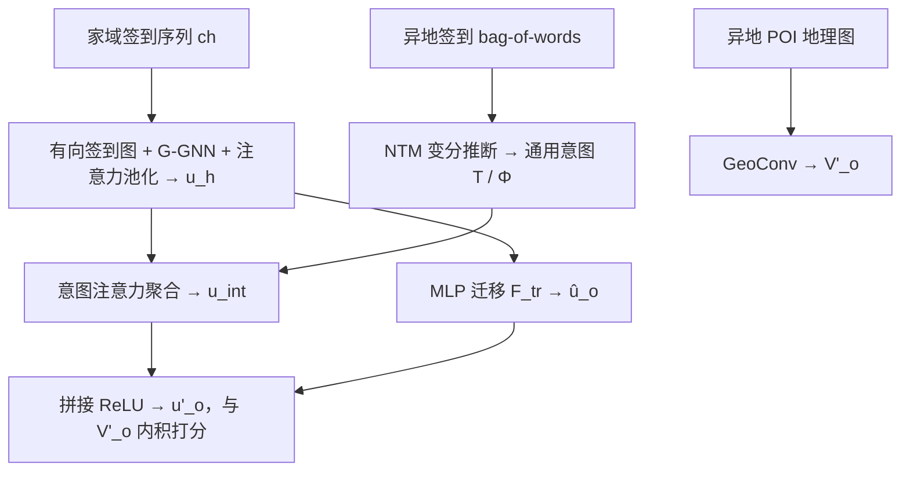

# Out-of-Town Recommendation with Travel Intention Modeling (融合旅行意图建模的异地推荐)

- **会议/期刊**: AAAI 2021
- **作者与机构**: Haoran Xin, Xinjiang Lu, Tong Xu, Hao Liu, Jingjing Gu, Dejing Dou, Hui Xiong（USTC、百度研究院商务智能实验室、南航、Rutgers）
- **推荐链路定位**: 召回（目标城市 POI 全库排序）
- **研究方向**: 时空轨迹与 POI 本地生活推荐 / 冷启动与长尾推荐
- **论文原文**: [论文原文链接](https://arxiv.org/abs/2101.12555v2)
- **开源代码**: 暂未开源

## TL;DR (1分钟核心速览)

异地推荐（out-of-town）的用户在目标城市零交互，家域偏好又因"兴趣漂移"不可直接套用。TRAINOR 用有向 G-GNN 编码家域签到结构、用神经主题模型 (NTM) 无监督学到 K 个通用旅行意图并按用户偏好注意力聚合成个体意图、再用 MLP 把家域表征迁移为异地表征叠加 GeoConv 地理约束，联合三项损失端到端训练。在 BJ→SH / SH→HZ / GZ→FS 三个真实跨城数据集、按用户 8:1:1 划分、目标城全库排序协议下，Rec@10 相较最强基线提升 2.9%–3.8%。

## Background & Motivation (背景与核心矛盾)

- **主流范式**: 早期异地推荐依赖区域级热度/流动性近似（Pham 等）、社交+地理邻近（Ference 等），或位置感知主题模型 LA-LDA 与跨域映射 EMCDR 这类"源域→目标域"迁移范式。
- **前人局限**: ① 家域偏好与异地行为存在系统性 **interest drift**，直接迁移或仅做地理平滑都会失配；② 异地签到本质由**旅行意图**（度假/购物/出差）驱动，而意图是隐变量、随用户动态组合，上述方法要么忽略、要么依赖稀疏的文本评论做主题建模，加剧数据稀疏。
- **核心洞察 (Key Insight)**: 异地签到高度旅游主导（文中最反直觉的现象是：非个性化的 TOP 热度基线竟打败 UCF/BPR-MF/SR-GNN 等个性化模型），说明异地行为更像"少数几个共享意图 + 个体偏好调权"的混合生成过程，而非家域偏好的线性外推。
- **本文切入点**: 把异地签到视为"主题混合"生成样本，用变分推断无监督拆出通用意图，再用家域偏好注意力选意图、用 MLP 承接兴趣漂移。

## Method (核心方法设计)

### 1. 整体框架 (Overall Architecture)

输入是用户 $u$的家域签到序列$\vec{ch}$与异地签到集合$\vec{co}$（后者转为 bag-of-words）。五条支路：① 家域支路把$\vec{ch}$建成有向签到图，G-GNN 传播后经注意力池化得家域偏好$\mathbf{u}^h$；② 意图支路用 NTM 对$\vec{co}$做变分推断，得到 K 个通用意图嵌入$\mathbf{T}$及其对异地 POI 的分布$\Phi$，再用$\mathbf{u}^h$作 query 注意力聚合出个体意图$\mathbf{u}^{(int)}$；③ 异地支路给用户/POI 另设嵌入，POI 侧经 GeoConv 注入地理邻近；④ 迁移支路用 MLP$F_{tr}$把$\mathbf{u}^h$映射为$\hat{\mathbf{u}}^o$；⑤ 拼接个体意图后内积打分，三项损失联合优化。推理时新用户只需家域签到即可前向出分，无需任何异地交互。

### 2. 关键设计拆解 (Key Designs)

1. **有向签到图 + G-GNN 家域编码**：家域签到是**时序转移**而非共现，普通无向 GCN 会丢失访问先后。作者把相邻签到对 $(v^h_{i-1},v^h_i)$建为有向边、归一化重复边，拼成$\vec{A}_{ch}=[A^{(out)},A^{(in)}]\in\mathbb{R}^{D_1\times 2D_1}$，再套 GRU 式门控传播$\mathbf{a}_v^{(t)}=\vec{A}_{v:}^\top\mathbf{V}^{h(t-1)}+\mathbf{b}_g$、$\mathbf{v}_v^{h(t)}=(1-\mathbf{z}_v^{(t)})\odot\mathbf{v}_v^{h(t-1)}+\mathbf{z}_v^{(t)}\odot\tilde{\mathbf{v}}_v^{(t)}$，最后注意力池化$\mathbf{u}^h=\sum_i\alpha_i\mathbf{v}_i^{h\prime}$、$\alpha_i=\mathbf{q}^\top\zeta(W_p\mathbf{v}_i^{h\prime}+\mathbf{b}_p)$。门控让高频 POI 不被过度平滑，注意力让"代表性"POI 主导用户表征。

2. **NTM 通用意图 + 用户特定意图聚合**：意图无标签，故走生成式路线。设意图混合 $\Theta\in\mathbb{R}^K$由 Gaussian Softmax 生成：$\mathbf{z}\sim\mathcal{N}(\mathbf{0},I)$、$\Theta=\mathrm{softmax}(F_\Theta(\mathbf{z}))$，第$i$个意图对异地 POI 的分布为$\Phi_i=\mathrm{softmax}(E\mathbf{t}_i)$，观测$\vec{co}$由$v_i\sim\Phi^\top\Theta$抽样。用 encoder 出后验$q(\mathbf{z}|\vec{co})=\mathcal{N}(\boldsymbol{\mu},\boldsymbol{\sigma}^2)$，损失为 ELBO：
$$\mathcal{L}_N=-\sum_{u}\Big[\mathbb{E}_{q(\mathbf{z}|\vec{co})}\big(\vec{co}^\top\log(\Phi^\top\Theta)\big)+D_{KL}\big(q(\mathbf{z}|\vec{co})\,\|\,p(\mathbf{z})\big)\Big]$$
再以 $\beta_i=\mathrm{softmax}(\mathbf{t}_i^\top W_t\mathbf{u}^h)$、$\mathbf{u}^{(int)}=\sum_{i=1}^{K}\beta_i\mathbf{t}_i$ 做个体化：意图库共享（缓解异地零交互的稀疏），权重由家域偏好决定（保证个性化与可解释）。

3. **兴趣漂移迁移、地理约束与联合训练**：为避免家域/异地两个空间不可比，用 MLP 显式学漂移：$\mathcal{L}_T=\sum_{i}\|F_{tr}(\mathbf{u}^h_i)-\mathbf{u}^o_i\|^2$，即把家域表征拉到异地隐空间；POI 侧用$\mathbf{V}^{o\prime}=\mathrm{ReLU}(A_{geo}\mathbf{V}^oW_c+\mathbf{b}_c)$，其中$e^o_{i,j}=\exp(-\mathrm{dist}(i,j))$构造地理图，符合"游客在城内短距离串点"的先验。打分$s(i,j)=\big(\mathrm{ReLU}(W_f[\mathbf{u}^o_i;\mathbf{u}^{(int)}_i]+\mathbf{b}_f)\big)^\top\mathbf{v}^{o\prime}_j$，$\mathcal{L}_P$采用 BPR 成对损失（每用户固定数量正样本 + 随机负样本，异地侧有负采样、家域侧无负采样）。总损失$\mathcal{L}=\lambda_1\mathcal{L}_N+\lambda_2\mathcal{L}_P+\lambda_3\mathcal{L}_T$，$\lambda_{1,2,3}=1$，Adam、$d=128$、$K=15$。推理为一次前向 + 全库内积，无额外图传播开销。

## Experimental Setup & Evaluation Protocol (实验设置与评估协议)

- **数据集与预处理**: 2019 下半年真实跨城签到，POI 至少被访问 5 次、用户家域签到 ≥5 且异地签到 ≥3；**每个用户仅一条旅行记录**（保证评测公平，也意味着无法做序列级数据增广）。

| 数据集 | #Users | #家域POI | #家域签到 | #异地POI | #异地签到 |
| :--- | :---: | :---: | :---: | :---: | :---: |
| BJ→SH | 10,776 | 2,111 | 127,528 | 1,140 | 70,794 |
| SH→HZ | 19,997 | 3,415 | 263,158 | 1,203 | 116,475 |
| GZ→FS | 12,788 | 4,228 | 220,006 | 1,225 | 57,229 |

- **数据划分与防穿越**: 按**用户**随机 8:1:1 划分训练/测试/验证，同用户签到不跨集合，避免信息泄露；重复 5 次不同划分取平均。
- **排名评测协议**: 目标城市内 **Full-Ranking**（对 $V^o$ 全库打分取 Top-k），多真值场景，指标 Rec@10/20/30 与 MAP。
- **对比基线与超参**: TOP、UCF、BPR-MF、GRU4Rec、SR-GNN、LA-LDA、EMCDR 共 7 个；所有隐向量 $d=128$，$K=15$，L2 权重$10^{-5}$，学习率$0.001$。

## Key Experimental Results (实验关键数据)

### 1. 主实验对比 (Main Results)

| 方法 | BJ→SH R@10 | R@20 | R@30 | MAP | SH→HZ R@10 | R@20 | R@30 | MAP | GZ→FS R@10 | R@20 | R@30 | MAP |
| :--- | :---: | :---: | :---: | :---: | :---: | :---: | :---: | :---: | :---: | :---: | :---: | :---: |
| LA-LDA | 0.0160 | 0.0335 | 0.0417 | 0.0151 | 0.0008 | 0.0021 | 0.0028 | 0.0019 | 0.0020 | 0.0036 | 0.0057 | 0.0021 |
| UCF | 0.0443 | 0.0700 | 0.0935 | 0.1133 | 0.0628 | 0.0874 | 0.0981 | 0.2577 | 0.0386 | 0.0661 | 0.0800 | 0.1071 |
| BPR-MF | 0.1768 | 0.2379 | 0.2844 | 0.0901 | 0.2812 | 0.3588 | 0.4116 | 0.1910 | 0.1642 | 0.2545 | 0.3173 | 0.0947 |
| SR-GNN | 0.1168 | 0.1807 | 0.2627 | 0.1071 | 0.2287 | 0.4550 | 0.5661 | 0.2013 | 0.0933 | 0.1670 | 0.2541 | 0.0566 |
| TOP | 0.2062 | 0.3103 | 0.3818 | 0.1494 | 0.3713 | 0.4620 | 0.5176 | 0.2896 | 0.1964 | 0.2838 | 0.3483 | 0.1202 |
| GRU4Rec | 0.2091 | 0.3011 | 0.3763 | 0.1438 | 0.3619 | 0.4650 | 0.5150 | 0.2807 | 0.1789 | 0.2742 | 0.3422 | 0.1034 |
| EMCDR | 0.2163 | 0.3008 | 0.3649 | **0.1553** | 0.3772 | 0.4358 | 0.4732 | **0.3260** | 0.1928 | 0.2770 | 0.3368 | **0.1246** |
| **TRAINOR** | **0.2226** | **0.3198** | **0.3938** | 0.1541 | **0.3914** | **0.4768** | **0.5295** | 0.2955 | **0.2039** | **0.2922** | **0.3551** | **0.1246** |
| Improv. (R@10) | +2.9% | +3.1% | +3.1% | −0.8% | +3.8% | +2.5% | +2.4% | −9.4% | +3.8% | +3.0% | +2.0% | 0.0% |

### 2. 消融实验 (Ablation Study)

| 变体 | BJ→SH R@10 | R@20 | MAP | SH→HZ R@10 | R@20 | MAP | GZ→FS R@10 | MAP |
| :--- | :---: | :---: | :---: | :---: | :---: | :---: | :---: | :---: |
| TRAINOR-IC（去意图+去 GeoConv） | 0.2029 | 0.2880 | 0.1497 | 0.3679 | 0.4406 | 0.3020 | 0.1937 | 0.1245 |
| TRAINOR-I（去意图） | 0.2177 | 0.3084 | 0.1543 | 0.3825 | 0.4624 | 0.3016 | 0.2028 | 0.1266 |
| TRAINOR-C（去 GeoConv） | 0.2233 | 0.3194 | 0.1538 | 0.3914 | 0.4757 | 0.2950 | 0.2032 | 0.1246 |
| TRAINOR（完整） | **0.2226** | **0.3198** | 0.1541 | **0.3914** | **0.4768** | 0.2955 | **0.2039** | 0.1246 |

### 3. 关键实验发现 (Key Findings)

1. **意图模块主要买"召回"而非"排序"**：加回意图后 SH→HZ 的 Rec@10 从 0.3825 升到 0.3914（+2.3%），但 MAP 从 0.3016 微降到 0.2955；作者归因为全局意图信号在精细排序时会引入扰动，说明意图更适合做粗召回层先验。
2. **GeoConv 与意图模块高度冗余**：无意图时去掉 GeoConv（TRAINOR-IC vs TRAINOR-I）全线指标下滑（SH→HZ R@10 0.3679→0.3825，MAP 0.3020→0.3016 量级同步下降）；但完整模型去掉 GeoConv 反而 BJ→SH R@10 略升（0.2226→0.2233），印证意图嵌入已隐含 POI 间地理关系、再叠加 GeoConv 会过拟合。
3. **异地行为由"热门+意图"双主导**：非个性化 TOP 在三个数据集上 R@10（0.2062/0.3713/0.1964）全面压制 BPR-MF 与 SR-GNN，说明纯协同/序列信号在跨城零交互下失效；TRAINOR 相对最强基线仅领先 2–4%，也说明提升空间主要来自意图先验而非结构容量。参数敏感性上 $K$从 5 到 30 曲线平稳、$\lambda_{1,2,3}\in[0.1,0.9]$ 亦稳定，工程调参成本低。

## Highlights & Limitations (亮点、对比与审稿批判)

- **与代表作对比 (vs. Prior Work)**: 相比 EMCDR——同样用 MLP 做跨域映射，但只用单品家域表征、无意图结构，故 TRAINOR 在 Rec@k 上稳定领先；相比 LA-LDA——后者靠 POI 共访与地理间隔做主题，依赖文本/共现密度，在跨城稀疏下几乎失效（R@10 仅 0.0160）；相比 SR-GNN/GRU4Rec——它们把家域序列直接外推，忽略兴趣漂移与目的地语境差异。
- **可迁移亮点**: ① 用 Gaussian-Softmax NTM 的 ELBO 给"无标签隐意图"做共享意图库，可作为冷启动场景的意图先验层，权重还能直接可视化作解释（案例研究把用户区分为度假/购物/出差）；② "注意力选意图 + MLP 迁偏好"双通道结构，可复用到跨域/跨场景召回中以解耦"共享知识"与"域特有漂移"。
- **审稿级局限批判**: ① 评测规模有限——每个用户仅一条旅行记录、单次划分且只有三组邻近城市对，跨大区（如南北跨千里）泛化未验证，且 Rec@k 的提升幅度（2–4%）在 5 次重复下未报显著性检验；② MAP 未提升甚至退化，作者归因于家域侧未做负采样，但未给出修复实验；③ 依赖家域 ≥5 次签到，对真正 strict zero-shot 新用户不可用，且未报告推理/构图的绝对时延与线上可行性。

## Rating (四维评分)

- **方法创新性 (Novelty)**: ⭐⭐⭐⭐ （首次把旅行意图作为隐主题混合引入异地推荐，G-GNN 有向签到图 + NTM 意图库 + MLP 漂移迁移三件套组合自然，但各模块均为已有技术的针对性拼装）
- **评估协议与实验扎实度 (Protocol & Experiments)**: ⭐⭐⭐ （目标城全库排序协议与 7 个基线较规范、消融齐全，但仅三个邻近城市对、单条旅行记录、缺显著性检验且 MAP 未占优）
- **写作与数学规范度 (Clarity & Rigor)**: ⭐⭐⭐⭐ （生成过程与 ELBO、门控传播、联合损失符号定义清晰，$\vec{A}_{ch}=[A^{(out)},A^{(in)}]$ 图示直观；未给复杂度与收敛性分析）
- **工业落地与复现价值 (Industrial & Practical Value)**: ⭐⭐⭐ （推理仅一次前向 + 内积，K 与 λ 不敏感便于上线，意图可视化可做推荐理由；但无开源代码、依赖家域签到积累、收益幅度有限）

