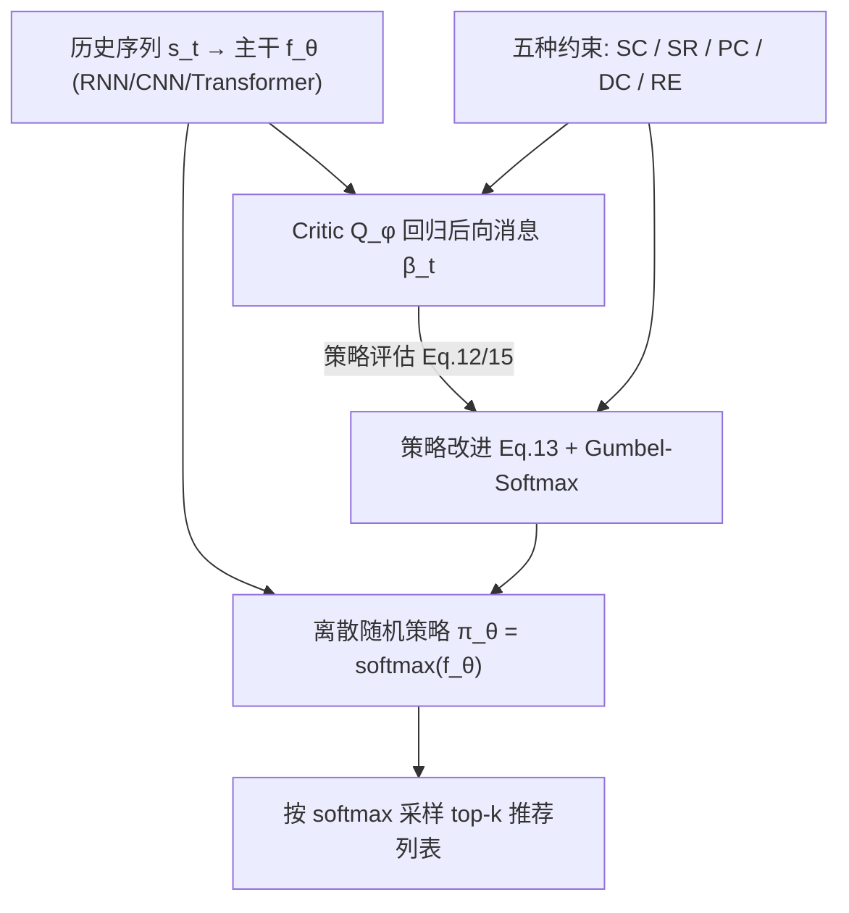
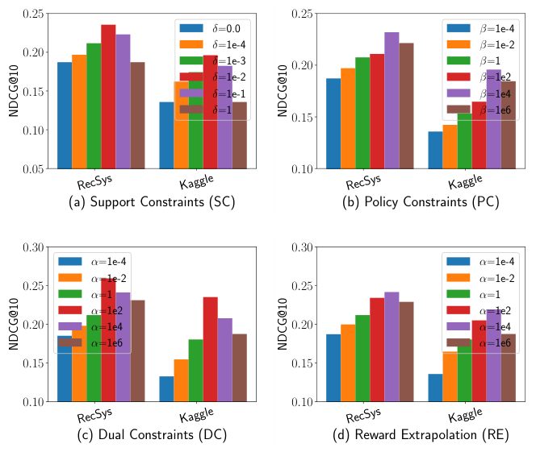

# A General Offline Reinforcement Learning Framework for Interactive Recommendation (面向交互式推荐的通用离线强化学习框架)

- **会议/期刊**: AAAI 2021
- **作者与机构**: Teng Xiao, Donglin Wang（西湖大学 MiLAB / 工程学院 AI 分部）
- **推荐链路定位**: 端到端策略学习（序列推荐决策层，可替代 RNN 序列召回的 next-item 目标）
- **研究方向**: 强化学习与动态探索推荐 / 序列与会话推荐
- **论文原文**: [https://arxiv.org/abs/2310.00678v1](https://arxiv.org/abs/2310.00678v1)
- **开源代码**: 暂未开源

## TL;DR (1分钟核心速览)

离线推荐不能在线探索，而直接套用 DQN/PG 会因**外推误差**与**训练（argmax）测试（softmax top-k）不一致**而大幅掉点。本文把交互推荐写成含"最优性变量"的概率生成模型，用消息传递推出离散随机 Actor-Critic（SDAC），再提出支撑约束、监督正则、策略约束、对偶约束、奖励外推五种手段压缩学习策略与未知日志策略的分布错配。在两个真实数据集、全库 Full-Ranking 协议下，最强变体 DC 相对 SL 在 NDCG@10 上提升 13.8%（RecSys）与 25.2%（Kaggle）。

## Background & Motivation (背景与核心矛盾)

- **主流范式**: 交互推荐被建模为 MDP，早期用 RNN/CNN/Transformer 做序列监督（next-item 交叉熵），或用 DQN、DDPG 直接优化长期累积奖励。
- **前人局限**: (1) **外推误差**——离线数据只覆盖日志策略的支撑集，Q 目标对被高估的 OOD (state, action) 反复自举，误差指数放大；(2) **训练/测试不匹配**——Q-learning 训练用 $\arg\max_a Q$，线上却按$Q/\sum_{a'}Q$ 采 top-k，原则性冲突；(3) **日志策略未知**——反馈来自历史策略混合，IPS 类方法方差随步长指数增长且支撑不足时仍有偏。
- **核心洞察 (Key Insight)**: 若把"动作是否最优"作为二值观测 $O_t$，则策略学习等价于对后验$p(\tau\mid O_{1:T})$的变分推断，其最优解天然是 **softmax 形式的随机策略**，从根上消除 argmax/softmax 错配；而离线病态性可统一表述为$q_\theta(\tau)$与日志分布$\pi_b$ 的 KL 错配，可用多种正则统一治理。
- **本文切入点**: 一套概率推断框架 + 五种可插拔约束项，把"监督信号"与"任务奖励"在同一损失内调和。

## Method (核心方法设计)

### 1. 整体框架 (Overall Architecture)

输入用户历史事件序列构成状态 $s_t$，主干网络$f_\theta(s_t)\in\mathbb{R}^{|\mathcal{A}|}$输出全物品 logit；Actor 给出离散随机策略$\pi_\theta(a_t\mid s_t)$，Critic$Q_\phi$ 通过消息传递的平方误差回归逼近后向消息；二者交替做策略评估与策略改进（Gumbel-Softmax 使离散采样可回传）。离线阶段在 Critic 目标与 Actor 损失上分别注入五种"与日志策略对齐"的正则/约束，最后按 softmax 概率采样生成 top-k 列表。

### 2. 关键设计拆解 (Key Designs)

1. **概率生成模型与离散随机 AC（替代 DQN 的 argmax 病根）**：以 $p(O_t=1\mid s_t,a_t)=\exp(r(s_t,a_t)/\alpha)$（奖励非正、$\alpha$为温度）构造联合分布，变分推断得负 ELBO$L(\theta)=\mathbb{E}_{\tau\sim q_\theta}\big[\sum_t \log q_\theta(a_t\mid s_t)-r(s_t,a_t)/\alpha\big]$。由消息传递递归$\beta_t(s_t,a_t)=p(O_t\mid s_t,a_t)\mathbb{E}_{p(s_{t+1}\mid\cdot)}[\beta_{t+1}]$可得闭式策略$\pi_\theta(a_t\mid s_t)=\frac{\beta_t(s_t,a_t)}{\beta_t(s_t)}\cdot\frac{1}{|\mathcal{A}|}$，取$Q=\alpha\log\beta$ 后即为 softmax 策略——训练与测试同分布，且天然带熵正则（探索）。
2. **对偶约束 DC（把日志策略当先验，抑制多步偏移）**：SR/PC 只约束单步，无法阻止未来步偏离。DC 先用监督学习估计 $\hat{\pi}_b$，把它作为动作先验写入联合分布，得到策略评估$\hat{L}^{dc}_Q$中目标值多出$+\alpha\log\hat{\pi}_b(a_{t+1}\mid s_{t+1})$ 一项，策略改进变为
$L^{dc}_\pi(\theta)=\mathbb{E}_{a_t\sim\pi_\theta}\big[\log\frac{\pi_\theta(a_t\mid s_t)}{\hat{\pi}_b(a_t\mid s_t)}-\frac{Q_\phi(s_t,a_t)}{\alpha}\big]$，
即在**奖励与自举目标两端**同时拉近日志策略，等效于对整条轨迹做信赖域约束。
3. **监督正则 SR / 奖励外推 RE 的取舍与训练目标**：SR 以硬约束 $\mathbb{E}_{s\sim\pi_b}\big[\mathrm{KL}(\pi_b\|\pi_\theta)\big]\le\epsilon$引入拉格朗日乘子$\beta$由对偶梯度下降自适应调整（免去手调$\beta$的量纲问题）；策略约束 PC 则用反向 KL 化简为加权极大似然$L^{pc}_\pi=\mathbb{E}_{\mathcal{D}}[w_t\log\pi_\theta]$，$w_t=-\exp(Q_\phi/\beta)$——无需估计日志策略、也无需 Gumbel 采样。RE 换一种后向消息定义，把约束折进奖励：$\hat{r}=r+\alpha\log\hat{\pi}_b$。训练负采样为**免负采样**（全 softmax 归一化，$|\mathcal{A}|$ 达 2.6万~7万），推理时一次前向即得全物品分布，开销与 SASRec 同级。

## Experimental Setup & Evaluation Protocol (实验设置与评估协议)

- **数据集与预处理**:

| 数据集 | #Sessions | #Items | #Interactions | 稀疏度 | 特征/场景说明 |
| :--- | :---: | :---: | :---: | :---: | :--- |
| RecSys (RecSys Challenge 2015) | 200,000 | 26,702 | 1,110,965 | 每 session 约 5.6 次交互 | 电商点击+购买序列，另有 43,946 条购买信号 |
| Kaggle (RetailRocket) | 195,523 | 70,852 | 1,176,680 | 每 session 约 6.0 次交互 | 真实电商行为；以 add-to-cart 作稀疏信号共 57,269 条 |

- **数据划分与防穿越**: 随机 **80%/10%/10%** 划分 session 序列为 train/valid/test（非全局时间戳切分），超参在验证集调优，每组实验重复 5 次取均值。
- **排名评测协议**: 无偏 **Full-Ranking（全库未交互物品排序）**，报告 HR@{5,10} 与 NDCG@{5,10}；显著性用 paired t-test，$p\le0.01$标$\ast$。
- **对比基线与超参**: SL、DQN、PG(IPS 类 off-policy 梯度)、SL+DQN、SL+PG（多损失拼接）、SDAC（无约束版），以及本文 SC/SR/PC/DC/RE；主干统一为同一 RNN（另以 Caser 式 CNN、SASRec 式 Transformer 复验），以排除主干混淆；$\alpha,\beta,\delta,\epsilon$ 在验证集网格搜索。

## Key Experimental Results (实验关键数据)

### 1. 主实验对比 (Main Results)

RNN 主干、全库排序（H@10 / N@10）：

| 方法 | RecSys H@10 | RecSys N@10 | Kaggle H@10 | Kaggle N@10 |
| :--- | :---: | :---: | :---: | :---: |
| SL (next-item CE) | 0.3793 | 0.2279 | 0.2673 | 0.1878 |
| DQN | 0.3125 | 0.1673 | 0.1965 | 0.1176 |
| PG (IPS) | 0.3218 | 0.1792 | 0.2083 | 0.1212 |
| SL+PG | 0.4013 | 0.2382 | 0.3036 | 0.2118 |
| SDAC (无约束) | 0.3316 | 0.1872 | 0.2173 | 0.1358 |
| SR | 0.4184 | 0.2515 | 0.3153 | 0.2259 |
| PC | 0.3903 | 0.2319 | 0.2941 | 0.1958 |
| RE | 0.4071 | 0.2416 | 0.3085 | 0.2192 |
| **DC (本文最优)** | **0.4217** | **0.2593** | **0.3204** | **0.2351** |
| Improv. vs SL | +11.2% | +13.8% | +19.9% | +25.2% |

### 2. 消融实验 (Ablation Study)

以"逐项叠加约束"视作模块消融（RecSys，RNN），并给出稀疏购买信号与换主干结果：

| 配置 | RecSys H@10 | RecSys N@10 | 购买信号 N@10 | CNN 主干 N@10 |
| :--- | :---: | :---: | :---: | :---: |
| w/o 约束 (SDAC) | 0.3316 | 0.1872 | 0.3012 | 0.1643 |
| + SC | 0.3905 | 0.2356 | 0.3351 | 0.2202 |
| + PC | 0.3903 | 0.2319 | 0.3396 | 0.2214 |
| + SR | 0.4184 | 0.2515 | 0.3516 | 0.2311 |
| + RE | 0.4071 | 0.2416 | **0.3527** | 0.2371 |
| **+ DC** | **0.4217** | **0.2593** | **0.3587** | **0.2413** |

### 3. 关键实验发现 (Key Findings)

1. **外推误差是主要矛盾而非模型容量**：DQN/PG 在完全相同的 RNN 主干下比 SL 低 13~20 个点（N@10 0.1673 vs 0.2279），而仅把 argmax 换成 softmax 随机策略（SDAC）就能回升到 0.1872；再叠加任一分布约束，SR/DC 反超 SL 11~14%，说明**收益几乎全部来自分布对齐项**。
2. **约束要看"未来步"而非"当前步"**：DC 把 $\hat{\pi}_b$ 注入自举目标后，在稀疏购买信号上相对 SR 由 0.3516→0.3587（N@10），且 RE（奖励外推）在该稀疏设定下反超 SR（0.3527 vs 0.3516），验证多步偏移控制对稀疏反馈尤其关键。
3. **超参实质是"监督信号 vs 任务奖励"的旋钮**：SR 用对偶梯度自适应更新 $\beta$（目标$\epsilon=1$）一致优于任何固定$\beta\in\{0.01,0.1,1,10\}$；DC/RE 的$\alpha$在$10^{-2}\sim10^{2}$ 区间最稳，两端分别退化为纯 SL 与纯 RL，性能显著下滑，证明二者必须调和。

<figure class="paper-figure" markdown="span">
  <figcaption>图2：在两个数据集上改变四种方法的权衡参数时NDCG的性能比较。</figcaption>
</figure>

## Highlights & Limitations (亮点、对比与审稿批判)

- **与代表作对比 (vs. Prior Work)**: 相较 IPS 类 off-policy 梯度（PG）与 SL+PG 多损失拼接，本文给出**单一可推导的 ELBO 目标**而非启发式加和，且显式处理离散大动作空间与未知日志策略；相较 DQN/DDPG 类推荐 RL，本文用随机 softmax 策略直接消除训练/测试错配，并首次系统对比五种离线正则。
- **可迁移亮点**: (1) 把"日志策略作动作先验写入自举目标 $+\alpha\log\hat{\pi}_b$"这一招可低成本移植到任意离线 RL/生成式召回的奖励塑形；(2) Gumbel-Softmax 蒸馏大 Critic 到小 Actor 的做法，可用于大词表 softmax 的推理降本。
- **审稿级局限批判**: (1) 评测仅用 HR/NDCG 代理长期奖励，**未做真正反事实/离线策略评估（IPS、DM）或线上 A/B**，"最大化累积奖励"的主张缺乏直接证据；(2) DC/RE 依赖监督学习估计 $\hat{\pi}_b$，其精度未做敏感性分析，且随机 80/10/10 划分会破坏时序性、可能引入未来信息泄漏；(3) 仅两个电商数据集、无用户侧特征与冷启动分析，$\alpha$与$\epsilon$ 的跨数据集可迁移性存疑。

## Rating (四维评分)

- **方法创新性 (Novelty)**: ⭐⭐⭐⭐ （用最优性变量 + 消息传递统一解释 softmax 随机策略与五类约束，理论起点清晰，但五种正则多为已有离线 RL 技巧的适配移植）
- **评估协议与实验扎实度 (Protocol & Experiments)**: ⭐⭐⭐ （Full-Ranking 全库排序、5 次重复与 $p\le0.01$ 检验到位，但缺反事实评估、线上验证与日志策略估计误差分析）
- **写作与数学规范度 (Clarity & Rigor)**: ⭐⭐⭐⭐ （生成模型→ELBO→消息传递→五种约束的推导链条连贯，符号一致；部分推导置于附录、DC 与 RE 的后向消息定义差异解释略简）
- **工业落地与复现价值 (Industrial & Practical Value)**: ⭐⭐⭐ （免负采样、单次前向出全库分布、可直接替换序列召回训练目标；但未开源、DC 需额外训练日志策略模型，线上收益仍待验证）

