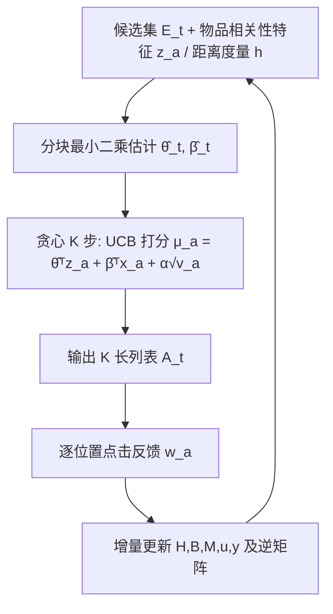
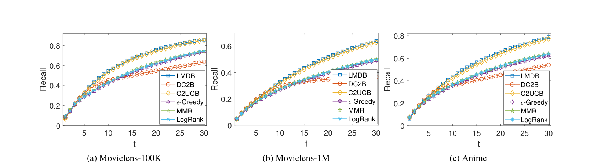
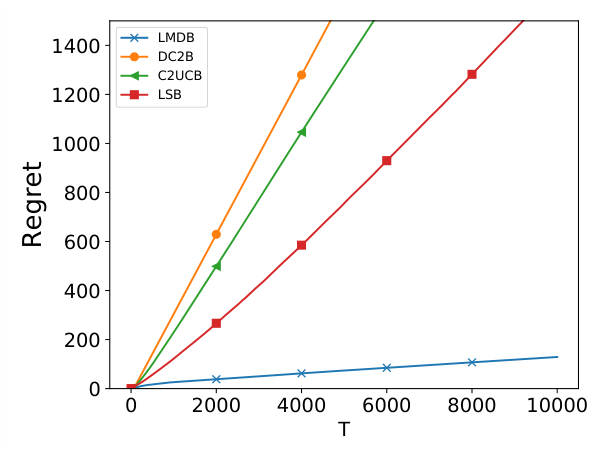

# A Hybrid Bandit Framework for Diversified Recommendation (混合 Bandit 框架驱动的多样化推荐)

- **会议/期刊**: AAAI 2021
- **作者与机构**: Qinxu Ding, Yong Liu, Chunyan Miao, Fei Cheng, Haihong Tang（阿里巴巴-南洋理工联合研究院 / 南洋理工大学 LILY 中心 / 阿里巴巴集团）
- **推荐链路定位**: 重排（列表级集合选择，在线交互式推荐）
- **研究方向**: 强化学习与动态探索推荐（RL, Bandits & Long-Term Engagement）
- **论文原文**: [https://arxiv.org/abs/2012.13245v1](https://arxiv.org/abs/2012.13245v1)
- **开源代码**: 暂未开源

## TL;DR (1分钟核心速览)

现有交互式推荐 bandit 方法只学用户对「单个物品相关性」的偏好（LinUCB/C²UCB/LSB），或把多样性当作与用户无关的固定正则（DPP、熵正则），忽略了**不同用户对列表多样性的偏好本身是异质的**。本文提出 LMDB 框架：用模块函数（modular）刻画相关性、散度函数（dispersion）刻画列表多样性，将二者加权和作为列表效用，并用 LMDH 算法（分块最小二乘估计 + 贪心 + UCB 探索）在线学习用户偏好向量。理论上给出 $\tilde{O}(K(d+m)\sqrt{n}/\gamma)$ 的无间隙 regret 上界；在 ML-100K/ML-1M/Anime 三套数据的 30 轮模拟交互中，Recall 全程第一、F2-score 全程最优，多样性稳居前三。

## Background & Motivation (背景与核心矛盾)

- **主流范式**: 交互式推荐以 contextual bandit 逐轮推荐列表并回收隐式反馈；多样化推荐则多用 MMR、DPP、熵正则等次模（submodular）函数在离线阶段做贪心重排。
- **前人局限**: ① bandit 系方法（LinUCB、C²UCB、DC2B、LSB）把多样性视为**与用户无关**的集合属性，无法区分"兴趣明确的用户偏好高相关列表"与"兴趣模糊的用户偏好高多样列表"；② DPP 核与熵正则需 $O(K^2)$ 甚至矩阵行列式计算，在线逐轮更新代价高，且难以嵌入线性 bandit 的置信区间分析。
- **核心洞察 (Key Insight)**: 散度函数（dispersion）的计算只需两两距离求和，天然具备**局部线性增量**：加入物品 $a$的边际增益$\eta^{\top}\Delta(a|A)$对偏好向量$\eta$ 是线性的，因此偏好可学习、置信区间可解析、贪心有近似保证。
- **本文切入点**: 把「相关性（模块函数）+ 多样性（散度函数）」统一成一个线性可学习的列表效用，用一次 bandit 学习同时估计 $\theta$（相关性偏好）与$\beta$（多样性偏好）。

## Method (核心方法设计)

### 1. 整体框架 (Overall Architecture)

每轮 $t$给定候选集$E_t$，LMDH 先用历史反馈估计$\hat\theta_t,\hat\beta_t$（分块最小二乘，利用矩阵块求逆把$\theta$与$\beta$解耦）；再以贪心方式逐个挑$K$个物品，每步对每个候选计算"相关性得分 + 多样性边际增益 + UCB 探索奖励"；展示列表后收集逐条点击奖励，增量更新统计量$H_t,B_t,M_t,u_t,y_t$ 及其逆矩阵，进入下一轮。整条链路无需训练深度网络，推理仅需矩阵-向量乘。

### 2. 关键设计拆解 (Key Designs)

1. **模块–散度混合效用（Modular + Dispersion Utility）**：针对"相关性可加、多样性依赖集合内部对比"这一结构差异，把列表效用定义为
   $F(A|\eta)=\sum_{i=1}^{d}\theta_i R_i(A)+\sum_{i=1}^{m}\beta_i V_i(A)$，其中$R_i(A)=\sum_{a\in A}R_i(a)$为模块函数，$V_i(A)=\sum_{\{i,j\}\in A}h_i(i,j)$为散度函数。关键性质是**边际增益局部线性**：加入$a$的增量为$\eta^{\top}\Delta(a|A)$，$\Delta(a|A)=\langle\Delta R(a|A),\Delta V(a|A)\rangle$，$\Delta V(a|A)=\langle\sum_{j\in A}h_1(a,j),\dots\rangle$。这使得"多样性也可写成线性 bandit 形式"，从而可估、可界。
2. **贪心近似与 1/4 保证（Algorithm 1）**：直接最大化 $F$是 NP-hard 的组合优化。作者证明：若$\theta^{\top}\langle R_1(a),\dots\rangle\ge 0$且$\beta\ge 0$，则对$F$本身做贪心（而非前人"非 oblivious"贪心）可得$F(A_{\text{greedy}}|\eta)\ge \tfrac14 F(A^*|\eta)$，即$\gamma=1/4$。
3. **LMDH 的 UCB 与计算复杂度**：对物品 $a$定义拼接特征$\zeta_a=[z_a^{\top},x_a^{\top}]^{\top}$，其置信半径按分块求逆展开为
   $v_a=z_a^{\top}H_t^{-1}z_a-2z_a^{\top}H_t^{-1}B_tM_t^{-1}x_a+x_a^{\top}M_t^{-1}x_a+x_a^{\top}M_t^{-1}B_t^{\top}H_t^{-1}B_tM_t^{-1}x_a$，
   打分 $\mu_a=\hat\theta_t^{\top}z_a+\hat\beta_t^{\top}x_a+\alpha\sqrt{v_a}$。每步复杂度$O(LK(d^2+m^2+md))$，通过维护$H_t^{-1},M_t^{-1}$（而非原始矩阵）把求逆降到$O(d^2+m^2)$，适合在线更新。**训练无需负采样**（bandit 反馈即标签），regret 为$\mathcal{R}_\gamma(n)\le \frac{2\alpha K}{\gamma}\sqrt{\frac{\sqrt{n}(d+m)\log[1+nK(d+m)/\lambda]}{\lambda\log(1+1/\lambda)}}+nK\delta$，取$\lambda=1,\delta=1/(nK)$即$\tilde{O}(K(d+m)\sqrt{n}/\gamma)$。

## Experimental Setup & Evaluation Protocol (实验设置与评估协议)

- **数据集与预处理**: 正反馈阈值 ML-100K/ML-1M 取 rating $>3$，Anime 取 rating$>6$（无 5-core 过滤）。

| 数据集 | #Users | #Items | #Interactions | 稀疏度/密度 | 特征/场景说明 |
| :--- | :---: | :---: | :---: | :---: | :--- |
| ML-100K | 942 | 1,447 | 55,375 | 4.06% | 18 类，电影 |
| ML-1M | 6,038 | 3,533 | 575,281 | 2.70% | 18 类，电影 |
| Anime | 69,400 | 8,825 | 5,231,117 | 0.85% | 44 类，动画 |

- **数据划分与防穿越**: **用户级冷启动划分**——随机取 80% 用户训练、20% 用户测试（测试用户完全不参与 BPRMF 训练）。物品特征 $z_a$由 BPRMF（$d=10$，归一化到$[-1,1]^{10}$）在训练集上学得后**冻结**作为相关性特征，避免特征穿越。
- **排名评测协议**: 采用**无偏离线评估**（Li et al. 2011）：每轮候选集 $E_t$= 全集减去前$t-1$轮已推荐物品（渐进式候选消除，非固定采样负例）；$K=|A_t|=10$，共 30 轮。奖励并非真实点击，而是由冻结特征下的用户偏好模拟生成（伪在线）。
- **指标**: $\text{Recall}(t)$（累计命中/测试交互数）、$\text{Diversity}(t)$（平均两两 Cosine 距离$=\frac{2}{K(K-1)}\sum(1-\text{sim}(z_i,z_j))$），以及调和折中$\text{F}_\beta(t)$（$\beta=1,2$；$\beta=2$ 表示 Recall 权重加倍）。
- **基线**: LogRank、MMR（$\alpha=0.9$）、$\epsilon$-Greedy（$\epsilon=0.05$）、C²UCB（$\lambda_0=100,\lambda=0.1,\sigma=1$）、DC2B（$\alpha=3,\lambda=1$）；模拟数据集另加 LSB。LMDB 取$\lambda=50,\alpha=1$。原文以曲线呈现，未报告显著性检验。

## Key Experimental Results (实验关键数据)

### 1. 主实验对比 (Main Results)

原文仅以曲线（图 1–6）报告结果，下表为 30 轮收敛后的**相对排序**汇总（"—" 表示原文未给出具体数值，不做臆造）：

| 方法 | Recall (30 轮末) | Diversity | F1-score | F2-score |
| :--- | :---: | :---: | :---: | :---: |
| LogRank | 低 | 最低 | 低 | 低 |
| MMR | 中低 | 中 | 中 | 中 |
| $\epsilon$-Greedy | 中 | 高 | 中高（Anime 上接近 LMDB） | 中 |
| C²UCB | 中高（后段追赶） | 中低 | 中 | 中 |
| DC2B | 前 5 轮有效，后段下滑 | 前 15 轮较高 | 中 | 中 |
| **LMDB (本文)** | **最优（全 30 轮全数据集）** | **前三（稳定优于 C²UCB）** | **最优 / 可比** | **最优（全数据集）** |

<figure class="paper-figure" markdown="span">
  <figcaption>图1：不同方法在Recall指标下的推荐性能。</figcaption>
</figure>

### 2. 消融实验 (Ablation Study)

原文无组件式消融，代之以超参敏感性 + 模拟 regret + 贪心近似比验证：

| 分析项 | 设置 | 结果 |
| :--- | :--- | :--- |
| 正则 $\lambda$|$0.1\sim 10^3$|$\lambda\ge 1$ 后 F1 曲线几乎重合（不敏感） |
| 探索 $\alpha$|$0.01\sim 10$ | 同样不敏感，鲁棒 |
| 列表长 $|A_t|$ | 5 / 10 / 15 | 各设置下 F1 均优于 C²UCB 与 DC2B |
| 模拟 regret（$T=10^4$） | vs. C²UCB / DC2B / LSB | LMDB 曲线**最早趋于平坦且 regret 最小** |
| 贪心近似比 (vs. 穷举) | $K=2,3,4,5$|$0.9995/0.9992/0.9989/0.9971$，远优于理论值$0.25$ |

<figure class="paper-figure" markdown="span">
  <figcaption>图5：不同bandit方法在模拟数据集上的Regret。</figcaption>
</figure>

### 3. 关键实验发现 (Key Findings)

1. **收益主要来自"个性化多样性偏好"这一自由度**：在 $\beta=2$（更看重准确率）的 F2 指标上，LMDB 在三个数据集、全部 30 轮均排名第一，而$\beta=1$时 Anime 上仅与$\epsilon$-Greedy 持平——说明 LMDB 的优势不是"更激进地多样化"，而是在保证准确率前提下"按用户调节多样化程度"。
2. **DC2B 的时间衰减是结构性的**：DPP + Thompson sampling 在前 5 轮 Recall 领先，但随轮数增加被反超，反映贝叶斯后验在 $K^2$核计算约束下更新效率不足；而 LMDB 的$O(d^2+m^2)$ 增量逆更新使 30 轮内持续累积优势。
3. **理论近似比严重保守**：贪心实测近似比 $0.9971\sim0.9995$（$K\le 5$），远高于定理 1 的 1/4，提示"模块+散度"在真实特征分布下几乎可精确贪心求解，为工程上直接使用贪心提供了信心。

## Highlights & Limitations (亮点、对比与审稿批判)

- **与代表作对比 (vs. Prior Work)**: 与 C²UCB（熵正则，多样性无个性化）相比，LMDB 让 $\beta$ 进入可学习参数；与 DC2B（DPP + 全贝叶斯）相比，用散度函数替换行列式核，把每步代价从核矩阵运算降到矩阵-向量乘，并给出显式无间隙 regret；与 LSB（线性次模 bandit）相比，LMDB 允许同时建模多个相关性属性与多个距离度量，且不要求预先固定多样性权重。
- **可迁移亮点**: ①"边际增益局部线性"这一技巧可迁移到任何集合级目标（如覆盖度、新颖度、EE 指标）的 bandit 化；②分块求逆把高维偏好拆成两个低维最小二乘，可用于解耦多目标在线学习。
- **审稿级局限批判**: ①**奖励是模拟的**——点击由同一套 BPRMF 特征与人工偏好生成，"无偏评估"实质是 self-consistent 仿真，缺少真实线上 A/B，泛化性存疑；②多样性仅用单一平均 Cosine 距离度量且距离张成空间与相关性特征同源（都来自 $d=10$的 BPRMF 向量），削弱了"多样性独立于相关性"的论证力度；③需要$\alpha$满足含$d+m$、$n$、$K$的显式下界才成立，理论保证对大规模$L$与$K$ 的常数项缺乏刻画；④Anime 上候选集被裁剪为 1,000 个最热物品，长尾多样性收益未被验证。

## Rating (四维评分)

- **方法创新性 (Novelty)**: ⭐⭐⭐⭐ （首次把散度函数引入 contextual combinatorial bandit，用"边际增益局部线性"打通个性化多样性与线性 UCB 分析，思路干净且非拼凑）
- **评估协议与实验扎实度 (Protocol & Experiments)**: ⭐⭐⭐ （用户级冷启动划分与渐进候选消除合理，但奖励为特征模拟、无真实反馈、无显著性检验，且仅以曲线呈现无量化表）
- **写作与数学规范度 (Clarity & Rigor)**: ⭐⭐⭐⭐ （定理 1/2 与附录证明完整，regret 分解清晰；不足是分块求逆推导被省略、$F$中$\theta^\top R\ge0$ 假设的实际含义讨论偏浅）
- **工业落地与复现价值 (Industrial & Practical Value)**: ⭐⭐⭐ （每步 $O(LK(d^2+m^2+md))$、增量逆更新友好，易嵌入现有重排服务；但无开源代码，且多样性度量需预先设计距离核，冷启动物品的特征质量强依赖 BPRMF）

