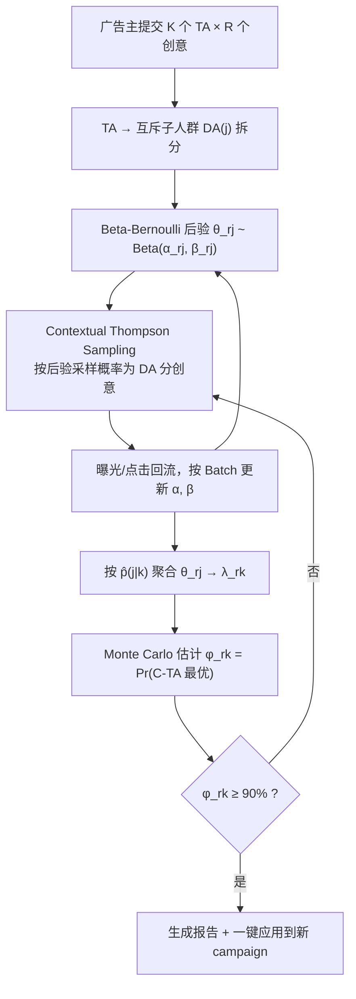
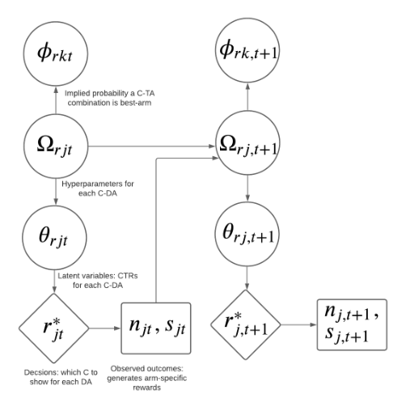

# Comparison Lift: Bandit-based Experimentation System for Online Advertising (对比提升：面向在线广告的 Bandit 实验系统)

- **会议/期刊**: AAAI 2021 (原文 2020-09 arXiv 预印)
- **作者与机构**: Tong Geng, Xiliang Lin, Harikesh S. Nair, Jun Hao, Bin Xiang, Shurui Fan（京东 JD.com；Stanford University）
- **推荐链路定位**: 广告创意/人群投放决策层（实验与流量分配，位于召回-精排之上、campaign 配置之下）
- **研究方向**: 强化学习与动态探索推荐 / 去偏公平与工业架构
- **论文原文**: [https://arxiv.org/abs/2009.07899v1](https://arxiv.org/abs/2009.07899v1)
- **开源代码**: 暂未开源

## TL;DR (1分钟核心速览)

在线广告主面临"创意 × 目标人群"组合爆炸，而现有 EaaS 工具几乎都是固定样本 A/B/n 分流：把流量均摊到已被证伪的劣质创意上，实验成本高；且多个人群定义天然重叠，用户无法唯一归属，样本失去总体代表性。Comparison Lift 将重叠目标人群（TA）拆成互斥子人群（DA），在 DA 上以创意为 arm、广告主收益为 reward 跑 Batch 级 Contextual Thompson Sampling，再用 $\hat{p}(j|k)$ 聚合回 TA 层、Monte Carlo 估计每个 C-TA 的最优后验概率并给出停止规则。线上 1,547 次实验中，自适应设计使测试期点击数平均 +27%，最优组合相对"盲选"使 CTR 平均 +46%。

## Background & Motivation (背景与核心矛盾)

- **主流范式**: 工业界广告实验产品（Google Optimize、Facebook A/B Test、Amazon ELC、腾讯分流测试）以固定样本 A/B/n split-test 为主，各 arm 全程等额分流，测试结束再做频率派假设检验。
- **前人局限**: ①资源浪费——均分流量意味着劣质创意烧掉与最优创意相同的预算，且实验必须在达到固定样本量后才能收敛，广告主的"机会成本"高；②重叠人群不可赋值——广告主常用嵌套定义（如"近半年买过 Nike"⊂"近 3 天浏览鞋类页"），一个用户同时属于多个 TA，直接比较重叠 TA 会造成样本非代表性与数据欠利用。
- **核心洞察 (Key Insight)**: 作者在实践中观察到，广告主对"哪套创意/人群更好"的先验知识远弱于教科书假设（案例中最优与最差组合 CTR 相差 97%），广告投放本身就应被建模为**不确定性下的序贯决策**；因此实验的随机化机制应与广告主的收益目标同构，而非以"无偏测量"为唯一目的。
- **本文切入点**: 用互斥子人群 DA 消解 TA 重叠这一"赋值难题"，把探索粒度下沉到 DA（学得更快、匹配更细），把交付粒度留在 TA（结论可解释、可直接下单），从而在同一算法里同时兼顾"降低实验成本"与"对齐广告主目标"。

## Method (核心方法设计)

### 1. 整体框架 (Overall Architecture)

广告主提交 $K$个目标人群（TA）与$R$个创意；系统先用平台侧人群特征把$K$个 TA 划分为$J$个互斥子人群（DA），保证任一用户$i$唯一落入某个$j$。随后为每个 C-DA 组合$(r,j)$建立 Beta-Bernoulli 共轭后验，按 Batch（典型 10 分钟）执行 Contextual Thompson Sampling：依据"该创意在当前 DA 上期望收益最高"的后验概率分配流量，Batch 结束用曝光/点击日志回流更新后验。并行地，用平台总体分布$\hat{p}(j|k)$把 DA 级 CTR 聚合成 TA 级$\lambda_{rkt}$，Monte Carlo 采样估计每个 C-TA 组合"最优"的后验概率$\phi_{rkt}$，越过阈值即通知广告主并生成可一键复用的报告。

<figure class="paper-figure" markdown="span">
  <figcaption>图1：算法示意图</figcaption>
</figure>

### 2. 关键设计拆解 (Key Designs)

1. **TA→DA 互斥拆分（解重叠赋值难题）**：痛点来自重叠人群无法给用户唯一上下文，导致一个曝光可能被多个 arm 重复记账。本文把 $K$个 TA 划分为互斥集$\mathcal{J}=\{1,\dots,J\}$，用户$i$的上下文由其特征唯一决定$i\in \mathrm{DA}(j)$，bandit 直接在 DA 上学习。由于同一 TA 下所有 DA 的样本共同为该 TA 的估值提供信息（"数据池化"），学习被显著加速；同时 DA 更细的粒度让创意与用户偏好匹配得更准。

2. **收益对齐的 Beta-Bernoulli TS（把"点击"换成"利润"）**：把点击指示 $y_{irj}\sim \mathrm{Ber}(\theta_{rj})$配共轭先验$\theta_{rj}\sim \mathrm{Beta}(\alpha_{rj},\beta_{rj})$，广告主单次曝光收益定义为$\pi_{irj}=\gamma y_{irj}-b_{irj}$，对应期望收益
   $$\mu^\pi_{rj}(\theta_{rj})=\gamma\theta_{rj}-\bar{b}_{rj}.$$
   第 $t$个 Batch 中创意$r$ 在该上下文被选中的概率为
   $$w_{rjt}=\Pr\!\left[\mu^\pi_{rj}(\theta_{rjt})=\max_{r\in\mathcal{R}}\mu^\pi_{rj}(\theta_{rjt})\,\middle|\,\vec{\alpha}_{jt},\vec{\beta}_{jt}\right].$$
   直觉上，把"收益"而非"CTR"写进采样权重，使探索方向与广告主真实效用同向；共轭结构则保证后验更新为闭式加法，适配高并发实时服务。

3. **后验聚合到 C-TA 层 + MC 停止规则**：DA 级只服务于探索，交付结论必须回到 TA 层。以 $\lambda_{rkt}=\sum_{j\in O(k)}\theta_{rjt}\cdot\hat{p}(j|k)$聚合得到 TA 级 CTR，再由$H$ 次后验采样估计
   $$\phi_{rkt}=\frac{1}{H}\sum_{h=1}^{H}\mathbb{I}\!\left[\omega^\pi_{rkt}(\lambda^{(h)}_{rkt})=\max_{r\in\mathcal{R},k\in\mathcal{K}}\omega^\pi_{rkt}(\lambda^{(h)}_{rkt})\right],$$
   越过阈值（90%）即生成报告。这里的物理直觉是：用"最优概率"替代 p 值，天然支持**边跑边看、随时停止/重启**，而固定样本频率派框架下这种 peek 会造成显著性膨胀。

**损失与更新、推理开销**：无显式梯度损失，"训练"即按 Batch 的闭式后验更新 $\vec{\alpha}_{j(t+1)}=\vec{\alpha}_{jt}+\vec{s}_{jt}$、$\vec{\beta}_{j(t+1)}=\vec{\beta}_{jt}+\vec{n}_{jt}-\vec{s}_{jt}$，其中$s_{rjt}=\sum_{i=1}^{n_{rjt}}y_{irjt}$。整条链路**免负采样**、无 embedding 训练；在线单请求开销仅为按 DA 查后验 + 一次采样，主成本在 Batch 聚合与$H$次 MC（服务于报表而非 serving）。工程上要求$K\le 5,R\le 5$（即 ≤25 arms），因为 DA 数随$K$ 组合爆炸而线性抬高探索成本。

## Experimental Setup & Evaluation Protocol (实验设置与评估协议)

- **数据集与预处理**: 本文是工业系统论文，**无公开离线基准**；评估载体为 2019-05 至 2020-06 期间线上真实运行的 1,547 次实验（含 Samsung 案例）。产品侧硬约束：同一实验的 TA 与创意共享同一出价、关闭智能出价、实验期间不得改配置。

| 统计口径 | 数值 | 说明 |
| :--- | :---: | :--- |
| 实验总数 (2019-05 ~ 2020-06) | 1,547 | 月均约 110 次，2020-02 因春节+疫情下滑 |
| 每次实验创意数 (均值) | 2.42 | 上限 5 |
| 每次实验目标人群数 (均值) | 3.78 | 上限 5，DA 数由重叠结构决定 |
| 实验持续时长 (均值) | 5.20 天 | Batch 粒度 10 分钟 |
| 结束时最优 arm 后验概率 (均值) | 73.7% | 显著低于系统设定的 90% 通知阈值 |
| Value of Experimentation (均值) | **1.46** | 极值可达 2.75 |
| Value of Adaptive Design (均值) | **1.27** | 多创意实验子集中可 >1.6 |

- **数据划分与防穿越 (Splitting Strategy)**: 不是离线切分，而是**线上随机对照试验（RCT）+ 反事实模拟**。两个核心指标的构造方式是：`Value of Exp.` = 最优组合 CTR ÷ 各被测组合 CTR 的均值（假设无实验时广告主在 $R\times K$ 个选项中均匀盲选）；`Value of Adaptive` = 实测点击数 ÷ 反事实点击数，后者通过"把各 DA 的用户在各创意间等额重分配、套用实测 C-DA CTR"模拟得到。**防穿越的关键筛选**：只统计结束时最优组合后验概率 > 90% 的实验，并剔除任一 C-TA 组合曝光 < 1,000 次的实验，以压低 CTR 噪声。
- **排名评测协议 (Ranking Protocol)**: 该论文的"排序"是**组合级最优识别**而非 top-N 推荐排序，因此无 Full-Ranking / Sampled Ranking 之分；等价协议是"给定后验，报告每个 C-TA 为最优的概率 $\phi_{rkt}$ 并做阈值判定"，理论上对应最小化期望 regret 的最优 arm 识别（best-arm identification）。
- **对比基线与超参设置**: 主对照为**固定样本 A/B/n 等额分流**（同一批 DA 用户均分到各创意）；案例研究另给出"6 个组合均匀盲选"的无实验反事实。超参直接对应业务量：$\gamma$（点击→金额换算因子）、$\bar{b}_{rj}$、$\hat{p}(j|k)$均可由历史数据预计算或在测试中用 bin estimator 在线估计并固定；先验取扩散先验$\alpha_{rj,1}=\beta_{rj,1}=1$（即初始 CTR 在$[0,1]$上均匀）；停止阈值 90%，MC 采样$H$ 次。原文未做显著性检验报告（工业论文惯例），结论以均值统计与直方图分布支撑。

## Key Experimental Results (实验关键数据)

### 1. 主实验对比 (Main Results)

以三星（Samsung）案例（2 个重叠 TA → 3 个 DA，3 个创意，共 6 个 C-TA 组合）与全网 1,547 次实验的聚合指标为主表：

| 方案 | 测试期点击数 (相对) | 广告主所得 CTR (相对) | 最优组合识别置信度 | 说明 |
| :--- | :---: | :---: | :---: | :--- |
| 无实验（$6$ 组合均匀盲选） | 1.00 | 1.00（6 组合 CTR 均值） | — | 广告主凭经验选型 |
| 固定样本 A/B/n（等额分流） | 1.00（基准） | ≈ 1.00 组合均值 | 需跑满固定样本 | 劣质 arm 全程占用同等流量 |
| **Comparison Lift (DA + TS)** | **1.27** (`+27%`) | **1.46** (`+46%`) | **99.91%**（案例） | 案例中 Test-level 亦达 1.4 / 1.17 |
| 案例：最优 vs 最差组合 | — | 3.94% vs 2.00% (`+97%`) | — | 说明组合间差异极大，实验价值高 |

### 2. 消融实验 (Ablation Study)

系统级"消融"以反事实重分流实现，而非逐模块删减：

| 配置 (w/o 某组件) | 测试期点击数 | 广告主 CTR | 结论指向 |
| :--- | :---: | :---: | :--- |
| w/o 自适应（退化为固定 A/B/n 均分） | 1.00 | ≈1.00 | 损失全部 27% 收益 |
| w/ DA 拆分（完整模型） | **1.27** | **1.46** | 完整配置 |
| w/o TA→DA 拆分（直接对重叠 TA 赋值） | 无法唯一赋值，样本非代表性 | — | 数据欠用/偏置（引 Geng et al. 2020） |
| w/o 收益对齐（仅最大化 CTR，忽略 $b_{rj}$） | — | 探索方向偏离广告主效用 | 采样权重失真 |
| 提前停止（平均 73.7% 而非 90% 时结束） | 探索不足，未识别真最优 arm | — | 落地主要风险 |

### 3. 关键实验发现 (Key Findings)

1. **自适应性本身就是最直接的钱**：同一批曝光下，TS 分流比等额分流多产生 27% 的点击（`Value of Adaptive = 1.27`，多创意子集中可 >1.6），意味着"实验成本"被压缩近三成——这是把 bandit 引入实验设计的最大单一收益项，且无需任何模型侧精度提升即可获得。
2. **广告主先验知识远比假设的差，因此测量产品的价值上限很高**：`Value of Experimentation` 均值 1.46、上界 2.75；三星案例中最优组合 CTR 3.94% 是最差组合 2.00% 的近两倍（+97%）。这说明组合间的真实效用差异巨大，"帮广告主找到最优"比"无偏估计处理效应"更值钱。
3. **"边跑边看"是系统性行为，探索不足是真实落地的头号风险**：系统设 90% 阈值才通知，但 1,547 次实验结束时最优 arm 平均后验概率仅 **73.7%**，且不少实验因预算不足被动中断——两者都导致 bandit 在真最优 arm 被识别前就被叫停，从而系统性低估产品价值。这也反向证明贝叶斯后验式推断（可随时停止/重启）比固定样本频率派假设检验更适合该场景。

## Highlights & Limitations (亮点、对比与审稿批判)

- **与代表作对比 (vs. Prior Work)**: ①相对 Google Optimize / Facebook A/B Test / Amazon ELC / 腾讯分流测试等固定样本 EaaS，本文是**唯一把随机化目标从"无偏测量"改成"广告主收益最大化"**的产品级实现；②相对经典 Contextual Bandit / LinUCB 类学术工作，本文的增量不在于新 bandit 算子（算法本身见 Geng, Lin & Nair 2020），而在于 **TA→DA 拆分—DA 级探索—TA 级聚合** 这一"细粒度探索、粗粒度交付"的双层结构，解决了重叠人群的赋值难题；③相对已有的重叠人群实验纠正方法，本方案无需事后重加权即可在服务时实时完成。
- **可迁移亮点**: (a) "重叠受众→互斥子群体→臂级探索→群体级聚合"的套路可直接迁移到多场景推荐（同一用户同时属于首页/搜索/信息流多个场景）与分层 A/B 实验；(b) 以"最优概率 $\phi$ + MC 单调阈值"作为停止与上线判据，可替代 p 值，天然支持在线看板式 peek 与随时中止。
- **审稿级局限批判**: ①**评估缺离线性与算法间对照**——全文没有公开数据集，也没有与 UCB、LinUCB、非参数 bandit、固定样本序贯检验（如 mSPRT）的定量对比，"27%/46%" 均建立在反事实模拟（等额重分流）之上，模拟假设本身未被验证；②**规模与目标函数受限**——$K,R\le 5$（≤25 arms）是硬性产品约束，DA 数随 TA 重叠组合爆炸而指数增长，作者也承认需引入 payoff 的 logistic/probit 参数化或 SMC 才能扩展；③**目标单一且反馈即时**——仅优化 CTR 派生的瞬时收益，转化/收入存在延迟反馈，受曝光影响的目标无法被 bandit 及时吸收，且$\gamma$、$\hat{p}(j|k)$ 依赖外部估计并在实验期固定，存在设定误差风险。

## Rating (四维评分)

- **方法创新性 (Novelty)**: ⭐⭐⭐ （核心如 TA→DA 拆分的双层探索-交付结构有巧思，但 bandit 算子本身沿用既有 Contextual TS，属系统级组合创新而非算法突破）
- **评估协议与实验扎实度 (Protocol & Experiments)**: ⭐⭐⭐ （线上 1,547 次真实实验规模罕见、反事实构造清晰，但缺乏离线基准、算法间对照与显著性检验，结论高度依赖模拟假设）
- **写作与数学规范度 (Clarity & Rigor)**: ⭐⭐⭐⭐ （Beta-Bernoulli 共轭、DA→TA 聚合、MC 最优概率三组公式定义完整且环环相扣，工程与算法叙述衔接清楚；部分符号（$O(k)$ 与 DA 映射）可再显式化）
- **工业落地与复现价值 (Industrial & Practical Value)**: ⭐⭐⭐⭐⭐ （完整给出 UI 接入、Retrieval/Ad Server/Aggregator/Bandit DB 的实时链路与延迟约束，1,547 次实验的运营数据与踩坑教训可直接复用；不足是未开源）

