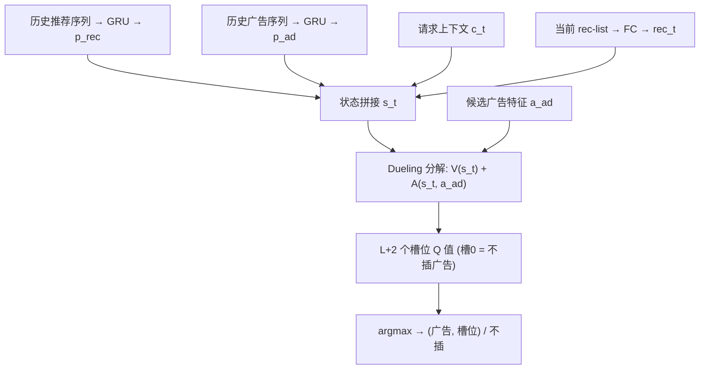
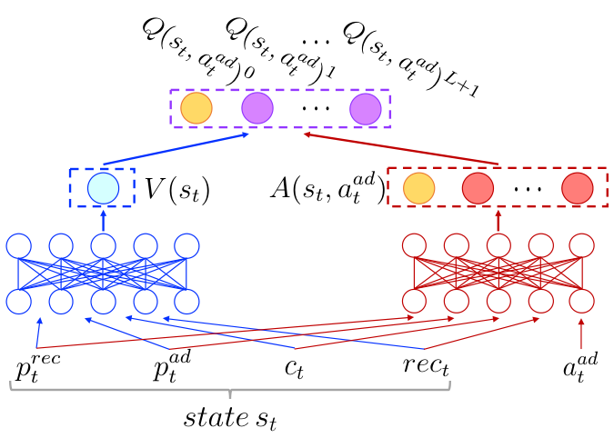

# DEAR: Deep Reinforcement Learning for Online Advertising Impression in Recommender Systems (面向推荐系统的在线广告曝光深度强化学习框架)

- **会议/期刊**: AAAI 2021
- **作者与机构**: Xiangyu Zhao, Jiliang Tang, Hui Liu (Michigan State University)；Changsheng Gu, Haoshenglun Zhang, Xiwang Yang, Xiaobing Liu (ByteDance)
- **推荐链路定位**: 重排（推荐列表内的广告混排/位次决策）
- **研究方向**: 强化学习与动态探索推荐 / 多任务学习与列表级重排
- **论文原文**: [https://arxiv.org/abs/1909.03602v3](https://arxiv.org/abs/1909.03602v3)
- **开源代码**: 暂未开源

## TL;DR (1分钟核心速览)

推荐列表里插广告是典型的「插多了伤体验、插少了少赚钱」的两难：既有 RL 广告工作只优化广告收入，且经典 DQN 架构只能处理单一层级动作（选广告 或 选位置，二者不可兼得）。本文把广告插入建模为含三层内部关联子动作的 MDP，提出 DEAR——一个以「状态 + 候选广告」为输入、直接在 $L+2$个位置槽上输出 Q 值的 Dueling-DQN，并把「不插广告」视为特殊槽位 0，从而在$O(|A|)$前向复杂度内联合决策。抖音 100 万会话的仿真在线评估中，累积奖励 10.96，相对 HDQN / GRU / DFM / W&D 分别提升 6.71% / 11.05% / 18.75% / 20.17%（$p<0.01$）。

## Background & Motivation (背景与核心矛盾)

- **主流范式**: 在线广告的 GD/RTB 两条工业路线，以及近年基于 RL 的长期收益优化（把每次曝光当作 MDP 决策），代表作包括 HDQN 这类分层 RL 与基于 bandit / MDP 的 RTB 竞价策略。
- **前人局限**: (i) 绝大多数 RL 广告算法只优化广告收入 $r^{ad}$，把广告当作对用户体验无副作用的外挂模块，导致过度插入、用户流失；(ii) 现有 DQN 架构表达力不足——图 2(a) 式「状态 → 全位置 Q 值」能定位但选不出广告，图 2(b) 式「状态-动作对 → 单 Q 值」能选广告但选不出位置，若把位置 one-hot 拼进输入则需$O(|A|\cdot L)$ 次前向，工业不可用。
- **核心洞察 (Key Insight)**: 广告系统的推荐侧与广告侧由不同部门、不同指标独立优化（图 1），而「是否插广告」几乎只由状态（尤其当前 rec-list 质量）决定，「插哪条广告 / 插在哪个槽」则由状态与广告共同决定——这一结构性差异正好可由价值函数/优势函数的分解来刻画。
- **本文切入点**: 把三个子动作折叠进一个输出层：对给定候选广告一次性输出 $L+2$ 个槽位 Q 值（槽 0 = 不插），并用 Dueling 分解把「插不插」的决策归因于状态侧。

## Method (核心方法设计)

### 1. 整体框架 (Overall Architecture)

AA（广告智能体）在每个请求时刻接收状态 $s_t$：用两条 GRU 分别对用户最近的推荐浏览序列与广告浏览序列编码得到$p^{rec}_t, p^{ad}_t$，与请求上下文$c_t$（OS、App 版本、feed 类型）、当前 rec-list 的低维稠密表示$rec_t$（$L$条推荐特征 concat 后过 tanh 全连接）拼接成状态向量$s_t=\text{concat}(p^{rec}_t,p^{ad}_t,c_t,rec_t)$。该状态先经共享底层，再分叉出仅依赖状态的$V(s_t)$与依赖状态-广告对的优势$A(s_t,a^{ad}_t)$，聚合后得到该候选广告在$L+1$个真实槽位 + 1 个「不插」槽位上的 Q 值；对候选集内所有广告并行前向后取全局最大 Q 值对应的 (广告, 槽位) 作为动作。训练用 off-policy 回放（Algorithm 1），线上用贪心$Q^*$ 执行（Algorithm 2）。

<figure class="paper-figure" markdown="span">
  <figcaption>图3：所提出DQN的详细架构</figcaption>
</figure>

### 2. 关键设计拆解 (Key Designs)

1. **槽位折叠式 Q 网络（把「选广告+选位置+是否插」压成一次前向）**：针对图 2 两种经典 DQN 互斥的缺陷，DEAR 以 $(s_t, a^{ad}_t)$为输入、以「位置」为输出维度，把位置视作第二层动作，于是只需$|A|$次前向即可覆盖全部$|A|\times L$组合；再把「不插广告」定义为特殊槽位 0，输出层长度由$L+1$扩为$L+2$。复杂度由$O(|A|\cdot L)$降为$O(|A|)$。直觉上，位置选择是在同一广告内部做 softmax 式比较，天然可共享广告特征计算，避免重复编码。
2. **Dueling 价值-优势分解（对齐「插不插」与「插什么」的异质依赖）**：作者观察到「是否插广告」主要受 rec-list 质量支配，而「选哪条广告/哪个槽」需状态与广告联合判断，故令
$$Q(s_t,a^{ad}_t)=V(s_t)+A(s_t,a^{ad}_t)$$
$V$只吃状态特征，使插不插的判断不被具体广告噪声干扰；$A$ 吃状态-广告对，专注广告与槽位的交互增益。消融显示该分解带来 3.69% 的收益。
3. **奖励设计、训练目标与推理开销**：奖励由广告收入与体验惩罚两部分组成 $r_t(s_t,a_t)=r^{ad}_t+\alpha\cdot r^{ex}_t$，其中$r^{ex}_t=1$（用户继续浏览）/$-1$（用户离开），$\alpha$ 控制两者权衡；训练最小化
$$\mathcal{L}(\theta)=\mathbb{E}_{s_t,a_t,r_t,s_{t+1}}\big[(y_t-Q(s_t,a_t;\theta))^2\big],\quad y_t=\mathbb{E}\big[r_t+\gamma\max_{a_{t+1}}Q(s_{t+1},a_{t+1};\theta^{T})\big]$$
采用分离的 evaluation / target 网络（$\gamma=0.95$，回放池 10,000）平滑训练，负样本无需构造（全候选广告显式枚举，属免负采样）。推理时每请求仅需$|A|$ 次前向 + 一次 argmax，工程上可按平台召回机制先裁剪候选广告集。

## Experimental Setup & Evaluation Protocol (实验设置与评估协议)

- **数据集与预处理**: 抖音 2019 年 3 月 1–30 日真实日志，全部特征（视频 id、like/finish/comment/follow/group 打分；广告 bid-price、hidden-cost、predicted-ctr、predicted-recall）离散化为 one-hot，基线共用同一特征。

| 数据集 | Sessions | #Normal Videos | #Normal Views | #Ad Views | 平均会话时长/长度 | 含广告列表占比 |
| :--- | :---: | :---: | :---: | :---: | :---: | :---: |
| Douyin (2019.03) | 1,000,000 | 188,409 | 17,820,066 | 10,806,778 | ~18 min / ~55 条 | 55.23%（ad revenue 0.667） |

- **数据划分与防穿越 (Splitting Strategy)**: 按时间顺序取 100 万会话，**前 70% 作训练/验证、后 30% 作测试**（时间序切分，避免未来信息泄漏）。
- **排名评测协议 (Ranking Protocol)**: 非传统 Top-N 排序指标，而是**会话级累积奖励** $R=\sum_{t=1}^{T} r_t$，在**可回放用户反馈的仿真在线环境**中按给定$(s,a,\text{slot})$生成$r^{ad}$与$r^{ex}$；辅以相对提升幅度与$p$ 值检验。注意这属于「仿真在线评测」而非无偏 Full-Ranking 离线排序。
- **对比基线与超参设置**: W&D、DeepFM（均改造输出层以预测是否插广告 + 广告 CTR）、GRU4Rec（改造输出层做广告插入）、HDQN（高层选位置 + 低层选广告的分层 DQN）；状态分量维度 64/64/13/360/60，输出层 $L+2=8$，$\alpha$由交叉验证选取，显著性阈$p<0.01$。

## Key Experimental Results (实验关键数据)

### 1. 主实验对比 (Main Results)

| 方法 | 累积奖励 $R$| Improv. (vs. DEAR) |$p$-value |
| :--- | :---: | :---: | :---: |
| W&D (KDD'16) | 9.12 | 20.17% | 0.000 |
| DeepFM (IJCAI'17) | 9.23 | 18.75% | 0.000 |
| GRU4Rec (ICLR'16) | 9.87 | 11.05% | 0.000 |
| HDQN (NIPS'16) | 10.27 | 6.712% | 0.002 |
| **DEAR (本文)** | **10.96** | **–** | **–** |

### 2. 消融实验 (Ablation Study)

| 变体 | 改动含义 | 累积奖励 $R$| Improv. (vs. DEAR) |$p$-value |
| :--- | :--- | :---: | :---: | :---: |
| DEAR-1 | 去掉 RL，改监督学习训练 | 9.936 | 10.32% | 0.000 |
| DEAR-2 | 双 GRU 换成两层 FCN | 10.02 | 9.056% | 0.000 |
| DEAR-3 | 退回图 2(b) DQN + 位置 one-hot 输入 | 10.39 | 5.495% | 0.001 |
| DEAR-4 | 不做 $V/A$ 分解 | 10.57 | 3.689% | 0.006 |
| DEAR-5 | 候选广告随机选 | 9.735 | 12.58% | 0.000 |
| DEAR-6 | 选定广告随机插槽 | 9.963 | 10.01% | 0.000 |
| **DEAR** | 完整模型 | **10.96** | **–** | **–** |

### 3. 关键实验发现 (Key Findings)

1. **RL 建模本身是最大收益源，广告/槽位决策次之**：去 RL 的 DEAR-1 掉 10.32%，而「随机选广告」(DEAR-5, −12.58%) 与「随机插槽」(DEAR-6, −10.01%) 掉得更狠，说明广告与位置子动作的内部耦合必须联合优化，任一随机化都会抹平 RL 长期收益。
2. **架构层面的「折叠」是真实增益而非等价变换**：DEAR-3（等价表达、但需 $O(|A|\cdot L)$次前向）比完整 DEAR 低 5.495% 且在$p=0.001$ 水平显著——原因在于 one-hot 位置输入使广告与位置特征无法在共享底层充分交互；Dueling 分解再补 3.69%。
3. **$\alpha$是收入/体验的显式旋钮，且存在峰值**：随$\alpha$增大，$R^{ex}$单调上升而$R^{ad}$单调下降（图 6a/6b），总奖励$R$在$\alpha=1$达到峰值（图 6c）。这意味着平台可把$\alpha$当作业务旋钮（拉高保体验、拉低保短期收入），但需注意 DEAR 在$\alpha$ 偏移时的一致性未做鲁棒性报告。

## Highlights & Limitations (亮点、对比与审稿批判)

- **与代表作对比 (vs. Prior Work)**: 相对 HDQN 的分层 RL，DEAR 用**单一网络**替代高低两层 DQN，规避了 HRL 联合训练不稳定（Nachum et al. 2018）的痛点并显著降低前向开销；相对 W&D/DeepFM/GRU4Rec 这类静态或即时奖励导向的监督模型，其本质差异是把「用户是否离开」纳入长期回报，从而在 30% 留出会话上取得 11%–20% 的累积奖励优势。
- **可迁移亮点**: (i) 「把另一层动作折叠成输出维度、并把 no-op 作为特殊槽位」是通用的多层关联动作表达技巧，可直接迁移到列表页多广告位填充、会话内追问-推荐联合决策；(ii) $V(s)+A(s,a)$ 对「一部分动作只依赖状态」的任务（如是否触发、是否追问、是否插入模块）具有普适的建模价值。
- **审稿级局限批判**: (i) 论文公式 (2) 定义 $r^{ex}\in\{1,-1\}$，但实现细节处又写「继续为 1，否则为 0」——奖励符号不一致，直接影响用户体验项的惩罚强度与$\alpha$的可解释性；(ii) 评测完全依赖**仿真环境**生成$r^{ad}/r^{ex}$，其仿真器保真度、离线日志中的行为策略偏差（off-policy 评估校正）均未讨论，只有 1 个数据集、无线上 A/B；(iii) 每请求需对$|A|$个候选广告各前向一次，工业场景下候选规模大时（候选百级以上）仍需召回预裁剪，论文未报告实际延迟与吞吐；(iv) 假设每列表最多插 1 条广告、$L$ 固定为 6，多广告与变长列表的扩展虽声称 "straightforward" 但缺乏实验。

## Rating (四维评分)

- **方法创新性 (Novelty)**: ⭐⭐⭐⭐ （把三层内部关联子动作折叠进单 DQN 的 $L+2$输出并配 Dueling 分解，理论上给出$O(|A|\cdot L)\to O(|A|)$ 的复杂度论证，思路干净且可推广）
- **评估协议与实验扎实度 (Protocol & Experiments)**: ⭐⭐⭐ （时间序 70/30 划分合理、有 $p$ 值检验与 6 组消融，但仅单数据集、依赖仿真在线环境、无 Full-Ranking 式离线无偏评估与线上 A/B）
- **写作与数学规范度 (Clarity & Rigor)**: ⭐⭐⭐ （MDP 形式化与算法伪代码清晰，但 $r^{ex}$ 的 1/-1 与 1/0 两处定义冲突，且缺仿真器设计细节与复杂度/延迟实证）
- **工业落地与复现价值 (Industrial & Practical Value)**: ⭐⭐⭐⭐ （源自抖音真实场景、架构轻量、$\alpha$ 提供业务可调旋钮，工程部署直观；但未开源、候选规模与延迟表现待验证）

