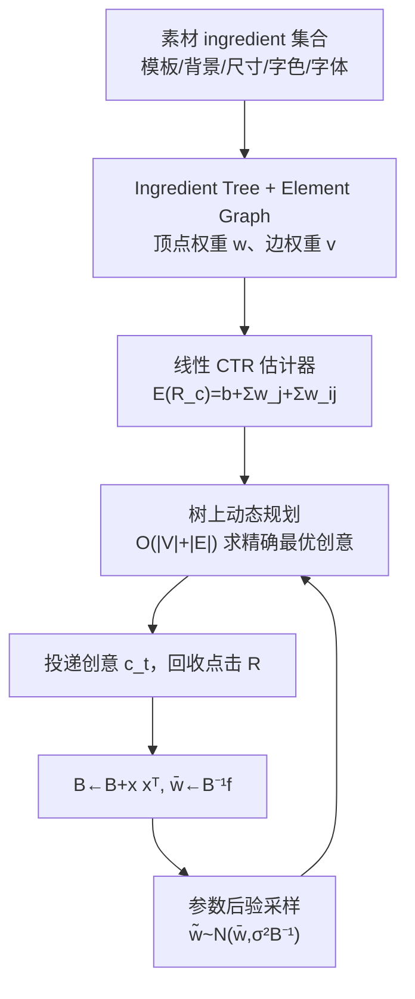
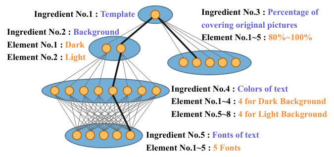

# Efficient Optimal Selection for Composited Advertising Creatives with Tree Structure (基于树结构的组合式广告创意高效最优选择)

- **会议/期刊**: AAAI 2021
- **作者与机构**: Jin Chen, Tiezheng Ge, Gangwei Jiang, Zhiqiang Zhang, Defu Lian, Kai Zheng（电子科技大学 / 阿里巴巴 / 中国科学技术大学）
- **推荐链路定位**: 召回层素材决策（在线创意投前的 arm 选择，非 item 召回）
- **研究方向**: 强化学习与动态探索推荐 / CTR 预估与特征交叉
- **论文原文**: [https://arxiv.org/abs/2103.01453v1](https://arxiv.org/abs/2103.01453v1)
- **开源代码**: [https://github.com/alimama-creative/AES-Adaptive-and-](https://github.com/alimama-creative/AES-Adaptive-and-)

## TL;DR (1分钟核心速览)

组合式广告创意的候选空间随素材种类指数爆炸（5 类素材即 2 万级），而单商品日均曝光不足 10 次，CTR 反馈极稀疏：标准 MAB 要枚举全空间无法在线，多元 bandit 靠 hill climbing 只能局部最优且难以注入视觉约束。本文提出 AES——把 ingredient 组织为树、元素组织为二部图，用「顶点权重 + 边权重」线性模型刻画创意 CTR，并在树上用动态规划以 $O(|V^E|+|E^E|)$ 精确求最优创意；关键一步是把 Thompson sampling 从「对创意采样」改为「对参数后验采样」，使 DP 可直接嵌入探索回路。离线真实日志（85 万曝光 / 200 创意）上收敛更快，相对 Ind-Egreedy 提升约 8.0%，单次搜索耗时 165s vs Full-TS 730s。

## Background & Motivation (背景与核心矛盾)

- **主流范式**: 广告创意原由广告主手绘再交给平台用 MAB/LinearUCB 选 arm；智能创意平台出现后，广告主只给图片与文案，平台即时合成模板、字体、文字颜色、图片尺寸等 ingredient 的组合创意。
- **前人局限**: ①候选空间 $L_1\times\cdots\times L_N$ 指数增长且随时间（节日/广告位）漂移，枚举型 MAB 与 LinearUCB 在线不可用；②MVT 显式建所有二阶交互但只能 hill climbing 近似，既易陷局部最优，也无法表达「浅色文字不配浅色背景」这类视觉约束（硬约束）。
- **核心洞察 (Key Insight)**: 专业设计师的合成过程是自上而下逐 ingredient 决策的，且元素之间只存在「树边相邻 ingredient」间的匹配关系——因此元素图整体是二部图，最优创意可分解为子树最优解的拼接。
- **本文切入点**: 用树结构把 $O(\prod L_i)$ 的枚举搜索降为图上线性时间的 DP，同时把探索粒度从创意级下沉到参数级。

## Method (核心方法设计)

### 1. 整体框架 (Overall Architecture)

框架分三阶段闭环：**CTR 估计**——以 ingredient 树 $\mathcal{T}$为骨架、以元素为点、以相邻 ingredient 元素间匹配度为边构成元素图$G^E$，可行创意$c$即与$\mathcal{T}$同构的连通子图，其期望 CTR 由所选顶点与边权重线性加和给出；**最优创意选择**——自叶子向根做动态规划，对每个元素缓存「以它为根的子树最优值」；**高效探索**——每轮从参数后验$\mathcal{N}(\bar{\boldsymbol{w}},\sigma^2 B^{-1})$ 采样一组权重，用 DP 求出该采样下最优创意并投递，收到点击后做贝叶斯线性回归闭式更新。由于采样发生在参数空间而非创意空间，DP 与 Thompson sampling 天然可组合。

<figure class="paper-figure" markdown="span">
  <figcaption>图2：成分树与元素图。蓝色顶点构成成分树。黄色顶点构成元素图。一个可行的广告创意示例显示为具有相连粗边的子图。</figcaption>
</figure>

### 2. 关键设计拆解 (Key Designs)

1. **元素图上的线性 CTR 估计器（把组合爆炸压成参数规模）**：MVT 对任意 ingredient 对建交互，参数与搜索都不可控。AES 只保留树边上的交互，创意收益写成
   $E(R_c)=b+\sum_{j\in V_c^E}w_j+\sum_{(i,j)\in E_c^E}w_{i,j}$参数总量仅$|V^E|+|E^E|$（远小于创意数），且视觉约束可直接实现为「删边」（匹配度设为 0），使不可行组合在搜索中被自然剪除。

2. **树上动态规划（线性时间取全局最优而非 hill climbing 局部最优）**：定义 $d_{I_i}[j]$为「ingredient$I_i$取元素$j$ 时以它为根子树的最优值」，转移为
   $d_{I_i}[j]=w_j+\sum_{I_m\in C[I_i]}\max_{t\in I_m}\big(v_{j,t}+d_{I_m}[t]\big)$，叶子处退化为$d_{I_i}[j]=w_j$根节点取$\max_j d_R[j]$即全局最优。因树无环、子问题可复用，复杂度$O(|V^E|+|E^E|)$，且对权重更新可即时重算，适配在线频繁刷新。

3. **参数级 Thompson Sampling 与训练开销**：给权重加高斯先验后，后验仍为高斯：采样 $\tilde{\boldsymbol{w}}\sim\mathcal{N}(\bar{\boldsymbol{w}},\sigma^2 B^{-1})$，取$c_t=\arg\max_c \boldsymbol{x}_c^\top\tilde{\boldsymbol{w}}$（由 Alg.1 求解），观测$R_{c_t}$后更新$B\leftarrow B+\boldsymbol{x}\boldsymbol{x}^\top$,$\boldsymbol{f}\leftarrow\boldsymbol{f}+R\boldsymbol{x}$,$\bar{\boldsymbol{w}}=B^{-1}\boldsymbol{f}$。探索发生在$K=|V^E|+|E^E|$维权重上，等价于一次采样即对全空间创意做一次「无偏重排」，故比在创意空间做$\epsilon$-greedy 收敛快得多；无需负采样，单轮推理开销即一次 DP + 一次$O(K^3)$ 求逆。

## Experimental Setup & Evaluation Protocol (实验设置与评估协议)

- **数据集与预处理**:

| 数据集 | #创意 | #Ingredient/元素 | #曝光/规模 | 说明 |
| :--- | :---: | :---: | :---: | :--- |
| Synthetic | 200 | 5 类（模板/背景/图片尺寸/字色/字体） | 2,000 batch × 1,000 = 2M 次 | 权重 $\sim\mathcal{N}(0,1)$ 生成，CTR 分布见图 4 |
| Real-World | 200（聚合自原始组合） | 同上，元素图见原文图 2 | ≈850,000 条曝光、≈2,000 商品、连续 7 天 | 某电商稳定广告位日志 |

- **数据划分与防穿越 (Splitting Strategy)**: 无传统 train/test 划分；真实日志按创意聚合出统计 CTR，作为 Bernoulli 试验的成功概率驱动在线模拟，属**时间序贯回放**，每 1,000 次曝光才更新一次模型以模拟真实延迟反馈。
- **排名评测协议 (Ranking Protocol)**: 非 Top-N 排序评测，而是 bandit 标准的 **Cumulative Regret / Overall CTR 累计曲线**；对比基线含无上下文类（Egreedy $\epsilon{=}0.1$、UCB$\lambda{=}0.03$）、简单分解类（Ind-Egreedy、LinearUCB）、结构类（TEgreedy、MVT、Vertex-TS、Edge-TS、Full-TS）；每个算法在合成数据重复 20 次、真实数据重复 50 次以消除随机性，实验机 CPU E5-2682 / 256G。

## Key Experimental Results (实验关键数据)

### 1. 主实验对比 (Main Results)

原文主结果以曲线（图 5/图 7）报告，下表汇总各基线的机制属性与原文给出的相对结论：

| 方法 | 建模元素交互 | 最优搜索方式 | 是否全局最优 | 原文报告表现 |
| :--- | :---: | :---: | :---: | :--- |
| Egreedy / UCB | ✗ | 枚举 | 是 | 前期探索慢，Overall CTR 最低 |
| Ind-Egreedy | ✗（各 ingredient 独立） | 枚举 | 是 | 早期上升快，约 200 batch 后收敛到较低平台，**AES 相对 +8.0%** |
| LinearUCB | 线性（创意级特征） | 枚举 | 是 | 收敛慢于 AES，持续偏低 |
| TEgreedy | ✓（树边） | DP | 是 | 次优，说明「探索参数」优于「探索创意」 |
| MVT | ✓（全二阶） | Hill Climbing | ✗ | 交互更全但被局部搜索拖累，劣于 AES |
| Full-TS | ✓（全二阶） | 枚举 | 是 | CTR 与 AES 相当，但耗时 **729.70±3.09s** |
| **AES (Ours)** | ✓（树边） | **DP** | **是** | **真实数据相对 Random 增益最高、收敛最快；耗时 165.04±0.07s** |

### 2. 消融实验 (Ablation Study)

| 变体 | 建模内容 | 搜索/探索 | 结论（原文图 6/图 8、表 1） |
| :--- | :--- | :--- | :--- |
| Vertex-TS | 仅顶点权重 | DP + TS | 弱于 AES，证明边（元素匹配）不可省 |
| Edge-TS | 仅边权重 | DP + TS | 弱于 AES，证明元素本身的主效应不可省 |
| Full-TS | 全二阶交互 | 枚举 + TS | 精度与 AES 持平，但耗时 4.4× |
| MVT | 全二阶交互 | Hill Climbing + TS | 交互更全仍落后，归因于搜索不精确 |
| **AES** | 顶点 + 树边 | **DP + TS** | 精度≈Full-TS，速度最优 |

### 3. 关键实验发现 (Key Findings)

1. **「树假设」几乎不损精度但换来数量级效率**：Full-TS 建模全部二阶交互，AES 只建模树边，二者 CTR 曲线接近，而搜索耗时从 729.70s 降至 165.04s；说明决定点击的是相邻 ingredient 的匹配（背景-字色、尺寸-模板），跨层长程交互贡献甚微。
2. **探索粒度决定收敛速度**：同为树结构，TEgreedy 与 AES 均优于 Ind-Egreedy，而 AES 又优于 TEgreedy——在 $K$维权重上采样远比在创意空间做$\epsilon$-greedy 高效；合成数据 200 batch 后 AES 相对 Ind-Egreedy 提升 8.0%，直接印证「元素独立假设」丢失的交互信息是可观的。
3. **搜索空间越大优势越明显**：候选创意数从 32 增至 1,200 时，Egreedy 的 regret 急剧上升（大量相似期望收益的创意被反复试错），而 AES 的 regret 曲线始终最低且平缓，说明 DP 的线性复杂度在真实万级创意空间下更具工程价值。

## Highlights & Limitations (亮点、对比与审稿批判)

- **与代表作对比 (vs. Prior Work)**: 相比 LinearUCB（创意级线性特征、需枚举），AES 用图结构把参数降到 $|V^E|+|E^E|$并支持精确 DP；相比 MVT（全二阶交互 + hill climbing），AES 牺牲少量长程交互换来全局最优与硬约束可注入；相比 Full-TS（全交互 + 枚举），AES 在精度持平下把搜索复杂度从$\prod L_i$降到$O(|V^E|+|E^E|)$。
- **可迁移亮点**: ①「对参数后验采样 → 用结构化 argmax 求解器解码」这一范式可平移到组合式推荐（捆绑包、套餐、多槽位展示位分配）；②把业务规则编码为元素图删边，是一种优雅的硬约束注入方式，避免后处理惩罚项调参。
- **审稿级局限批判**: ①估计器是加性线性模型，本质只含二阶交互且无法表达饱和/阈值效应（如「字色对比度低于阈值才掉点击」），与 DCN 类高阶交叉相比表达力有限；②实验全为离线日志 Bernoulli 重放，无真实线上 A/B，且候选仅 200、模拟每 1,000 次曝光批量更新，未验证万级空间下的在线 P99 延迟；③ingredient 树的层级与父子关系需人工按经验给定，不同树序可能影响精度，论文未给出树结构的敏感性分析。

## Rating (四维评分)

- **方法创新性 (Novelty)**: ⭐⭐⭐⭐ （把「树结构 DP + 参数级 Thompson sampling」组合成可精确求解的在线探索框架，思路干净且此前少见）
- **评估协议与实验扎实度 (Protocol & Experiments)**: ⭐⭐⭐ （合成+真实双数据、20/50 次重复与 regret 敏感性分析到位，但缺线上 A/B、主结果仅以曲线呈现、无显著性检验）
- **写作与数学规范度 (Clarity & Rigor)**: ⭐⭐⭐⭐ （DP 状态转移、TS 后验更新与复杂度分析交代清晰，线性估计器的假设边界也自陈）
- **工业落地与复现价值 (Industrial & Practical Value)**: ⭐⭐⭐⭐ （出自阿里妈妈真实场景、已开源，DP 可实时重算，搜索耗时降 4.4×，对组合素材/多槽位投放直接可用）

