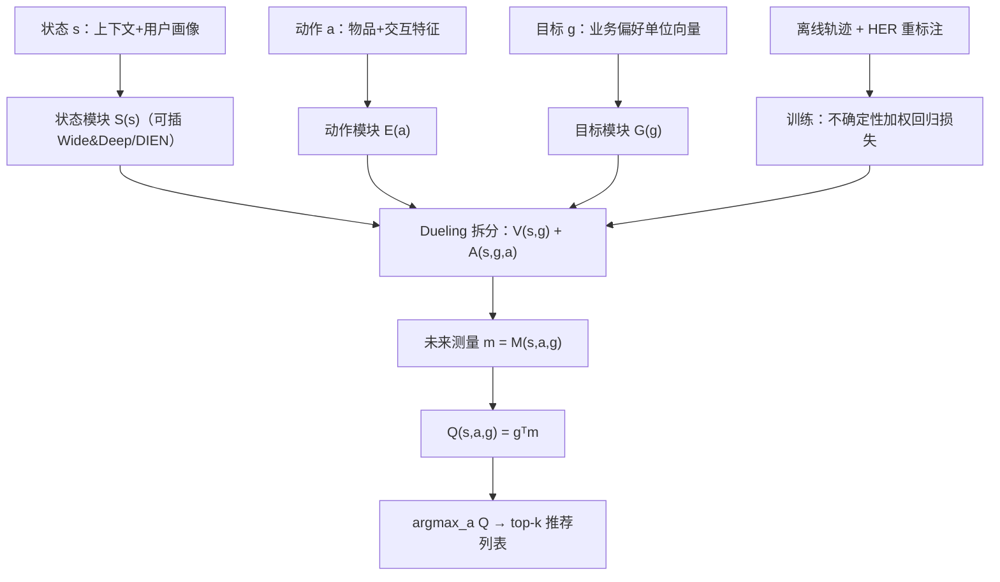
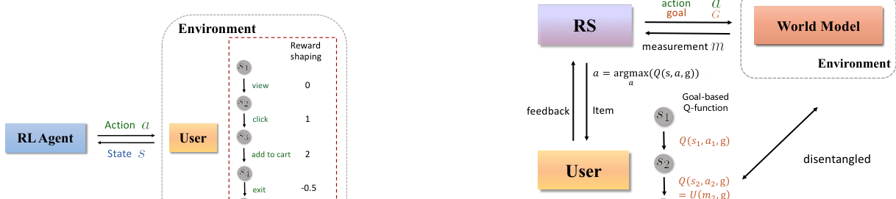

# Reinforcement Learning with a Disentangled Universal Value Function for Item Recommendation (面向物品推荐的解耦通用价值函数强化学习)

- **会议/期刊**: AAAI 2021
- **作者与机构**: Kai Wang, Zhene Zou, Qilin Deng, Jianrong Tao, Runze Wu, Changjie Fan（网易伏羲 AI Lab）、Liang Chen（中山大学）、Peng Cui（清华大学）
- **推荐链路定位**: 重排/策略层（RL 策略生成 top-k 推荐列表）
- **研究方向**: 强化学习与动态探索推荐 / 多任务多目标
- **论文原文**: [https://arxiv.org/abs/2104.02981v2](https://arxiv.org/abs/2104.02981v2)
- **开源代码**: [https://github.com/mouna99/dien](https://github.com/mouna99/dien)（论文引用的是 DIEN 的 state 模块实现，GoalRec 本体暂未开源）

## TL;DR (1分钟核心速览)

大规模 RL 推荐面临三大工程痛点：状态/动作空间巨大导致 credit assignment 失效、真实用户反馈稀疏且方差极大、业务奖励函数无法预先指定。GoalRec 借鉴世界模型与目标导向 RL，把价值函数解耦为「与奖励无关的未来轨迹测量预测器 $M$」×「参数化目标向量$g$」的内积，使同一套动态模型可泛化到任意奖励设置。在 MovieLens-25m / Taobao / YooChoose 的 RNN 用户仿真环境中，累积奖励相对 Rainbow、Dyna-Q、TD3 平均提升 3.7%、6.1%、10.7%，在高维与高方差环境下优势进一步放大。

## Background & Motivation (背景与核心矛盾)

- **主流范式**: 以 DQN/Rainbow/TD3 为代表的 model-free RL 直接把用户反馈当作标量奖励回归价值函数，或用 Dyna-Q 式单步模拟器提供伪样本（Pseudo Dyna-Q）。
- **前人局限**: ① 奖励信号稀疏（转化率约 0.2%）且未对齐（成交价差异巨大），直接回归 $Q$ 会得到高方差、有偏估计；② 状态/动作维度达 10^4 量级时，小网络无法承载百万级参数，"信用分配"问题使大模型学不动；③ 奖励塑形（浏览/点击/退出如何给分）没有标准答案，多个不同奖励设置的 agent 需同时在线，策略无法复用彼此经验。
- **核心洞察 (Key Insight)**: 推荐环境中有大量**时间稠密、自监督**的多维监督（点击、停留时长、会话级指标、未来物品嵌入均值），这些信号与奖励无关却刻画了环境动态；而"奖励设置"本质上只是对这些测量的一个线性加权目标。
- **本文切入点**: 用 goal-based RL 把「环境动态」与「奖励意图」彻底拆开——先训一个奖励无关的高容量世界模型预测未来测量向量 $m$，再用目标向量$g$与之内积得到任意目标下的$Q$。

## Method (核心方法设计)

### 1. 整体框架 (Overall Architecture)

模型把推荐建模为 MDP，状态 $s$由上下文特征与用户画像构成，动作$a$由物品特征与用户-物品交互特征构成。核心是解耦式价值函数：世界模型$\mathcal{M}(s,a,g;\theta)$输出维度为$\dim(m)$的未来测量向量（含即时反馈、会话级业务指标、未来点击物品的平均嵌入），目标模块将业务目标编码为单位向量$g$，二者点积即得该目标下的状态-动作价值；推理时对候选集枚举$a$取$\arg\max$ 生成 top-k 列表。训练侧用 hindsight experience replay 从离线轨迹反推目标，并用 homoscedastic uncertainty 自动加权多维回归损失。整个框架下用户只提供日志反馈，无需实时在线交互。

<figure class="paper-figure" markdown="span">
  <figcaption>图1：(a) 传统强化学习框架。(b) 所提出的解耦框架。在传统框架中，强化学习智能体接收环境（用户）的反馈及相应的塑形奖励，然后以完全实时交互的方式进行训练。对于 GoalRec，推荐系统智能体向未来度量预测器（世界模型）发起由状态 s、动作（物品）a 和特定目标 g 组成的查询，并为用户推荐一个或多个物品，以最大化长期效用 Q(s, a, g)。</figcaption>
</figure>

### 2. 关键设计拆解 (Key Designs)

1. **解耦通用价值函数（Disentangled UVF）**：前人把 $Q$直接对奖励回归，方差大且绑定单一奖励设置。本文沿用 VDFP 的解耦下界并扩展到目标维度：对凸函数$U$有$Q^{\pi}(s,a)\ge U(M^{\pi}(s,a))$，等号在线性$U$处成立；因此取线性回报$U(m,g)=g^{\top}m$，得
$Q(s,a,g)=U\big(M_g(s,a),g\big)=g^{\top}m$，动作选择为$a'=\arg\max_a U(M_g(s,a),g)$。
直觉：$M$只学"世界会怎样演化"，$g$只编码"我关心什么"，故同一$M$ 可在推理期切换任意目标而无需重训。

2. **奖励无关的高容量世界模型 + Dueling 分解**：双塔结构（状态模块 $S(s)$可替换为 DIEN 等工业模型、动作模块$E(a)$、目标模块$G(g)$）输出测量向量；借鉴 Dueling DQN 拆成状态价值$V(s,g)$与动作优势$A(s,g,a)$。与传统 Dueling 不同，世界模型不枚举全部动作、无法直接求均值，故引入**辅助损失**约束$\sum_a A(s,g,a)\approx 0$，使$V$ 学到"全动作平均的未来测量"，从而在 10^4 动作空间下仍能高效区分动作优劣。

3. **训练目标、目标重标注与推理开销**：损失为多测量联合回归，用同方差不确定性自动定权
$\mathcal{L}(\theta)=\sum_{i}\sum_{j}\big(\frac{1}{\sigma_j^{2}}\|\mathcal{M}_j(s_i,a_i,g_i;\theta)-m_{j,i}\|^{2}+\log\sigma_j^{2}\big)$，
$\sigma_j^2$大则该项权重自动衰减，$\log\sigma_j^2$兼作正则。由于目标不影响环境动态，可用 HER 把每条轨迹存两次（原目标 + 实际达成测量作为新目标），在离线数据上凭空造出多目标监督，采样遵循$\epsilon$-greedy（$\epsilon$从 1 衰减到 0）。推理仅需一次前向（$S$、$E$、$G$ 三塔 + 点积），无需 MPC 式滚动规划，成本与双塔召回同量级。

## Experimental Setup & Evaluation Protocol (实验设置与评估协议)

- **数据集与预处理**: 论文统计置于附录 B，正文仅给出场景与仿真规模：

| 数据集 | #Users | #Items | #Interactions | 稀疏度/密度 | 特征/场景说明 |
| :--- | :---: | :---: | :---: | :---: | :--- |
| MovieLens-25m | 100,000（采样） | 见附录 B | 见附录 B | 见附录 B | 电影评分，"正评分"视为点击 |
| Taobao | 100,000（采样） | 见附录 B | 见附录 B | 见附录 B | 电商交易，"成交"视为点击 |
| YooChoose (RecSys15) | 100,000（采样） | 见附录 B | 见附录 B | 见附录 B | 匿名会话点击流 |

- **数据划分与防穿越 (Splitting Strategy)**: 用户级 **70%/30% 比例划分**（训练/测试）；每用户最多保留 **30 条交互轨迹**以模拟真实数据稀疏性。评估在**离线仿真环境**（RNN 用户模型拟合公开数据，并预测"失去耐心退出"概率）中进行，另设**高维环境**（动作维扩至 10,000、状态维 30,000）与**高方差环境**（奖励延迟 3 步 + 注入随机趋势噪声 $\epsilon_t\sim\mathcal{N}(0,0.2)$）两种扰动变体；真实商用流量 A/B 结果仅在附录 C 报告。
- **排名评测协议 (Ranking Protocol)**: 非传统 Full-Ranking 排序指标，而是**轨迹级仿真回报协议**：所有方法按预估奖励/点击概率取 top-k 组成列表，指标为 (a) **Cumulative Reward**（每用户平均点击数）；(b) **CTR**（点击数 / 平均浏览深度）。属交互式策略评估而非静态负采样排序。
- **对比基线与超参设置**: 监督式 Wide&Deep、DIEN；model-free RL 的 Rainbow、TD3（连续动作需在真实物品空间做最近邻映射）；model-based 的 Deep Dyna-Q；本文 GoalRec 与 GoalRec-off（纯离线训练、不与模拟器交互）。所有方法网格搜索取最优超参，RL 类共享相近状态网络与输入特征，且**均不使用物品特征**（保证公平），五次运行报告均值与标准差。

## Key Experimental Results (实验关键数据)

### 1. 主实验对比 (Main Results)

原始仿真环境（表 1），Reward 为主要指标（↑）：

| Model | ML-25m Reward | ML-25m CTR | Taobao Reward | Taobao CTR | YooChoose Reward | YooChoose CTR |
| :--- | :---: | :---: | :---: | :---: | :---: | :---: |
| Wide&Deep | 25.2 | **0.601** | 2.72 | **0.024** | 3.52 | **0.040** |
| DIEN | 26.4 | 0.592 | 2.87 | **0.024** | 3.85 | **0.041** |
| Deep Dyna-Q | 29.3 | 0.526 | 3.05 | 0.019 | 3.93 | 0.032 |
| Rainbow | 30.1 | 0.548 | 3.02 | 0.020 | 4.14 | 0.037 |
| TD3 | 28.3 | 0.513 | 2.80 | 0.020 | 3.91 | 0.034 |
| **GoalRec** | **31.6** | 0.544 | **3.14** | 0.021 | **4.23** | 0.037 |
| GoalRec-off | 29.1 | 0.549 | 3.20 | 0.020 | 4.09 | 0.038 |
| **Improv.** (vs 最强 RL) | **+5.0%** | — | **+4.0%** | — | **+2.2%** | — |

### 2. 消融实验 (Ablation Study)

原文未给标准模块级消融，而以「环境扰动 × 变体」承担同等归因作用（下表为 Reward，括号内为相对原始环境的退化）：

| 变体 | ML-25m 原始 | ML-25m 高维(10^4 动作) | ML-25m 高方差 | 结论 |
| :--- | :---: | :---: | :---: | :--- |
| Deep Dyna-Q | 29.3 | 27.1 (-7.5%) | 28.4 (-3.1%) | 单步模型 + 标量奖励易被扰动击穿 |
| Rainbow | 30.1 | 28.2 (-6.3%) | 29.5 (-2.0%) | credit assignment 受高维状态拖累 |
| TD3 | 28.3 | 16.2 (**-42.8%**) | 27.4 (-3.2%) | 动作空间膨胀后最近邻映射失效 |
| **GoalRec** | 31.6 | **33.8** (**+7.0%**) | **32.1** (+1.6%) | 唯一在扰动下不降反升 |
| GoalRec-off（无在线交互） | 29.1 | — | — | 纯离线仍优于 Dyna-Q/Rainbow-online |

### 3. 关键实验发现 (Key Findings)

1. **高维动作空间是本方法最大增益点**：动作维扩到 10,000 后，TD3 从 28.3 崩塌到 16.2（-42.8%）、Rainbow 掉 6.3%，而 GoalRec 从 31.6 升到 33.8（相对 Rainbow 高维版 +19.9%，相对 TD3 +108.6%）——因为稠密测量监督 + 百万级世界模型把"大空间"变成"可监督的表征学习"，实证了"解耦即容量"的论断。
2. **高方差环境验证解耦的必要性**：注入延迟奖励与趋势噪声后，三个 baseline 平均退化 2.0%–3.2%，而 GoalRec 反而微升 1.6%；说明未来测量向量本身对随机噪声有平滑效应，标量奖励回归则被噪声直接污染。
3. **奖励与 CTR 存在显式权衡**：GoalRec 在 Reward 上全面领先，但 ML-25m 的 CTR（0.544）仍低于 Wide&Deep（0.601）/DIEN（0.592）；即轨迹级长期收益的提升以单次点击率为代价，这也解释了为什么需要 $g$参数化——业务方可沿$g$ 方向在"点得更多"与"留得更久"之间连续调节，而非固定单一塑形。
4. **离线可学性**：仅用他策略（myopic 监督模型）产生的离线轨迹，GoalRec-off 在 Taobao 上达 3.20，反超在线训练的 Rainbow（3.02），说明 HER 重标注确实能缓解"目标探索不可行"的冷启动困境。

## Highlights & Limitations (亮点、对比与审稿批判)

- **与代表作对比 (vs. Prior Work)**: 相较 Pseudo Dyna-Q（世界模型仅作伪样本生成器、只用即时反馈），本文将世界模型嵌入价值函数本体并预测完整轨迹；相较 VDFP/Successor Feature（解耦但仍绑定单一标量回报），本文把目标提升为向量并做 UVF 泛化；相较 Rainbow/TD3（model-free、标量奖励、小网络），本文从根本上绕开了信用分配与奖励塑形两个死结。
- **可迁移亮点**: ① 「测量向量 + 目标向量内积」的多目标打分范式可直接替换 MMoE/PLE 的硬编码任务头，实现推理期零成本切换业务权重；② HER 式的"把实际结果当目标"重标注，可迁移到任意离线日志的多目标重训场景，天然缓解目标稀疏。
- **审稿级局限批判**: ① 主实验全部建立在 RNN 用户仿真器上，"仿真器即真值"的假设未经充分证伪，真实 A/B 仅在附录，且高维/高方差变体均为人为注入而非真实分布偏移；② 缺少标准组件消融（去掉目标模块、去掉辅助 loss、去掉 HER 各自贡献多少），也未报告参数量与单次推理时延，10^4 动作枚举前向在线上 serving 的成本存疑；③ 目标空间 $g$的可行域与归一化方式（单位向量约束）缺乏理论刻画，$U$ 取线性是"最优性"的必要条件却也限制了价值函数表达能力。

## Rating (四维评分)

- **方法创新性 (Novelty)**: ⭐⭐⭐⭐ （把 goal-based RL 的 UVF 与世界模型首次系统性引入推荐，$Q=g^{\top}M$ 的解耦形式简洁且有理据，但组件均为已有技术的非平凡组合）
- **评估协议与实验扎实度 (Protocol & Experiments)**: ⭐⭐⭐ （三数据集 × 三环境变体 + 五种子方差较完整，但以仿真回报替代标准排序评估、无模块级消融、真实线上结果置于附录，说服力打折）
- **写作与数学规范度 (Clarity & Rigor)**: ⭐⭐⭐⭐ （Def 1–3 / Lemma 1–2 层层递进，下界与等号条件交代清晰，三塔结构与辅助 loss 的动机讲得透；$g$ 的约束与复杂度分析略欠）
- **工业落地与复现价值 (Industrial & Practical Value)**: ⭐⭐⭐⭐ （来自网易伏羲真实业务，强调免 MPC 的单次前向与可插拔 DIEN state 模块，工程路径清晰；但 GoalRec 本体未开源，复现依赖附录与 DIEN 代码）

