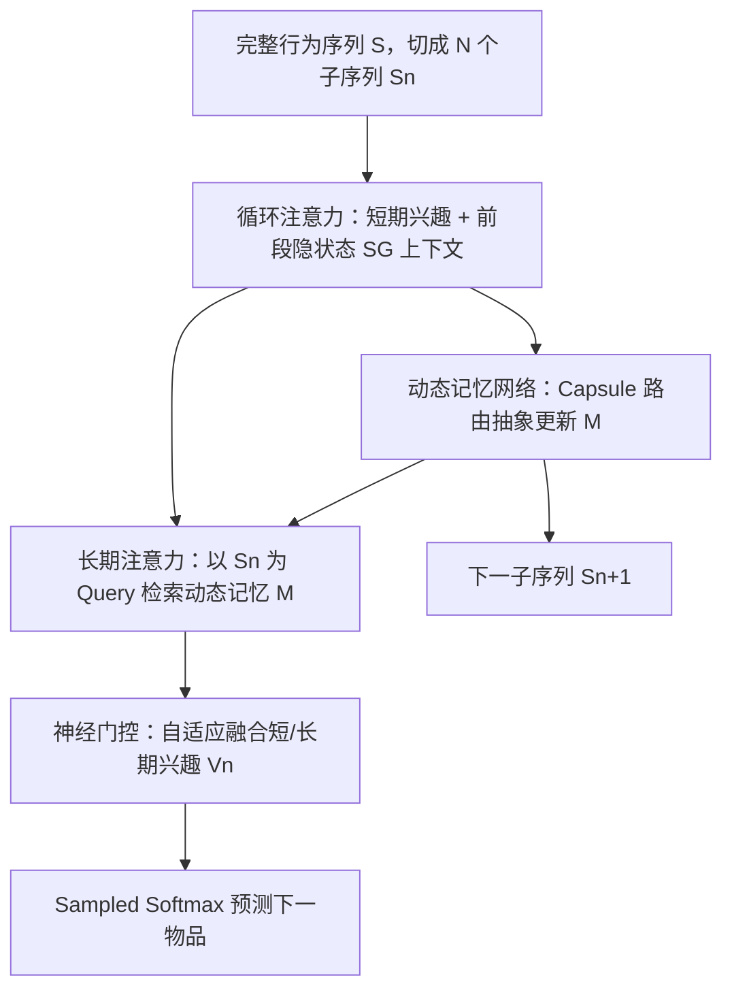
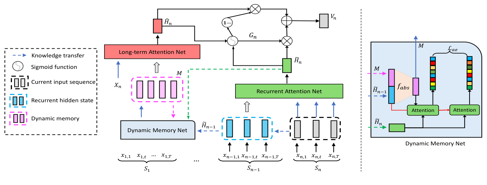

# Dynamic Memory based Attention Network for Sequential Recommendation (动态记忆注意力网络)

- **会议/期刊**: AAAI 2021
- **作者与机构**: Qiaoyu Tan, Jianwei Zhang, Ninghao Liu, Xiao Huang, Hongxia Yang, Jingren Zhou, Xia Hu（Texas A&M / 阿里巴巴 / 香港理工）
- **推荐链路定位**: 召回（Next-Item 序列推荐）
- **研究方向**: 序列与会话推荐
- **论文原文**: [arXiv:2102.09269v1](https://arxiv.org/abs/2102.09269v1)
- **开源代码**: 暂未开源

## TL;DR (1分钟核心速览)

面向真实电商系统中上千条行为长度的超长用户序列，传统 RNN/CNN/Self-Attention 既难以捕获跨段长程依赖，又必须在每次推理时扫全序列。DMAN 将全序列切为若干等长子序列逐个训练：循环注意力把上一段隐状态作为当前段的额外上下文，用固定尺寸外部记忆（Capsule 动态路由更新）表示长期兴趣，再由神经门控自适应融合长短兴趣。在 4 个基准上采用 Leave-One-Out + Full-Ranking 协议，Taobao 上 HR@50 相对最优基线 SDM 提升 **15.05%**，XLong（平均序列 >1000）上 Recall@500 提升 **11.9%**，且模型 2 个 epoch 即收敛。

## Background & Motivation (背景与核心矛盾)

- **主流范式**: GRU4Rec / Caser / SASRec 将用户行为按时间排序后整体编码为一个向量用于 Next-Item 预测；SDM/SHAN 则把序列切成短期段与长期段分别建模。
- **前人局限一（效率）**: 每次预测需 scan 全序列，实时系统响应时间不可接受；即便 SDM/SHAN 分段，推理仍需读完整序列。
- **前人局限二（精度与记忆保真）**: RNN 类模型对超长序列梯度衰减严重；HPMN 等记忆网络用预测 Next-Item 的目标驱动记忆写入，容易导致**长期知识遗忘**，且 FIFO 策略会无差别丢弃旧记忆。
- **核心洞察 (Key Insight)**: 用户兴趣在长序列上呈现月度/季节性周期，旧行为并未失效；而用户兴趣维度本身有界（数十）。因此只需将长期兴趣**主动压缩**进少量记忆槽，而非被动缓存全部历史。
- **本文切入点**: 用 Capsule 动态路由替代 FIFO 记忆抽象，并附加注意力重构损失强制记忆保留主要兴趣，从而消除“遗忘”与“冗余”两难。

## Method (核心方法设计)

### 1. 整体框架 (Overall Architecture)

DMAN 把用户完整行为序列 $\mathcal{S}=\{\mathcal{S}_n\}_{n=1}^N$按窗口$T$切分，逐段前向。对第$n$段：循环注意力以$H^{l-1}_n=\tilde{H}^{l-1}_n\|\mathrm{SG}(\tilde{H}^{l-1}_{n-1})$作为上下文抽取短期兴趣$\tilde{H}_n$；长期注意力以$\tilde{H}_n$为 Query、外部记忆$M$为 Key/Value 抽取长期兴趣$\hat{H}_n$；神经门控得到融合表征$V_n$；最后由动态记忆网络用 Capsule 路由把$\tilde{H}^{l-1}_{n-1}$抽象进$M$并送入下一段。训练含主任务$\mathcal{L}_{like}$与辅助重构损失$\mathcal{L}_{ae}$，两阶段分别更新以保证记忆不被分类损失直接污染。

<figure class="paper-figure" markdown="span">
  <figcaption>图1：DMAN 单层示意图。其将一系列序列作为输入，并逐序列训练模型。处理第 n 个序列 Sn 时，循环注意力网络以先前隐藏状态 eHn−1 为上下文提取短期用户兴趣。同时，长期注意力网络基于记忆块 M 提取长期兴趣。随后，通过神经门控网络将短期兴趣与长期兴趣结合以进行联合用户建模。最后，动态记忆网络通过融合 th 更新记忆块</figcaption>
</figure>

### 2. 关键设计拆解 (Key Designs)

1. **循环注意力网络（跨段上下文）**: 朴素做法每段独立建模，段首几个物品缺乏上下文。DMAN 在每层注意力中以 stop-gradient 方式拼接上一段的隐状态作为扩展 Key/Value，使注意力能“回看”前段，同时梯度不穿越，避免训练时跨段回传导致的不稳定：
$\tilde{H}^{l}_n=\mathrm{softmax}\big(\tilde{H}^{l-1}_n \tilde{W}_Q^{\top}(\tilde{H}^{l-1}_n\tilde{W}_K^{\top})^{\top}\big)\tilde{H}^{l-1}_n\tilde{W}_V^{\top},\quad H^{l-1}_n=\tilde{H}^{l-1}_n\,\|\,\mathrm{SG}(\tilde{H}^{l-1}_{n-1})$
段级别的循环让模型在不牺牲效率的前提下近似“全序列注意力”。

2. **动态记忆网络 + Capsule 抽象**: FIFO 会无差别丢弃最早记忆，而用户兴趣数量有限但彼此交织，故用 $m$ 个 Interest Capsule 表示长期兴趣维度。路由 logit 与 squash 输出：
$b_{ij}=\bar{x}_j^{\top}W_{ij}x_i,\quad s_j=\sum_{i=1}^{m+T}\alpha_{ij}W_{ij}x_i,\quad \bar{x}_j=\frac{\|s_j\|^2}{1+\|s_j\|^2}\frac{s_j}{\|s_j\|}$主胶囊为旧记忆$M^{l-1}$拼接前段隐状态$\tilde{H}^{l-1}_{n-1}$，输出即更新后的$M$。

3. **注意力重构辅助损失（记忆保真）**: 若仅用 Next-Item 损失，与目标无关的记忆会被丢弃，导致长程遗忘。DMAN 冻结循环注意力参数，要求“以旧记忆+新段为 Key”与“以抽象后记忆为 Key”对同一 Query 的输出一致：
$\mathcal{L}_{ae}=\sum_{l=1}^{L}\big\|\mathrm{Atten}^l_{rec}(\tilde{H}^{l}_n,\ M\|\tilde{H}^{l-1}_{n-1},\ \cdot)-\mathrm{Atten}^l_{rec}(\tilde{H}^{l}_n,\ M,\ \cdot)\big\|_F^2$
这是一个有损目标——当前段不再关注的记忆允许被丢弃，恰好刻画兴趣漂移。

4. **训练目标、负采样与推理效率**: 主损失为 Sampled Softmax 近似（每正样本 5 个负样本）：
$\mathcal{L}_{like}=-\sum_{u}\sum_{t\in\mathcal{S}_n}\log\frac{\exp(x_t^{\top}V_{n,t})}{\sum_{j\in\mathcal{V}}\exp(x_j^{\top}V_{n,t})}$
$\mathcal{L}_{like}$与$\mathcal{L}_{ae}$交替更新。推理时仅需维护每个用户$m$个记忆槽（$m=20$），无需回扫历史前缀，长序列场景 O(1) 记忆开销。

## Experimental Setup & Evaluation Protocol (实验设置与评估协议)

- **数据集与预处理**:

| 数据集 | #Users | #Items | 窗口 T / 候选 K | 平均序列长度 | 特征/场景说明 |
| :--- | :---: | :---: | :---: | :---: | :--- |
| MovieLens | 6,040 | 3,952 | 20 / 10 | 较短 | 电影评分，稀疏序列 |
| Taobao | 987,994 | 4,162,024 | 20 / 10 | 中等 | 电商行为，物品数巨大 |
| JD.com | 1,608,707 | 378,457 | 20 / 10 | 中等 | 京东浏览日志 |
| XLong | 20,000 | 3,269,017 | 50 / 20 | **>1000** | 淘宝超长序列，专测长程依赖 |

- **数据划分与防穿越**: `Leave-One-Out`——按时间排序后，最后一条交互作测试、倒数第二条作验证，其余为训练；训练序列再按窗口 $T$切为$L$ 个连续子序列。使用 mask + 位置编码避免未来信息泄露。
- **排名评测协议**: **Full-Ranking**——对测试用户将全部未交互物品作为负样本排序，主指标 HR@K 与 NDCG@K（XLong 用 Recall@200/500）。训练侧使用 Sampled Softmax（5 负样本）。
- **对比基线与超参**: 基线分三类——传统序列模型（GRU4Rec / Caser / SASRec，含只用末段序列的 $\ast$变体）、长序列模型（SHAN / SDM / HPMN）、本文变体（DMAN-XL / -FIFO / -NRAN）。统一$d=128$、batch=128、Adam、lr=1e-3、最多 8 epoch；$m$搜 {2,4,6,8,10,20,30} 定 20，$L$ 搜 {1,2,3,4,5} 定 2。全部指标为 **5 次重复运行的均值**，未报告显著性检验。

## Key Experimental Results (实验关键数据)

### 1. 主实验对比 (Main Results)

| 模型 | ML HR@10 | ML HR@50 | ML NDCG@100 | Taobao HR@50 | Taobao HR@100 | Taobao NDCG@100 | JD HR@10 | JD HR@50 | JD NDCG@100 |
| :--- | :---: | :---: | :---: | :---: | :---: | :---: | :---: | :---: | :---: |
| GRU4Rec | 19.78 | 47.40 | 18.75 | 13.48 | 16.53 | 5.81 | 35.28 | 47.52 | 27.64 |
| Caser | 20.80 | 48.12 | 19.28 | 15.55 | 17.91 | 7.35 | 36.76 | 49.13 | 28.35 |
| SASRec | 22.96 | 50.09 | 20.36 | 20.47 | 24.48 | 9.84 | 38.99 | 52.64 | 31.32 |
| SHAN | 21.34 | 49.52 | 19.55 | 18.87 | 21.94 | 8.73 | 37.72 | 50.55 | 29.80 |
| HPMN | 22.84 | 50.54 | 19.77 | 19.98 | 24.37 | 9.66 | 39.14 | 53.22 | 32.24 |
| SDM | 23.42 | 51.26 | 20.44 | 21.66 | 25.42 | 10.22 | 40.68 | 55.30 | 34.82 |
| **DMAN** | **25.18** | **53.24** | **22.03** | **24.92** | **29.37** | **11.13** | **44.58** | **58.82** | **36.93** |
| **Improv.** | +7.51% | +3.86% | +7.77% | **+15.05%** | **+15.53%** | +8.90% | +9.58% | +6.36% | +6.05% |

XLong（超长序列）| Recall@200 | Recall@500：GRU4Rec 0.079/0.098；SASRec 0.105/0.123；HPMN 0.118/0.136；SDM 0.107/0.129；**DMAN 0.132/0.163**（较 SDM +23.4%/+26.4%，较 HPMN +11.9%/+19.9%）。

### 2. 消融实验 (Ablation Study)

| 数据集 | 变体 | Recall@100 | NDCG@100 | 注释 |
| :--- | :--- | :---: | :---: | :--- |
| Taobao | w/o 长时注意力 (DMAN-XL) | 0.237 | 0.094 | 移除外部记忆 |
| Taobao | w/ FIFO 记忆 (DMAN-FIFO) | 0.263 | 0.108 | 替代 Capsule 抽象 |
| Taobao | w/o 循环上下文 (DMAN-NRAN) | 0.257 | 0.104 | 替代为 vanilla attention |
| Taobao | **DMAN 完整** | **0.293** | **0.111** | — |
| XLong | w/o 长时注意力 (DMAN-XL) | 0.021 | 0.013 | 移除外部记忆 |
| XLong | w/ FIFO 记忆 (DMAN-FIFO) | 0.036 | 0.017 | 替代 Capsule 抽象 |
| XLong | w/o 循环上下文 (DMAN-NRAN) | 0.043 | 0.019 | 替代为 vanilla attention |
| XLong | **DMAN 完整** | **0.054** | **0.022** | — |

### 3. 关键实验发现 (Key Findings)

- **外部记忆是超长序列的决定性组件**: 去掉长时注意力后，XLong 上 Recall@100 从 0.054 掉到 0.021（-61%），Taobao 上掉 0.056（-19%）。序列越长，纯注意力越无法弥合跨段语义鸿沟，而动态记忆提供了一种 O(1) 的“跨段信道”。
- **Capsule 抽象优于 FIFO 缓存且优势随序列长度放大**: Taobao 上 DMAN-FIFO→DMAN 仅 +11.4%，而在平均长度 >1000 的 XLong 上达到 **+50%**（0.036→0.054）。FIFO 无差别丢弃与周期性兴趣冲突，抽象路由则在固定容量下保留最有信息量的兴趣维度。
- **循环上下文在小数据上尤其重要**: 去掉前段隐状态拼接（DMAN-NRAN）在 MovieLens/Taobao 类中等长度序列上损失明显（Taobao -12.4%），说明段首物品缺少上下文的“冷启动”问题在切分策略下不可忽视；而在已有长记忆兜底的 XLong 上损失被部分补偿（仅 -25.6% vs -157% 的记忆消融）。此外超参分析显示 $m=20$后再增大记忆槽收益 <2%，$L=2$ 已足够，学习曲线约 2 个 epoch 即收敛，验证了分段训练的工程可用性。

## Highlights & Limitations (亮点、对比与审稿批判)

- **与代表作对比 (vs. Prior Work)**: 与 **SDM/SHAN** 的核心区别在于后者仍需在推理期扫描长序列、长短期段贡献靠外部固定规则拼接；DMAN 把长序列压缩为 $m$ 个记忆槽，推理开销与序列长度解耦。与 **HPMN** 的区别在于记忆的更新信号从“预测 Next-Item”换成了“注意力重构”，避免 Next-Item 目标无法覆盖的旁路兴趣被丢弃。
- **可迁移亮点**: (1) stop-gradient 拼接前段隐状态的 trick 可直接用于任何分块 Transformer 长序列训练；(2) 冻结主网络、用注意力输出对齐作为外部记忆正则，可移植到 LLM 长记忆 / KV-cache 压缩类工作。
- **审稿级局限批判**: (1) 未做显著性检验，仅报告 5 次均值，且 Taobao/JD 指标列混用 HR@50/HR@100 存在口径不统一；(2) 空间/时间开销只分析了记忆槽 $m$与层数$L$，但胶囊路由每段需迭代 3 次，对每用户每段训练成本叠加在$N$ 段上，文中未给出训练/推理 wall-clock 对比；(3) XLong 平均长度 >1000 但只取 2 万用户，长尾用户（交互数 <100）的行为被忽略，冷启动场景能力未知。

## Rating (四维评分)

- **方法创新性 (Novelty)**: ⭐⭐⭐⭐ （Capsule 动态路由 + 冻结主网的注意力重构做记忆抽象，比 FIFO 缓存更贴合推荐中周期性兴趣规律，机制新颖）
- **评估协议与实验扎实度 (Protocol & Experiments)**: ⭐⭐⭐⭐ （4 数据集含超长 XLong、Full-Ranking 全库排序、5 次重复，但缺显著性检验与 HR 口径统一问题）
- **写作与数学规范度 (Clarity & Rigor)**: ⭐⭐⭐⭐ （关键算子公式与 stop-gradient 设计交代清晰，但 $\mathcal{L}_{like}$与$\mathcal{L}_{ae}$ 的阶段式训练节奏仅一句话带过，缺收敛性论证）
- **工业落地与复现价值 (Industrial & Practical Value)**: ⭐⭐⭐⭐ （分段训练 + O(1) 记忆推理对在线实时系统极具吸引力，超参鲁棒（$m=20$、$L=2$），但未开源限制复现）

