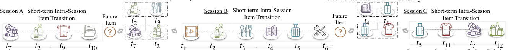
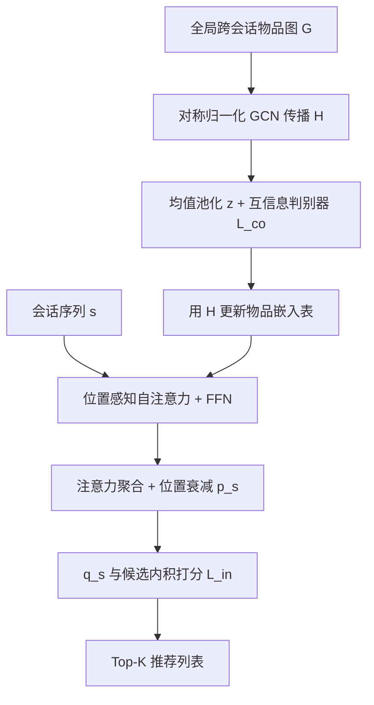

# Graph-Enhanced Multi-Task Learning of Multi-Level Transition Dynamics for Session-based Recommendation (图增强的多级转移动态多任务学习会话推荐)

- **会议/期刊**: AAAI 2021
- **作者与机构**: Chao Huang, Jiahui Chen, Lianghao Xia, Yong Xu, Peng Dai, Yanqing Chen, Liefeng Bo, Jiashu Zhao, Jimmy Xiangji Huang（JD Finance America / 华南理工大学 / 鹏城实验室 / Wilfrid Laurier / York University）
- **推荐链路定位**: 召回（匿名会话 Next-Item 候选生成）
- **研究方向**: 序列与会话推荐 / 图神经网络与知识图谱推荐
- **论文原文**: [https://arxiv.org/abs/2110.03996v1](https://arxiv.org/abs/2110.03996v1)
- **开源代码**: [https://github.com/sessionRec/MTD](https://github.com/sessionRec/MTD)

## TL;DR (1分钟核心速览)

针对会话推荐中"只建模会话内局部序列、忽略跨会话全局物品转移"这一核心痛点，MTD 提出多级转移动态的多任务框架：会话内用位置感知的双层注意力（自注意力 + 位置衰减聚合）刻画短/长程序列规律，会话间用全局物品图 + 局部-图级互信息最大化编码高阶跨会话依赖，两路损失交替优化并共享隐空间。在 Yoochoose/Diginetica/RetailRocket 三数据集、Pre@10/MRR@10 全库排序协议下，相对最强基线分别取得 **+1.3%/+4.3%/+1.5%**（Pre@10）与 **+1.2%/+3.2%/+5.1%**（MRR@10）提升。

## Background & Motivation (背景与核心矛盾)

- **主流范式**: 会话推荐沿三条线演进——RNN 序列编码（GRU4Rec）、注意力/记忆网络聚合（NARM、STAMP）、以及会话内建图的消息传递（SR-GNN）；近年 CSRM/CoSAN 尝试引入邻域会话的协同信号。
- **前人局限**: (1) RNN/注意力方法仅在单会话内建模，无法感知跨会话的物品转移，冷启或短会话下信号极稀疏；(2) SR-GNN 虽用图建模长期依赖，但图只在单个会话内构建，跨会话高阶连通性完全缺失；CSRM/CoSAN 需为每批次检索邻域会话，训练代价高且未显式刻画关系层级。
- **核心洞察 (Key Insight)**: 真实场景中的物品转移是**多层级**的——同一会话内存在短程相邻点击与长程"主意图"关联，而跨会话还存在如 $t_7\to t_2\to t_3$ 的隐式传递依赖（图 1 示例），二者构成层次化的转移关系结构，必须在统一隐空间联合保持。
- **本文切入点**: 把"会话内序列建模"与"跨会话图建模"视为两个互补任务，用多任务学习 + 交替优化将低阶（局部序列）与高阶（全局图）关系注入同一物品嵌入表。

<figure class="paper-figure" markdown="span">
  <figcaption>图1：具有多级转移动态的基于会话推荐示例。</figcaption>
</figure>

## Method (核心方法设计)

### 1. 整体框架 (Overall Architecture)

输入为匿名会话序列 $s=[v_{s,1},\dots,v_{s,I}]$。左支路（intra-session）先经位置感知自注意力编码器学习物品两两相关性，再由注意力聚合层按重要性加权融合出会话主意图向量，并注入相对位置衰减表示，拼接成查询向量$q_s$与候选物品内积打分。右支路（inter-session）将所有历史会话拼接为全局有向物品图，用对称归一化 GCN 做$L$层嵌入传播得到高阶物品表示$H$，并以均值池化得到图级表示$z$，通过判别器最大化"节点-图"互信息以保留跨会话转移结构。训练时以 mini-batch Adam 交替优化两路损失，并在每轮图优化后**用$H$ 覆写物品嵌入表**，使全局信号回流到序列打分模块，形成闭环。

### 2. 关键设计拆解 (Key Designs)

1. **位置感知双层注意力（会话内转移建模）**：RNN 的刚性顺序假设无法刻画非相邻物品的强关联。MTD 先用标准点积自注意力 $X_s=\delta(QK^{\top}/\sqrt{d})V$加 FFN 得到$\tilde{X}_s$，再用**末位物品作为查询**的注意力聚合：$\alpha_i=\delta(g^{\top}\sigma(W_3 x_{s,I}+W_4 x_{s,i}))$，$x_s^{*}=\sum_i \alpha_i x_{s,i}$。同时引入相对位置衰减$p_s=\sum_i \omega_i x_{s,i},\ \omega_i\propto \exp(|i-I|+1)$，让越靠近当前时刻的物品获得越大权重——物理直觉是"用户主意图由近期行为主导，但远距离行为提供弱上下文"。最终$q_s=W_c[x_{s,I},x_s^{*},p_s]$。

2. **图级互信息约束的跨会话关系编码**：仅做 GCN 传播（$H^{(l+1)}=\phi(\hat{D}^{-1/2}\hat{A}\hat{D}^{-1/2}H^lW^l)$，$\hat{A}=A+I$）容易过平滑且丢失全局结构。MTD 用判别器$\xi(h_m,z)=\sigma(h_m^{\top}W_g z)$ 区分真实节点-图对与**节点打乱（node shuffling）生成的假对**，损失为
$$\mathcal{L}_{co}=-\frac{1}{N_{pos}+N_{neg}}\Big[\sum_{i}^{N_{pos}}\log\xi(h_m,z)+\sum_{i}^{N_{neg}}\log(1-\xi(\tilde{h}_m,z))\Big]$$
最大化局部嵌入与图级表示之间的互信息，等价于让每个物品表示都"携带"全局转移上下文，从而在无监督信号下完成从 item-level 到 graph-level 的层次化约束。

3. **多任务交替训练与推理开销**：总损失 $\mathcal{L}=\mathcal{L}_{cr}+\lambda_1\mathcal{L}_{in}+\lambda_2\|\Theta\|_2^2$，其中$\mathcal{L}_{in}$为会话打分的交叉熵、$\mathcal{L}_{cr}$即图侧互信息损失；两路输入不同故采用交替优化，并用频率参数$f$控制$\mathcal{L}_{in}$的更新节奏（Yoochoose/Diginetica/RetailRocket 分别取 1/4/6）以平衡两任务收敛速度。复杂度为$O(L_1 I d^2+I^2d)$（会话内）+$O(|A|d+Md^2)$（图侧），实测每 epoch 仅 24/40/53 秒，远低于 SR-GNN 的 1401/2586/2502 秒。

## Experimental Setup & Evaluation Protocol (实验设置与评估协议)

- **数据集与预处理**: 统一过滤"会话长度 $\geq 2$且物品出现频次$\geq 5$"（即类 5-core 过滤）：

| 数据集 | #Users(会话) | #Items | #Interactions(会话数) | 稀疏度/密度 | 特征/场景说明 |
| :--- | :---: | :---: | :---: | :---: | :--- |
| Yoochoose | 369,859 训练 / 55,400 测试 | 17,376 | — | 平均会话长 6.15 | RecSys'15 电商点击流 |
| Diginetica | 719,470 训练 / 60,858 测试 | 43,097 | — | 平均会话长 5.13 | CIKM Cup 2016 电商搜索点击 |
| RetailRocket | 433,648 训练 / 15,132 测试 | 36,968 | — | 平均会话长 9.93 | 电商浏览行为 |

- **数据划分与防穿越 (Splitting Strategy)**: 采用**全局时间戳切分**——Diginetica 与 RetailRocket 均取**最后一周**作为测试集，其余为训练集，严格避免未来会话泄漏；Yoochoose 沿用官方划分。
- **排名评测协议 (Ranking Protocol)**: 采用 `Full-Ranking (全库未交互物品排序)`，指标为 Pre@K 与 MRR@K（K=5/10/20），MRR@K 在首个正确物品未进入 Top-K 时置 0；训练阶段以交叉熵 + 隐式反馈标签构造正负样本（未显式声明负采样比例，为本文协议披露的薄弱点）。
- **对比基线与超参设置**: 基线覆盖频率类（POP/S-POP）、相似度类（ItemKNN）、RNN 类（GRU4Rec）、注意力类（NARM/STAMP/SASRec）、图类（SR-GNN/CSRM/CoSAN）共 10 个。嵌入维度 $d=100$，$\lambda_2=10^{-6}$，batch=512，学习率$10^{-3}$，dropout=0.2，Adam 优化；未报告显著性检验。

## Key Experimental Results (实验关键数据)

### 1. 主实验对比 (Main Results)

| Dataset | Metric | GRU4Rec | NARM | STAMP | SASRec | SR-GNN | CSRM | CoSAN | **MTD** | Improv.% |
| :--- | :--- | :---: | :---: | :---: | :---: | :---: | :---: | :---: | :---: | :---: |
| Diginetica | Pre@10 | 20.31 | 36.72 | 37.05 | 38.42 | 38.40 | 38.56 | 37.58 | **40.22** | +4.31% |
| Diginetica | MRR@10 | 7.78 | 15.00 | 16.05 | 16.27 | 17.04 | 16.23 | 15.57 | **17.58** | +3.17% |
| Yoochoose | Pre@10 | 55.13 | 60.19 | 58.79 | 60.42 | 60.84 | 60.46 | 61.01 | **61.83** | +1.34% |
| Yoochoose | MRR@10 | 25.76 | 29.03 | 29.44 | 30.47 | 30.57 | 30.37 | 30.21 | **30.83** | +1.18% |
| RetailRocket | Pre@10 | 31.01 | 44.74 | 43.14 | 46.39 | 44.88 | 47.21 | 45.83 | **47.93** | +1.53% |
| RetailRocket | MRR@10 | 15.37 | 25.54 | 26.65 | 26.74 | 26.95 | 27.14 | 26.01 | **28.51** | +5.05% |

Top-K 扩展（表 3）：Diginetica Pre@20 由 CSRM 的 52.56 提升至 **53.92**（+2.59%），RetailRocket Pre@20 由 55.04 提升至 **55.95**（+1.65%）；Yoochoose 上 MTD 在 Pre@5/10/20 全面领先。

### 2. 消融实验 (Ablation Study)

图 3 报告 Pre@20 随训练轮次的变化（MTD 参考值：Diginetica 53.92 / RetailRocket 55.95），各变体趋势如下：

| 变体 | 组件替换说明 | 相对 MTD 的变化 | 结论指向 |
| :--- | :--- | :---: | :--- |
| MTD-va | 用 vanilla attention 替换位置感知聚合 | 明显下降（约 1–3 pt） | 层级注意力聚合有效 |
| MTD-at | 在 MTD-va 上再加时间因子 | 小幅回升，仍低于 MTD | 位置信息必要但不充分 |
| MTD-lo | 移除跨会话图编码器，仅保留会话内建模 | 下降最多（约 1.5–3 pt） | 全局转移信号是主增益来源 |
| MTD-ga | 用图注意力网络替换层级关系编码器 | 低于 MTD | 互信息层级约束优于纯 GAT |
| **MTD** | 完整模型 | **最优** | — |

### 3. 关键实验发现 (Key Findings)

1. **全局图分支是最大增益源**：去掉跨会话编码的 MTD-lo 在三个数据集上均出现最大跌幅（Diginetica 与完整模型差距约 1.5–3 个 Pre@20 点），而在 RetailRocket（平均会话长 9.93、最长）上 MRR@10 提升最高（+5.05%），说明会话越长、局部序列越"够用"时，跨会话高阶依赖反而成为区分度关键。
2. **图注意力不等于层级互信息**：MTD-ga 用 GAT 替代互信息判别器后仍落后 MTD，印证"局部嵌入 ↔ 图级表示"的对比式约束比单纯加权邻居聚合更能保留全局结构；同时图卷积层数超过 2–3 层后性能下滑（图 4c），说明高阶连通性存在过平滑边界。
3. **效率与效果并非权衡**：MTD 每 epoch 耗时 24/40/53 秒，仅为 SR-GNN 的 1.7%/1.5%/2.1%、CSRM 的 4.5%/7.2%/23%，却取得更优指标——关键在于全局图只构建一次并复用，避免了 CSRM 每批次检索邻域会话的开销。

## Highlights & Limitations (亮点、对比与审稿批判)

- **与代表作对比 (vs. Prior Work)**: 与 SR-GNN 的本质区别在于建图范围——SR-GNN 为每个会话单独建图（会话内转移），MTD 建**全局物品图**并叠加互信息约束；与 CSRM/CoSAN 的区别在于不依赖"邻域会话检索"这一昂贵且启发式的操作，而用图传播 + 对比目标隐式聚合跨会话信号；与 SASRec 相比，MTD 额外引入位置衰减与多任务图正则，而非纯自注意力堆叠。
- **可迁移亮点**: (1) "图编码后用 $H$覆写嵌入表"的交替更新策略，可低成本地把全局图信号注入任意序列/双塔召回模型；(2) 位置衰减权重$\omega_i\propto\exp(|i-I|+1)$ 是一种无需额外参数的相对位置编码替代方案，适合长会话场景。
- **审稿级局限批判**: (1) **协议披露不足**：全文未明确训练负采样比例与候选集规模，$\mathcal{L}_{in}$使用 sigmoid + 二分类标签暗示采样排序而非严格全库排序，与"Full-Ranking"表述存在张力，影响与 SR-GNN 等基线的公平可比性；(2) **增益幅度有限且缺显著性检验**：Yoochoose 上 Pre@10 仅 +1.34%、MRR@10 仅 +1.18%，未报告$p$值或方差，难以判断是否在噪声范围内；(3) 符号存在不一致（正文损失写作$\mathcal{L}_{cr}$而方法节定义为$\mathcal{L}_{co}$），且多任务频率$f$ 需按数据集手工调（1/4/6），跨数据集迁移需重新搜索。

## Rating (四维评分)

- **方法创新性 (Novelty)**: ⭐⭐⭐⭐ （首次把"多级转移动态"形式化为会话内/跨会话双任务，并用局部-图级互信息做层级约束，思路清晰但各组件均为已有技术的组合式创新）
- **评估协议与实验扎实度 (Protocol & Experiments)**: ⭐⭐⭐ （三数据集 + 时间切分合理、基线覆盖 10 个较全面，但负采样协议未披露、缺显著性检验，消融仅以曲线呈现无精确数值表）
- **写作与数学规范度 (Clarity & Rigor)**: ⭐⭐⭐ （公式与模块划分清楚，但 $\mathcal{L}_{cr}$/$\mathcal{L}_{co}$符号不一致、位置权重公式$\omega_i\propto\exp(|i-I|+1)$ 缺少归一化说明，复杂度分析较简略）
- **工业落地与复现价值 (Industrial & Practical Value)**: ⭐⭐⭐⭐ （代码已开源，每 epoch 数十秒的训练开销与"全局图一次构建"设计非常适合大规模匿名会话召回场景）

