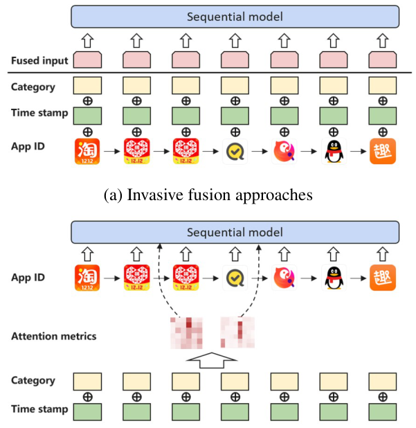
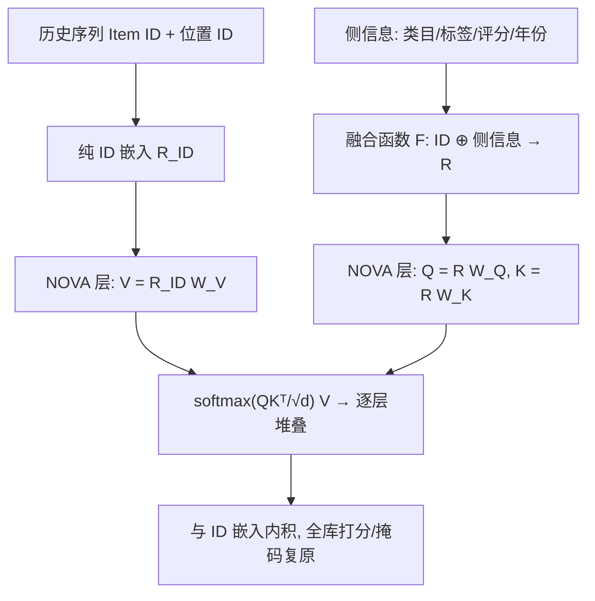

# Non-invasive Self-attention for Side Information Fusion in Sequential Recommendation (面向序列推荐的非侵入式侧信息自注意力)

- **会议/期刊**: AAAI 2021
- **作者与机构**: Chang Liu（HKU）；Xiaoguang Li、Guohao Cai、Zhenhua Dong、Hong Zhu、Lifeng Shang（华为诺亚方舟实验室）
- **推荐链路定位**: 召回（Next-Item 序列建模）
- **研究方向**: 序列与会话推荐
- **论文原文**: [https://arxiv.org/abs/2103.03578v1](https://arxiv.org/abs/2103.03578v1)
- **开源代码**: 暂未开源

## TL;DR (1分钟核心速览)

BERT4Rec 类模型只吃单一 Item ID 输入，直接把类目、评分、标签等侧信息加/拼进 ID 嵌入（“侵入式融合”）在试点实验中收益极小甚至为负。本文提出 NOVA：Q/K 由“ID+侧信息”的混合表示生成，而 V 严格来自纯 ID 嵌入，使隐层始终停留在与解码一致的 ID 向量空间。在 ML-1m/ML-20m/APP 三个数据集、Leave-One-Out + **全库 Full-Ranking** 协议下稳定超越 BERT4Rec，ML-1m 上 HR@10 相对提升 13.51%，FLOPs 仅增 4%。

## Background & Motivation (背景与核心矛盾)

- **主流范式**: 序列推荐已从 CNN/RNN（Caser、GRU4Rec）演进到 Transformer，BERT4Rec 以双向掩码自注意力取得 SOTA，但其输入源单一（仅 Item ID + 位置 ID）。
- **前人局限**: 已有侧信息利用几乎全是“侵入式”——用 sum / concat / gating 把侧信息不可逆地烧进 ID 嵌入再送入序列模型（图 1a）。矛盾一：BERT 本质是自编码器，编码与解码共用同一 ID 嵌入映射，混合嵌入造成“复合嵌入空间”，使 ID 复原/解码变难；矛盾二：侧信息维度与稀疏度不匹配，直接融合导致信息淹没 (information overwhelming)，试点实验中反而掉点。
- **核心洞察 (Key Insight)**: 侧信息的价值在于“指导注意力分配”，而非“改写物品表征”。只要 V 保持在纯 ID 空间，Q/K 携带再多辅助信号也只是改变注意力权重。
- **本文切入点**: 拆分自注意力的三个信息源，把侧信息限制在 Q/K 分支（非侵入），V 走独立 ID 通路。

<figure class="paper-figure" markdown="span">
  <figcaption>图 1：侵入式与非侵入式方法示意图。侵入式方法不可逆地融合各类信息，再输入序列模型；非侵入式方法中，侧信息仅参与注意力矩阵计算，而物品信息保留在独立向量空间。</figcaption>
</figure>

## Method (核心方法设计)

### 1. 整体框架 (Overall Architecture)

沿用 BERT4Rec 的双向掩码训练：随机掩码序列中部分位置，用上下文复原被掩码物品。区别在于每个 NOVA 层接收两个并行输入张量——纯 ID 表示 $\mathbf{R}^{(ID)}\in\mathbb{R}^{B\times L\times h}$与融合了侧信息的整合表示$\mathbf{R}\in\mathbb{R}^{B\times L\times h}$。侧信息不随层传播，每层显式重新注入同一份侧信息；Q、K 从$\mathbf{R}$计算，V 与输出从$\mathbf{R}^{(ID)}$ 计算，因此逐层更新的隐状态始终处在由 Item ID 上下文张成的同一向量空间。最后一层输出与 ID 嵌入矩阵做内积，全库打分。除替换自注意力层外，BERT 结构（层数、头数、FFN）与原版完全一致，额外参数几乎全来自侧信息嵌入表。

### 2. 关键设计拆解 (Key Designs)

1. **非侵入式自注意力 NOVA（解耦 Q/K 与 V 的信息源）**：痛点是混合嵌入破坏解码一致性。核心算子是让 V 只来自纯 ID 分支：

$$\mathrm{NOVA}(\mathbf{R},\mathbf{R}^{(ID)})=\sigma\!\left(\frac{\mathbf{Q}\mathbf{K}^{\top}}{\sqrt{d_k}}\right)\mathbf{V},\quad \mathbf{Q}=\mathbf{R}\mathbf{W}_Q,\ \mathbf{K}=\mathbf{R}\mathbf{W}_K,\ \mathbf{V}=\mathbf{R}^{(ID)}\mathbf{W}_V$$

直觉：注意力矩阵是“谁该看谁”的路由信号，侧信息在此处提供语义相似度先验（如相同类目的物品更易互相关注）；而输出必须是“物品是什么”的向量，不能掺入异构特征，否则下一步解码就在异构空间里做同质检索。

2. **三种融合函数与融合位置的可控性**：位序本身即一种行为侧信息，原 BERT 用加法融合 $F_{\text{add}}(f_1,\dots,f_m)=\sum_i f_i$；本文另设拼接通路$F_{\text{concat}}(f_1,\dots,f_m)=\mathrm{FC}(f_1\odot\cdots\odot f_m)$ 与门控通路

$$F_{\text{gating}}(f_1,\dots,f_m)=\sum_{i=1}^{m}G_i f_i,\quad \mathbf{G}=\sigma(\mathbf{F}\mathbf{W}_F)$$

门控系数由当前上下文动态生成，等价于让模型按样本自适应地挑选侧信息，缓解低质侧信息淹没问题。三种融合下 NOVA 均稳定优于基线，说明收益主要来自“非侵入”这一结构性设计而非某个特定融合算子。

3. **训练目标、负采样与推理开销**：训练目标是掩码位置上的交叉熵（复原被掩码 Item ID），**不使用负采样**；由于是全库 softmax 打分，评测天然与训练目标对齐。推理时只需一次前向，无额外候选检索；实测 FLOPs 从 $0.4796\times10^9$增至$0.4988\times10^9$（+4%），模型尺寸 35.5MB→42.6MB（增量全在侧信息嵌入表，可用查表替代），GPU 下推理时延与 BERT4Rec 基本持平。

## Experimental Setup & Evaluation Protocol (实验设置与评估协议)

- **数据集与预处理**: 短于 5 条交互的序列被丢弃（5-core 式过滤），以排除冷启动干扰。

| 数据集 | #Users | #Items(词表) | #Interactions | 平均序列长 | 特征/场景说明 |
| :--- | :---: | :---: | :---: | :---: | :--- |
| ML-1m | 6,040 | — | 988,129 | 165 | 年份、类目（物品侧）+ 评分（行为侧） |
| ML-20m | 138,493 | — | 19,723,277 | 142 | 同上 |
| APP（工业私有） | 100,000 | — | 1,774,867 | 18 | 类目、开发者、包体大小、标签 |

- **数据划分与防穿越 (Splitting Strategy)**: `Leave-One-Out`——按时间戳排序，末位为测试、倒数第二位为验证（调参/选 checkpoint），其余为训练。
- **排名评测协议 (Ranking Protocol)**: **Full-Ranking（全库未交互物品排序）**，指标 HR@{5,10}、NDCG@{5,10}。作者明确指出 BERT4Rec 原文的“1 正 + 100 个按流行度采样的负例”协议会使高流行负例易区分、不流行真值反而显眼，造成严重偏差，故**将所有基线统一重跑为全库排序**，这一点是本实验可信度的关键。
- **对比基线与超参设置**: 基线为 BERT4Rec（仅位序侧信息）及其三种侵入式改造（Add / Concat / Gating）。Adam，lr=1e-4，200 epochs，batch=128，5% 线性 warm-up + 线性衰减，固定随机种子；网格搜索 hidden $\in\{128,256,512\}$、heads$\in\{4,8\}$、layers$\in\{1,2,3,4\}$，最终 MovieLens 用 4 头/3 层/512 维，APP 用 256 维。

## Key Experimental Results (实验关键数据)

### 1. 主实验对比 (Main Results)

| 模型（融合方式） | ML-1m HR@10 | ML-1m NDCG@10 | ML-1m HR@5 | ML-1m NDCG@5 | ML-20m HR@10 | ML-20m NDCG@10 | APP HR@10 | APP HR@5 |
| :--- | :---: | :---: | :---: | :---: | :---: | :---: | :---: | :---: |
| BERT4Rec (仅位序) | 25.24 | 13.98 | 16.61 | 11.20 | 30.70 | 18.83 | 27.44 | 19.73 |
| BERT + 侵入 Add | 24.65 | 13.73 | 16.82 | 11.23 | 31.00 | 18.94 | 27.57 | 19.82 |
| BERT + 侵入 Concat | 24.92 | 14.00 | 16.57 | 11.30 | 31.21 | 19.21 | 27.38 | 19.38 |
| BERT + 侵入 Gating | 24.60 | 13.61 | 16.39 | 10.98 | 31.29 | 19.25 | 27.61 | 19.72 |
| **NOVA-BERT (Add)** | 28.34 | 16.55 | 20.22 | 13.95 | 31.65 | 19.40 | **27.73** | 19.88 |
| **NOVA-BERT (Concat)** | 27.70 | 16.18 | 19.82 | 13.64 | **31.68** | **19.42** | 28.00 | 20.02 |
| **NOVA-BERT (Gating)** | **28.65** | **16.80** | **20.45** | **14.16** | 31.22 | 19.15 | 27.85 | **20.08** |
| **Improv.% (最优 vs 基线)** | **+13.51%** | **+20.17%** | **+23.12%** | **+26.43%** | **+3.19%** | **+3.13%** | **+1.49%** | **+1.77%** |

### 2. 消融实验 (Ablation Study)

ML-1m，NOVA-BERT + Gating 融合，按侧信息类型拆解：

| 侧信息配置 | HR@10 | NDCG@10 | HR@5 | NDCG@5 | 相对 None |
| :--- | :---: | :---: | :---: | :---: | :---: |
| None（仅位序） | 0.2809 | 0.1636 | 0.2015 | 0.1383 | — |
| Item（年份+类目） | 0.2743 | 0.1609 | 0.1927 | 0.1346 | **-2.35%（掉点）** |
| Behavior（评分） | 0.2815 | 0.1655 | 0.2005 | 0.1393 | +0.21% |
| All（全部侧信息） | **0.2865** | **0.1680** | **0.2045** | **0.1416** | **+2.00%** |

### 3. 关键实验发现 (Key Findings)

1. **“信息量”不等于“收益”，结构决定一切**：三种侵入式融合在 ML-1m 上全部不如仅用位序的 BERT4Rec（如 Gating 的 HR@10 从 25.24 跌到 24.60），而同样输入同一批侧信息，NOVA 把 HR@10 拉到 28.65，说明瓶颈不是数据而是融合位置——侧信息应进入注意力路由而非物品表征。
2. **收益随数据密度递减，呈“补充品”特征**：ML-1m（稀疏、长序列 165）相对提升 13.51%，ML-20m（密集 19.7M 条）降至 3.19%，APP（短序列 18）仅 1.49%；作者解释为语料丰沛时模型从 ID 上下文本身就能学出足够好的嵌入，侧信息的边际价值被压缩，这也意味着 NOVA 更适合中等规模/稀疏场景。
3. **侧信息类型间存在非可加协同，且单项可能反噬**：仅用物品侧（年份+类目）NDCG@10 反而从 0.1636 掉到 0.1609，因为内在属性可从海量序列中隐式推断，单独注入只增加噪声；“物品侧 + 行为侧”全量组合的增益（+2.00%）明显大于两者单独增益之和（-2.35% + 0.21%），说明两类信号需共同作用才能形成有效注意力先验。

## Highlights & Limitations (亮点、对比与审稿批判)

- **与代表作对比 (vs. Prior Work)**: 相比 BERT4Rec（只用位序）、Caser/p-RNN（侵入式拼接、并行子网且模型臃肿）、TISSA（门控融合仍改写 ID 嵌入）、IDT（item boosting 的损失层启发式、仅适用于驻留时长这类行为侧信息），NOVA 的本质区别是**在注意力算子内部做信息源分工**，而非在嵌入层做特征合并，因此既不改变表征空间也不依赖启发式规则。
- **可迁移亮点**: (1) “Q/K 携带辅助语义、V 保持纯净”的解耦思路可直接移植到多模态序列推荐、跨域序列迁移、乃至 LLM4Rec 中的特征注入层；(2) 统一改用 Full-Ranking 重跑基线的做法，对纠正该领域“采样 100 负例”评测虚高问题具有方法论价值。
- **审稿级局限批判**: (1) 基线池过窄——仅对比 BERT4Rec 及其三种侵入式变体，缺少 Caser、GRU4Rec、SASRec、FDSA 等侧信息序列模型的同协议复现，SOTA 论断的说服力受限；(2) 侧信息每层重复注入、且不随层传播，融合函数与侧信息组合仍靠人工网格搜索与数据集先验选择，在侧信息维度高（如数百个稀疏特征）时嵌入表膨胀（+7.1MB）与冗余注入的开销未被评估；(3) APP 数据集仅 1.49% 提升且为私有数据不可复现，注意力可视化也仅给出“更呈对角局部性”的定性观察，缺乏与精度的定量相关性检验。

## Rating (四维评分)

- **方法创新性 (Novelty)**: ⭐⭐⭐⭐ （把侧信息融合从“表征层”前移到“注意力 Q/K 层”的视角简洁而本质，虽无理论证明，但“复合嵌入空间破坏自编码一致性”的论证有清晰物理直觉。）
- **评估协议与实验扎实度 (Protocol & Experiments)**: ⭐⭐⭐⭐ （坚持全库 Full-Ranking 并重跑所有基线、消融按侧信息类型拆解到位，扣分主要在基线池过窄与工业数据不可复现。）
- **写作与数学规范度 (Clarity & Rigor)**: ⭐⭐⭐⭐ （问题定义、侧信息分类、NOVA 公式与三种融合算子表述干净，复杂度对比有 FLOPs/模型尺寸实测支撑。）
- **工业落地与复现价值 (Industrial & Practical Value)**: ⭐⭐⭐⭐ （+4% FLOPs、推理时延等同原版 BERT，已在应用商店线上验证优于现网方法，但代码未开源，侧信息嵌入表的线上查表替代方案仅一笔带过。）

