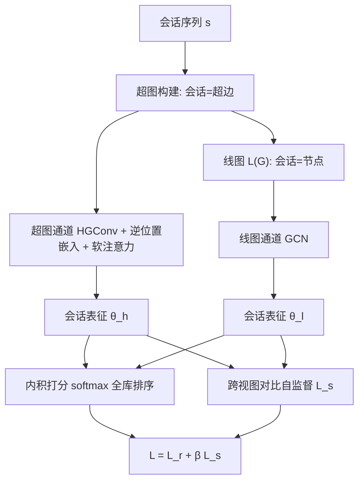
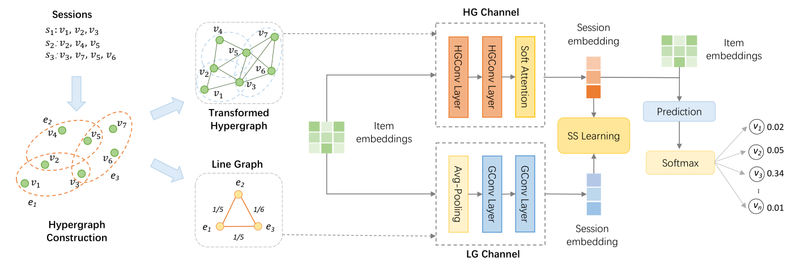

# Self-Supervised Hypergraph Convolutional Networks for Session-based Recommendation (面向会话推荐的自监督超图卷积网络)

- **会议/期刊**: AAAI 2021
- **作者与机构**: Xin Xia, Hongzhi Yin, Junliang Yu, Qinyong Wang, Lizhen Cui, Xiangliang Zhang（昆士兰大学 / 山东大学 / KAUST）
- **推荐链路定位**: 召回（会话级 Next-Item 预测）
- **研究方向**: 序列与会话推荐 / 自监督对比学习与交互去噪
- **论文原文**: [https://arxiv.org/abs/2012.06852v5](https://arxiv.org/abs/2012.06852v5)
- **开源代码**: [https://github.com/xiaxin1998/DHCN](https://github.com/xiaxin1998/DHCN)

## TL;DR (1分钟核心速览)

现有会话推荐（SBR）把 item transition 视为有向成对边，无法表达“一次点击由多个历史点击共同触发”的集合式高阶关系，且会话数据极稀疏。本文把每条会话整体编码为**一条超边**（session = hyperedge），用无参数谱超图卷积做 intra-session 聚合，再在超图的**线图**（session 为节点）上做 inter-session 聚合，并令两通道的会话表征互信息最大化作为辅助自监督任务。在 Tmall / Nowplaying / Diginetica 的全库排序协议下，P@20 相对最优基线提升 5.46%–19.70%，MRR@20 提升 4.97%–9.32%。

## Background & Motivation (背景与核心矛盾)

- **主流范式**: RNN 系（GRU4REC / NARM / STAMP）把会话当严格时序序列；GNN 系（SR-GNN / FGNN / GC-SAN）把会话建成有向子图，只在相邻或被点击的 item 对之间传递消息。
- **前人局限**: ① 严格顺序假设过强——Spotify 顺序/随机播放同一张专辑会产生两条不同序列却是同一偏好，强制建模相对次序易过拟合；② 成对边只能刻画 pairwise 关系，真实场景中一次点击常由前序多个 item 联合触发，存在 many-to-many 高阶关联。
- **核心洞察 (Key Insight)**: 超边是**集合式**结构（强调共现/连贯性而非次序），天然匹配“会话内 item 时序相关但不严格依赖”的假设；而 SBR 数据稀疏（超边内 item 数少）会限制超图建模收益，需第二视图补足。
- **本文切入点**: 一会话一超边做 item 级高阶建模，同时用超图的线图提供 session 级跨会话视图，两视图互为自监督信号。

## Method (核心方法设计)

### 1. 整体框架 (Overall Architecture)

输入为匿名会话 $s=[i_{s,1},...,i_{s,m}]$，先构建超图$\mathcal{G}=(\mathcal{V},\mathcal{E})$（每条会话为一超边，item 为顶点），并由其导出线图$L(\mathcal{G})$（节点=会话，共享 item 则连边）。超图通道经$L$层无参超图卷积得到 item 表征，叠加逆位置嵌入与软注意力池化得到会话表征$\theta_h$；线图通道经$L$层 GCN 得到另一组会话表征$\theta_l$。二者内积打分经 softmax 完成全库排序预测，同时以两视图会话表征的对比损失作辅助任务联合训练。

<figure class="paper-figure" markdown="span">
  <figcaption>图 1：超图构建与所提出 DHCN 模型的流程。</figcaption>
</figure>

### 2. 关键设计拆解 (Key Designs)

1. **无参数超图卷积（item 级高阶聚合）**：成对图卷积只能看见直接邻居，本文把“节点→超边→节点”的两段传播写成闭式算子，等价于让同一会话内任意两 item 全连接。核心式（$W_{\epsilon\epsilon}=1$，矩阵形式已行归一化）：
   $$X_h^{(l+1)}=\mathbf{D}^{-1}\mathbf{H}\mathbf{W}\mathbf{B}^{-1}\mathbf{H}^{\top}X_h^{(l)}$$
   其中 $\mathbf{H}\in\mathbb{R}^{N\times M}$ 为关联矩阵。与 HGNN 一致地**去掉非线性激活与可学习滤波矩阵**，使模型极轻量；由于超边内 item 全通，信息传播只依赖共现结构而非边方向，物理上对应“偏好由集合决定”。
2. **线图通道（session 级跨会话视图）**：仅用超图时短会话（1–3 个 item）几乎无信息。线图节点为会话，边权取 Jaccard 相似度 $W_{p,q}=|e_p\cap e_q|/|e_p\cup e_q|$，做对称归一化 GCN：
   $$\Theta_l^{(l+1)}=\hat{\mathbf{D}}^{-1}\hat{\mathbf{A}}\,\Theta_l^{(l)},\quad \hat{\mathbf{A}}=\mathbf{A}+\mathbf{I}$$
   该通道不接触任何 item 特征，只编码“哪些会话因共享 item 而相邻”，从而为稀疏会话注入跨会话上下文。
3. **双视图对比自监督与联合训练**：同一 mini-batch 内两通道的会话表征存在一一映射，可视为天然的标签增强：正样本为同一会话的两视图对，负样本由对 $\Theta_h$/$\Theta_l$ 做 row-wise 与 column-wise 打乱（shuffle）构造，判别器取内积：
   $$\mathcal{L}_s=-\log\sigma\!\left(f_D(\theta_{h_i},\theta_{l_i})\right)-\log\sigma\!\left(1-f_D(\tilde{\theta}_{h_i},\theta_{l_i})\right)$$
   总目标 $\mathcal{L}=\mathcal{L}_r+\beta\mathcal{L}_s$，$\mathcal{L}_r$ 为全库 softmax 交叉熵。**负采样**：主任务不额外采负样本（全库 softmax），辅助任务用**批内 shuffle 负样本**（免去显式构造）；推理只需两通道前向，无 RNN/自注意力单元，仅保留逆位置嵌入作为唯一时序因子。

## Experimental Setup & Evaluation Protocol (实验设置与评估协议)

- **数据集与预处理**: 过滤仅含 1 个 item 的会话，并删除出现次数 $<5$ 的 item（item 级 5-core）。

| 数据集 | #Users | #Items | #Interactions | 稀疏度/密度 | 特征/场景说明 |
| :--- | :---: | :---: | :---: | :---: | :--- |
| Tmall | 匿名会话 | 40,728 | 351,268 训练 / 25,898 测试会话 | 平均长度 6.69 | 电商购物日志（IJCAI-15） |
| Nowplaying | 匿名会话 | 60,417 | 825,304 / 89,824 | 平均长度 7.42 | 音乐收听，顺序性弱 |
| Diginetica | 匿名会话 | 43,097 | 719,470 / 60,858 | 平均长度 5.12 | 电商点击流（CIKM Cup） |

- **数据划分与防穿越 (Splitting Strategy)**: 沿用 SR-GNN 的**会话末尾切分 + 序列增广**——对每条会话展开为 $([i_{s,1}],i_{s,2}),\ldots,([i_{s,1..m-1}],i_{s,m})$ 多个前缀-标签对，最后一位作测试标签，无未来信息穿越。
- **排名评测协议 (Ranking Protocol)**: **Full-Ranking（全库未交互排序）**，对全部 $N$ 个候选 item 做 softmax 打分，指标为 P@10/P@20 与 MRR@10/MRR@20。
- **对比基线与超参设置**: 基线含传统（Item-KNN、FPMC）、RNN 系（GRU4REC、NARM、STAMP）、GNN 系（SR-GNN、FGNN）。嵌入维度 $d=100$，batch=100，L2=$10^{-5}$，lr=0.001；层数 Tmall 取 1 层、Nowplaying/Diginetica 取 3 层；表中标注$*$ 表示显著优于最佳基线。

## Key Experimental Results (实验关键数据)

### 1. 主实验对比 (Main Results)

| 方法 | Tmall P@10 | M@10 | P@20 | M@20 | Nowplaying P@10 | M@10 | P@20 | M@20 | Diginetica P@10 | M@10 | P@20 | M@20 |
| :--- | :---: | :---: | :---: | :---: | :---: | :---: | :---: | :---: | :---: | :---: | :---: | :---: |
| Item-KNN | 6.65 | 3.11 | 9.15 | 3.31 | 10.96 | 4.55 | 15.94 | 4.91 | 25.07 | 10.77 | 35.75 | 11.57 |
| FPMC | 13.10 | 7.12 | 16.06 | 7.32 | 5.28 | 2.68 | 7.36 | 2.82 | 15.43 | 6.20 | 26.53 | 6.95 |
| GRU4REC | 9.47 | 5.78 | 10.93 | 5.89 | 6.74 | 4.40 | 7.92 | 4.48 | 17.93 | 7.33 | 29.45 | 8.33 |
| NARM | 19.17 | 10.42 | 23.30 | 10.70 | 13.60 | 6.62 | 18.59 | 6.93 | 35.44 | 15.13 | 49.70 | 16.17 |
| STAMP | 22.63 | 13.12 | 26.47 | 13.36 | 13.22 | 6.57 | 17.66 | 6.88 | 33.98 | 14.26 | 45.64 | 14.32 |
| SR-GNN | 23.41 | 13.45 | 27.57 | 13.72 | 14.17 | 7.15 | 18.87 | 7.47 | 36.86 | 15.52 | 50.73 | 17.59 |
| FGNN | 20.67 | 10.07 | 25.24 | 10.39 | 13.89 | 6.80 | 18.78 | 7.15 | 37.72 | 15.95 | 50.58 | 16.84 |
| DHCN | 25.14 | 13.91 | 30.43 | 14.26 | 17.22 | 7.78 | 23.03 | 8.18 | 39.87 | 17.53 | 53.18 | 18.44 |
| **S²-DHCN** | **26.22** | **14.60** | **31.42** | **15.05** | **17.35** | **7.87** | **23.50** | **8.18** | **40.21** | **17.59** | **53.66** | **18.51** |
| Improv.% | +10.71% | +7.87% | +12.25% | +8.84% | +18.32% | +9.15% | +19.70% | +8.68% | +6.19% | +9.32% | +5.46% | +4.97% |

### 2. 消融实验 (Ablation Study)

原文以图 2 柱状图给出（未列数值），下表记录趋势方向：

| 变体 | Tmall P@20 / M@20 | Diginetica P@20 / M@20 |
| :--- | :---: | :---: |
| DHCN（完整，无自监督） | 30.43 / 14.26 | 53.18 / 18.44 |
| w/o 逆位置嵌入 (DHCN-P) | ↑ 上升 | ↓ 下降 |
| w/o 软注意力 (DHCN-NA) | ↑ 上升 | ↓ 下降（降幅更大） |
| + 自监督 (S²-DHCN) | 31.42 / 15.05 | 53.66 / 18.51 |
| 层数 1 vs 3 | 1 层最优 | 3 层最优 |
| $\beta$取 0.001–0.02 | 增益最佳 | 增益最佳；$\beta\geq0.03$ 后 M@20 明显下降 |

### 3. 关键实验发现 (Key Findings)

1. **超图收益与场景“顺序强度”强相关**：Nowplaying（音乐可随机播放、顺序语义最弱）提升最大，P@20 从 18.87→23.50（+19.70%）；Diginetica 顺序语义强，仅 +5.46%。说明超边的集合假设在弱序场景回报最高。
2. **自监督对稀疏/短会话的补足最明显**：Tmall 上 DHCN→S²-DHCN 使 M@20 由 14.26→15.05（相对 +5.5%），远高于 Diginetica 的 +0.4%；印证“超边内 item 少→靠线图跨会话信息救场”的设计动机。
3. **模型简洁性与稳健性可兼得**：Tmall 上去掉逆位置嵌入与软注意力反而涨（弱序假设的自证），而 Diginetica 两项均下降；层数敏感度低（1–3 层），$\beta$过大则因主辅任务梯度冲突使 M@20 显著下滑，须保持$\beta$ 为弱权重。

## Highlights & Limitations (亮点、对比与审稿批判)

- **与代表作对比 (vs. Prior Work)**: SR-GNN/FGNN 把会话建成有向成对图，只覆盖相邻 item；DHCN 用超边把会话内 item 全连接，且卷积无参数，参数量与计算显著更省。相对 HyperRec（超图用于短期偏好），DHCN 额外挖掘 hyperedge 间（线图）信息并首次面向 SBR。相对 S³-Rec（mask 式自监督），DHCN 不依赖特征掩码，适配极稀疏会话。
- **可迁移亮点**: ① “主图 + 线图”双通道 + 跨视图对比，可低成本套用到 KG/序列任意图结构；② 用 Jaccard 加权线图把序列交互转成 session-session 相似图，可作为冷启动会话的通用增强模块。
- **审稿级局限批判**: ① 消融仅在图上呈现、无具体数值与多次运行方差，显著性证据弱于主实验；② 线图通道需构建 $M\times M$会话邻接（$M$ 为会话数），大规模线上场景需采样/分块，论文未讨论工业级开销；③ 评测仅用 P/MRR，缺少 NDCG 与冷启动/长尾分桶分析。

## Rating (四维评分)

- **方法创新性 (Novelty)**: ⭐⭐⭐⭐ （首次将“会话=超边”与线图双通道对比自监督结合，结构假设与 SBR 弱序特性契合，但超图卷积本身沿用 HGNN 无参形式）
- **评估协议与实验扎实度 (Protocol & Experiments)**: ⭐⭐⭐⭐ （三数据集 + 全库排序 + 7 个强基线且给出显著性标记，但消融仅图示、缺方差与分桶实验）
- **写作与数学规范度 (Clarity & Rigor)**: ⭐⭐⭐⭐ （公式紧凑、通道与负样本构造交代清楚，未给复杂度与线图规模分析）
- **工业落地与复现价值 (Industrial & Practical Value)**: ⭐⭐⭐⭐ （代码开源、无 RNN/自注意力、参数量小易部署；线图邻接的规模化仍是工程门槛）

