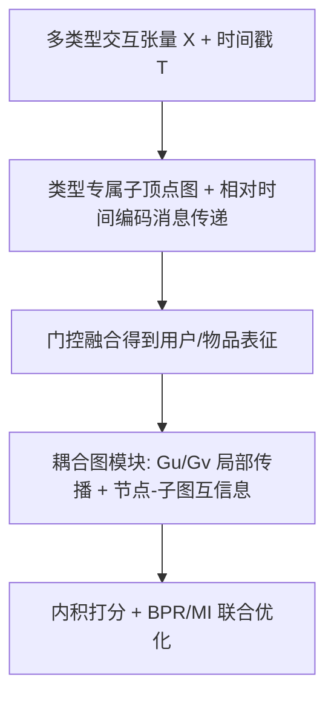
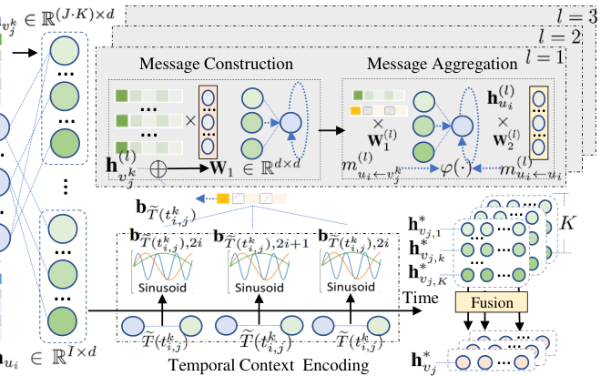

# Knowledge-aware Coupled Graph Neural Network for Social Recommendation (知识感知耦合图神经网络社交推荐)

- **会议/期刊**: AAAI 2021
- **作者与机构**: Chao Huang, Huance Xu, Yong Xu, Peng Dai, Lianghao Xia 等；JD Finance America、华南理工大学、鹏城实验室、唯品会研究、Case Western Reserve University
- **推荐链路定位**: 召回（用户/物品表征学习）
- **研究方向**: 社交与群组推荐 / 图神经网络与知识图谱推荐
- **论文原文**: [https://arxiv.org/abs/2110.03987v1](https://arxiv.org/abs/2110.03987v1)
- **开源代码**: [https://github.com/xhcdream/KCGN](https://github.com/xhcdream/KCGN)

## TL;DR (1分钟核心速览)

社交推荐的主流 GNN 方案只编码用户-用户社交边，忽略物品侧语义依赖、把用户-物品交互压成单一类型、且丢弃交互时间戳。KCGN 用「类型专属物品子顶点 + 相对时间编码」的关系感知消息传递刻画多类型动态交互，再用互信息估计器把用户社交图与物品依赖图的局部/全局结构耦合进同一表征空间。在 Epinions/Yelp/E-Commerce 三套数据、Leave-One-Out + 99 负采样评测下，HR@10 相对最强基线提升 1.8%–4.9%，单 epoch 训练耗时仅为 KGAT 的 1/3。

## Background & Motivation (背景与核心矛盾)

- **主流范式**: 以 DiffNet/GraphRec/Danser 为代表的 GNN 社交推荐，在用户社交图上做层级消息扩散或图注意力聚合，把社交同质性当作协同过滤的补充信号。
- **前人局限**: ① 只建 $G_u$不建$G_v$，物品同类/互补的语义关联被浪费；② 只支持单一交互类型，无法区分「浏览→收藏→购买」的异质行为链；③ 绝大多数模型假设交互静态，忽略时间戳带来的行为漂移。
- **核心洞察 (Key Insight)**: 非线性邻域聚合只能保留局部邻近性，学不到图级别的子结构相似性（如同构社交结构的用户应被拉近）；而互信息最大化恰好能把「节点级独特性」与「子图级全局语义」同时约束住。
- **本文切入点**: 把多类型时序交互图与孪生的用户/物品关系图耦合到统一框架，用互信息而非额外监督信号做全局结构对齐。

## Method (核心方法设计)

### 1. 整体框架 (Overall Architecture)

模型分三层闭环：先把三阶张量 $\mathcal{X}\in\mathbb{R}^{I\times J\times K}$（$K$种交互类型）与时间戳张量$\mathcal{T}$展开为「用户顶点—类型专属物品子顶点$v_j^k$」的多类型图$\mathcal{G}_m$，在其上执行带相对时间编码的关系感知消息传递并经门控融合得到$h^*_{u_i}, h^*_{v_j}$；随后把该结果作为初值送入耦合图模块，在社交图$\mathcal{G}_u$与物品依赖图$\mathcal{G}_v$上做对称归一化传播，并用节点-子图判别器最大化互信息；最后以内积打分 + BPR 与$\mathcal{L}_\beta$ 联合训练，推理时仅做内积检索。

<figure class="paper-figure" markdown="span">
  <figcaption>图1：多类型交互模式建模的架构。⊕表示逐元素相加。</figcaption>
</figure>

### 2. 关键设计拆解 (Key Designs)

1. **类型感知 + 时间感知的关系消息传递**：把物品拆成 $K$ 个类型子顶点，使「同一物品的不同行为」拥有独立表征，避免异质信号被平均掉。核心算子为

$$m_{u_i\leftarrow v_j^k}=\frac{1}{\sqrt{|\mathcal{N}_i||\mathcal{N}_j^k|}}\big(\mathbf{h}_{v_j^k}\mathbf{W}_1\big),\quad \mathbf{h}_{u_i}^{(l+1)}=\phi\Big(\tfrac{1}{|\mathcal{N}_{u_i}|}\mathbf{h}_{u_i}^{(l)}\mathbf{W}_2^{(l)}+\!\!\sum_{(j,k)\in\mathcal{N}_{u_i}}\!\!\tfrac{1}{\sqrt{|\mathcal{N}_{v_j^k}|}}(\mathbf{h}_{v_j^k}^{(l)}\oplus \mathbf{b}_{\tilde{T}(t_{i,j}^k)})\mathbf{W}_1^{(l)}\Big)$$

其中时间嵌入沿用正弦位置编码 $\mathbf{b}_{\tilde{T},2i}=\sin(\tilde{T}/10000^{2i/d})$。直觉：距离当前越远的交互被赋予不同频率相位，模型据此区分「早期浏览」与「近期购买」的贡献权重；子顶点再经门控机制汇总，自动学习哪类行为对该用户最有信息量。
2. **耦合图 + 互信息全局结构对齐**：在 $\mathcal{G}_u,\mathcal{G}_v$上做$\eta(\mathcal{G})=\hat{D}^{-\frac12}\hat{A}\hat{D}^{-\frac12}$的局部传播后，对每个连通子图$G'_u$做均值池化得全局向量$f_{G'_u}$，用节点打乱生成负对，损失为

$$\mathcal{L}_\beta=-\frac{\lambda_1}{N^{u}_{pos}+N^{u}_{neg}}\sum_{i}\Big[\tau(z_{u_i},f_{G'_u})\log\sigma(z_{u_i}\cdot f_{G'_u})+\tau(\tilde{z}_{u_i},f_{G'_u})\log(1-\sigma(\tilde{z}_{u_i}\cdot f_{G'_u}))\Big]+\text{(item 对称项)}$$

与以往「节点 vs 单一全局向量」的 InfoGraph 式对比不同，这里以**连通子图**为粒度，能保留多社区结构；该正则等价于最大化 $I(z;f_{G'})$，从而在无额外标签的前提下同时压制孤立节点噪声与子图漂移。
3. **训练目标与开销**：总损失 $\mathcal{L}=\sum_{(i,j^+,j^-)\in\mathcal{O}}-\ln\sigma(\hat{x}_{i,j^+}-\hat{x}_{i,j^-})+\lambda\|\Theta\|_2^2+\mathcal{L}_\beta$，负样本沿用 BPR 的均匀采样（评测阶段另取 99 负例）。复杂度$O(|\mathcal{E}|d+(I+JK)d^2)$，与 NGCF 同阶；因避免逐对注意力权重计算，实测远快于 KGAT/GraphRec。

## Experimental Setup & Evaluation Protocol (实验设置与评估协议)

- **数据集与预处理**: 三套真实数据，物品依赖图 $\mathcal{G}_v$ 统一按 item category 构造；Epinions/Yelp 把 1–5 星评分离散为 5 种交互类型，E-Commerce 含 page view / add-to-cart / add-to-favorite / purchase 四类。

| 数据集 | #Users | #Items | #Interactions | 稀疏度 | 特征/场景说明 |
| :--- | :---: | :---: | :---: | :---: | :--- |
| Epinions | 18,081 | 251,722 | 715,821 | $1.57\times10^{-4}$ | 带社交关系的评论平台，5 档评分类型 |
| Yelp | 43,043 | 66,576 | 283,512 | $9.89\times10^{-5}$ | 本地商户评论，含共同兴趣社交边 |
| E-Commerce | 334,042 | 195,940 | 1,930,466 | $2.95\times10^{-5}$ | 工业电商，4 类行为链，社交边由共交互构造 |

- **数据划分与防穿越 (Splitting Strategy)**: 采用 `Leave-One-Out`（每位用户留最后一次交互作测试，倒数第二次作验证），训练/验证/测试严格按时间顺序切分，无未来交互泄漏。
- **排名评测协议 (Ranking Protocol)**: `Sampled Ranking`，每个正例配 99 个均匀采样负例，指标为 HR@10 与 NDCG@10。
- **对比基线与超参设置**: 覆盖 PMF（MF）、TrustMF（社交 MF）、SAMN/EATNN（注意力社交）、DiffNet/GraphRec/NGCF+S/Danser/LR-GCCF（GNN 社交）、DGRec（序列社交）、KGAT（知识图谱）共 11 个基线；嵌入维度 $d\in\{8,16,32,64\}$，学习率$\{0.001,0.005,0.01\}$，batch$\{1024\text{–}8192\}$，验证集连续 5 轮不升即早停；最优层数$L=2$。

## Key Experimental Results (实验关键数据)

### 1. 主实验对比 (Main Results)

| 数据集 | 指标 | PMF | TrustMF | DiffNet | GraphRec | NGCF+S | KGAT | DGRec | LR-GCCF | **KCGN** | Improv. |
| :--- | :---: | :---: | :---: | :---: | :---: | :---: | :---: | :---: | :---: | :---: | :---: |
| Epinions | HR@10 | 0.619 | 0.635 | 0.632 | 0.686 | 0.707 | 0.675 | 0.626 | 0.677 | **0.742** | +4.95% |
| Epinions | NDCG@10 | 0.410 | 0.417 | 0.416 | 0.478 | 0.498 | 0.470 | 0.412 | 0.478 | **0.513** | +3.01% |
| Yelp | HR@10 | 0.698 | 0.756 | 0.785 | 0.760 | 0.781 | 0.772 | 0.766 | 0.769 | **0.8026** | +2.24% |
| Yelp | NDCG@10 | 0.460 | 0.495 | 0.512 | 0.494 | 0.523 | 0.511 | 0.495 | 0.518 | **0.530** | +1.34% |
| E-Com | HR@10 | 0.654 | 0.674 | 0.722 | 0.668 | 0.694 | 0.689 | 0.672 | 0.690 | **0.735** | +1.80% |
| E-Com | NDCG@10 | 0.431 | 0.452 | 0.519 | 0.439 | 0.476 | 0.473 | 0.441 | 0.485 | **0.529** | +1.93% |

### 2. 消融实验 (Ablation Study)

原文以图 3 给出各变体的 HR@10/NDCG@10（未列具体数值），下表按其相对排序与结论整理：

| 变体 | 移除模块 | 相对性能 | 结论 |
| :--- | :--- | :---: | :--- |
| KCGN | — | 最优（基准） | 全模块协同最优 |
| KCGN-T | 时间上下文编码 | 次优（小幅下降） | 时间相位对动态兴趣有增益 |
| KCGN-M | 多类型交互（退化为单类型） | 明显下降 | 交互异质性建模是主要增益源 |
| KCGN-I | 物品依赖图 $\mathcal{G}_v$ | 下降 | 跨物品知识不可或缺 |
| KCGN-U | 用户社交图编码 | 下降 | 社交信号仍为基础信息 |
| KCGN-UI | 用户+物品双关系编码及互信息耦合 | 下降最大 | 双图耦合与 MI 是核心 |

| 数据 | 每 epoch 训练耗时(s) | DGRec | SAMN | KGAT | GraphRec | **KCGN** |
| :--- | :--- | :---: | :---: | :---: | :---: | :---: |
| Epinions | — | 4.4 | 4.7 | 60.5 | 40.5 | **17.5** |
| Yelp | — | 2.6 | 8.9 | 20.9 | 7.3 | **3.7** |
| E-Com | — | 82.5 | 78.3 | 342.8 | 497.3 | **70.2** |

### 3. 关键实验发现 (Key Findings)

1. 增益随数据稀疏度单调放大：Epinions（$1.57\times10^{-4}$）HR 相对最强基线 +4.95%，Yelp +2.24%，最稠密的 E-Com（$2.95\times10^{-5}$）仅 +1.80%——说明孪生图结构先验主要补偿的是共现信号不足，而非替代稠密协同信号。
2. 目标类型预测（Epinions 正反馈 / E-Com 购买）中 KCGN 仍取得 HR 0.745 / 0.839 / 0.911，Epinions 相对 KGAT（0.685，已引入辅助知识图但未区分类型）提升 8.76%，证明「类型子顶点拆分」比「额外知识图」更有效地解耦行为语义。
3. 效率与深度呈倒 U：KCGN 每 epoch 17.5s，比 KGAT（60.5s）快 3.5×、比 GraphRec（40.5s）快 2.3×；层数从 1→2 稳定提升，3 层后下降，说明高阶社交传播在第 3 跳已引入噪声，$L=2$ 为精度/开销的甜点。

## Highlights & Limitations (亮点、对比与审稿批判)

- **与代表作对比 (vs. Prior Work)**: NGCF+S 只把社交边并入协同图，KMGN 类工作只加物品知识图但不能区分行为类型；KGAT 虽用知识图注意力，却在同一消息通道里混合了所有交互；DGRec 建模序列但仅支持单一交互关系。KCGN 是少数同时统一「类型异质性 + 时间动态 + 用户/物品双图耦合」的框架。
- **可迁移亮点**: ① 把「物品拆成类型子顶点 + 门控汇总」的写法可直接移植到多行为电商/短视频（曝光-点击-点赞-分享）召回；② 以**连通子图**为粒度（而非全图单向量）做互信息对比，是一种低成本、无需负采样调参的结构正则，可加在任意 LightGCN 类骨干上。
- **审稿级局限批判**: ① 评测仅用 99 负采样的 Sampled Ranking，未报 Full-Ranking，采样负例数量对 HR 的影响未被讨论；② 互信息判别器的正负对构造依赖节点打乱，子图数量 $N_{pos}/N_{neg}$与小图（如 Epinions 用户稀疏）情形下的方差未做稳定性分析；③ 时间编码仅用绝对时间戳的正弦槽位，未处理不规则采样与长尾时间分布，$K$类型数增大时参数量$O(JK d)$ 线性膨胀，工业物品库下存储开销需再评估。

## Rating (四维评分)

- **方法创新性 (Novelty)**: ⭐⭐⭐⭐ （将类型子顶点、相对时间编码与子图级互信息三项拼成统一框架，单项不算全新但组合切中社交推荐三处空白）
- **评估协议与实验扎实度 (Protocol & Experiments)**: ⭐⭐⭐ （11 个基线覆盖完整且有稀疏度分桶与效率对比，但仅 Sampled Ranking、消融仅以图呈现且无显著性检验）
- **写作与数学规范度 (Clarity & Rigor)**: ⭐⭐⭐⭐ （消息传递与 MI 损失公式完整、复杂度分析清晰，对 $\tau(\cdot)$ 指示函数与平衡项的表述略冗余）
- **工业落地与复现价值 (Industrial & Practical Value)**: ⭐⭐⭐⭐ （代码已开源，含真实电商 33 万用户级数据验证，单 epoch 70s 的工业可承受开销，明显优于注意力类基线）

