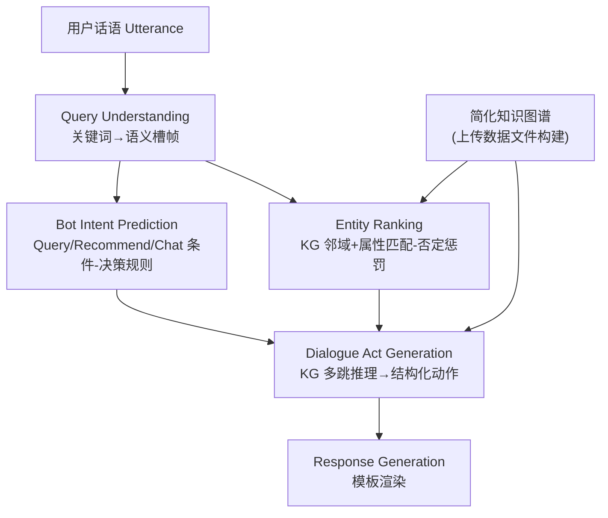
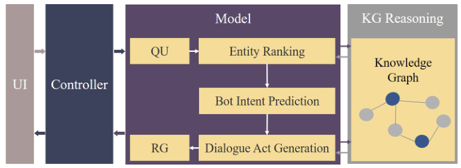

# FORCE: A Framework of Rule-Based Conversational Recommender System (规则式对话推荐系统框架 FORCE)

- **会议/期刊**: AAAI 2022 (Demonstration Track)
- **作者与机构**: Jun Quan, Ze Wei, Qiang Gan, Jingqi Yao 等（Microsoft China；苏州大学；UC Irvine）
- **推荐链路定位**: 多轮对话交互层（Query Understanding → 实体排序 → 对话动作生成，端到端会话闭环）
- **研究方向**: 对话推荐与智能体仿真 / 冷启动与长尾推荐
- **论文原文**: [https://arxiv.org/abs/2203.10001v1](https://arxiv.org/abs/2203.10001v1)
- **开源代码**: 暂未开源（仅提供演示视频 https://youtu.be/UjkLL5pgXx8）

## TL;DR (1分钟核心速览)

现有 CRS 几乎全部押注深度模型，强依赖大规模人工标注语料，在工业冷启动场景（新领域、新语言、无数据）直接失效。FORCE 反其道而行：用「简化知识图谱 + 条件-决策规则 + 模板生成」搭一个 Model-View-Controller 四层可配置框架，开发者只需上传一个三元组数据文件并拖动几个配置条即可上线 bot。在 `M-RD`（英文电影，采自 ReDial）与 `DX`（中文医疗诊断）两域上，意图预测准确率由随机基线 33.33% 提升至 67.28% / 66.34%，`M-RD` 的 R@50 由 20.30% 升至 50.97%（相对 +151%）。

## Background & Motivation (背景与核心矛盾)

- **主流范式**: 以 ReDial / CR-Walker 为代表的 CRS 采用端到端深度模型，在 Redial、TG-ReDial 等电影、音乐语料上做监督学习，通过 KG 语义融合或图游走生成推荐与回复。
- **前人局限**: ① 每个新业务域都需重新标注数千轮对话，冷启动产品（医疗、金融、心理咨询）拿不到数据；② 公开数据集中在电影/音乐两类娱乐域，深度模型难以跨域迁移，也无法跨语言快速复制。
- **核心洞察 (Key Insight)**: 对话推荐的本质决策空间其实很小——bot 每轮只需在 `Query / Recommend / Chat` 三类意图中选一个，再在 KG 上挑一个满足当前槽位约束的实体。既然决策树可枚举，标注数据就不是必需品，**规则 + 结构化 KG 在封闭域内足以逼近监督模型**。
- **本文切入点**: 把 CRS 拆成可解耦的模块流水线，用「配置」代替「训练」，让冷启动 bot 的构建成本从"标注 + 训练"降为"上传数据文件 + 调三个滑条"。

## Method (核心方法设计)

### 1. 整体框架 (Overall Architecture)

FORCE 基于 MVC 模式分四层：User Interface Layer 提供对话与构建界面；Controller Layer 负责前后端消息调度；**Model Layer** 是核心，串起五个模块：Query Understanding 依配置的关键词把用户话语解析为语义槽帧（semantic frame）→ Entity Ranking 结合会话上下文、KG 实体邻域与已提及属性对候选实体打分 → Bot Intent Prediction 用「条件-决策」规则判定本轮动作 → Dialogue Act Generation 在 KG 上推理出下一动作的结构化表示（Dialogue Act）→ Response Generation 用可配置模板把 Dialogue Act 渲染成自然语言。Knowledge Graph Reasoning Layer 承接上传数据构建的简化 KG，为实体排序与动作生成提供多跳邻域推理。模块间以预定义接口解耦，任一模块可被训练好的模型替换，但本文版本全部为规则实现。系统另提供 `casual`（泛化推荐，适配影视/音乐/书籍）与 `cautious`（精准推荐，适配医疗/咨询）两套预置模式。

<figure class="paper-figure" markdown="span">
  <figcaption>图1：FORCE 的整体架构。</figcaption>
</figure>

### 2. 关键设计拆解 (Key Designs)

1. **简化 KG 上的实体打分（Entity Ranking）**：痛点在于冷启动无交互矩阵可做协同过滤，只能靠内容与约束。原文未给出显式公式，据系统描述其打分可归纳为「属性命中奖励 − 用户否定惩罚 + 邻域共现」的加权形式：$s(e)=\sum_{a\in\mathcal{A}_{\text{utt}}}\mathbb{I}[(e,a)\in\mathcal{G}]-\lambda_{\text{neg}}\cdot\mathbb{I}[e\in\mathcal{E}_{\text{deny}}]+\beta\cdot g_{\text{nbr}}(e)$，其中$g_{\text{nbr}}(e)$ 为 KG 上实体邻域与当前对话已提及实体的连通强度。其有效性直觉是：对话已把用户约束压缩成少量槽位，KG 上的属性匹配等价于一次精确的约束求解，无需学习即可泛化到新域。
2. **三类意图的「条件-决策」树 + 可调偏好**：痛点是深度模型输出的意图不可解释、不可运营干预。FORCE 把决策写成显式规则，并暴露三个滑条 $p_{Q},p_{R},p_{C}$与匹配阈值$\tau$与否定惩罚$\lambda_{\text{neg}}$：只有当候选实体匹配度$\ge\tau$时 `Recommend` 分支才被触发，否则回落到 `Query` 追问槽位。这样"追问 vs 直推"的激进程度成为可调业务参数，`cautious` 模式即取高$\tau$、高$\lambda_{\text{neg}}$。
3. **训练目标、负采样与推理效率**：本文是规则框架，**无损失函数、无负采样、无梯度训练**，全部决策为确定性规则 + 模板字符串拼接；推理开销仅在 KG 邻域查询与字符串渲染，单轮响应为毫秒级常数复杂度，无 GPU 需求。代价是回复多样性受模板库上限约束。

## Experimental Setup & Evaluation Protocol (实验设置与评估协议)

- **数据集与预处理**: 原文未报告用户/物品规模与稀疏度，仅说明两个数据集的构造方式如下（无 `5-core` 过滤，未给统计表）：

| 数据集 | 语言/领域 | 构造方式 | 候选空间 | 场景/模式 |
| :--- | :---: | :--- | :---: | :--- |
| M-RD (Mini-ReDial) | 英文 / 电影 | 从 ReDial 采样含全部三类意图、5–7 轮的会话 | 相对大（随机 R@1≈0.41%） | casual 泛化推荐 |
| DX | 中文 / 医疗诊断 | 对中文医疗诊断数据集 Xu et al. 2019 重新处理 | 极小（随机 R@1=20%，约 5 候选） | cautious 精准推荐 |

- **数据划分与防穿越 (Splitting Strategy)**: 属演示型评测，**未采用 Leave-One-Out / 比例划分 / 全局时间戳切分**；直接对采样会话逐轮做在线评测，无训练集故不存在穿越风险。
- **排名评测协议 (Ranking Protocol)**: 在 `Recommend` 意图轮次上计算 Recall@k；对比基线为**随机采样（random ranking）**，而非全库无偏 Full-Ranking 的 SOTA 模型——这正是该文评估的最大软肋。
- **对比基线与超参设置**: 基线仅 Random + CR-Walker 的论文引用值（†在完整 ReDial 上测得，非 M-RD）；无 Embedding 维度 $d$（规则系统），无显著性检验，无多次随机种子方差报告。

## Key Experimental Results (实验关键数据)

### 1. 主实验对比 (Main Results)

| 数据集 | 方法 | Intent Acc. (%) | R@1 (%) | R@2 (%) | R@3 (%) | R@10 (%) | R@50 (%) |
| :--- | :--- | :---: | :---: | :---: | :---: | :---: | :---: |
| M-RD | Random 基线 | 33.33 | 0.41 | – | – | 4.10 | 20.30 |
| M-RD | CR-Walker †(完整 ReDial) | 67.8 | 3.1 | – | – | 15.5 | 36.5 |
| M-RD | **FORCE** | **67.28** | **4.37** | – | – | **16.50** | **50.97** |
| DX | Random 基线 | 33.33 | 20.00 | 40.00 | 60.00 | – | – |
| DX | **FORCE** | **66.34** | **79.51** | **92.98** | **97.15** | – | – |

相对随机基线的提升：M-RD 上 R@1 / R@10 / R@50 分别约 **+966% / +302% / +151%**；DX 上 R@1 提升 **+297.6%**（79.51 vs 20.00）。

### 2. 消融实验 (Ablation Study)

原文**未提供组件消融**（无深度模型可拆、无训练环节），此处以「跨语言 × 跨领域 × 双模式」的配置迁移对照替代，作为其泛化主张的唯一证据：

| 配置维度 | M-RD 设置 | DX 设置 | 观察（Intent Acc.） |
| :--- | :--- | :--- | :--- |
| 语言 | 英文 | 中文 | 66.34 vs 67.28，几乎无衰减 |
| 领域 | 娱乐（电影） | 医疗诊断 | 同上，说明规则不依赖域标注 |
| 预置模式 | casual（低 $\tau$） | cautious（高$\tau$） | 高阈值更保守但 top-k 更集中（R@1=79.51） |
| 候选集规模 | 大（随机 R@1≈0.41%） | 小（随机 R@1=20%） | 候选缩小 50× 使 R@1 绝对收益放大 |

### 3. 关键实验发现 (Key Findings)

1. **意图决策是规则系统最稳的环节**：两域 Intent Acc. 均落在 66–67%，与深度模型 CR-Walker 在完整 ReDial 上的 67.8% 几乎持平，而两者相差 33.4 个百分点的随机基线，证明"三类动作 + 槽位条件"的决策空间确实可被显式规则近似覆盖。
2. **收益集中在长尾 recall 而非 top-1 精度**：M-RD 上 R@50 达 50.97%（超 CR-Walker 14.5 个点、超随机 30.7 个点），但 R@1 仅 4.37%，绝对增益 3.96 个点，说明 KG 属性匹配擅长"把对的实体捞进候选池"，却不擅长精细排序。
3. **DX 的 79.51% R@1 主要来自候选空间收缩而非排序能力**：随机基线本身就有 20% R@1（≈5 候选），FORCE 将其推到 79.51%，属"封闭小候选域 + 精确槽位匹配"的高效场景；一旦迁移到 M-RD 这类大候选域，R@1 即回落至 4.37%，提示框架适用边界是**候选可枚举的垂直域**。

## Highlights & Limitations (亮点、对比与审稿批判)

- **与代表作对比 (vs. Prior Work)**: 与 CR-Walker（KG 图游走 + 监督生成）相比，FORCE 不做任何训练、不生成自由文本，换来零标注启动与完全可解释的决策可视化；与 CRSLab 等工具包相比，FORCE 提供的是可直接上线的 MVC 产品级框架而非实验评测库；与纯检索式 FAQ bot 相比，FORCE 具备 KG 多跳约束求解能力。本质差异是"数据驱动"与"配置驱动"的路线之争，而非同赛道性能之争。
- **可迁移亮点**: ①「意图-动作树 + 可调阈值 $\tau$」把追问/直推的激进程度外化为业务参数，可迁移到任何多轮任务型系统做冷启动兜底；②把 KG 邻域推理结果实时可视化，既是可解释性卖点，也是低成本的对话数据采集工具——先跑规则 bot 收集会话，再回流训练深度模型，形成 data flywheel。
- **审稿级局限批判**: ①**评估严重不充分**：基线仅 random sampling，未在 M-RD 上复现任何 CRS SOTA（CR-Walker 数字取自完整 ReDial，数据集不同不可直接比），无显著性检验与方差，召回指标仍在采样候选而非全库；②**回复质量完全未被评估**：无 BLEU/ROUGE、无人工流畅度与满意度、无成功率指标，而模板拼接恰恰是规则系统的最大短板；③**超参敏感**：匹配阈值 $\tau$、否定惩罚$\lambda_{\text{neg}}$ 与滑条偏好全为手工设定，论文未做敏感性分析，不同域的可移植性存疑；④演示型论文，代码未开源、无可复现脚本。

## Rating (四维评分)

- **方法创新性 (Novelty)**: ⭐⭐⭐ （不追求模型新颖度，但"规则 + 简化 KG 的可配置 CRS 框架"在深度学习一统的 CRS 赛道提供了有价值的反向路线与工程范式）
- **评估协议与实验扎实度 (Protocol & Experiments)**: ⭐⭐ （仅随机采样基线、无消融、无显著性检验、无回复质量评估、CR-Walker 数字跨数据集引用，作为 Demo Track 尚可，作为实证研究严重不足）
- **写作与数学规范度 (Clarity & Rigor)**: ⭐⭐⭐ （系统四层架构与五模块流水线描述清晰、图示完整，但全文无一个公式与形式化定义，模块打分与规则判定的细节仅停在自然语言层面）
- **工业落地与复现价值 (Industrial & Practical Value)**: ⭐⭐⭐⭐ （一个数据文件 + 若干配置即可上线冷启动 bot，语言/领域无关，支持模块级替换为学习模型，是少见的"可直接交付"型推荐系统框架；扣分项为代码未开源）

