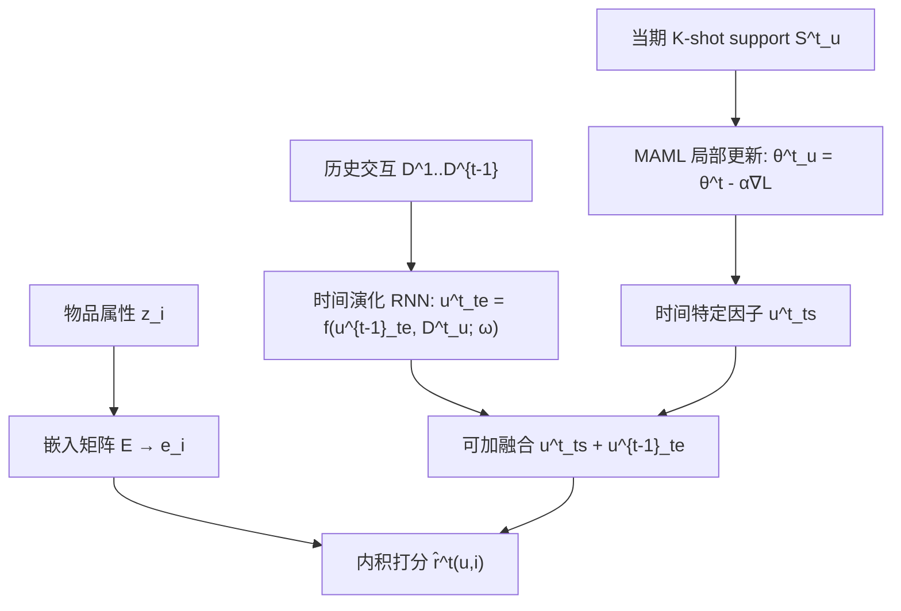
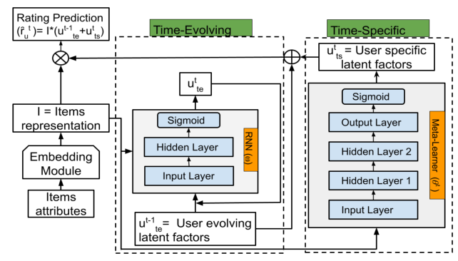

# A Dynamic Meta-Learning Model for Time-Sensitive Cold-Start Recommendations (面向时间敏感冷启动推荐的动态元学习模型)

- **会议/期刊**: AAAI 2022
- **作者与机构**: Krishna Prasad Neupane, Ervine Zheng, Yu Kong, Qi Yu（Rochester Institute of Technology）
- **推荐链路定位**: 精排（分期评分预测 / Top-N 排序）
- **研究方向**: 冷启动与长尾推荐 / 序列与会话推荐
- **论文原文**: [https://arxiv.org/abs/2204.00970v1](https://arxiv.org/abs/2204.00970v1)
- **开源代码**: [https://github.com/ritmininglab/A-Dynamic-Meta-Learning-Model-for-Time-Sensitive-Cold-Start-Recommendations](https://github.com/ritmininglab/A-Dynamic-Meta-Learning-Model-for-Time-Sensitive-Cold-Start-Recommendations)

## TL;DR (1分钟核心速览)

本文提出 **时间敏感冷启动** 新问题：用户历史交互丰富但近期几乎静默，仅靠历史会推荐"过时兴趣"，而近期稀疏交互又不足以估出当期偏好。作者把用户隐向量可加分解为 **时间特定因子**（当期少量交互经 MAML 快速适配，借用他人当期共性）与 **时间演化因子**（嵌套 RNN 传递口味漂移），二者相加与属性派生的物品嵌入做内积。在 Netflix / Last.fm / MovieLens-1M 的分期留出协议下，RMSE 相对最优基线降低 1.7%–5.1%，NDCG@N 提升 3.3%–7.7%。

## Background & Motivation (背景与核心矛盾)

- **主流范式**: 静态 MF（SVD++）刻画不变隐因子；动态 MF 用加性时间偏置（timeSVD++）或状态空间/卡尔曼滤波（CKF、DPF）刻画漂移；冷启动侧则以元学习（MeLU、ML-ICS）把每个用户当少样本回归任务，靠跨用户共享知识快速适配。
- **前人局限**: ① 动态 MF 的时间因子仍是"每人每期一组参数"，当期交互稀少时无法估准，且加性偏置表达力弱；② 元学习推荐器把用户任务视为**静态**，跨期不传递兴趣演化，历史与当期信息割裂，导致"用老口味做新推荐"。
- **核心洞察 (Key Insight)**: 图 1 显示同一用户对三类题材的平均评分在 2002–2005 间剧烈震荡。作者判断该波动由两类可加因素叠加：**time-evolving**（跨期缓慢的口味迁移，可从长历史上学）与 **time-specific**（当期预算、评分尺度、外部事件导致的突发偏移，只能从当期数据学）。
- **本文切入点**: 既然两因素的**数据可得性不同**，就用两套机制分别承载——RNN 吃长历史学演化、MAML 吃 K 条当期交互学当期共性，再相加成统一用户表征。

## Method (核心方法设计)

### 1. 整体框架 (Overall Architecture)

输入按时间周期 $t\in\mathcal{H}$聚合的用户-物品交互（评分或播放计数）。物品侧不学自由 ID 向量，而是把 genre/director/actors/plot/rating 等属性二值化后经嵌入矩阵$E$编码成$e_i$。用户侧双分支并行：**时间演化模块**把上一期隐因子$u^{t-1}_{te}$与当期交互集合$D^t_u$送入嵌套 RNN 得到$u^t_{te}$；**时间特定模块**以当期 support set 做一步梯度适配得$u^t_{ts}$。两者相加后与$e_i$ 内积打分，MSE 回归 + 嵌入重建损失联合优化。推理时对新到的冷启动用户仅需 K=5 条当期交互做一次局部更新即可出分。

<figure class="paper-figure" markdown="span">
  <figcaption>图2：所提模型通过循环网络模块捕获随时间演化的因素，并通过元学习模块捕获时间特定因素。</figcaption>
</figure>

### 2. 关键设计拆解 (Key Designs)

1. **时间特定元学习模块（Time-Specific Meta-Learning）**：痛点是当期交互仅 K 条，无法直接拟合用户参数。作者把每个用户视为任务 $T^t_u=(S^t_u,Q^t_u)$，先由全局参数$\theta^t$在 support 上做一步内循环，再在 query 上做外循环元更新，使$\theta^t$ 收敛到"当期所有用户的共同先验"：
$\theta^t_u=\theta^t-\alpha\nabla_{\theta^t}\mathcal{L}_{T^t_u}[f^t_{\theta^t,\omega}],\quad \theta^t\leftarrow\theta^t-\beta\nabla_{\theta^t}\sum_{T^t_u\sim p(\mathcal{T})}\mathcal{L}_{T^t_u}$关键差别在于$\theta^t$**按期独立初始化**（而非 MeLU 那样全时段共享），因此它编码的是"第$t$ 期流行趋势/评分尺度"这类时间特定知识，可零成本迁移给当期新用户。

2. **时间演化嵌套 RNN 模块（Time-Evolving Nested RNN）**：痛点是历史交互顺序蕴含口味漂移，但常规 RNN 输入是观测。本文让 RNN 的**输入与输出都是隐变量**：$u^t_{te}=f_{rnn}(u^{t-1}_{te},D^t_u;\omega)$，隐状态跨期递推形成一条平滑的用户兴趣轨迹，使得即便当期无交互，也能把$u^{t-1}_{te}$ 前推一期给出兜底推荐（附录 Table 6 验证：完全缺失当期交互时 NDCG 仅从 0.3382 掉到 0.3226）。

3. **训练目标、嵌入联合优化与推理开销**：预测为 $\hat{r}^t(u,i)=(u^t_{ts}+u^{t-1}_{te})^{\top}e_i$，用向量相加而非拼接可减少可训练参数、抑制少样本过拟合。嵌入由属性自编码重建约束：$\mathcal{L}_{emb}=-\sum_{i\in\mathcal{I}}\sum_j[z_i]_j\log[\hat{z}_i]_j$。总目标
$\min_{\theta^t,\omega,E}\ \sum_{T^t_u\sim p(\mathcal{T})}\mathcal{L}_{T^t_u}+\xi\mathcal{L}_{emb}+\tfrac{\lambda}{2}(\|\theta^t\|_2^2+\|\omega\|_2^2)$无负采样（回归式打分），总复杂度$O(m_1+T(m_2+m_3)(S+Q))$；实测 ML-1M 每轮 41.65s（元模块 31.40s、RNN 11.11s、嵌入 3.14s，RTX 2070）。

## Experimental Setup & Evaluation Protocol (实验设置与评估协议)

- **数据集与预处理**:

| 数据集 | #Users | #Items | #Interactions | 稀疏度/密度 | 特征/场景说明 |
| :--- | :---: | :---: | :---: | :---: | :--- |
| Netflix | 480,000 | ~18,000 | ~100M | 极稀疏 | 显式评分 1–5，2002.01–2005.12，切 16 期(3 月)；IMDB 属性 |
| MovieLens-1M | 6,040 | 3,900 | 1M | 较稠密 | 显式评分，2000.04–2003.02，切 6 期(6 月) |
| Last.fm | 548 | 12,902 | 爬取计数 | 极稀疏 | 隐式播放计数（取 log），2012.01–2015.12，16 期 |

- **数据划分与防穿越 (Splitting Strategy)**: **全局时间戳分期切分**。预测第 $t$期时，RNN 只可见$\le t-1$期历史；当期用户按交互量动态划分为 meta-train（交互充足）与 meta-test（时间敏感冷启动用户），每用户当期**前 K=5 条**为 support，**当期剩余交互**为 query/测试集。非元学习基线同样只喂前$t-1$ 期 + 当期前 K 条，保证少样本公平性。
- **排名评测协议 (Ranking Protocol)**: 严格说**不是 Full-Ranking**——NDCG 仅在当期 query 集（用户已交互物品）内部排序，未与全库未交互物品混排，也无负采样比设定；为惩罚负反馈，评分线性映射到 $[-1,1]$ 后作相关性。RMSE 面向显式评分，NDCG 面向隐式计数。
- **对比基线与超参设置**: 覆盖静态 MF（SVD++）、动态（timeSVD++、CKF、DPF）、深度（Wide&Deep、DeepFM、DIEN）、图（GC-MC、NGCF）、序列（Caser、SASRec）、元学习（MeLU、ML-ICS）六族共 13 个基线。物品每属性 32 维 × 5 属性 = **160 维**嵌入；Adam，$\alpha=\beta=\gamma=10^{-4}$（网格搜索$\{10^{-5},\dots,10^{-1}\}$），L2 正则；**未报告显著性检验**。

## Key Experimental Results (实验关键数据)

### 1. 主实验对比 (Main Results)

| 类别 | 模型 | Netflix RMSE↓ | Netflix NDCG↑ | Last.fm RMSE↓ | Last.fm NDCG↑ | ML-1M RMSE↓ | ML-1M NDCG↑ |
| :--- | :--- | :---: | :---: | :---: | :---: | :---: | :---: |
| MF | SVD++ | 0.9797 | 0.2915 | 1.7829 | 0.2882 | 1.0825 | 0.3023 |
| 动态 | timeSVD++ | 0.9538 | 0.3115 | 1.6912 | 0.2962 | **1.0483** | 0.3224 |
| 动态 | CKF | 0.9337 | 0.3130 | 1.5316 | 0.3018 | 1.0652 | 0.3151 |
| 深度 | DeepFM | 0.9811 | 0.2930 | 1.6815 | 0.2971 | 1.1723 | 0.2882 |
| 图 | NGCF | 1.0321 | 0.3026 | 1.5612 | 0.2896 | 1.1216 | 0.3103 |
| 序列 | Caser | 1.0124 | 0.3101 | 1.5824 | 0.2931 | 1.1339 | 0.3012 |
| 序列 | SASRec | – | 0.3246 | – | 0.3103 | – | 0.3238 |
| 元学习 | MeLU | 0.9213 | 0.3232 | 1.2580 | 0.3122 | 1.0685 | 0.3214 |
| 元学习 | ML-ICS | 0.9332 | 0.3173 | 1.2408 | 0.3142 | 1.0845 | 0.3244 |
| — | **Ours** | **0.8925** | **0.3472** | **1.2203** | **0.3385** | **0.9945** | **0.3351** |
| — | Improv. | 3.13% | 6.96% | 1.65% | 7.73% | 5.13% | 3.30% |

（Improv. 以各族最强基线为参照：Netflix 对 MeLU/SASRec，Last.fm 对 ML-ICS，ML-1M 对 timeSVD++/ML-ICS。）

### 2. 消融实验 (Ablation Study)

| 配置 | Netflix RMSE | Netflix NDCG | Last.fm RMSE | Last.fm NDCG | ML-1M RMSE | ML-1M NDCG |
| :--- | :---: | :---: | :---: | :---: | :---: | :---: |
| w/o TE-RNN（仅 TS-ML） | 0.9380 | 0.3103 | 1.2791 | 0.3073 | 1.0935 | 0.3144 |
| w/o TS-ML（仅 TE-RNN） | 0.9478 | 0.3011 | 1.9938 | 0.2910 | 1.2505 | 0.3162 |
| Full（两者融合） | **0.8925** | **0.3472** | **1.2203** | **0.3385** | **0.9945** | **0.3351** |

### 3. 关键实验发现 (Key Findings)

1. **两因子互补而非冗余**：单模块已能与 SOTA 基线持平（TS-ML 单独在 Netflix 达 0.9380/0.3103），但融合后 RMSE 再降 4.9%/4.8%（相对 TS-ML/TE-RNN），NDCG 提升 11.9%/15.3%，说明"当期共性"与"跨期漂移"捕捉的是正交信息；Last.fm 上 TE-RNN 单独崩塌（RMSE 1.9938，比 SVD++ 还差），凸显播放计数这类强波动隐式数据必须依赖当期元知识校正。
2. **时间特定因子是主贡献项**：TS-ML 在三个数据集上全面优于 TE-RNN（如 ML-1M NDCG 0.3144 vs 0.3162 接近，但 RMSE 1.0935 vs 1.2505 明显更优），印证冷启动场景下"当期全局趋势"比"历史轨迹外推"更可靠；周期长度实验（Table 5）中 1 个月短周期下 Ours 仍以 0.9864 RMSE 领先 MeLU 的 1.0037，而 SVD++/DeepFM 退化到 1.09/1.13。
3. **对当期完全静默具备鲁棒性**：人为删除 5 位测试用户第 4 期全部交互后，第 4/5 期 NDCG 仅从 0.3382/0.3448 降至 0.3226/0.3415（RMSE 0.8720→0.8953），说明 $u^{t-1}_{te}$前推 +$\theta^t$ 全局先验可构成合理兜底；但代价是失去个性化适配，这是该分解范式的天然上界。

## Highlights & Limitations (亮点、对比与审稿批判)

- **与代表作对比 (vs. Prior Work)**: 相对 timeSVD++/CKF 一类动态 MF，本文不是给每人每期加偏置，而是把"当期参数"交给跨用户共享的元先验，从根本上解决当期样本不足；相对 MeLU/ML-ICS 一类元学习推荐器，本文的元参数**按期重置**并叠加一条 RNN 隐状态轨迹，补上了"兴趣演化"这一被忽略的维度；相对 Caser/SASRec 等序列模型，本文显式保留长期历史（RNN 递推）而非截断会话，因而在冷启动用户上更稳。
- **可迁移亮点**: ① "按期重置元参数"这一技巧可平移到任何存在周期性分布漂移的场景（大促、季节性本地生活、热点新闻推荐）；② 用**属性重建损失**约束物品嵌入、与主任务联合训练，可在无 item ID 自由度的情况下缓解新物品冷启动，且参数量可控。
- **审稿级局限批判**: ① 评测协议偏弱——NDCG 只在用户当期已交互物品内部排序，无全库负样本、无 Full-Ranking，与真实 Top-N 服务差距大；且未做显著性检验，Last.fm 仅 548 用户，1.65% 的 RMSE 优势很可能落在置信区间内（原文 ±0.16）。② "时间敏感冷启动"的判定阈值（当期交互数）未做敏感性分析，用户划分方式本身会影响结论；③ 推理需为每个新用户跑一次梯度内循环，线上批量打分成本高于纯内积检索，且论文未给出延迟对比；④ 与 SASRec 等强序列基线只比了 NDCG，缺 RMSE 对照，比较不完整。

## Rating (四维评分)

- **方法创新性 (Novelty)**: ⭐⭐⭐⭐ （首次形式化 time-sensitive cold-start，并把用户隐向量做"时间特定 + 时间演化"可加分解，元参数按期重置的设计有明确物理直觉）
- **评估协议与实验扎实度 (Protocol & Experiments)**: ⭐⭐⭐ （三数据集 × 13 基线的覆盖不错，但仅 query 集内排序、无 Full-Ranking、无显著性检验，小数据集结论偏脆）
- **写作与数学规范度 (Clarity & Rigor)**: ⭐⭐⭐⭐ （分解式与两级更新公式清晰，算法伪码完整，复杂度与实测耗时均有交代；部分符号如 $D^t_u$与$S^t_u$ 关系表述略含混）
- **工业落地与复现价值 (Industrial & Practical Value)**: ⭐⭐⭐⭐ （代码开源、无需用户画像因而天然隐私友好，适合"回流用户/沉默用户唤醒"场景；但逐用户内循环的在线成本需工程侧做向量化或蒸馏）

