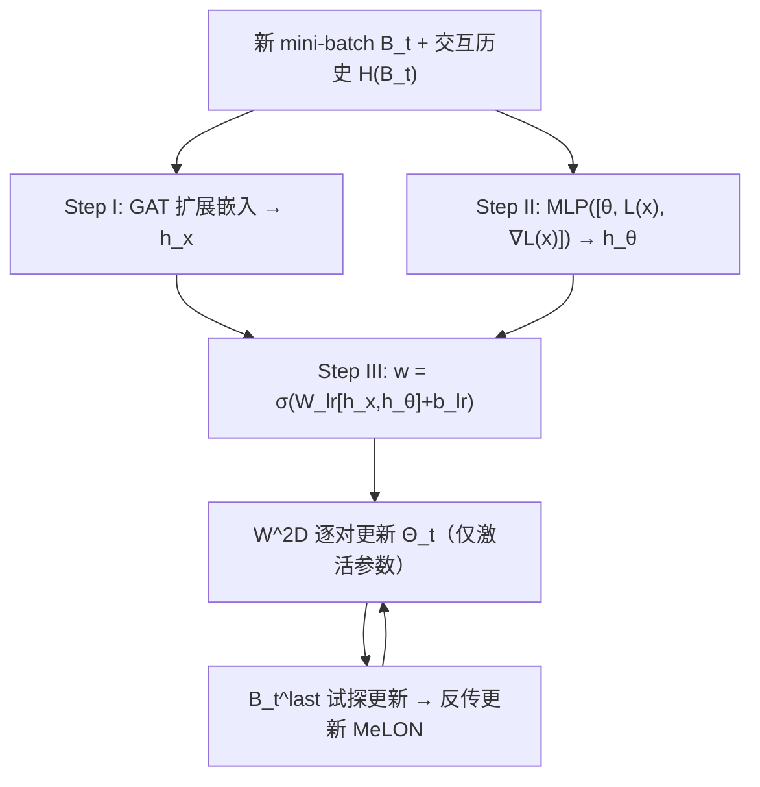
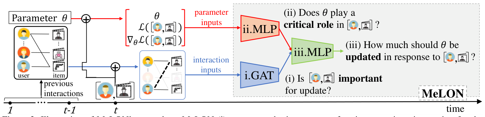

# Meta-Learning for Online Update of Recommender Systems (面向推荐系统在线更新的元学习策略)

- **会议/期刊**: AAAI 2022
- **作者与机构**: Minseok Kim, Hwanjun Song, Yooju Shin, Dongmin Park, Kijung Shin, Jae-Gil Lee (KAIST / NAVER AI Lab)
- **推荐链路定位**: 精排（在线增量更新策略，模型无关）
- **研究方向**: 协同过滤与双塔召回 / 冷启动与长尾推荐
- **论文原文**: [https://arxiv.org/abs/2203.10354v1](https://arxiv.org/abs/2203.10354v1)
- **开源代码**: 暂未开源（论文声明代码与数据集随补充材料提供）

## TL;DR (1分钟核心速览)

在线推荐要求模型随新交互快速对齐用户当下兴趣，但每批新交互极度稀疏。既有更新策略只具单向灵活性：重要性重加权（interaction-wise，各参数共享权重）或元优化（parameter-wise，各交互共享学习率）。MeLON 将二者升维为 **$n\times M$的逐「交互-参数」对学习率矩阵$W^{2D}$**，用 GAT 编码交互语义、用 MLP 编码参数角色，再经元学习"学会如何去学习"。在 Adressa/Amazon/Yelp 的 prequential 评估（1 正 + 99 负采样排序）下，NCF 骨干的 HR@5 分别提升 29.9% / 10.9% / 18.2%。

## Background & Motivation (背景与核心矛盾)

- **主流范式**: 线上系统先离线预训练快照 $\Theta_t$，再对新到达的 mini-batch$\mathcal{B}_t$做微调，更新式写作$\Theta_{t+1}=\Theta_t-\nabla_{\Theta_t}L_{\Theta_t}(\mathcal{B}_t)^{\top}W$，其中$W\in\mathbb{R}^{n\times M}$ 决定"谁被更新多少"。
- **前人局限 (一)**: 重要性重加权（eALS 启发式、MWNet 元权重网络）只按交互损失填 $W$的整行，$W_I$ 各行内元素相同，无法表达"同一交互对不同参数意义不同"。
- **前人局限 (二)**: 元优化（MetaSGD、$S^2$Meta、SML）只按参数历史填$W$的整列，$W_P$ 各列内元素相同，无法表达"不同交互应激发不同参数"。
- **核心洞察 (Key Insight)**: 作者用线性代数给出判据——更新灵活性等价于 $W$的秩。Lemma 2 证明$\mathrm{rank}(W_I)=\mathrm{rank}(W_P)=1$；由 Eckart–Young，$\min_{W^{1D}}\|W^{*}-W^{1D}\|_2=\sigma_2$，而$\mathrm{rank}(W^{2D})$ 可大于 1，故二维策略的最优性间隙上界更小（Theorem 3）。
- **本文切入点**: 让学习率的每个元素成为三元函数 $\varphi^{2D}(x,L_{\Theta_t}(x),\theta_{t,m})$，并摘掉等式约束$x=x'\wedge\theta_m\neq\theta_{m'}\Rightarrow$ 同值。

## Method (核心方法设计)

### 1. 整体框架 (Overall Architecture)

MeLON 是一个与骨干无关的元模型，每来一批 $\mathcal{B}_t$走三步闭环：(1) 用 GAT 在"用户历史物品 ∪ 物品历史用户"构成的二部图上扩展节点嵌入，得到交互表示$h_x$；(2) 用轻量 MLP 把参数当前值、该交互的损失与梯度映射为参数角色表示$h_\theta$；(3) 拼接二者过 sigmoid 得一格学习率，逐参数更新。元模型自身按 learning-to-learn 训练：先在$\mathcal{B}_t^{last}$（同批用户/物品的上一次交互）上做一次"试探性"参数更新得$\tilde{\Theta}$，用$\tilde{\Theta}$在$\mathcal{B}_t$ 上的损失反传更新 MeLON，最后用更新后的 MeLON 真正更新推荐模型。

<figure class="paper-figure" markdown="span">
  <figcaption>图2：MeLON 流程示意图。MeLON (i) 基于先前交互表示给定用户-物品交互对当前更新的重要性，(ii) 识别每个参数在该交互中的作用，(iii) 为每个参数-交互对自适应调整特定学习率。</figcaption>
</figure>

### 2. 关键设计拆解 (Key Designs)

1. **交互表示：用邻居补足单条交互的语义稀疏**：单条 $(u,i)$信息量过低，因此在时间$t$前的二部图上做 GAT，注意力$\alpha_{ui'}=\mathrm{softmax}(\mathrm{LeakyReLU}([e_u,e_{i'}]^{\top}a_U))$，得$\tilde{e}_u=\mathrm{ReLU}(W_{user}[e_u,\sum_{i'\in H^{user}(x)}\alpha_{ui'}e_{i'}]+b_{user})$，再$h_x=\mathrm{ReLU}(W_x[\tilde{e}_u,\tilde{e}_i]+b_x)$。直觉：把"该用户近期读了什么"和"该物品近期被谁碰过"压进同一向量，从而在 few-shot 批次中仍可判别交互重要性。

2. **参数角色：损失 + 梯度刻画"这个参数该不该动"**：$h_{\theta_{t,m}}=\mathrm{MLP}([\theta_{t,m},L_{\Theta_t}(x),\nabla_{\theta_{t,m}}L_{\Theta_t}(x)])$，输入前按 MetaLSTM/Andrychowicz 惯例做 log 缩放并把**幅值与符号解耦**（正负梯度方向意义不同，不可混为一谈）。直觉：梯度大的参数对当前交互敏感，是"相关专家"；梯度接近 0 的参数不宜被污染。

3. **二维学习率与元训练目标**：$w^{lr}_{x,\theta_{t,m}}=\sigma(W_{lr}[h_x,h_{\theta_{t,m}}]+b_{lr})$，$\theta_{t+1,m}=\theta_{t,m}-w^{lr}_{x,\theta_{t,m}}\nabla_{\theta_{t,m}}L_{\Theta_t}(x)$。元目标为$\varphi^{2D}_{t+1}=\varphi^{2D}_t-\eta\nabla_{\varphi}\sum_{x\in\mathcal{B}_t}\tfrac{1}{n}L_{\tilde{\Theta}}(x)$。负采样沿用 BPR 式的 1 正 + 随机负样本；**推理/更新开销**靠"选择性更新"抑制——只更新该交互前向计算真正涉及的参数（如对应 user/item 的嵌入），故每批耗时仍在一秒内。

## Experimental Setup & Evaluation Protocol (实验设置与评估协议)

- **数据集与预处理**: 过滤交互数 < 20 的用户与物品；显式评分二值化为隐式正反馈：

| 数据集 | #Users | #Items | #Interactions | 稀疏度/密度 | 特征/场景说明 |
| :--- | :---: | :---: | :---: | :---: | :--- |
| Adressa (新闻) | 29,589 | 1,457 | 1,191,114 | 密度 ≈ 2.72% | 一周新闻点击，兴趣衰减最快 |
| Amazon (三子类均值) | 91,013 | 118,031 | 3,625,349 | 密度 ≈ 0.034% | 商品评论，兴趣中等持久 |
| Yelp (本地生活) | 60,543 | 74,249 | 2,880,520 | 密度 ≈ 0.064% | 商户点评，兴趣最稳定 |

- **数据划分与防穿越**: 全局**时间戳切分 + prequential 流式评估**——Adressa/Yelp 为前 95% 离线预训练 / 0.5% 在线验证 / 后 4.5% 在线测试；Amazon 各子类按规模取 95:0.5:4.5、90:1:9、80:2:18。验证集仅用于调超参（取测试集 10%）。
- **排名评测协议**: **Sampled Ranking**，每个用户 1 个真实交互 + 随机 99 个未交互物品参与排序（非 Full-Ranking），报 HR@5/10/20 与 NDCG@5/10/20；batch size 256，100 epoch，5 次随机种子取均值 ± 标准误（无显著性检验）。
- **对比基线与超参**: 骨干为 BPR 与 NCF；更新策略 6 个基线——Default（标准微调）、eALS、MWNet（重要性重加权）、MetaSGD、$S^2$Meta、SML（元优化）。GAT 每节点采样 10 邻居，角色 MLP 隐层$L=2$，Adam$\eta=0.001$、weight decay 0.001，Titan RTX。

## Key Experimental Results (实验关键数据)

### 1. 主实验对比 (Main Results)

下表为 BPR 骨干（NCF 上 SML 因依赖嵌入参数不可实现，故用 BPR 保证基线完整）：

| Dataset | Method | HR@5 | HR@20 | NDCG@10 |
| :--- | :--- | :---: | :---: | :---: |
| Adressa | Default | 0.292 | 0.422 | 0.272 |
| | eALS | 0.443 | 0.613 | 0.396 |
| | MWNet | 0.289 | 0.421 | 0.269 |
| | MetaSGD | 0.276 | 0.686 | 0.271 |
| | $S^2$Meta | 0.278 | 0.559 | 0.262 |
| | SML | 0.270 | 0.399 | 0.255 |
| | **MeLON** | **0.877** | **0.983** | **0.698** |
| Amazon | Default | 0.246 | 0.457 | 0.202 |
| | eALS | 0.327 | 0.542 | 0.270 |
| | MWNet | 0.244 | 0.456 | 0.201 |
| | SML | 0.220 | 0.409 | 0.181 |
| | **MeLON** | **0.363** (+11.0% vs eALS) | **0.650** | **0.294** |
| Yelp | Default | 0.600 | 0.883 | 0.480 |
| | eALS | **0.677** | **0.922** | **0.538** |
| | SML | 0.478 | 0.720 | 0.382 |
| | $S^2$Meta | 0.208 | 0.471 | 0.174 |
| | **MeLON** | 0.619 | 0.886 | 0.491 |

NCF 骨干上 MeLON 相对最强基线在 Adressa/Amazon/Yelp 的 HR@5 分别提升 **29.9% / 10.9% / 18.2%**；Yelp 上 eALS 在 HR@5/HR@20 仍略胜（0.677/0.922 vs 0.619/0.886），说明兴趣变化缓慢时"只猛推新交互"已足够。

### 2. 消融实验 (Ablation Study)

| 变体 (BPR, HR@5) | Adressa | Amazon | Yelp |
| :--- | :---: | :---: | :---: |
| MeLON$_{I}$（仅重要性重加权） | 0.293 | 0.248 | 0.605 |
| MeLON$_{P}$（仅元优化） | 0.278 | 0.269 | 0.208 |
| **MeLON（二维）** | **0.877** | **0.363** | **0.619** |

### 3. 关键实验发现 (Key Findings)

1. **增益来自"二维耦合"而非模型容量**：单维变体退化到与其对应类别的基线同量级（MeLON$_I$在 Adressa 的 0.293 ≈ eALS 0.443 档位、MeLON$_P$的 0.278 ≈$S^2$Meta 0.278），二者相乘式融合后跳到 0.877，验证了秩驱动的灵活性理论。
2. **数据集的时间敏感度决定哪一维更重要**：新闻类 Adressa 中 $W^{2D}$ 呈现明显横向（参数维）条带，参数角色主导；Yelp 则呈纵向（交互维）条带，交互重要性主导；这也解释了为何 eALS 在 Yelp 上能追平甚至局部超越 MeLON。
3. **元模型并不带来不可接受的延迟**：每批更新耗时 Adressa 0.076s、Amazon 0.072s、Yelp 0.041s，均低于 SML（0.130–3.345s）与 $S^2$Meta（0.112–1.630s），仅比 Default（0.007–0.011s）高一个量级，归功于选择性参数更新。

## Highlights & Limitations (亮点、对比与审稿批判)

- **与代表作对比**: 相对 MWNet（学习样本权重，单维 data-side）与 SML / $S^2$Meta（学习参数级学习率，单维 parameter-side），本文首次把更新算子写成$n\times M$ 自由矩阵，并用谱范数间隙给出严格的灵活性优势证明；相对 eALS 这类纯启发式，MeLON 的超参由元梯度端到端学习。
- **可迁移亮点**: (1) "损失 + 梯度 + 参数值三件套 → 学习率"的参数角色编码器可直接搬给任意模型的增量微调或持续学习防遗忘；(2) 用"$W$ 的秩"论证更新灵活性的分析视角，可复用于样本加权、LoRA 适配等优化器设计。
- **审稿级局限批判**: (1) 评估仅用 **1 正 + 99 负的采样排序**，未做 Full-Ranking，且只报均值 ± 标准误、无显著性检验，头部指标（HR@5 逼近 0.88–0.98）在稀疏负采样下易被高估；(2) 每个 mini-batch 需额外一次试探更新与前反向，且 GAT 构图依赖在线维护的历史二部图，用户/物品规模上亿时的邻居采样与图存储开销未讨论；(3) SML 在 NCF 上缺失、Yelp 上被 eALS 反超，说明方法优势对"兴趣漂移速度"这一先验敏感，缺少自适应选择单维/二维的开关机制。

## Rating (四维评分)

- **方法创新性 (Novelty)**: ⭐⭐⭐⭐ （把在线更新统一为学习率矩阵并给出秩与谱范数的最优性间隙证明，"逐对学习率"这一算子形式清晰且此前确实空缺）
- **评估协议与实验扎实度 (Protocol & Experiments)**: ⭐⭐⭐ （三数据集 × 两骨干 × 六基线的组合充分、消融干净，但仅有采样排序、无全库排序与显著性检验，且未报告冷启动用户分桶结果）
- **写作与数学规范度 (Clarity & Rigor)**: ⭐⭐⭐⭐ （$W_I/W_P$ 秩为 1 的 Lemma 与 Theorem 3 推导简洁可校验，三步元更新流程与算法伪代码对齐良好）
- **工业落地与复现价值 (Industrial & Practical Value)**: ⭐⭐⭐⭐ （模型无关、可插拔到任意 DNN 推荐器，单批更新 0.04–0.08s 且靠选择性更新控住开销，但代码未公开、在线图维护成本待验证）

