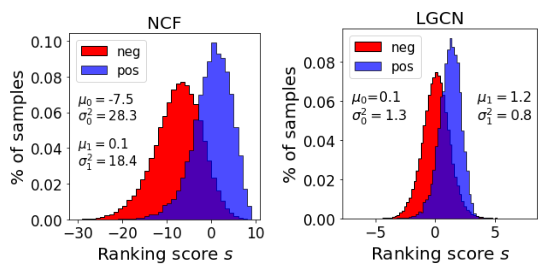
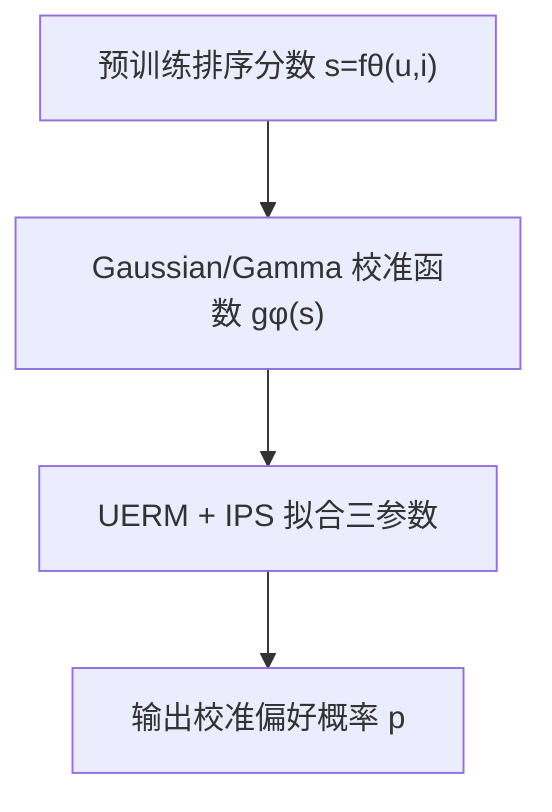

# Obtaining Calibrated Probabilities with Personalized Ranking Models (个性化排序模型的可校准概率获取)

- **会议/期刊**: AAAI 2022 (Oral)
- **作者与机构**: Wonbin Kweon, SeongKu Kang, Hwanjo Yu；POSTECH
- **推荐链路定位**: 精排后处理（排序分数到偏好概率的校准）
- **研究方向**: CTR/CVR 预估与特征交叉 / 去偏公平、可信隐私与工业架构
- **论文原文**: [论文原文链接](https://arxiv.org/abs/2112.07428v2)
- **开源代码**: [开源代码仓库链接](https://github.com/WonbinKweon/CalibratedRankingModels)

## TL;DR (1分钟核心速览)

本文解决排序分数无概率语义、隐式反馈又因曝光偏差使校准失真的问题；提出 Gaussian/Gamma 两种三参数后处理校准函数，并用 IPS 无偏经验风险最小化拟合参数。在 Yahoo!R3/Coat 的无偏测试集上，ECE 相对最佳基线降低 5.21%–25.85%，且不改变原排序。

## Background & Motivation (背景与核心矛盾)

- **主流范式**: BPR/NCF/CML/LightGCN 等以 pairwise 或 BCE 损失学排序分数，分数仅保序、不在 $[0,1]$，不能直接解释为偏好概率。
- **前人局限**: 非参数 Hist/Isotonic/BBQ 依赖分箱，表达弱且易在稀疏隐式反馈上过拟合；Platt/temperature scaling 假设正负类同方差，无法拟合长尾偏斜；Beta 校准只接受 $[0,1]$ 输入。
- **核心洞察 (Key Insight)**: 真实交互中正类极少（约 10%），负类分数分布更散、左尾更长；需要允许不同方差/偏度的参数族，才能覆盖全概率区间。
- **本文切入点**: 从 Gaussian/Gamma 类条件分布推导后验，并用 IPS 将“曝光”与“偏好”解耦，校准 $P(R=1|s)$而非$P(Y=1|s)$。

<figure class="paper-figure" markdown="span">
  <figcaption>图2：负样本对与正样本对的排序分数分布。</figcaption>
</figure>

## Method (核心方法设计)

### 1. 整体框架 (Overall Architecture)

输入预训练排序模型 $f_\theta(u,i)$的分数$s$；冻结$f_\theta$，仅学习校准函数$g_\phi(s)$的三个参数，将$s$映射为校准偏好概率。训练阶段在验证集上用交互标签$Y$与估计倾向$\omega$ 做 UERM 拟合；推理阶段做单调变换，只改概率语义、不改排序。

### 2. 关键设计拆解 (Key Designs)

1. **Gaussian calibration（允许正负类异方差）**：Platt 由同方差高斯后验得 $\sigma(bs+c)$，等于把二次项系数写死为 0；本文保留$a$，得$g_\phi(s)=\sigma(as^2+bs+c)$。其中$a=(2\sigma_0^2)^{-1}-(2\sigma_1^2)^{-1}$ 捕捉负/正类方差差，适配正类稀疏、负类分散的交互分布。
2. **Gamma calibration（建模偏斜分数分布）**：排序分数常右偏、左尾长。令类条件为 Gamma 分布，后验化为 $g_\phi(s)=\sigma(a\log s+bs+c)$，并将$s\leftarrow s-s_{\min}$保证正数输入。$\log s$项吸收偏度，$bs$ 项控制尾部，比高斯更贴合非对称分布。
3. **训练目标、负采样与推理效率**：隐式反馈满足 $Y=O\cdot R$，naive log-loss 把未曝光当负类；UERM 用 IPS 估计 ideal risk：$\mathcal{L}_{\text{UERM}}=-\frac{Y}{\omega}\log g_\phi(s)-(1-\frac{Y}{\omega})\log(1-g_\phi(s))$，其中$\omega=P(O=1)$。$\omega$用物品流行度平方根估计并 clip 到$0.1$；命题 1 证明其期望等于 ideal risk。单调约束为$2as+b>0$（Gaussian）与$a/s+b>0$（Gamma），Scipy 约束逻辑回归分钟级完成；基模型训练负采样率为 1，校准阶段无需负采样。

## Experimental Setup & Evaluation Protocol (实验设置与评估协议)

- **数据集与预处理**: 评分 $>3$记$Y=1$，$<4$记$Y=0$；训练集只观测$Y$，测试集含无偏偏好$R$（用户对均匀抽样物品评分，$O=1$）。

| 数据集 | #Users | #Items | #Interactions | 稀疏度/密度 | 特征/场景说明 |
| :--- | :---: | :---: | :---: | :---: | :--- |
| Yahoo!R3 | 15.4K | 1K | >300K 训练 / 54K 无偏测试 | 约 1.95% | 音乐评分；测试为用户均匀抽样评分 |
| Coat | 290 | 300 | >7K 训练 / 4.6K 无偏测试 | 约 8.0% | 服装评分；小规模强稀疏 |

- **数据划分与防穿越 (Splitting Strategy)**: 留出 10% 训练集作验证集，用于基模型调参与校准参数拟合；测试集用独立无偏偏好 $R$评估，避免用曝光标签$Y$ 直接评估校准。
- **排名评测协议 (Ranking Protocol)**: 不是 Full-Ranking 或 Sampled Ranking；在无偏测试集上计算 ECE/MCE（$M=15$ 箱）与 NLL。排序性能另用 NDCG/Recall 表验证，校准为单调后处理，理论上不改变排序。
- **对比基线与超参设置**: 基模型为 BPR、NCF、CML、UBPR、LightGCN；校准对比 MinMax/Sigmoid、Hist、Isotonic、BBQ、Platt、Beta。嵌入维度 128（NCF 为 64），batch 512，lr 0.001，负采样率 1；原文未报告显著性检验。

## Key Experimental Results (实验关键数据)

### 1. 主实验对比 (Main Results)

下表取 Yahoo!R3/LGCN 与 Coat/NCF 的 ECE（越低越好），保留 8 个代表性校准方法；`Improv.` 为本文最佳相对最佳竞争者的提升。

| 方法 | Yahoo!R3 / LGCN ECE↓ | Coat / NCF ECE↓ |
| :--- | :---: | :---: |
| MinMax | 0.2258 | 0.4624 |
| Hist | 0.0194 | 0.0230 |
| Isotonic | 0.0154 | 0.0159 |
| Platt + $\mathcal{L}_{\text{naive}}$ | 0.0099 | 0.0245 |
| Platt + UERM | 0.0070 | 0.0120 |
| Beta + UERM | 0.0076 | 0.0075 |
| Gaussian + UERM | **0.0061** | 0.0062 |
| Gamma + UERM | 0.0065 | **0.0061** |
| **Improv.** | **12.86%** | **18.67%** |

### 2. 消融实验 (Ablation Study)

| 方法 | Yahoo/LGCN naive | UERM | Coat/NCF naive | UERM |
| :--- | :---: | :---: | :---: | :---: |
| Platt | 0.0099 | 0.0070 | 0.0245 | 0.0120 |
| Beta | 0.0150 | 0.0076 | 0.0258 | 0.0075 |
| Gaussian | 0.0073 | **0.0061** | 0.0264 | 0.0062 |
| Gamma | 0.0098 | 0.0065 | 0.0239 | **0.0061** |

### 3. 关键实验发现 (Key Findings)

1. **UERM 是稳定增益源**：所有参数化方法改用 IPS 后 ECE 下降 7.40%–76.52%；如 Coat/NCF 上 Gaussian 从 0.0264 降至 0.0062，说明未曝光样本被当负类是主要校准偏差来源。
2. **Gaussian/Gamma 优于 Platt/Beta**：LGCN/Yahoo 上 Gaussian 比 Platt+UERM 再降 12.86%，Coat/NCF 上 Gamma 比 Beta+UERM 再降 18.67%；原因是三参数连续函数可拟合异方差与偏斜，而 Beta 需重缩放、Platt 被对称性限制。
3. **可靠性图与分数分布一致**：非参数方法几乎不产出 $p>0.6$的概率，参数化+UERM 能覆盖全区间并显著缩小正偏好区间（$p>0.5$）的 gap；图2显示正负类方差不同、左尾更长，直接支持 Gaussian/Gamma 的设计。

## Highlights & Limitations (亮点、对比与审稿批判)

- **与代表作对比 (vs. Prior Work)**: 相比 Menon 等 isotonic regression 的分箱式非参数校准，本文给出可微、可约束、全区间覆盖的三参数参数化校准；相比 Platt/temperature 的同方差假设，本文显式学习异方差；相比 Beta 的 $[0,1]$ 输入限制，本文直接处理无界排序分数。
- **可迁移亮点**: 任何排序模型都可外挂该后处理层，线上只加一次单调映射；流行度倾向估计+clip 是可复用的轻量 IPS 去偏技巧。
- **审稿级局限批判**: 仅在 Yahoo!R3/Coat 两个无偏测试集验证，未报告线上 A/B 与显著性检验；倾向估计依赖物品流行度，且校准参数依赖验证集与基模型，跨域/跨时段稳定性仍需检验。

## Rating (四维评分)

- **方法创新性 (Novelty)**: ⭐⭐⭐⭐ （把类条件分布后验推导成可约束三参数校准，并系统引入 IPS 做排序概率校准，机制清晰但非全新框架）
- **评估协议与实验扎实度 (Protocol & Experiments)**: ⭐⭐⭐⭐ （使用无偏测试集与 5 个基模型，ECE/MCE/NLL 完整；但仅两数据集且无显著性检验）
- **写作与数学规范度 (Clarity & Rigor)**: ⭐⭐⭐⭐ （公式、单调约束与倾向偏差命题推导完整；部分细节依赖附录，主文表格较密）
- **工业落地与复现价值 (Industrial & Practical Value)**: ⭐⭐⭐⭐ （三参数后处理、排序不变、分钟级拟合，易上线；但依赖倾向估计与验证集，大规模线上延迟未验证）

