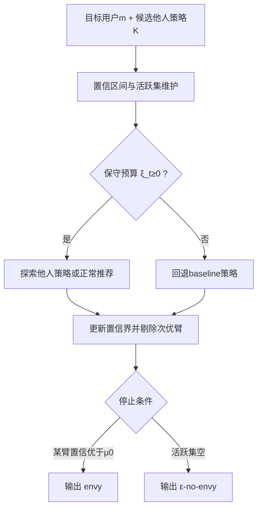
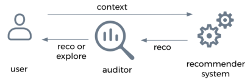

# Online certification of preference-based fairness for personalized recommender systems (个性化推荐系统基于偏好的公平性在线认证)

- **会议/期刊**: AAAI 2022
- **作者与机构**: Virginie Do, Sam Corbett-Davies, Jamal Atif, Nicolas Usunier（LAMSADE/Université PSL & Meta AI）
- **推荐链路定位**: 在线审计/策略评估层（非召回、精排）
- **研究方向**: 去偏公平、可信隐私与工业架构 / 强化学习与动态探索推荐
- **论文原文**: [论文原文链接](https://arxiv.org/abs/2104.14527v4)
- **开源代码**: 暂未开源

## TL;DR (1分钟核心速览)

论文针对现有推荐公平审计只做敏感组粒度 parity、忽略个体偏好的痛点，提出用户级 envy-freeness：每个用户都不应更偏好他人的推荐。审计需要反事实探索未知偏好，故将其建模为带保守约束的纯探索 bandit，提出 OCEF 与概率版 AUDIT。在 Last.fm/MovieLens 模拟审计中，概率认证仅需 41 个目标用户、75 条他人策略，样本复杂度与总用户数 \(M\) 无关。

## Background & Motivation (背景与核心矛盾)

- **主流范式**: 推荐公平审计多控制敏感组曝光/效用 parity，或追求组间 equal utility。
- **前人局限**: parity 不区分由偏好造成的合理差异；equal utility 需人际效用比较，且会压低高偏好用户收益。更关键的是，现有审计不回答“若用户 \(m\) 收到用户 \(n\) 的推荐，是否会更好”的反事实问题。
- **核心洞察 (Key Insight)**: 最优个性化策略天然无嫉妒；若用户 \(m\) 从自身策略所得效用高于任何他人策略，则个性化差异可被偏好辩护。此准则避免人际比较，只做同一用户视角下的推荐比较。
- **本文切入点**: 用主动探索估计他人策略对目标用户的效用，同时用保守探索约束保证审计过程不显著损害用户体验。

## Method (核心方法设计)

### 1. 整体框架 (Overall Architecture)

对目标用户 \(m\)，把其现有推荐策略视为 baseline arm 0，把若干其他用户策略视为候选 arms。每轮依据置信区间选择展示自身推荐或他人推荐，观测 Bernoulli 奖励并更新置信界；若某候选臂置信优于 baseline 则输出 envy，若活跃集为空则输出 \(\epsilon\)-no-envy。全程以保守预算约束累计效用不低于 baseline 的 \(1-\alpha\)。全系统概率审计则先采样少量用户与策略，再并行运行 OCEF。

<figure class="paper-figure" markdown="span">
  <figcaption>图 1：审计场景：审计者要么向用户展示当前推荐系统给该用户的推荐，要么通过展示给另一用户的推荐进行探索。</figcaption>
</figure>

### 2. 关键设计拆解 (Key Designs)

1. **\(\epsilon\)-envy-free 与概率松弛**：痛点是个体公平审计需比较所有用户策略。定义 $\forall m,n:u_m(\pi_n)\le\epsilon+u_m(\pi_m)$；进一步只要求至少 \(1-\lambda\) 比例用户不是 \((\epsilon,\gamma)\)-envious。直觉是把“人人无嫉妒”的强保证松弛为“绝大多数用户、绝大多数他人策略不更优”，从而让审计规模不再随 \(M\) 爆炸。
2. **OCEF 保守纯探索**：痛点是纯探索会随机化推荐、损伤体验。OCEF 维护活跃集 $S_t=\{k:\overline{\mu}_k(t)>\underline{\mu}_0(t)+\epsilon\}$，并强制$\frac1t\sum_{s=1}^t\mu_{k_s}\ge(1-\alpha)\mu_0$；当保守预算估计$\xi_t<0$ 时回退 baseline。该设计把“发现嫉妒”和“不恶化体验”统一为带约束的停止问题。
3. **AUDIT 与推理开销**：全量精确审计需对所有用户运行，代价随 \(M\) 增长；AUDIT 采样 $\tilde M=\lceil\log(3/\delta)/\lambda\rceil$个用户、每个用户采样$K=\lceil\log(3\tilde M/\delta)/\log(1/(1-\gamma))\rceil$条策略。本文不训练推荐模型、无负采样；审计成本定义为$C_\tau=\tau\mu_0-\sum_{s=1}^\tau\mu_{k_s}$，其界由 Theorem 1 给出。

## Experimental Setup & Evaluation Protocol (实验设置与评估协议)

- **数据集与预处理**:

| 数据集 | #Users | #Items | #Interactions | 稀疏度/密度 | 特征/场景说明 |
| :--- | :---: | :---: | :---: | :---: | :--- |
| Last.fm | 约1.9k | 2.5k | 原文未报告 | 未报告 | 取最常听2.5k物品，log变换，矩阵分解补全偏好 |
| MovieLens-1M | 2,000 | 2,500 | 原始1M评分；子矩阵未报告 | 未报告 | 取评分数最多用户/物品，评分<3置0，矩阵补全 |

- **数据划分与防穿越 (Splitting Strategy)**: 真实偏好矩阵按附录为 `70%/10%/20%` 训练/验证/测试；审计模拟中推荐系统在 ground-truth 子集上估计偏好，正文称 20%、附录 D 称 70%，存在口径不一致。
- **排名评测协议 (Ranking Protocol)**: 非传统 ranking 评测；不采用 Full-Ranking 或 Sampled Ranking。推荐动作由 softmax 策略采样，奖励为 Bernoulli，期望由补全后的偏好给出；指标为审计时长与累计成本。
- **对比基线与超参设置**: 公平诊断对比 EUU 与 OPT；bandit 实验含 4 个 10-arm 实例。审计实验设 \(\epsilon=\delta=0.05\)、\(\lambda=\gamma=0.1\)，得 \(\tilde M=41\)、\(K=75\)；矩阵分解 48 因子，softmax 逆温度 5 与 10/15 用于构造无嫉妒/有嫉妒策略。

## Key Experimental Results (实验关键数据)

### 1. 主实验对比 (Main Results)

原文 Table 1 的公平诊断结果如下（OPT 为无约束最优策略）：

| 数据集 | 策略 | Total utility ↑ | Average envy ↓ | Prop. 0.05-envious ↓ |
| :--- | :--- | :---: | :---: | :---: |
| Last.fm | EUU | 1552 | 0.10 | 0.61 |
| Last.fm | **OPT** | **1726** | **0** | **0** |
| MovieLens | EUU | 1671 | 0.04 | 0.13 |
| MovieLens | **OPT** | **1761** | **0** | **0** |

OPT 相对 EUU 的 utility 提升分别为 **11.2%** 与 **5.4%**，且嫉妒用户比例降为 0。

### 2. 消融实验 (Ablation Study)

原文无模块级消融；以下为关键参数/场景敏感性。

| 设置/组件 | 审计时长 | 审计成本 | 结论 |
| :--- | :---: | :---: | :--- |
| \(\alpha\) 过小（更保守） | 先降后升 | 更接近0 | 过度回退 baseline 反而拖长审计 |
| \(\alpha\to1\)（放松约束） | 可缩短 | envy-free 时上升 | 体验保护与成本存在权衡 |
| \(\delta\uparrow\) | 下降 | — | 低置信证书需更少样本 |
| \(K\uparrow\) | 上升 | — | 审计时长随候选策略数增长 |
| 模型因子数=1 | 无嫉妒 | — | 等价流行度推荐，审计可检测 |
| 中间因子数 | 嫉妒显现 | — | 模型误设是个体嫉妒来源 |

### 3. 关键实验发现 (Key Findings)

1. **equal utility 反而制造嫉妒**：Last.fm 上 EUU 使总效用从 1726 降至 1552，61% 用户存在 0.05-嫉妒；MovieLens 上 13% 用户嫉妒，说明强制组间相等并不等于用户侧公平。
2. **模型误设是可审计的嫉妒源**：1 个 latent factor 时所有用户收到近似流行度推荐、嫉妒为 0；中间因子数下模型容量不足，嫉妒显著；因子数足够后嫉妒下降。
3. **保守探索存在非平凡甜点**：在 4 个 bandit 实例中，Problems 2–4 的审计时长在非平凡 \(\alpha\) 处最小；有嫉妒时探索可带来负成本，无嫉妒时成本为正并随放松约束上升。AUDIT 将认证规模压到 41 用户/75 臂，与 \(M\) 无关。

## Highlights & Limitations (亮点、对比与审稿批判)

- **与代表作对比 (vs. Prior Work)**: 相比 parity/equal-utility 审计，本文直接审计个体偏好反事实；相比 Patro 等 fair allocation 假设真实偏好已知，本文显式处理偏好部分可观测；相比经典 best-arm identification，本文 baseline 未知且加入保守体验约束。
- **可迁移亮点**: “概率松弛 + 保守纯探索”可迁移到推荐策略上线前审计、A/B 实验风险控制与多策略公平回归测试。
- **审稿级局限批判**: 其一，审计需向用户展示他人策略推荐，侵入性强，隐私与伦理成本高；其二，实验偏好由矩阵补全模拟，正文与附录的训练比例表述不一致，且平稳性假设较强，线上非平稳场景仍需验证。

## Rating (四维评分)

- **方法创新性 (Novelty)**: ⭐⭐⭐⭐ （将 envy-freeness 审计形式化为带保守约束的纯探索 bandit，问题建模新颖且理论完整）
- **评估协议与实验扎实度 (Protocol & Experiments)**: ⭐⭐⭐ （真实数据仅作模拟审计，缺传统推荐 baseline，且训练划分口径有矛盾）
- **写作与数学规范度 (Clarity & Rigor)**: ⭐⭐⭐⭐ （定义、算法与定理链条清晰，遗憾在实验细节一致性）
- **工业落地与复现价值 (Industrial & Practical Value)**: ⭐⭐⭐ （用户数无关的概率认证适合内部审计，但需跨用户策略接口且未开源）

