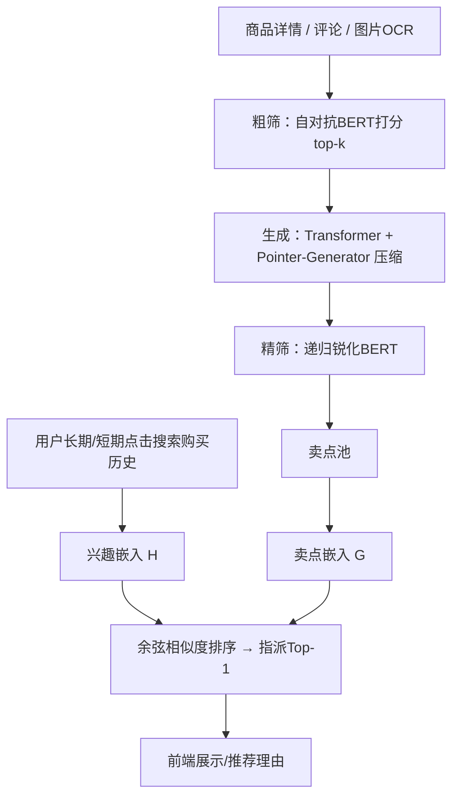
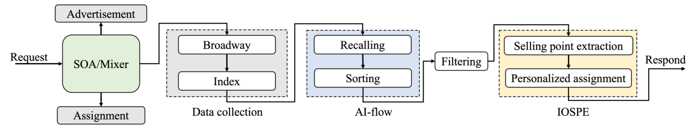
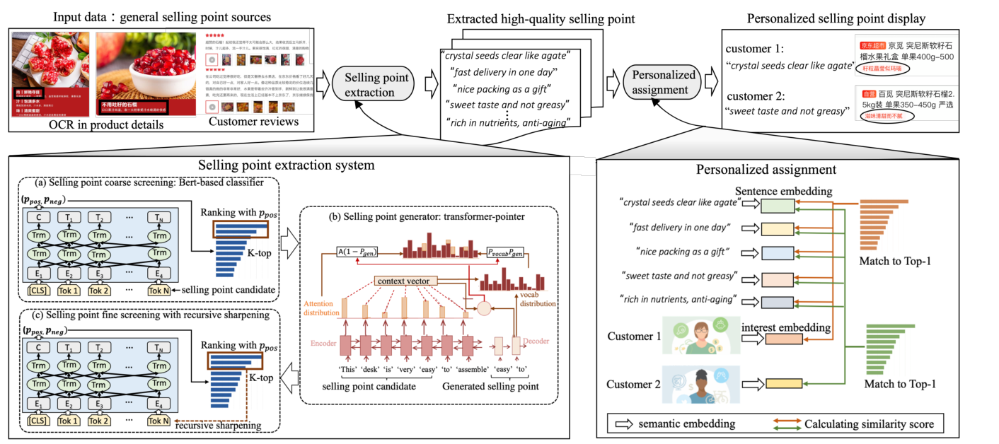

# Intelligent Online Selling Point Extraction for E-Commerce Recommendation (面向电商推荐的智能在线卖点抽取系统)

- **会议/期刊**: AAAI 2022 (IAAI Track, 工业应用奖)
- **作者与机构**: Xiaojie Guo, Shugen Wang, Hanqing Zhao, Zhuoye Ding, Yun Xiao, Lingfei Wu 等（京东硅谷研发中心 / 京东 / 南洋理工大学）
- **推荐链路定位**: 重排—展示层（推荐理由/卖点生成与指派），端到端嵌入在线推荐服务
- **研究方向**: 生成式推荐 / 对话与智能体推荐（可解释推荐理由生成）
- **论文原文**: [https://arxiv.org/abs/2112.10613v1](https://arxiv.org/abs/2112.10613v1)
- **开源代码**: 暂未开源

## TL;DR (1分钟核心速览)

电商展示位的商品描述需“短、抓眼、因人而异”，而现有 NLG 方案只会做通用摘要、篇幅冗长、无个性化。IOSPE 提出“卖点”这一新任务：先用自对抗 BERT 从商品描述/评论/图片 OCR 中粗筛候选句，再用 Transformer+Pointer-Generator 把口语化长句压缩为短语卖点，最后用递归锐化（recursive sharpening）BERT 精筛质量，并以用户兴趣嵌入与卖点嵌入的余弦相似度做个性化指派。系统在京东 62 个类目、400 万商品全量上线，累计生成 1 亿+卖点，线上 A/B 显示 CTR 提升 1.89%、商品页平均停留时长提升 2.03%。

## Background & Motivation (背景与核心矛盾)

- **主流范式**: 商品描述生成沿用 seq2seq / Transformer / Pointer-Generator，以用户评论或商品属性为源做摘要式生成；个性化描述由 Chen et al. (2019) 初步探索。
- **前人局限**:
  - **内容错位**：现有模型做的是"完整摘要"，而非"挑出唯一最抓眼特征"，一个商品常有多个特征，算法缺乏"选哪个"的判别能力。
  - **长度与口吻失配**：生成结果沿用评论口吻（如 "This desk is very easy for me to assemble and install"），冗长且缺乏营销力；移动端首页展示位根本放不下。
  - **无个性化**：所有用户看到同一段描述，无法匹配"商务用户关心续航、游戏用户关心刷新率"的差异诉求。
- **核心洞察 (Key Insight)**: 卖点不是"生成"问题而是"筛选 + 压缩 + 匹配"问题——互联网上（评论、详情图 OCR）已存在大量含金量高的原始表述，模型只需判别其营销价值并改写为短语，再由用户画像做最后一道匹配。
- **本文切入点**: 用"判别式粗筛 → 生成式压缩 → 判别式精筛 → 相似度指派"的混合流水线，替代端到端 NLG 的单一范式。

## Method (核心方法设计)

### 1. 整体框架 (Overall Architecture)

IOSPE 作为推荐系统的下游模块嵌入 JD 在线链路：SOA/Mixer 分发请求 → Broadway 采集用户画像与商品属性/评论/图片 → Index 中转 → AI-flow 完成召回（FTRL 在线学习 + GBDT 非线性排序 + LR 线性排序）→ Filtering 去重去已购 → **IOSPE** 对每个推荐商品从卖点池抽取高质量卖点并按用户画像指派最优一条 → 回传前端渲染。离线侧由数据处理系统回流曝光/点击日志，驱动精筛 BERT 的持续微调。整个卖点抽取分三级：粗筛保留 top-$k$ 候选句、生成器压缩为短语、递归精筛保留高质量项；指派阶段则退化为一次向量余弦检索。

<figure class="paper-figure" markdown="span">
  <figcaption>图 2：电子商务中带有 IOSPE 卖点模块的 JD 个性化推荐架构（箭头表示请求触发过程）。</figcaption>
</figure>
<figure class="paper-figure" markdown="span">
  <figcaption>图 3：卖点提取框架。</figcaption>
</figure>

### 2. 关键设计拆解 (Key Designs)

1. **自对抗 BERT 粗筛 + 递归锐化精筛（Recursive Sharpening）**：痛点是"好卖点"无标注规模、单轮分类器决策边界模糊。做法是以人工撰写卖点为恒正样本 $T^{pos}_{1}$，模型在第$n$轮把上一轮判正的生成卖点$T^{pos}_{n}$当作**新的负样本**，与$T^{pos}_{1}$ 组成正类继续微调。物理直觉：每一轮都在"抬高及格线"，迫使分类器把上一轮边界附近的样本重新压到负侧，形成自我对抗式的边界收紧，从而在无新人工标注下逐轮提升判别精度。
2. **Pointer-Generator 的生成/拷贝门控（解决 OOV 与口吻转换）**：痛点在于商品型号、专有属性词极易 OOV，纯词表生成会丢失关键信息；同时评论口语需被压缩。模型在解码第 $t$步由上下文向量$o_t$与解码自注意力输出$q_t$ 计算门控：
   $$p_{gen}=\sigma\left(\mathbf{w}_t^{\top}o_t+\mathbf{w}_q^{\top}q_t+b\right),\quad p_{final}=p_{gen}P_{vocab}(w)+(1-p_{gen})\sum_{i:w_i=w}A_{t,i}$$
   当词为 OOV 时 $p_{gen}\to 0$，输出退化为直接指向源句中的该词位置，既保留精确型号又实现"从口语长句到精炼短语"的改写。
3. **损失、训练与个性化指派开销**：粗筛/精筛均为二分类交叉熵（BERT 分类头），生成器为负对数似然 $\mathcal{L}_{NLL}=-\sum_t \log p_{final}(y_t)$，无需负采样（正样本=人工卖点，负样本=源句）。个性化侧将用户历史关键词$w_i$以重要性$s_i$加权池化为$H=\frac{1}{N}\sum_i \mathbf{h}_i s_i$，卖点嵌入$G$为其词向量之和，指派打分$\text{sim}=\frac{H\cdot G}{\|H\|_2\|G\|_2}$，复杂度仅$O(ND)$，可在毫秒级请求内完成；重模型（BERT 打分）则用 PySpark 离线批跑写入 Hive 表，在线只查表。

## Experimental Setup & Evaluation Protocol (实验设置与评估协议)

- **数据集与预处理**: 本文为工业部署论文，**无公开离线基准**，全部证据来自 JD 线上流量；覆盖 62 个重点类目、400 万+商品，累计生成 1 亿+卖点。

| 数据源/流量段 | 规模 | 用途 | 说明 |
| :--- | :---: | :---: | :--- |
| 商品描述（base） | 62 类目 | 粗筛/生成基础源 | 人工撰写详情 |
| 用户评论（review） | 全量 | 增量源 | 口语化、含真实体验 |
| 图片 OCR | 全量 | 增量源 | 详情图参数文字 |
| A/B 段 a（无 IOSPE） | 5% 流量 | 基线组 | baseline |
| A/B 段 b（无个性化） | 5% 流量 | 消融组 | general assignment |
| A/B 段 c（core） | 85% 流量 | 实验组 | 全量 IOSPE |
| A/B 段 d（过渡） | 5% 流量 | 灰度缓冲 | 观察一周无坏效应再并入 core |

- **数据划分与防穿越 (Splitting Strategy)**: 非传统训练/测试划分，而是 **在线流量切分 + 时间窗口对照**：质量监督 A/B 运行 10 天，个性化指派 A/B 运行 14 天，源选择实验跨 5 周；离线用线上回流日志做特征回流微调，避免用未来数据训练当期模型。
- **排名评测协议 (Ranking Protocol)**: 不适用离线 Full-Ranking；采用**线上真实曝光-点击对照**，指标为 effective user 维度的人均曝光深度（overall exp deep）、人均点击（overall exp clk）、推荐商品点击（rec clk）、广告点击（ads clk）、人均曝光类目数（overall exp item / rec exp item），并以
  $$\text{相对提升}=\frac{\text{base clk pv}/\text{base exp pv}}{\text{ctrl clk pv}/\text{ctrl exp pv}}-1$$
  做卖点粒度与 SKU 粒度的归因聚合。
- **对比基线与超参设置**: 基线为"无监督模块"与"通用（非个性化）指派"两种删减配置；生成器采用多头数 $h$的标准 Transformer 编码-解码，候选保留 top-$k$句，精筛递归轮数$N$为多轮；未报告显著性检验（工业 A/B 依赖大样本量级下的稳定百分比差异，$p$ 值缺失是主要方法学短板）。

## Key Experimental Results (实验关键数据)

### 1. 主实验对比 (Main Results)

线上 A/B 全指标对比（数值为线上度量原值，`Improv.` 为相对提升）：

| 配置 | overall exp deep | overall exp clk | rec clk | ads clk | overall exp item | rec exp item |
| :--- | :---: | :---: | :---: | :---: | :---: | :---: |
| 无质量监督 | 82.1632 | 3.1332 | 1.7942 | 1.3474 | 31.2317 | 19.7234 |
| **+ 在线/离线监督** | **82.3007** | **3.1332** | **1.7942** | **1.3499** | 31.1952 | **19.7601** |
| Improv. | +0.17% | +0.14% | +0.10% | +0.19% | +0.20% | +0.18% |
| 通用（非个性化）指派 | 80.2021 | 3.2439 | 1.9735 | 1.2818 | 28.5641 | 18.5879 |
| **个性化指派** | **80.3131** | **3.2569** | **1.9829** | **1.2855** | **28.5651** | **18.5918** |
| Improv. | +0.14% | +0.40% | +0.47% | +0.29% | +0.10% | +0.02% |
| **整机（vs. 原方案）** | — | — | — | — | — | **CTR +1.89% / 时长 +2.03%** |

### 2. 消融实验 (Ablation Study)

| 消融项 | 关键指标变化 | 结论 |
| :--- | :---: | :--- |
| w/o 在线+离线质量监督 | 全指标下降 0.10%–0.20% | 监督模块是稳定增益，但幅度有限 |
| w/o 个性化指派（general） | rec clk −0.47%，exp deep −0.40% | 个性化是最大单点增益来源 |
| w/o 评论源（仅 base） | rec UV 提升约 +7%（加入后） | 评论是最强外部源 |
| w/o OCR 源（仅 base） | rec UV 提升约 +1% | OCR 补充参数细节，弱于评论 |

### 3. 关键实验发现 (Key Findings)

1. **个性化指派的收益（rec clk +0.47%）显著高于质量监督（+0.10%–0.20%）**：说明在卖点质量已达阈值后，"给谁看哪一条"比"再多生成几条"更值钱，提示推荐理由模块应把预算优先投在用户-理由匹配而非生成模型扩容。
2. **评论源带来约 7% 的 rec UV 提升，远超 OCR 的约 1%**：UGC 的"他人真实体验"具备社交刺激效应，而 OCR 仅补充硬参数，验证了卖点内容源应以评论为主、OCR 为辅的选源策略。
3. **递归锐化 + 在线监督带来的是"细水长流"式增益**：单项仅 0.1%–0.2%，但因覆盖 400 万商品、1 亿条卖点，累积成全站 CTR +1.89%、停留 +2.03%，说明工业场景中小幅稳定提升在超大基数下才具备业务价值。

## Highlights & Limitations (亮点、对比与审稿批判)

- **与代表作对比 (vs. Prior Work)**: 相较 Chen et al. (2019) 的个性化描述生成与 Novgorodov et al. (2020) 的评论驱动描述生成，IOSPE 并不追求端到端大模型生成，而是把任务拆成"判别-生成-判别-匹配"四段可独立优化、可独立监控的模块，具备工程可运维性；与常规 seq2seq 摘要相比，其生成器通过 pointer 门控显式解决 OOV 型号丢失，通过精筛引入"营销吸引力"这一非语言质量维度。
- **可迁移亮点**: (1) **递归锐化自训练**——把上一轮模型判正样本降级为负样本，可在无新标注下持续收紧分类边界，适用于任何"正样本稀缺、边界模糊"的判别任务（如低质 UGC 过滤、假阳性负反馈清洗）；(2) **曝光-点击双位对照（base vs. ctrl position）** 的线上质量归因公式，可用于任意推荐理由/文案模块的在线质量监控。
- **审稿级局限批判**: (1) **完全缺失离线基准与统计显著性检验**，所有结论依赖单一平台线上 A/B，且部分表格数值（overall exp clk 前后相同却报告 +0.14%）存在内部不一致，可复现性极低；(2) **系统复杂度与延迟代价被淡化**：三级流水线 + BERT 批量打分 + 递归多轮微调，训练/维护成本高，且论文自承仍会产生"基于差评生成的卖点"和"属性值抽取错误"两类硬伤，需靠事后情感分类器与属性匹配后处理打补丁，说明生成质量尚未闭环。

## Rating (四维评分)

- **方法创新性 (Novelty)**: ⭐⭐⭐ （"卖点"任务定义与递归锐化自训练有巧思，但生成器本身是 Transformer+Pointer-Generator 的成熟组合，缺乏理论层面新意）
- **评估协议与实验扎实度 (Protocol & Experiments)**: ⭐⭐ （仅有单平台线上 A/B，无离线基准、无显著性检验，表格数值存在内部不一致，消融颗粒度粗）
- **写作与数学规范度 (Clarity & Rigor)**: ⭐⭐⭐ （流水线与部署流程描述清晰、公式规范，但对超参 $k$、$N$、$h$ 与训练细节几乎未披露）
- **工业落地与复现价值 (Industrial & Practical Value)**: ⭐⭐⭐⭐⭐ （62 类目、400 万商品、1 亿卖点全量上线并给出 CTR +1.89% 的真实业务收益，是少见的完整工业闭环案例，架构经验高度可复用）

