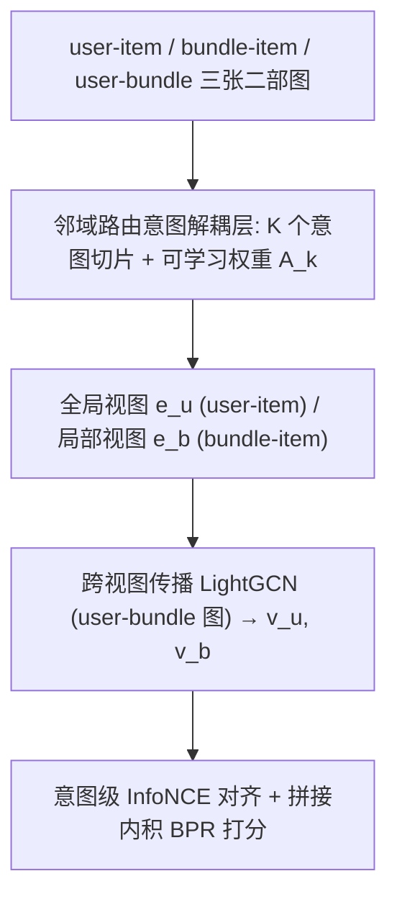
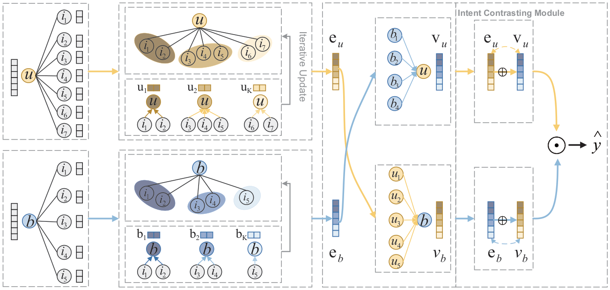

# Multi-view Intent Disentangle Graph Networks for Bundle Recommendation (多视图意图解耦图网络用于捆绑推荐)

- **会议/期刊**: AAAI 2022
- **作者与机构**: Sen Zhao, Wei Wei, Ding Zou, Xianling Mao（华中科技大学 CCIIP 实验室 / 北京理工大学）
- **推荐链路定位**: 召回（用户–捆绑包整体召回）
- **研究方向**: 图神经网络与知识图谱推荐 / 自监督对比学习
- **论文原文**: [https://arxiv.org/abs/2202.11425v3](https://arxiv.org/abs/2202.11425v3)
- **开源代码**: [https://github.com/Snnzhao/MIDGN.git](https://github.com/Snnzhao/MIDGN.git)

## TL;DR (1分钟核心速览)

捆绑推荐中现有 GCN 方法把用户表征压成单一向量，忽略"用户购买意图本身是多样的"。MIDGN 将用户/捆绑包 embedding 切成 $K$ 个意图切片，用邻域路由分别在用户–物品图（全局视图）与捆绑包–物品图（局部视图）上解耦意图，再用意图级 InfoNCE 跨视图对齐。在 NetEase / Youshu 全库排序协议下，Recall@20 相对最强基线 BGCN 分别提升 38.2% 与 14.2%。

## Background & Motivation (背景与核心矛盾)

- **主流范式**: 以 BGCN、BasConv 为代表，把 user–bundle–item 建成异构图，用 GCN 聚合多跳协同信号，同时建模"song-level"语义。
- **前人局限**: ① 全局视图下不同意图的物品互相干扰——早餐与烹饪两类 playlist 共享的物品（如鸡蛋）在构造"烹饪"意图时成为噪声；② 局部视图下同一捆绑包内跨意图物品被强行混在一个向量里，如"面包+平底锅"这类关联度低的组合被误判为整体偏好。
- **核心洞察 (Key Insight)**: 用户意图天然分布在两层结构上——跨 bundle 分布（全局，样本多、意图刻画更清晰）与 bundle 内分布（局部，能揭示意图内物品的高相关性），两者互补而非冗余。
- **本文切入点**: 不引入外部意图标签，而是把意图当作**可学习的隐式维度切片**，用可微的邻接权重"路由"每个交互到最匹配的意图，并强制两个视图学到的是同一组意图。

## Method (核心方法设计)

### 1. 整体框架 (Overall Architecture)

输入为三张二部图（user–item、bundle–item、user–bundle）。图解耦模块把用户/捆绑包向量切成 $K$块，每块绑定一个意图，并为每个意图维护一张带权邻接矩阵$\mathbf{A}_k$；邻域路由在每层迭代中同时更新意图切片与$\mathbf{A}_k$（全局视图跑 user–item 图，局部视图跑 bundle–item 图），得到$e_u$、$e_b$。跨视图传播模块在 user–bundle 图上做对称归一化聚合，把两视图的意图互相"交换"得到$v_u$、$v_b$。意图对比模块对同一意图在两视图下的切片做 InfoNCE 对齐，最终拼接后内积打分，BPR 训练、与对比损失交替优化。

<figure class="paper-figure" markdown="span">
  <figcaption>图2：所提出的MIDGN框架。其包含四个模块：(a) 图解耦模块，分别在全局和局部视图下解耦与用户意图耦合的用户-物品交互和捆绑-物品交互；(b) 跨视图传播模块，在不同视图下传播与用户意图耦合的协同信号；(c) 意图对比模块，用于增强不同视图下用户意图的相关性，以及预测模块。（彩色查看最佳）</figcaption>
</figure>

### 2. 关键设计拆解 (Key Designs)

1. **邻域路由的可微意图软分配**：前人把"意图"当静态聚类预处理，本文改为训练中端到端学习。每个交互 $(c,i)$（$c$为 user 或 bundle 的统一占位符）在$K$ 个意图上持有置信度，先 softmax 归一化为分配比例，再加权聚合邻居：
$\tilde{A}^{t}_{k}(c,i)=\frac{\exp A^{t}_{k}(c,i)}{\sum_{k'=1}^{K}\exp A^{t}_{k'}(c,i)}$，$c^{t}_{k}=\sum_{i\in N_c}\frac{\tilde{A}^{t}_{k}(c,i)}{\sqrt{D^{t}_{k}(c)D^{t}_{k}(i)}}\,i$。
随后用内积"回填"置信度：$A^{t+1}_{k}(c,i)=A^{t}_{k}(c,i)+(c^{t}_{k})^{\top}i$——意图切片与物品越相似，该边在下一轮越被强化，本质上是一个无需离散聚类的 EM 式软路由。
2. **双视图解耦 + 跨视图传播**：全局视图用 user–item 图学习"跨 bundle 分布的意图"（覆盖物品多、意图判别性强），局部视图用 bundle–item 图学习"bundle 内意图"（物品共现强、揭示意图内关联）。二者通过 user–bundle 图上的 LightGCN 聚合 $v_{u}=\sum_{b\in N_u}\frac{e_{b}}{\sqrt{|N_u||N_b|}}$ 交换视图信息，使每个意图切片同时携带"跨包广泛证据"与"包内紧耦合证据"。
3. **意图级对比与训练目标**：把同一意图在两视图下的切片视为正对，其余 $K-1$ 个意图切片视为负对（无需额外采样，天然 in-batch 硬负例）：
$\mathcal{L}_{contrast}=-\log\frac{\exp(e_{ck}\cdot v_{ck^{+}})}{\sum_{k'}\exp(e_{ck}\cdot v_{ck'})}$。
预测为 $\hat{y}_{ub}=(e_u\oplus v_u)\odot(e_b\oplus v_b)$，优化$\mathcal{L}_{BPR}=\sum_{(u,b,d)\in Q}-\ln\sigma(\hat{y}_{ub}-\hat{y}_{ud})+\lambda\|\theta\|_2^{2}$，与$\mathcal{L}_{contrast}$ 交替优化；训练负采样比为 1，推理时对全库未交互 bundle 内积排序，无额外候选生成开销。

## Experimental Setup & Evaluation Protocol (实验设置与评估协议)

- **数据集与预处理**: 沿用 DAM / BGCN 的公开版本，NetEase 中每个 bundle 至少含 10 首歌（且至少出现在 5 个 bundle 中），每个用户至少消费 10 首歌与 10 个 playlist；Youshu 为用户–书/书单场景。

| 数据集 | #Users | #Items | #Bundles | #U-B | #B-I | #U-I | U-B 密度 |
| :--- | :---: | :---: | :---: | :---: | :---: | :---: | :---: |
| NetEase | 18,528 | 123,628 | 22,864 | 302,303 | 1,778,838 | 1,128,065 | 0.07% |
| Youshu | 8,039 | 32,770 | 4,771 | 51,337 | 176,667 | 138,515 | 0.13% |

- **数据划分与防穿越 (Splitting Strategy)**: 沿用既有基准的 user–bundle 交互随机划分（约 8:1:1 的 train/valid/test），**非**全局时间戳切分，因而存在轻度未来信息泄漏风险，跨论文数值比较需谨慎。
- **排名评测协议 (Ranking Protocol)**: 测试阶段对所有未交互 bundle 做 **Full-Ranking 全库排序**（非采样排序），指标为 Recall@{20,40,80} 与 NDCG@{20,40,80}。
- **对比基线与超参设置**: 基线含 MFBPR、DAM（多任务注意力）、GCN/NGCF（直接搬到 user–bundle 图，记 GCNBG/NGCFBG）、RGCN、BasConv、BGCN。统一 BPR 损失 + Adam，embedding 维度 $d=64$，batch 4096，学习率在$\{10^{-5},\dots,3\times10^{-3}\}$网格搜索；MIDGN 的意图数$K\in\{1,2,4,8\}$、层数$L\in\{1,2,3,4\}$网格搜索。原文未报告显著性检验（无$p$ 值）。

## Key Experimental Results (实验关键数据)

### 1. 主实验对比 (Main Results)

| 方法 | NetEase R@20 | NetEase N@20 | NetEase R@80 | Youshu R@20 | Youshu N@20 | Youshu R@80 |
| :--- | :---: | :---: | :---: | :---: | :---: | :---: |
| MFBPR | 0.0335 | 0.0181 | 0.0948 | 0.1959 | 0.1117 | 0.3710 |
| DAM | 0.0411 | 0.0210 | 0.1090 | 0.2082 | 0.1198 | 0.3915 |
| GCN | 0.0402 | 0.0204 | 0.1051 | 0.2032 | 0.1175 | 0.3804 |
| NGCF | 0.0384 | 0.0198 | 0.1015 | 0.2119 | 0.1165 | 0.3743 |
| RGCN | 0.0407 | 0.0210 | 0.1112 | 0.2040 | 0.1069 | 0.4169 |
| BasConv | 0.0470 | 0.0244 | 0.1241 | 0.2121 | 0.1204 | 0.3988 |
| BGCN | 0.0491 | 0.0258 | 0.1304 | 0.2347 | 0.1345 | 0.4355 |
| **MIDGN** | **0.0678** | **0.0343** | **0.1654** | **0.2682** | **0.1527** | **0.4817** |
| Improv.% | +38.2% | +33.1% | +26.8% | +14.2% | +13.8% | +10.7% |

### 2. 消融实验 (Ablation Study)

| 变体 (Recall@20 / NDCG@20) | NetEase | Youshu |
| :--- | :---: | :---: |
| w/o local（局部视图换回 GCN） | 0.0547 / 0.0287 | 0.2475 / 0.1393 |
| w/o global（全局视图换回 GCN） | 0.0583 / 0.0303 | 0.2464 / 0.1441 |
| w/o contra.（去掉 InfoNCE） | 0.0609 / 0.0312 | 0.2588 / 0.1471 |
| **MIDGN 完整模型** | **0.0678 / 0.0343** | **0.2682 / 0.1527** |

### 3. 关键实验发现 (Key Findings)

- **双视图缺一不可，且局部视图更"贵"**：去掉局部解耦后 NetEase R@20 掉 19.3%（0.0678→0.0547），是所有变体中最大跌幅，说明 bundle 内物品关联是捆绑推荐区别于普通 item 推荐的核心信号；去掉全局视图掉 14.0%，验证"跨包更多物品能更清晰刻画单意图"的假设。
- **对比学习是廉价增益而非主力**：w/o contra. 掉 10.2%（NetEase），小于两个视图消融，但该模块不引入任何采样开销，属于"顺手的免费对齐"；即便全部消融变体（最差 0.0547）仍优于最强基线 BGCN（0.0491），证明增益主要来自意图解耦范式本身。
- **$K$与$L$存在明确拐点、且两数据集不同步**：$K$从 1→4 单调上升（0.0579→0.0678），到$K=8$骤降到 0.0587，即意图切得过细会让每簇证据不足；层数在 NetEase 上$L=4$最优（0.0678），而 Youshu 上$L=3$已达峰值、$L=4$ 反降到 0.2617，反映稀疏数据（Youshu 交互量约为 NetEase 的 1/6）更早遭遇高阶邻居噪声。

## Highlights & Limitations (亮点、对比与审稿批判)

- **与代表作对比 (vs. Prior Work)**: BGCN 虽然建模了 user–bundle–item 异构关系，但输出仍是**单一**用户/捆绑包向量，无法区分"为早餐买"与"为烹饪买"；BasConv 用异构聚合器区分节点类型，但同样不做意图粒度切分；DAM 走多任务路线，缺乏 bundle 内物品关联建模。MIDGN 的差异是把"意图"变成可微路由的隐变量，而非额外的网络分支。
- **可迁移亮点**: ① "邻接权重 softmax 归一 + 内积回填"的软路由机制，可零成本迁移到异构图或多行为类型图（点击/收藏/购买各作一路由通道）；② 同一实体不同视图切片互为负例的对比方式，天然产生 $K-1$ 个硬负例，适用于任何"多表征"模型的自监督对齐。
- **审稿级局限批判**: ① 邻域路由需对每条边维护 $K$个置信度并在每层迭代更新，边数达 178 万的 NetEase 上显存与预处理开销随$K$、$L$线性增长，论文未给出训练/推理时间对比；② 评估仅用随机划分与未交互全库排序，缺少时间切分与冷启动分桶，也未做显著性检验，"38.2%" 的稳健性无法判断；③$K$与$L$ 在两组数据上最优值不一致，实际部署需逐业务调参。

## Rating (四维评分)

- **方法创新性 (Novelty)**: ⭐⭐⭐⭐ （意图解耦 + 双视图路由 + 意图级对比三件套组合新颖，但单点算子均为已知技术的重组，缺理论分析）
- **评估协议与实验扎实度 (Protocol & Experiments)**: ⭐⭐⭐ （两数据集 + 全库排序 + 完整消融与超参分析尚可，但随机划分、无显著性检验、缺效率对比）
- **写作与数学规范度 (Clarity & Rigor)**: ⭐⭐⭐⭐ （公式与符号定义清晰、路由更新链条完整可复现，符号 $c$ 复用略绕）
- **工业落地与复现价值 (Industrial & Practical Value)**: ⭐⭐⭐⭐ （官方开源、纯 PyTorch/GNN 实现、无额外候选生成即可上线，主要成本在 $K$ 个邻接权重的存储）

