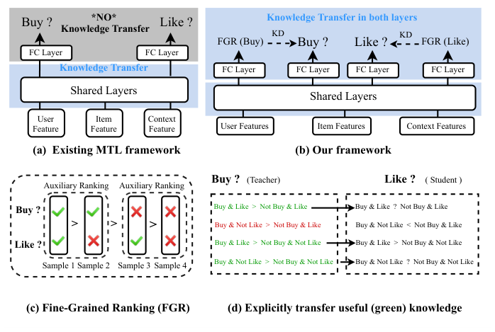
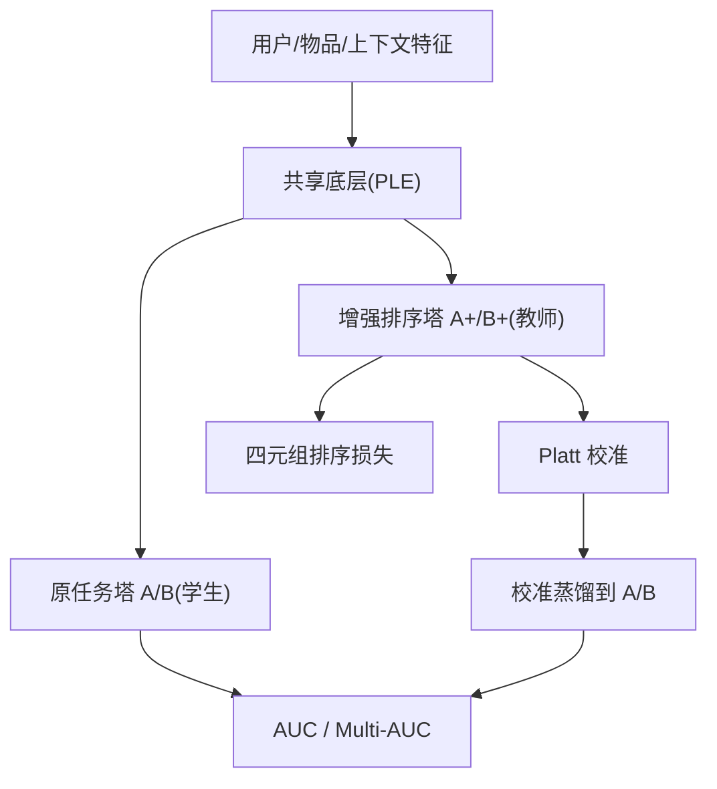

# Cross-Task Knowledge Distillation in Multi-Task Recommendation (多任务推荐中的跨任务知识蒸馏)

- **会议/期刊**: AAAI 2022
- **作者与机构**: Chenxiao Yang, Junwei Pan, Xiaofeng Gao, Tingyu Jiang, Dapeng Liu, Guihai Chen；上海交通大学、腾讯
- **推荐链路定位**: 精排（多任务排序）
- **研究方向**: 多任务学习与列表级重排 / CTR/CVR 预估与特征交叉
- **论文原文**: [链接](https://arxiv.org/abs/2202.09852v2)
- **开源代码**: 暂未开源

## TL;DR (1分钟核心速览)

针对多任务推荐仅用二值标签、忽视跨任务细粒度排序知识的痛点，CrossDistil 以四元组辅助排序任务为教师，结合 Platt 校准蒸馏与误差纠错同步训练，在微信朋友圈/TikTok 的样本级 AUC/Multi-AUC 上显著提升，TikTok Task A Multi-AUC 相对提升 17.0%。

## Background & Motivation (背景与核心矛盾)

- **主流范式**: Shared-Bottom/MMoE/PLE 以共享底层学习任务不变表征，各任务塔用二值交叉熵独立预测点击、购买等反馈。
- **前人局限**: 二值硬标签无法区分同标签样本内部排序；直接把 A 任务预测蒸馏给 B 会遇任务冲突（如 $x^{+-}\succ x^{-+}$ 在 A 成立而在 B 反转）、量纲不一致与同步训练教师噪声。
- **核心洞察**: 另一任务对同标签样本的预测概率含细粒度偏好，可作软标签重加权梯度；但只应保留无冲突的多部排序关系。
- **本文切入点**: 将四类标签组合拆成四元组辅助排序任务，再校准蒸馏到原任务。

<figure class="paper-figure" markdown="span">
  <figcaption>图1：CrossDistil 的动机示意图。</figcaption>
</figure>
*图 1：CrossDistil 的动机示意：利用另一任务预测补足同标签样本排序。*

## Method (核心方法设计)

### 1. 整体框架 (Overall Architecture)

CrossDistil 在 PLE 风格共享底层上并行挂原任务塔 A/B（学生）与增强排序塔 A+/B+（教师）。输入为 user/item/context 特征；A+ 用四元组损失学习 $x^{++}\succ x^{+-}\succ x^{-+}\succ x^{--}$ 的细粒度序，B+ 同理；教师 logits 经 Platt 校准后以温度蒸馏到学生，学生损失为硬标签 CE 与 KD 的加权和。误差纠错在蒸馏前钳制与硬标签矛盾的教师 logit；训练采用 Θ（预测）与 Ω（校准）交替的双层优化，推理只走学生塔。

### 2. 关键设计拆解 (Key Designs)

1. **四元组任务增强**：按 $y_A,y_B\in\{0,1\}$将样本分为$D^{++},D^{+-},D^{-+},D^{--}$；对任务 A 只保留无冲突的多部序$x^{++}\succ x^{+-}\succ x^{-+}\succ x^{--}$，其损失为$\mathcal{L}_{A+}=\sum -\beta_{A1}\ln\sigma(\hat r_{++}-\hat r_{+-})-\beta_{A2}\ln\sigma(\hat r_{-+}-\hat r_{--})+\sum -\ln\sigma(\hat r_{+\cdot}-\hat r_{-\cdot})$。该分解丢弃$x^{+-}$与$x^{-+}$ 间的冲突比较，先把“可迁移的细粒度序”提纯。

2. **校准蒸馏**：教师 A+ 用 pairwise loss 训练，输出不是概率；用 Platt scaling $\tilde r_{A+}=P_A\hat r_{A+}+Q_A$、$\tilde y_{A+}=\sigma(\tilde r_{A+})$对齐量纲，再$\mathcal{L}_{A-KD}=CE(\sigma(\tilde r_{A+}/\tau),\sigma(\hat r_A/\tau))$，学生$\mathcal{L}_{A-Stu}=(1-\alpha)\mathcal{L}_A+\alpha\mathcal{L}_{A-KD}$。线性校准不改变教师排序，只把软标签变成数值可信的监督。

3. **误差纠错与训练**：同步训练时教师早期不可靠；用 $r_T\leftarrow \mathbb{I}[y]\max\{\mathbb{I}[y]r_T,m\}$将矛盾 logit 拉回边界，$\mathbb{I}[y]=1$若$y=1$否则$-1$。蒸馏对教师无回传，故不干扰教师；总损失为$\mathcal{L}_{A+}+\mathcal{L}_{B+}+\mathcal{L}_{A-Stu}+\mathcal{L}_{B-Stu}$ 加权和，负例按四类子集 Bootstrap 采样，推理仅学生塔。

## Experimental Setup & Evaluation Protocol (实验设置与评估协议)

- **数据集与预处理**: 未做 5-core 过滤，按原始日志采样；W 为 Not interested/Click，T 为 Finish watching/Like。

| 数据集 | #Samples | #Fields | #Features | Density(A/B) | 划分 |
| :--- | :---: | :---: | :---: | :---: | :--- |
| WechatMoments | 9,381,820 | 10 | 447,002 | 1.510%/9.975% | 前4天训练，第5天验证/测试 |
| TikTok | 19,622,340 | 9 | 4,691,483 | 37.994%/1.101% | 随机80%/10%/10% |

- **数据划分与防穿越**: TikTok 随机 80/10/10；WechatMoments 按全局时间戳（天）前 4 天训练、最后 1 天验证/测试。
- **排名评测协议**: 非全库 Full-Ranking，而是在测试样本上算 bipartite AUC 与 weighted Multi-AUC（多类序 $x^{++}\succ x^{+-}\succ x^{-+}\succ x^{--}$），属样本级排序评估；训练负例为四类子集内 Bootstrap 均匀采样。
- **对比基线与超参设置**: 基线含 Single-Model、Shared-Bottom、Cross-Stitch、MMoE、PLE；TAUG/CrossDistil 以 PLE 为 backbone。原文未披露 embedding 维度与显著性检验。

## Key Experimental Results (实验关键数据)

### 1. 主实验对比 (Main Results)

W=WechatMoments，T=TikTok；加粗为各列最优。

| 方法 | W-A AUC | W-A Multi | W-B AUC | W-B Multi | T-A AUC | T-A Multi | T-B AUC | T-B Multi |
| :--- | :---: | :---: | :---: | :---: | :---: | :---: | :---: | :---: |
| Single-Model | 0.7528 | 0.6270 | 0.7597 | 0.6024 | 0.7456 | 0.6335 | 0.9491 | 0.7966 |
| Shared-Bottom | 0.7540 | 0.6378 | 0.7587 | 0.6145 | 0.7375 | 0.6344 | 0.9489 | 0.8101 |
| Cross-Stitch | 0.7582 | 0.6360 | 0.7600 | 0.6195 | 0.7468 | 0.6445 | 0.9488 | 0.7985 |
| MMoE | 0.7619 | 0.6431 | 0.7605 | 0.6226 | 0.7479 | 0.6474 | 0.9490 | 0.7980 |
| PLE | 0.7625 | 0.6394 | 0.7607 | 0.6240 | 0.7485 | 0.6464 | 0.9495 | 0.7983 |
| TAUG | 0.7632 | 0.6432 | 0.7612 | 0.6394 | 0.7491 | 0.6743 | 0.9498 | 0.8081 |
| **CrossDistil** | **0.7644** | **0.6879** | **0.7618** | **0.6861** | **0.7494** | **0.7411** | **0.9513** | **0.8341** |

相对 Single-Model 的提升：W-A AUC +1.54%、W-A Multi +9.71%、W-B AUC +0.28%、W-B Multi +13.89%；T-A AUC +0.51%、T-A Multi +16.98%、T-B AUC +0.23%、T-B Multi +4.71%。

### 2. 消融实验 (Ablation Study)

| 变体(TikTok) | A AUC | A Multi | B AUC | B Multi |
| :--- | :---: | :---: | :---: | :---: |
| CrossDistil | 0.7494 | 0.7411 | 0.9513 | 0.8341 |
| w/o AuxiliaryRank | 0.7488 | 0.6510 | 0.9501 | 0.8005 |
| w/o Calibration | 0.7478 | 0.7396 | 0.9504 | 0.8312 |
| w/o Correction | 0.7486 | 0.7399 | 0.9508 | 0.8310 |
| KD(same task) | 0.7489 | 0.6901 | 0.9505 | 0.8014 |
| KD(cross task) | 0.7269 | 0.6120 | 0.9184 | 0.7520 |

### 3. 关键实验发现 (Key Findings)

1. **增益集中在细粒度排序**：AUC 提升温和，但 Multi-AUC 飞跃，TikTok Task A 绝对提升 0.1076（+17.0%），Wechat Task B 提升 0.0837（+13.9%），说明跨任务蒸馏主要补足同类标签内部排序。
2. **任务冲突是负迁移主因**：去掉辅助排序任务后 TikTok A Multi-AUC 掉 0.0901；直接跨任务 KD 更使 A AUC -0.0225、Multi-AUC -0.1291，证明四元组分解是必要前置。
3. **校准与纠错均有效**：校准使 LogLoss A 0.5832→0.5703、B 0.0623→0.0337；纠错在训练早期加速收敛并提升最终点，且受损辅助信息比例从 10% 升到 90% 时学生性能单调下降，反向验证知识迁移真实发生。

## Highlights & Limitations (亮点、对比与审稿批判)

- **与代表作对比 (vs. Prior Work)**: PLE/MMoE 仅共享底层参数；CrossDistil 在顶层做跨任务排序蒸馏。与 vanilla KD 的同任务教师不同，本文用增强任务作教师以避冲突；与 TAUG 比增加校准与纠错。
- **可迁移亮点**: 四元组标签组合拆分为无冲突辅助排序任务；Platt 校准 + logit clamp 可迁移到任何同步 teacher-student 推荐蒸馏。
- **审稿级局限批判**: 评估为样本级 AUC/Multi-AUC，非全库 Full-Ranking，也无线上 A/B；双任务设定与额外教师塔、四元组采样、双层优化增加训练开销，超参 $m,\beta,\alpha$ 敏感且未开源。

## Rating (四维评分)

- **方法创新性 (Novelty)**: ⭐⭐⭐⭐ （把 KD 从同任务压缩转为跨任务排序知识迁移，四元组分解有清晰物理直觉）
- **评估协议与实验扎实度 (Protocol & Experiments)**: ⭐⭐⭐ （两个真实数据集+充分消融，但仅样本级 AUC/Multi-AUC，无全库排序与显著性检验）
- **写作与数学规范度 (Clarity & Rigor)**: ⭐⭐⭐⭐ （挑战—模块对应清晰，公式完整；部分符号与超参细节可更系统）
- **工业落地与复现价值 (Industrial & Practical Value)**: ⭐⭐⭐⭐ （腾讯生产数据验证，推理仅学生塔；但训练复杂且未开源）

