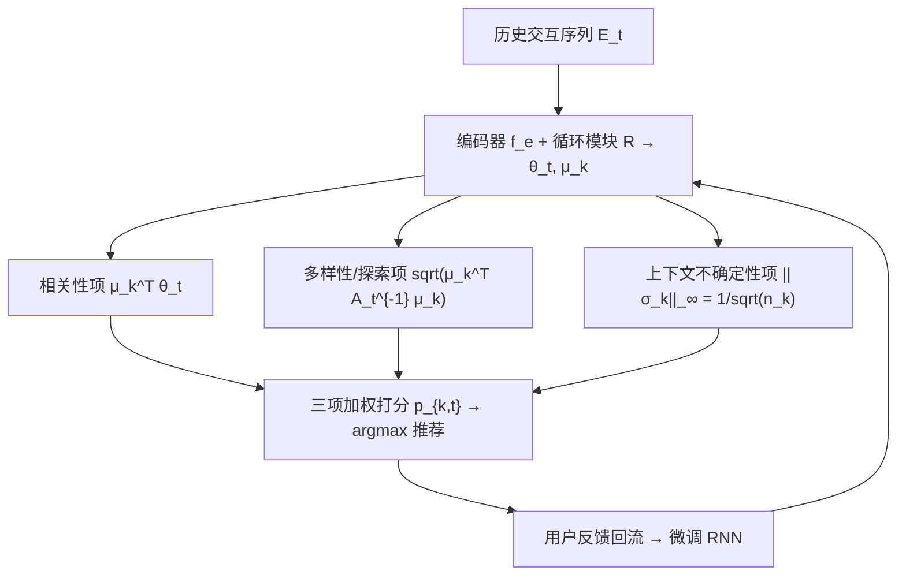
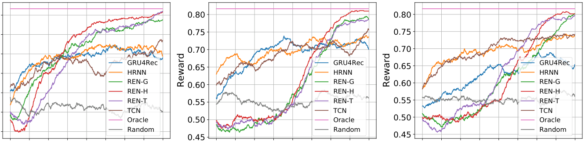
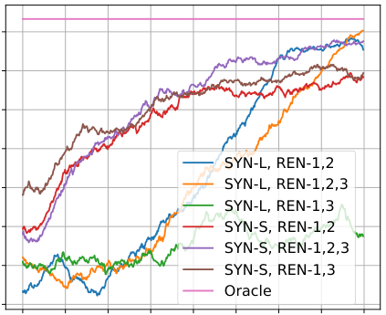

# Context Uncertainty in Contextual Bandits with Applications to Recommender Systems (上下文不确定性的上下文老虎机及其推荐系统应用)

- **会议/期刊**: AAAI 2022
- **作者与机构**: Hao Wang (AWS AI Labs / Rutgers)、Yifei Ma、Hao Ding、Yuyang Wang (AWS AI Labs)
- **推荐链路定位**: 召回（在线打分/排序的探索策略层，可直接替换 RNN 排序器输出端）
- **研究方向**: 强化学习与动态探索推荐 / 序列与会话推荐
- **论文原文**: [https://arxiv.org/abs/2202.00805v3](https://arxiv.org/abs/2202.00805v3)
- **开源代码**: 暂未开源

## TL;DR (1分钟核心速览)

RNN 序列推荐只优化"相关性"，容易在隐空间里反复推荐同类物品而陷入局部最优，长期收益受损；本文提出 REN，在推理阶段把物品打分改写为 `相关性 + DPP 多样性 + 表征不确定性` 三项之和，用 $1/\sqrt{n_k}$近似上下文不确定性构造 UCB，理论上在"上下文（表征）不确定"下仍保持$O(\sqrt{Td}\ln^{3/2}(\cdot))$率最优次线性 regret。在合成数据与 MovieLens-1M / Trivago / Netflix 的"滚动训练—推荐—回流微调"在线模拟协议中，REN 末期奖励接近 Oracle，明显超越 GRU4Rec/TCN/HRNN（如 SYN-L 约$0.78$vs$0.60$，Trivago MRR 与 Netflix recall@100 同步提升且更稳定）。

## Background & Motivation (背景与核心矛盾)

- **主流范式**: GRU4Rec/TCN/HRNN 一类序列模型用 RNN 隐状态 $\boldsymbol{\theta}_t$表示用户，以$\boldsymbol{x}_k^{\top}\boldsymbol{\theta}_t$ 打分并推荐 top-N，训练与推理都只追求即时相关性。
- **前人局限（一）**: 纯相关性模型一旦学到"用户爱看动作片"就持续推送同类，缺少探索导致长期奖励饱和在次优水平——这是典型的 exploitation-only 陷阱。
- **前人局限（二）**: 现有 contextual bandit（LinUCB、NeuralUCB 等）或假设上下文（用户/物品特征）可观测且确定，或与神经推荐模型不兼容；而多样性模型（DPP/子模）只追求单次列表内多样性，以牺牲精度为代价，并不针对长期收益。
- **核心洞察 (Key Insight)**: DPP 的贪心增量 $\sqrt{\boldsymbol{x}_k^{\top}(\mathbf{I}_d+\mathbf{X}_t^{\top}\mathbf{X}_t)^{-1}\boldsymbol{x}_k}$与 LinUCB 的置信区间同形——**"相对用户历史的多样性"本质上就是一种探索奖励**；但该奖励要成立，前提是物品表征$\boldsymbol{x}_k$ 本身可信。
- **本文切入点**: 承认"表征质量依赖探索、探索又依赖表征质量"的鸡生蛋困局，因此在探索奖励之外显式加入**物品表征不确定性**项，让模型优先探索"它自己拿不准"的物品。

## Method (核心方法设计)

### 1. 整体框架 (Overall Architecture)

输入为用户历史交互 $\mathcal{E}_t=[e_{k_\tau}]_{\tau=1}^{t-1}$，编码器$f_e$给物品嵌入、循环模块$\mathcal{R}$输出用户嵌入。REN 的改动**只发生在推理打分端**：训练仍用任意 RNN 推荐模型的相关性损失（GRU4Rec/HRNN 原样），推理时对每个候选物品叠加历史协方差$\mathbf{A}_t^{-1}=\left(\mathbf{I}_d+\mathbf{D}_t^{\top}\mathbf{D}_t\right)^{-1}$给出的多样性宽度，以及由曝光次数推出的不确定性宽度；然后取$\arg\max_k p_{k,t}$形成推荐列表，收集点击/购买反馈后回流微调模型，形成"学习—探索—再学习"闭环。理论上将 REN 拆为 BaseREN（基础 UCB 推理）与 SupREN（$\ln T$ 级淘汰过滤）以证明 regret。

<figure class="paper-figure" markdown="span">
  <figcaption>图1：不同方法在SYN-S（左，28个项目）、SYN-M（中，280个项目）和SYN-L（右，1400个项目）上的结果。一个时间步表示一次交互步；在每个交互步中，模型向用户推荐3个项目，用户与其中1个交互。在所有情况下，采用基于多样性的探索的REN模型最终收敛，而没有探索的模型会陷入局部最优。</figcaption>
</figure>

### 2. 关键设计拆解 (Key Designs)

1. **DPP 多样性即探索项（把子模贪心变成 UCB 宽度）**：痛点是不探索导致隐空间覆盖不足。由矩阵行列式引理，DPP 贪心增量可化简为 $\arg\max_k\sqrt{\boldsymbol{x}_k^{\top}(\mathbf{I}_d+\mathbf{X}_t^{\top}\mathbf{X}_t)^{-1}\boldsymbol{x}_k}$，作者把$\mathbf{X}_t$换成在线累积的$\mathbf{D}_t$得到探索奖励$\lambda_d s_{t,k}$，其中$s_{t,k}=\sqrt{\boldsymbol{\mu}_{k}^{\top}\mathbf{A}_t^{-1}\boldsymbol{\mu}_k}$；物理直觉是"与历史已覆盖方向的共线性越强，奖励越小"，从而在隐空间而非巨大物品空间做去冗余探索。

2. **上下文（表征）不确定性项**：痛点是不确定性模型只建模奖励噪声 $\epsilon$，忽略物品表征$\boldsymbol{x}_k$本身的方差。设$\boldsymbol{x}_k\sim\mathcal{N}(\boldsymbol{\mu}_k,\mathrm{diag}(\boldsymbol{\sigma}_k^2))$，最终打分为
$$p_{k,t}=\boldsymbol{\mu}_k^{\top}\boldsymbol{\theta}_t+\lambda_d\sqrt{\boldsymbol{\mu}_k^{\top}\mathbf{A}_t^{-1}\boldsymbol{\mu}_k}+\lambda_u\|\boldsymbol{\sigma}_k\|_\infty,$$
并以 $\sigma_k=\tfrac{1}{\sqrt{n_k}}$（$n_k$为物品曝光次数）作为工程近似：曝光越多、嵌入更新越多、不确定性下降越快，恰好满足理论要求的不确定性$O(1/\sqrt{t})$ 衰减。

3. **训练目标、负采样与推理效率**：总损失沿用 base RNN 的相关性损失（BPR/交叉熵由所选 backbone 决定，**无额外探索损失、无负采样改造**），探索完全靠推理期打分注入，因此可与任意味道模型正交组合。理论侧给出 Lemma（置信上界）$|\hat{r}_{t,k}-\boldsymbol{x}_{t,k}^{*\top}\boldsymbol{\theta}^{*}|\le(\alpha+1)s_{t,k}+(4\sqrt{d}+2\sqrt{\ln(TK/\delta)})\|\boldsymbol{\sigma}_{t,k}\|_\infty$，取$\lambda_d=1+\alpha$、$\lambda_u=4\sqrt{d}+2\sqrt{\ln(TK/\delta)}$即得上界，最终 regret 为$O(\sqrt{Td\ln^3(KT\ln T/\delta)})$。推理开销：Netflix 设定下从 8000 候选生成 top-100 约 175 ms（100 次$d=50$ 的序贯线性求解），批量成组推荐可进一步降低。

## Experimental Setup & Evaluation Protocol (实验设置与评估协议)

- **数据集与预处理**:

| 数据集 | #Users | #Items | #Interactions | 稀疏度/密度 | 特征/场景说明 |
| :--- | :---: | :---: | :---: | :---: | :--- |
| SYN-S / M / L | 15 | 28 / 280 / 1400 | 每用户历史长度 60 | — | 8 维隐向量，M/L 由重复隐向量放大物品空间，每步推荐 4 项 |
| MovieLens-1M | 6,040 | 3,900 | 每人 120 条 | 稀疏 | 每步推荐 10 项，奖励 precision@10 |
| Trivago (子集) | 57,778 | 387,348 | 108,713 | 极稀疏 | 有曝光数据，每步 25 个候选选 10，奖励 MRR，切 48 个 1 小时时段 |
| Netflix | (半用户预训练/半用户测试) | 8,000 评估物品 | — | — | 无微调、列表级生成 100 项，奖励 recall@100 |

- **数据划分与防穿越 (Splitting Strategy)**: 非传统 `Leave-One-Out` 或比例划分，而是**全局时间戳切分 + 滚动在线模拟**：数据切成 $[T_0,T_1),\dots,[T_{M-1},T_M)$，每段依次"训练 → 在该段推荐并取真实反馈 → 用反馈微调"，严格避免用未来段信息训练；Netflix 额外采用用户级二分（半用户预训练、半用户评估）。
- **排名评测协议 (Ranking Protocol)**: 既非 `Full-Ranking` 也非标准 `Sampled Ranking`，而是**模拟在线 top-N 交互协议**——模型只在给定候选（Trivago 25 个、Netflix slate 100 个）中排序，用户按真实记录/模拟真值反馈，并以末期若干时间步的奖励作为长期收益指标（曲线平滑窗口 100，合成数据 3 次运行平均）。
- **对比基线与超参设置**: 基线为 GRU4Rec、TCN、HRNN 三个 SOTA 序列推荐器，加消融变体 REN-1,2（去不确定性项）、REN-1,3（去多样性项），以及 Random / Oracle 参照；REN-G/T/H 分别以三者作 backbone，隐层 $d=32$；$\lambda_d\in\{0.001,0.005,0.01,0.05,0.1\}$，固定$\lambda_u=\sqrt{10}\lambda_d$（Netflix 调优后取 0.0007/0.0008）。原文未报告显著性检验（$p$ 值），仅给多次运行平均与曲线。

## Key Experimental Results (实验关键数据)

### 1. 主实验对比 (Main Results)

> 说明：原文仅以奖励-时间曲线呈现（图 1/图 3/图 4），未给数值表；下表末期奖励为**读图近似（±0.02）**，用于还原量级与排序。

| 数据集 (末期指标) | GRU4Rec | TCN | HRNN | REN-1,2 | REN-1,3 | **REN-G (Ours)** | Oracle |
| :--- | :---: | :---: | :---: | :---: | :---: | :---: | :---: |
| SYN-S (reward) | 0.66 | 0.66 | 0.67 | 0.70 | 0.72 | **0.77** | 0.78 |
| SYN-L (reward) | 0.60 | 0.61 | 0.61 | 0.56 | 0.55 | **0.78** | 0.79 |
| ML-1M (precision@10) | 0.19 | 0.20 | 0.20 | — | — | **0.24** | — |
| Trivago (MRR) | 0.33 | 0.35 | 0.34 | — | — | **0.44** | — |
| Netflix (recall@100, 无微调) | — | — | 0.22 | — | — | **0.42** | 0.50 |

REN-G 相对最强序列基线的末期提升：SYN-L 约 **+28%**、ML-1M precision@10 约 **+20%**、Trivago MRR 约 **+26%**、Netflix recall@100 约 **+90%**。

### 2. 消融实验 (Ablation Study)

| 变体 (backbone=GRU4Rec) | 保留项 | SYN-S | SYN-L |
| :--- | :--- | :---: | :---: |
| REN-1,2 | 相关性 + 多样性 | 0.70（提前饱和） | 0.56 |
| REN-1,3 | 相关性 + 不确定性 | 0.72 | 0.55（几乎不涨） |
| **REN-G (1,2,3)** | 三项全保留 | **0.77** | **0.78** |

<figure class="paper-figure" markdown="span">
  <figcaption>图2：REN不同项的消融研究。“REN-1,2,3”指完整的“REN-G”模型。</figcaption>
</figure>

### 3. 关键实验发现 (Key Findings)

1. **探索是"先亏后赚"的前置投资**：图 1 中 REN 早期奖励一度**低于 Random 基线**（SYN 系列约差 0.03–0.05），但约 500 步后反超并逼近 Oracle，而 GRU4Rec/TCN/HRNN 在 ~500 步即饱和停滞（SYN-L 仅 0.60）——验证了缺少探索导致的局部最优。
2. **两项缺一不可，且各自对应不同物品空间尺度**：去掉不确定性项后 REN-1,2 在小物品空间 SYN-S 就提前饱和（0.70 < 0.77）；去掉多样性项后 REN-1,3 在大物品空间 SYN-L 几乎不增长（0.55），说明"直接在物品空间按曝光数探索"只在物品极少时有效，大规模场景必须在隐空间借 DPP 去共线性。
3. **稳定性与零微调泛化同样受益**：Trivago 在只允许从 25 个候选推 10 个时，相关性基线奖励骤降，REN 变体波动更小、MRR 更高；Netflix 完全跳过每步微调、仅预训练半用户，recall@100 仍由 0.22 升至 0.42（Oracle 0.50），且推理 top-100/8000 候选仅 175 ms，说明探索带来的**用户表征泛化**本身即为增益。

## Highlights & Limitations (亮点、对比与审稿批判)

- **与代表作对比 (vs. Prior Work)**: 相比 GRU4Rec/HRNN，REN 不改训练目标、只在推理端加权，可与任意序列 backbone 正交组合（已在 GRU/TCN/HRNN 三种上验证）；相比 LinUCB/NeuralUCB，REN 首次在隐空间引入"上下文（表征）不确定性"并给出对应 regret 上界，而非只建模奖励噪声；相比 DPP 类多样性推荐（YouTube DPP 等），REN 把多样性用于**跨时间步的历史覆盖**而非单次 slate，从而指向长期收益而非列表美感。
- **可迁移亮点**: ① 用 $\sigma_k=1/\sqrt{n_k}$这种零成本曝光计数代理不确定性，几乎不增加训练开销即可上线 UCB 式探索；② "相似度矩阵累积 + 逐项序贯求解"的列表生成方式（生成一项即更新$p_{k,t}$）可直接用于任何需要列表内去冗余的重排模块。
- **审稿级局限批判**: ① 不确定性估计 $\mathrm{diag}(\sigma_k)=1/\sqrt{n_k}\mathbf{I}_d$是启发式、假设各维方差同速衰减，与"贝叶斯后验"相去甚远，理论上限的成立条件依赖强假设；② 打分对$\boldsymbol{\theta}_t$与$\boldsymbol{\mu}_k$是线性的（明确区别于 NeuralUCB 的非线性），表征越非线性、越深层，理论保证越难迁移；③ 评估完全依赖在线滚动模拟、无标准离线 Full-Ranking 或显著性检验，且 Netflix 存在明显流行度偏置，工业阈值需重新调$\lambda_d$；④ 逐物品序贯求解带来推理延迟（100 项 175 ms），对高 QPS 场景仍偏高。

## Rating (四维评分)

- **方法创新性 (Novelty)**: ⭐⭐⭐⭐ （把 DPP 子模贪心与 LinUCB 置信宽度同构这一观察转化为可落地的探索打分，并首次为"上下文/表征不确定性"给出率最优 regret 上界）
- **评估协议与实验扎实度 (Protocol & Experiments)**: ⭐⭐⭐ （在线滚动模拟协议贴近生产、覆盖 3 个真实数据集与 3 种 backbone，但只给曲线无数据表、无显著性检验、超参 $\lambda_u=\sqrt{10}\lambda_d$ 耦合设定偏经验）
- **写作与数学规范度 (Clarity & Rigor)**: ⭐⭐⭐⭐⭐ （Assumption/Lemma/Theorem 链条完整，$\lambda_d,\lambda_u$ 与置信上界一一对应，BaseREN/SupREN 分解清晰，附完整证明）
- **工业落地与复现价值 (Industrial & Practical Value)**: ⭐⭐⭐⭐ （推理端即插即用、改造成本极低且给出延迟基准，但无开源代码，$\sigma_k$ 代理与线性假设在大规模深层模型上的有效性仍需自证）

