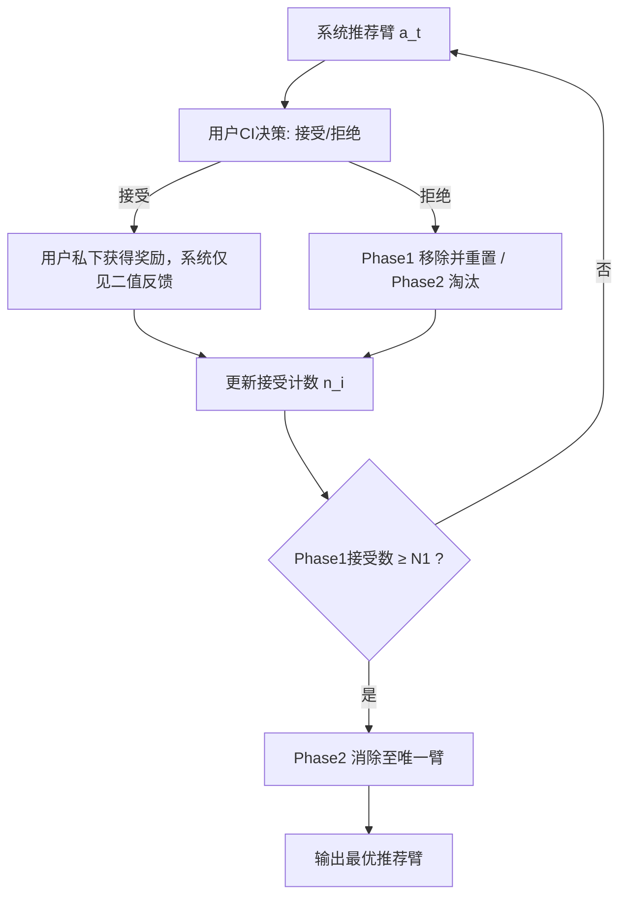

# Learning the Optimal Recommendation from Explorative Users (从探索型用户中学习最优推荐)

- **会议/期刊**: AAAI 2022（原文 arXiv 2021）
- **作者与机构**: Fan Yao, Chuanhao Li, Denis Nekipelov, Hongning Wang, Haifeng Xu；University of Virginia
- **推荐链路定位**: 在线探索/推荐决策（Bandit 最优臂识别）
- **研究方向**: 强化学习与动态探索推荐
- **论文原文**: [https://arxiv.org/abs/2110.03068v1](https://arxiv.org/abs/2110.03068v1)
- **开源代码**: 暂未开源

## TL;DR (1分钟核心速览)

针对经典推荐假设用户“全知、静态、显式反馈”的不现实性，本文建模探索型用户：仅在推荐项明显劣于其他项时拒绝，依据已接受奖励更新效用，且不向系统披露真实奖励；系统只观测二值接受/拒绝。作者将其形式化为 K-armed bandit 的固定置信度最优臂识别，提出两阶段 BAIR 算法，在合成 BAI 任务上以 $O(1/\delta)$ 交互识别最优臂并证明下界紧致。

## Background & Motivation (背景与核心矛盾)

- **主流范式**: 现有工作多把用户视为未知但全知的分类器，用 UCB/BAI/对抗 Bandit 从可观测奖励或稳定反馈中学习推荐。
- **前人局限**: ① 用户并非预先知道所有物品效用，需通过消费逐步估计偏好；② 系统通常只能获得点击/不点击等二值反馈，真实效用被用户私藏。此时用户反馈依赖历史接受项，非独立同分布，经典 BAI 的 $O(\log(1/\delta))$ 保证失效。
- **核心洞察 (Key Insight)**: 用户的“拒绝”比“接受”更具信息量：拒绝由置信区间比较触发，可帮助系统排除劣臂；但早期用户置信区间过宽，系统必须先“安全推荐”帮用户积累经验。
- **本文切入点**: 用置信区间刻画用户探索行为，设计“先扫掠积累接受数、后消除劣臂”的两阶段 BAIR，并给出匹配上下界。

## Method (核心方法设计)

### 1. 整体框架 (Overall Architecture)

系统每轮推荐臂 $a_t$，用户根据自身对各臂奖励的置信区间决定接受/拒绝；若接受，实现奖励仅反馈给用户用于更新其经验均值，系统只看到二值选择。BAIR 分两阶段：Phase-1 以安全扫掠收集$N_1$个接受，避免过早推荐风险臂；Phase-2 在候选集上持续推荐“接受次数最少”的臂，一旦被拒绝即淘汰，直至唯一存活臂输出。理论证明该流程以$1-\delta$成功识别最优臂，且总交互数上界与下界在$\delta$ 维度匹配。

### 2. 关键设计拆解 (Key Designs)

1. **探索型用户置信区间模型**：用户对臂 $i$维护$\mathrm{CI}_{i,t}=( \hat{\mu}_{i,t}-\sqrt{\Gamma(t;\rho,\alpha)/n_i^t}, \hat{\mu}_{i,t}+\sqrt{\Gamma(t;\rho,\alpha)/n_i^t} )$，其中$\Gamma(t;\rho,\alpha)=\max\{0,2\alpha\log[\rho_t n(t)]\}$。拒绝规则为：若存在$j\neq i$使$\mathrm{lcb}_{j,t}\ge \mathrm{ucb}_{i,t}$，则拒绝$i$。直觉是用户只在推荐项“明显更差”时拒绝，对置信区间交叠的臂保持探索，$\alpha$ 控制探索倾向。

2. **两阶段 BAIR：扫掠 + 消除**：Phase-1 先对候选集每臂推荐一次并移除被拒者，之后反复推荐同一臂直至被拒，所有臂均被拒后重置全集，直到累计接受数达 $N_1=\frac{1}{\rho_0}(2K/\delta)^{1/\alpha}$。Phase-2 始终推荐接受次数最少的臂，被拒即淘汰。关键不是“多探索”，而是用拒绝作为高置信排除信号；Phase-1 补偿系统无法观测奖励的信息缺口，Phase-2 才可近似标准 BAI 的$O(\log(1/\delta))$ 消除。

3. **训练目标、负采样与推理效率**：本文无离线训练损失与负采样，BAIR 为纯在线决策算法。总交互上界为 $O(K^{1/\alpha}\delta^{-1/\alpha}+K^{1+1/(2\alpha)}\delta^{-1/(2\alpha)}\sqrt{\log(K/\delta)}+\frac{\alpha K}{\Delta_1^2}\log\frac{K}{\delta\Delta_1})$；下界为$\Omega(\delta^{-1/\alpha})$，说明从“揭示偏好”学习比直接观测奖励多付出$\delta^{-1/\alpha}$ 量级成本。推理开销即 stopping time，无额外模型前向成本。

## Experimental Setup & Evaluation Protocol (实验设置与评估协议)

- **数据集与预处理**: 本文无真实推荐数据集，采用合成 BAI 仿真；每个配置生成 1000 个独立问题实例，$\mu_i\sim\mathcal{N}(0,1)$后重置$\mu^*$以匹配给定$\Delta_1$。

| 合成实例 | #Arms $K$ | #Instances | 奖励分布 | 特征/场景说明 |
| :--- | :---: | :---: | :---: | :--- |
| Synthetic BAI | 2 / 5 / 20 / 100 | 每配置 1000 | 子高斯，均值 $\mu_i$，单位方差 |$\Delta_1=0.5$主实验，$\Delta_1=0.2$补充；$\delta\in\{0.1,0.05,0.02,0.01,0.005\}$ |

- **数据划分与防穿越 (Splitting Strategy)**: 无离线划分；每个问题实例独立在线模拟至算法停止，用户置信区间仅用历史接受记录更新，不存在未来信息穿越。
- **排名评测协议 (Ranking Protocol)**: 非 Full-Ranking 或 Sampled Ranking，而是在线 BAI 协议：记录 stopping time、rejection rate 与 success probability；成功定义为终止时输出臂为真实最优臂。
- **对比基线与超参设置**: 基线为 Track-and-stop (T&S，固定置信 BAI SOTA)、UNI（均匀探索）、EXP3（对抗 Bandit）；主设置 $\alpha=1$，$\rho_t=1+n(t)/t\in[1,2]$，BAIR 取$N_1=2K/\delta$，报告 1000 实例平均。

## Key Experimental Results (实验关键数据)

### 1. 主实验对比 (Main Results)

| 设置 | 方法 | Stop↓ | Rej.%↓ | Succ↑ |
| :--- | :--- | :---: | :---: | :---: |
| $\delta=0.05,K=20$ | **BAIR** | **2421** | **1.5** | **1.000** |
| | T&S | 3161 | 4.4 | 0.965 |
| | UNI | — | 40.4 | 0.429 |
| | EXP3 | — | 12.3 | 0.577 |
| $\delta=0.05,K=100$ | **BAIR** | **10826** | **2.2** | **1.000** |
| | T&S | 16577 | 11.1 | 0.945 |
| | UNI | — | 43.2 | 0.150 |
| | EXP3 | — | 14.1 | 0.534 |

BAIR 相对 T&S 在 $K=20$时减少 23.4% stopping time、65.9% rejection，在$K=100$ 时减少 34.7% stopping time、80.2% rejection；成功率由 0.965/0.945 提升至 1.000。本文设定无传统推荐模型基线，故只列 3 个 bandit 基线。

### 2. 消融实验 (Ablation Study)

| 变体/敏感性 | Stop↓ | Succ↑ | 说明 |
| :--- | :---: | :---: | :--- |
| BAIR, $N_1=(2K/\delta)^{1/\alpha}$| 238579 | 1.000 | 理论保守$N_1$ |
| BAIR, $N_1=(\sqrt{K}/\delta)^{1/\alpha}$ | 8900 | 0.999 | 大幅降低 Phase-1 |
| BAIR, $N_1=(\log K/\delta)^{1/\alpha}$ | 8660 | 0.999 | 更激进但仍成功 |
| BAIR, $N_1=K$ | 8395 | 0.980 | Phase-1 不足，成功率下降 |
| BAIR($m$), 用户噪声$p=0.1$ | 3062 | 0.974 | 对噪声鲁棒，仍优于 T&S 的 10097/0.970 |

### 3. 关键实验发现 (Key Findings)

- **Phase-1 是主要成本，但可压缩**：$K=100,\delta=0.01$时，保守$N_1$导致 238579 步；改用$(\log K/\delta)^{1/\alpha}$后仅 8660 步且成功率 0.999，说明理论上界中的$N_1$ 在 K 维度偏悲观，实际可调。
- **经典 BAI 在隐反馈下失效**：$\delta=0.01,K=100$ 时 T&S 成功率仅 0.725，而 BAIR 为 1.000；T&S 将二值接受误当独立奖励，早期被用户宽置信区间误导。
- **拒绝信号比接受信号更“锋利”**：BAIR 在 $\delta=0.05,K=100$ 的 rejection rate 仅 2.2%，远低于 UNI 的 43.2% 与 EXP3 的 14.1%，且成功率 1.000，验证了“安全扫掠+首拒淘汰”的有效性。

## Highlights & Limitations (亮点、对比与审稿批判)

- **与代表作对比 (vs. Prior Work)**: 与 T&S 的本质区别在于本文不假设系统可观测实现奖励，且用户反馈随其学习演化；与 dueling bandit 相比，系统不知道用户比较的参考臂，反馈也非静态噪声比较；与 incentivized exploration 相比，系统处于信息劣势且目标为协作式帮助用户。
- **可迁移亮点**: ① 将“用户拒绝”建模为高置信排除信号，可用于隐式反馈推荐中的负反馈利用；② 两阶段 explore-then-eliminate 可迁移到冷启动在线 A/B 或新物品探索。
- **审稿级局限批判**: ① 仅合成实验，未在真实推荐日志验证；用户 CI 决策规则与已知 $\alpha,\rho_t$假设较强。②$N_1$ 最优选择未闭合，上下界在 K 维度不匹配；真实系统中臂可视为类目而非单物品，但大规模动作空间下扫掠成本仍高。

## Rating (四维评分)

- **方法创新性 (Novelty)**: ⭐⭐⭐⭐ （将探索型用户隐偏好与 BAI 结合，揭示 $O(1/\delta)$与$O(\log(1/\delta))$ 的本质差距，理论贡献清晰）
- **评估协议与实验扎实度 (Protocol & Experiments)**: ⭐⭐⭐ （合成实验充分、指标合理，但无真实数据与标准推荐基线，属理论验证型评估）
- **写作与数学规范度 (Clarity & Rigor)**: ⭐⭐⭐⭐⭐ （模型、算法、上下界证明完整，符号统一，定理与引理链条严谨）
- **工业落地与复现价值 (Industrial & Practical Value)**: ⭐⭐ （无开源代码，依赖强用户行为假设，在线扫掠成本高，但“拒绝即排除”思想可借鉴）

