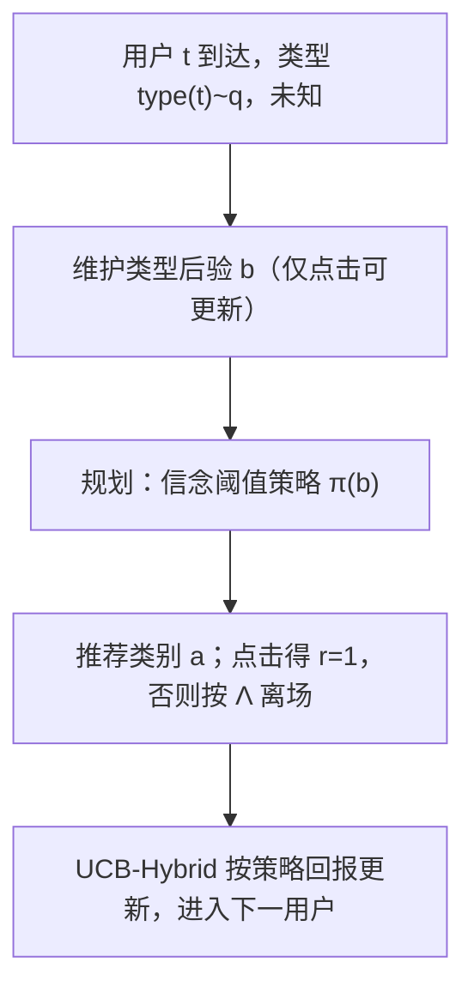

# Modeling Attrition in Recommender Systems with Departing Bandits (用离场多臂老虎机建模推荐系统中的用户流失)

- **会议/期刊**: AAAI 2022
- **作者与机构**: Omer Ben-Porat, Lee Cohen, Liu Leqi, Zachary C. Lipton, Yishay Mansour；Tel-Aviv University / CMU / Google Research
- **推荐链路定位**: 端到端在线推荐决策
- **研究方向**: 强化学习与动态探索推荐
- **论文原文**: [https://arxiv.org/abs/2203.13423v2](https://arxiv.org/abs/2203.13423v2)
- **开源代码**: 暂未开源

## TL;DR (1分钟核心速览)

本文指出传统 bandit 推荐只优化点击、不建模用户因不满而永久离场，提出 departing bandits：策略同时决定收益与交互时长。作者用 POMDP/信念阈值刻画规划，证明单类型最优固定臂、双类型双类别可 $O(1)$规划，并给出$\tilde{O}(\sqrt{T})$ 学习算法。MovieLens 仅作半合成示例，无标准主实验。

## Background & Motivation (背景与核心矛盾)

- **主流范式**: 推荐系统常被形式化为多臂老虎机，策略影响点击奖励，但交互轮数通常被假定为固定或外生。
- **前人局限**: Azar et al. 2013 处理多用户类型但采用固定 horizon；Cao et al. 2020 建模离场却仅限单类型；二者未联合刻画“策略影响留存”与“类型不可见”。
- **核心洞察 (Key Insight)**: 用户满意度既决定即时点击，也决定是否离场；因此探索可能缩短未来轨迹。论文反例中任何固定臂策略都会产生 $\Omega(T)$ 线性 regret。
- **本文切入点**: 将推荐建模为策略依赖 horizon 的 departing bandits，并把“用户类型”视为 POMDP 隐状态，用信念更新和阈值策略压缩搜索空间。

## Method (核心方法设计)

### 1. 整体框架 (Overall Architecture)

每个用户 $t$以未知类型$\mathrm{type}(t)\sim q$到达；推荐类别$a$后，以$P_{a,\mathrm{type}(t)}$点击并继续，否则以$\Lambda_{a,\mathrm{type}(t)}$永久离场。学习器在$T$个用户流上同时面对两个任务：给定$P,\Lambda,q$ 时求最优策略（规划），以及参数未知时在线学习（regret 最小化）。规划层利用 POMDP 信念状态把无限策略压缩为固定臂或阈值策略；学习层把“策略”当作 UCB 的臂，用策略累计回报而非单步奖励更新置信界。

### 2. 关键设计拆解 (Key Designs)

1. **策略依赖 horizon 的离场协议**：传统 bandit 的 regret 只累计即时奖励，本文把整段交互回报 $V_\pi=\sum_{j=1}^{N_\pi}r_j(\pi_j)$作为反馈，优化目标变为$\min_{\pi_1,\dots,\pi_T}\mathbb{E}[R_T]$，其中$\mathbb{E}[R_T]=T\mathbb{E}[V_{\pi^*}]- \sum_{t=1}^T V_{\pi_t}$。直觉是：一次坏探索不仅损失点击，还可能让用户永久消失，因而 regret 必须包含“轨迹变短”的代价。

2. **单类型：最优固定臂与 sub-exponential 回报**：当 $M=1$时，最优策略不一定是最高点击率臂，而是平衡点击与留存的固定臂：$a^*\in\arg\max_a \frac{P_a}{\Lambda_a(1-P_a)}$，其期望回报为$\frac{P_a}{\Lambda_a(1-P_a)}$。回报的中心化变量满足 sub-exponential，参数为$\tau_a=b_a=\frac{-8e}{\ln(1-\Lambda_a(1-P_a))}$，因此可用 UCB-Hybrid 对策略回报做置信界。

3. **双类型双类别：belief-category walk 与 $O(1)$阈值规划**：点击后信念按$b'=\frac{bP_{a,x}}{bP_{a,x}+(1-b)P_{a,y}}$更新；任意策略的期望回报有闭式$\mathbb{E}[V_\pi(b)]=\sum_{i=1}^\infty[bP_{1,x}^{m_{1,i}}P_{2,x}^{m_{2,i}}+(1-b)P_{1,y}^{m_{1,i}}P_{2,y}^{m_{2,i}}]$。据此，最优策略只可能是：主导行时固定臂；主导列时“先类别 2 共$N^*$轮，再永久类别 1”，只需比较$\pi_1,\pi_2,\pi_{2:\lfloor N^*\rfloor},\pi_{2:\lceil N^*\rceil}$；主导对角线时$\pi_1$或$\pi_2$。这避免了对无限 POMDP 策略空间的枚举。

**训练目标、负采样与推理效率**：总目标是最小化 $\mathbb{E}[R_T]$；本文不使用负采样，反馈为 Bernoulli 点击与离场事件。学习时取阈值策略集$\Pi_H$，$|\Pi_H|=2H+2$，$H=\Theta(\log T)$，用 UCB-Hybrid 在策略层面探索；规划在$M=2,K=2$下为$O(1)$，附录$M\ge2,K=2$的动态规划为$O(H^2)$。在线推理即选当前上置信界最大的策略执行。

## Experimental Setup & Evaluation Protocol (实验设置与评估协议)

- **数据集与预处理**: 本文是理论论文，正文无标准推荐实验；附录 B 仅在 MovieLens 上给出半合成构造方案：电影类型视为类别，评分 $r$转为点击概率$1-r$，并删除在任一目标类别上无评分的用户。原文未报告统计量与数值结果。

| 数据集 | #Users | #Items | #Interactions | 稀疏度/密度 | 特征/场景说明 |
| :--- | :---: | :---: | :---: | :---: | :--- |
| MovieLens（附录 B 半合成） | 原文未报告 | 原文未报告 | 原文未报告 | 未报告 | 类型=臂；评分 $r\mapsto 1-r$ 作为点击概率 |

- **数据划分与防穿越 (Splitting Strategy)**: 非传统训练/测试划分；设定为 $T$ 个用户顺序到达的在线流式评估。附录半合成方案为随机抽用户、随机抽其已评分电影，未报告切分比例。
- **排名评测协议 (Ranking Protocol)**: 非 Full-Ranking，也非 Sampled Ranking；评价指标为期望累计回报与 regret。理论对比以 regret 阶为核心，无 NDCG/Recall 等排序指标。
- **对比基线与超参设置**: 对比固定臂策略、普通按类别 UCB、单类型离场方法、多类型固定 horizon 方法；无 Embedding 维度 $d$。理论参数为$\epsilon>0$保证$P_{a,x}\le1-\epsilon$，$\tilde{\tau}=\frac{8e}{\ln(1/(1-\epsilon))}$，$\eta=1$；无显著性检验，因结果为理论界。

## Key Experimental Results (实验关键数据)

### 1. 主实验对比 (Main Results)

原文未提供传统数值主实验表；下表汇总其理论保证与代表性基线（**加粗**为本文最优阶）。

| 方法/设置 | 策略空间 | 规划复杂度 | 学习 Regret | 相对改进/备注 |
| :--- | :--- | :---: | :---: | :--- |
| 任意固定臂 $\pi_a$|$K$个固定臂 |$O(K)$|$\Omega(T)$ | 反例中线性 regret |
| 普通按类别 UCB | $K$ 个类别臂 | — | 无有效保证 | 回报非 sub-Gaussian |
| Cao et al. 2020 | 单类型+离场 | — | 单类型亚线性 | 不支持多类型 |
| Azar et al. 2013 | 多类型+固定 horizon | — | 固定 $T$ 界 | 无策略依赖 horizon |
| **本文 $M=1$** | 固定臂 |$O(K)$| **$\tilde{O}(\sqrt{KT\log T}+K\log T)$** | 一般$\Lambda$ |
| **本文 $M=2,K=2$** | 阈值策略$\Pi_H$| **$O(1)$** | **$\tilde{O}(\sqrt{T\log T})$** | 相对固定臂：$\Omega(T)\to$ 亚线性 |

### 2. 消融实验 (Ablation Study)

| 变体/移除组件 | 理论表现 | 结论 |
| :--- | :---: | :--- |
| Full：阈值策略 + UCB-Hybrid | $\tilde{O}(\sqrt{T\log T})$ | 信念阈值压缩候选集是关键 |
| w/o 阈值信念，仅固定臂 | $\Omega(T)$ | 无法处理策略依赖 horizon |
| w/o 候选缩减，直接用无限策略集 | 仅相对 $\Pi$有界 | 定理 3.2 要求有限且可枚举$\Pi$ |
| 截断 $H$过小 | 误差$\le 1/2^{O(H)}$| 需$H=\Theta(\log T)$ |
| $M=1$简化 |$O(\sqrt{KT\log T}+K\log T)$ | 单类型最优仍为固定臂 |

### 3. 关键实验发现 (Key Findings)

- 在论文 Table 1 反例中，首轮推荐类别 2 的期望为 $0.394$，高于类别 1 的$0.368$，但最优策略是“先类别 2 共 7 轮，再切类别 1”；其回报比固定$\pi_1$高$>0.0169$，比固定$\pi_2$高$>1.22\times10^{-5}$。说明短期点击最优不等于长期留存最优。
- 同一反例中任意固定臂均导致 $\Omega(T)$线性 regret；本文阈值策略将双类型双类别学习降到$\tilde{O}(\sqrt{T\log T})$，增益来自把“类型后验”而非仅“类别点击率”纳入探索。
- 单类型最优臂由 $\frac{P_a}{\Lambda_a(1-P_a)}$决定，而非单纯最大$P_a$；当离场概率$\Lambda_a$ 较高时，高点击臂可能因缩短轨迹而被淘汰，这给出“留存惩罚”的可解释排序。

## Highlights & Limitations (亮点、对比与审稿批判)

- **与代表作对比 (vs. Prior Work)**: 相比 Cao et al. 2020 的单类型离场模型，本文联合多类型与策略依赖 horizon；相比 Azar et al. 2013 的固定 horizon 多类型 bandit，本文把交互长度内生化；相比 Lu & Yang 2016 的 POMDP 近似，本文给出在线学习 regret 保证与 $O(1)$ 规划刻画。
- **可迁移亮点**: “信念阈值策略”可把 POMDP 策略搜索压缩到 $O(\log T)$ 个候选；对回报做 sub-exponential 刻画并用策略级 UCB，可迁移到其他“探索会伤害留存”的推荐场景。
- **审稿级局限批判**: 双类型学习依赖 $\Lambda=1$（首次不点击即离场）与仅两类别，$M\ge2$ 的 DP 规划无法直接用于学习；无真实线上 A/B 或标准推荐基准数值，工程部署与超参敏感性仍待验证。

## Rating (四维评分)

- **方法创新性 (Novelty)**: ⭐⭐⭐⭐ （把策略依赖 horizon 与隐类型 POMDP 合并，阈值策略与 sub-exponential 回报分析有理论新意）
- **评估协议与实验扎实度 (Protocol & Experiments)**: ⭐⭐ （理论保证完整，但无标准推荐实验与数值主表，MovieLens 仅半合成协议）
- **写作与数学规范度 (Clarity & Rigor)**: ⭐⭐⭐⭐ （规划分类、闭式回报与 regret 证明链条清晰，假设交代明确）
- **工业落地与复现价值 (Industrial & Practical Value)**: ⭐⭐ （无开源代码，假设较强且场景受限，但“留存感知探索”思想可借鉴）

