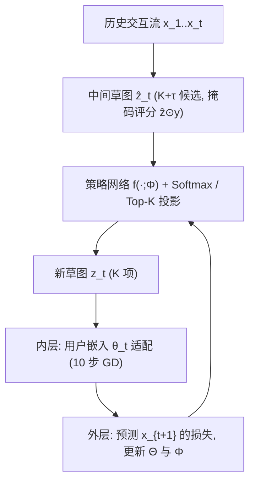
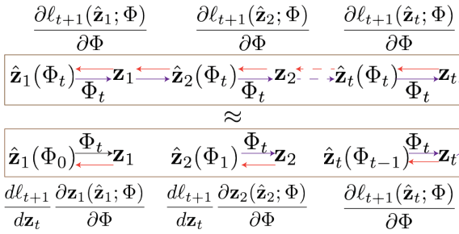

# DiPS: Differentiable Policy for Sketching in Recommender Systems (推荐系统中可微的草图策略)

- **会议/期刊**: AAAI 2022
- **作者与机构**: Aritra Ghosh, Andrew Lan (UMass Amherst); Saayan Mitra (Adobe Research)
- **推荐链路定位**: 序列召回的记忆/历史压缩模块（不改变打分器，只决定"留哪些历史物品"）
- **研究方向**: 序列与会话推荐 / 动态策略学习
- **论文原文**: [https://arxiv.org/abs/2112.07616v1](https://arxiv.org/abs/2112.07616v1)
- **开源代码**: [https://github.com/arghosh/DiPS](https://github.com/arghosh/DiPS)

## TL;DR (1分钟核心速览)

长历史用户下 RNN 序列推荐会遗忘远期兴趣，已有工作用小容量 sketch（K 个历史物品）缓解，但 sketch 策略全是**静态启发式**（随机蓄水池/Hardest/Influence），既不为下游推荐目标优化，也无法随数据增长而进化。DiPS 把"留/删哪些物品"写成可微策略网络，用**双层优化**（外层学全局模型+策略以最大化未来一步预测质量，内层用当前 sketch 适配用户嵌入）联合训练，并提出**队列缓存历史中间 sketch 的近似梯度**避免从 t=1 重算整条构图。在 5 个真实数据集、`Full-Ranking` Recall@20 协议下，达到同等精度所需 sketch 槽位最多减少 50%（Book 上 K=2 的 Recall@20 相比 Influence K=8 提升 32.6%）。

## Background & Motivation (背景与核心矛盾)

- **主流范式**: 会话式 SRS 只靠当前 session 建模；为补回长期静态兴趣，GRU4Rec/STAMP 一类工作额外维护 K 个历史物品的 sketch，用蓄水池采样（Random）或 Hardness/Influence 等信息量启发式决定留谁。
- **前人局限**: ① 启发式"信息量"（如分类难度、影响函数）与真实目标（未来物品的预测质量）不对齐，只能局部最优；② 度量是静态的，数据量增大也不会自动变好；③ 流式场景下每个时刻只见一个物品，是"one-pass"决策，无法像 coreset/主动学习那样在完整候选集上挑选。
- **核心洞察 (Key Insight)**: 由隐函数定理可推出，物品 $j$对下一步损失的**影响函数**$I_{t+1}(j)$ 就是"留在 sketch 里能带来多少收益"，因此"留谁"本质是一个可由未来损失直接反传优化的连续决策问题，而非人工打分。
- **本文切入点**: 把 sketch 更新建模为策略网络 $\pi(\cdot;\Phi)$，嵌入双层优化，与推荐模型$\Theta$ 端到端联合学习。

## Method (核心方法设计)

### 1. 整体框架 (Overall Architecture)

对单用户按时间步 $t$流式处理：中间草图$\hat{z}_{t}=\sum_{j\le t}e_{x_j}$（稀疏 0/1 向量，$K+\tau$个候选）与其评分向量做逐元素掩码$\hat{z}_t\odot y$后送入策略网络$f$（2 层 128 隐层 + ReLU + Dropout 0.1），在线设置经 softmax 采样"删掉哪一个"，批设置经 Top-K 投影层$\mu(\cdot)$选"保留哪 K 个"，得到新草图$z_{t}$；随后内层用该草图对用户嵌入做 10 步梯度下降得到$\theta_t^*$，外层在真实下一物品$x_{t+1}$上算损失并同时更新$\Theta$与$\Phi$。

### 2. 关键设计拆解 (Key Designs)

1. **双层可微 sketch 目标（把"留谁"接进推荐损失）**：外层最小化未来一步损失，内层在草图上学用户局部参数，策略输出直接决定内层损失权重：
$\min_{\Theta,\Phi}\sum_{t}\ell\big(r_{x_{t+1}},g(x_{t+1};\theta_t^*)\big)\ \ \text{s.t.}\ \ \theta_t^*=\arg\min_{\theta_t}\sum_{k=1}^{K}\ell(r_{x_{(k)}},g(x_{(k)};\theta_t))+R(\theta_t;\Theta)$。
因 $z_t$是$\Phi$的函数，$\frac{d\ell_{t+1}}{d\Phi}=\frac{d\ell_{t+1}}{d\theta_t^*}\frac{d\theta_t^*}{dz_t}\frac{dz_t}{d\Phi}$，未来损失可穿过草图索引反传到策略——这是与所有静态启发式的本质区别。

2. **队列式近似梯度估计（把 O(T) 重算变成可并行常数开销）**：精确总导数 $\frac{dz_t}{d\Phi}$需用当前$\Phi_t$从$z_1$起重跑整条草图链，显存/算力不可行。DiPS 用固定长度队列$\mathcal{M}=[\hat{z}_1,\dots,\hat{z}_t]$缓存**旧参数**产生的中间草图，近似假设学习率小时$\hat{z}_j(\Phi_{j})\approx\hat{z}_j(\Phi_t)$，并把 Jacobian$\frac{dz_{l+1}}{dz_l}$ 近似为单位阵（式 (4) 中更新是加性的），于是
$\frac{d\ell_{t+1}}{d\Phi}\approx\frac{\partial\ell_{t+1}(\hat{z}_t;\Phi)}{\partial\Phi}+\frac{\partial}{\partial\Phi}\Big(v^{\top}\sum_{j=1}^{t-1}z_j(\hat{z}_j;\Phi)\Big),\ v=\frac{d\ell_{t+1}}{dz_t}$，
右端无时序依赖、可全部并行；离散采样处用 straight-through 估计 $\hat{w}\approx\sigma(f(\cdot))$，批设置则借 Top-K 层的 KKT/隐函数定理求导。

<figure class="paper-figure" markdown="span">
  <figcaption>图1：上/下：时间步 t 的真实/近似梯度计算。使用由过去参数 Φ1:t−1 获得的中间草图计算得到的近似梯度，在学习率较小时接近真实梯度。</figcaption>
</figure>

3. **训练目标、负采样与推理开销**：预测器为 NCF，隐式场景用全库 softmax 的 categorical cross-entropy（实验未用 BPR/Top1 与负采样）；内层不做显式正则（固定 10 步 GD 等价于隐式正则）；物品侧参数 $\Theta^{(p)}$冻结、只适配 32 维用户嵌入。推理时每步只需一次前向 + 10 步内层 GD，草图尺寸$K\in\{2,4,8\}$ 使内存恒定。

## Experimental Setup & Evaluation Protocol (实验设置与评估协议)

- **数据集与预处理**: 显式 ML-1M/ML-10M/Netflix 过滤掉评分数 <20 的用户；隐式 Book、Foursquare 采用 `20-core`，Book 仅保留评分 >3.5 的评论作为正反馈。

| 数据集 | #Users | #Items | #Interactions | 密度 | 类型/说明 |
| :--- | :---: | :---: | :---: | :---: | :--- |
| Movielens 1M | 6K | 3.7K | 1M | 4.5% | 显式评分 |
| Movielens 10M | 70K | 11K | 10M | 1.3% | 显式评分 |
| Netflix | 430K | 18K | 100M | 1.29% | 显式评分 |
| Amazon Book | 22K | 24K | 1.1M | 0.21% | 隐式，>3.5 为正 |
| Foursquare | 52K | 37K | 2.3M | 0.12% | 隐式签到 |

- **数据划分与防穿越**: **按用户随机 60/20/20 划分** train/val/test（用户级隔离，非全局时间戳切分），每个用户内部保持原始时序；所有结果跑 5 次不同划分取均值±std。
- **排名评测协议**: 隐式任务为 **无偏 `Full-Ranking`**（Recall@20 与 MRR@20 的 rank 在所有 $M$ 个物品上计算，非采样排序）；显式任务用 RMSE。
- **对比基线与超参**: Random（蓄水池采样）、Hardest（最难样本/不确定性）、Influence（影响函数 coreset）、DiPS@1（去掉队列的消融变体）；嵌入维度 $d=32$，内层学习率$\alpha\in\{0.2,0.4,0.8\}$，队列长度 50–100，在线$\tau=1$、批$\tau=4$。

## Key Experimental Results (实验关键数据)

### 1. 主实验对比 (Main Results)

在线设置（$\tau=1$），RMSE 越低越好、Recall@20 越高越好，加粗为该行最优：

| 数据集 / K | 指标 | Random | Hardest | Influence | DiPS@1 | **DiPS** | Improv. |
| :--- | :---: | :---: | :---: | :---: | :---: | :---: | :---: |
| ML-1M / K=2 | RMSE↓ | 0.9701 | 0.9747 | 0.9747 | 0.9615 | **0.9543** | 1.63% |
| ML-10M / K=2 | RMSE↓ | 0.9232 | 0.9221 | 0.9147 | 0.9174 | **0.9008** | 1.52% |
| Netflix / K=4 | RMSE↓ | 0.9708 | 0.9786 | 0.9726 | 0.9631 | **0.9532** | 1.81% |
| Book / K=2 | Recall@20↑ | 0.0672 | 0.0682 | 0.0740 | **0.1244** | 0.1163 | 57.2% |
| Book / K=4 | Recall@20↑ | 0.0769 | 0.0787 | 0.0828 | **0.1349** | 0.1262 | 63.0% |
| Foursquare / K=2 | Recall@20↑ | 0.1329 | 0.1294 | 0.1316 | 0.1396 | **0.1406** | 5.8% |
| Foursquare / K=8 | Recall@20↑ | 0.1508 | 0.1456 | 0.1489 | 0.1591 | **0.1601** | 6.2% |

提升幅度相对该行最强静态基线（Random/Hardest/Influence 取最优）计算；批设置（$\tau=4$）趋势一致，Book 上 DiPS@1 仍最优（0.0859 vs DiPS 0.0751），Foursquare K=8 上 DiPS 达 0.1421（Random 0.1362）。

### 2. 消融实验 (Ablation Study)

| 变体 (K=2, 在线) | ML-1M RMSE↓ | ML-10M RMSE↓ | Netflix RMSE↓ | Book Recall↑ | Foursquare Recall↑ |
| :--- | :---: | :---: | :---: | :---: | :---: |
| 静态 Influence（不可学习） | 0.9747 | 0.9147 | 0.9726 | 0.0740 | 0.1316 |
| w/o 历史队列 (DiPS@1) | 0.9615 | 0.9174 | 0.9631 | **0.1244** | 0.1396 |
| 完整 DiPS（队列近似） | **0.9543** | **0.9008** | **0.9532** | 0.1163 | **0.1406** |
| 额外：策略迁移到 GRU4Rec | — | — | — | 同 Recall 所需 K 减半 | 同 Recall 所需 K 减半 |

### 3. 关键实验发现 (Key Findings)

1. **sketch 的"选得准"远胜"存得多"**：Book 上 DiPS 用 K=2 的 Recall@20 (0.1163) 就超过 Influence K=8 (0.0877) 32.6%，即槽位压到 1/4 仍领先；Foursquare 上 DiPS K=4 (0.1513) 已超 Random K=8 (0.1508)，印证 50% 槽位节省的说法。
2. **队列近似是主要增益源，但收益随数据规模放大**：去掉队列后 Netflix K=4 RMSE 从 0.9532 退化到 0.9631，ML-10M 从 0.9008 退化到 0.9174；而小数据集 Book/Foursquare 上 DiPS@1 反而略优（0.1244 vs 0.1163），说明 $\tau=4$ 的低频更新与小样本使"缓存旧草图"失效。梯度方向统计佐证：DiPS 保留真梯度 74% 的非零维度方向，DiPS@1 仅 12%（82% 被置零）。
3. **学到的策略可跨模型迁移并增强会话模型**：仅保留 NCF 上训练的策略 $\pi$ 给 GRU4Rec 用，达到同等 Recall@20 所需 sketch 数量减少约 50%；把 K 个历史 sketch 物品拼进会话 GRU4Rec 的隐状态，Book 与 Foursquare 上 Recall@20 均提升 >20%（K=0 即原模型）。

## Highlights & Limitations (亮点、对比与审稿批判)

- **与代表作对比 (vs. Prior Work)**: 相比 Random/Hardest/Influence 三类静态启发式，DiPS 首次让"留谁"由未来推荐损失驱动；相比通用的 DSN（可微样本选择）只能用于静态候选集，DiPS 解决了流式 one-pass 下"决策依赖全部历史决策"的梯度链难题；相比标准 MAML 式双层优化，其队列近似把 O(T) 重算降为可并行的常数开销。
- **可迁移亮点**: ① 队列缓存旧计算图 + 单位阵 Jacobian 近似，可迁移到任何"决策序列化、难以端到端反传"的记忆/检索结构（如可微 ANN 索引、可微 top-k 检索）；② 用影响函数 $I_{t+1}(j)$ 为策略提供物理直觉（保留与未来物品梯度同向的历史），可作为设计辅助监督信号。
- **审稿级局限批判**: ① 按用户随机划分而非**全局时间戳切分**，且未做冷启动/新用户划分，对未来时段泛化性证据不足；② 每个用户每步需 10 步内层 GD + 队列反传，训练成本显著高于蓄水池采样，论文未给出训练/推理延迟与显存实测；③ 仅用单一预测器（NCF）与无 side-info 输入，工业中带品类/时间特征的场景收益未验证，K、$\tau$、队列长度等超参敏感度分析缺失。

## Rating (四维评分)

- **方法创新性 (Novelty)**: ⭐⭐⭐⭐ （首次将流式 sketch 选择纳入双层可微优化，并用影响函数给出机制解释，问题抽象有新意）
- **评估协议与实验扎实度 (Protocol & Experiments)**: ⭐⭐⭐⭐ （5 数据集 × 显式/隐式 × 在线/批 × 5 次重复，含 Full-Ranking 与策略迁移验证；但缺时间戳切分与显著性检验）
- **写作与数学规范度 (Clarity & Rigor)**: ⭐⭐⭐⭐ （双层目标、近似梯度与 ST 估计推导清晰，附录补充梯度方向误差统计；符号略密）
- **工业落地与复现价值 (Industrial & Practical Value)**: ⭐⭐⭐⭐ （代码已开源、内存恒定、策略可跨模型复用；但训练期反传代价与线上延迟尚未量化）

