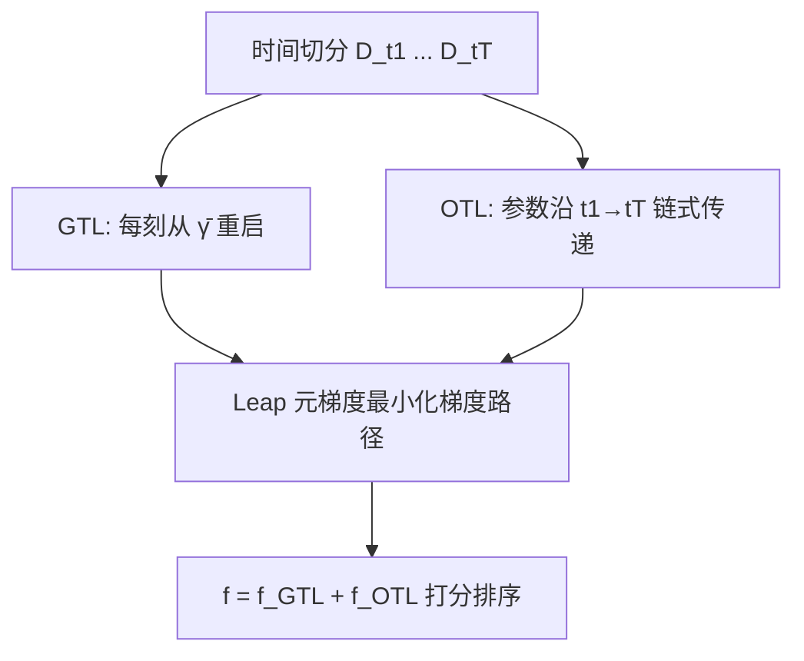
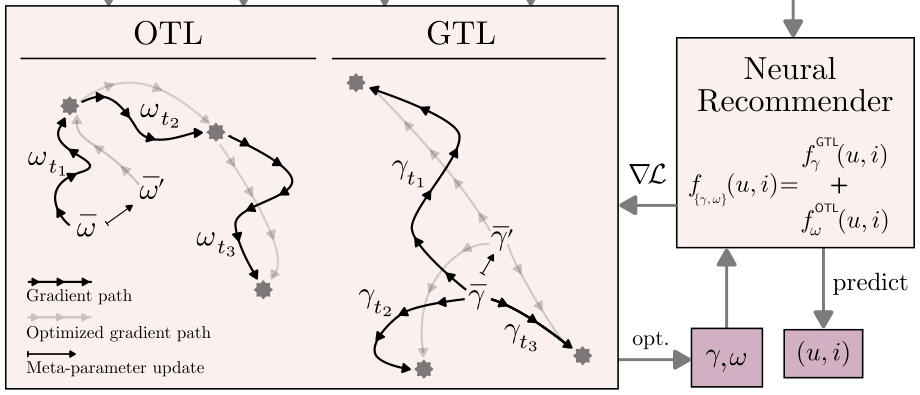

# Leaping Through Time with Gradient-based Adaptation for Recommendation (基于梯度自适应跨越时间的推荐)

- **会议/期刊**: AAAI 2022
- **作者与机构**: Nuttapong Chairatanakul, Hoang NT, Xin Liu, Tsuyoshi Murata（Tokyo Tech & RWBC-OIL/AIST）
- **推荐链路定位**: 精排（用户-物品打分排序）
- **研究方向**: 序列与会话推荐 / 图神经网络推荐
- **论文原文**: [https://arxiv.org/abs/2112.05914v2](https://arxiv.org/abs/2112.05914v2)
- **开源代码**: [https://github.com/nutcrtnk/LeapRec](https://github.com/nutcrtnk/LeapRec)

## TL;DR (1分钟核心速览)

针对用户偏好与物品热度随时间漂移的时序动态问题，本文不再用 RNN 隐状态承载时间，而是把"每个时间段的数据"视为一个元学习任务，用轨迹式元学习 Leap 直接优化**梯度路径**：GTL 让各时刻任务都从共享元参数 $\bar{\gamma}$ 重启以学习长期共性，OTL 沿时间轴链式传递参数以学习短期趋势，两路打分相加。骨干为 GCN + 位置无关自注意力。在 Amazon/Goodreads/Yelp 的全局时间切分 + 1:99 采样排序协议下，HR@1 相对最强基线提升 18.59% / 8.30% / 5.09%。

## Background & Motivation (背景与核心矛盾)

- **主流范式**: 时序推荐靠 RNN/LSTM 门控、时间间隔嵌入（Time-LSTM、TiSASRec、SLi-Rec）或流式在线更新（SPMF、SML）把时间信息注入模型。
- **前人局限 (一)**: RNN 的记忆量随步数线性增长，且时间感知被写死进循环单元，想迁移到 GNN/SA 等新骨干就必须重设计整个网络；流式模型只用近期数据训练，必然遗忘历史。
- **前人局限 (二)**: vanilla MAML 计算量随时间步 $T$ 线性膨胀，无法覆盖长期依赖；FOMAML 只用梯度路径的**端点**，丢弃了轨迹方向信息，损失时序信息。
- **核心洞察 (Key Insight)**: 时间依赖不必编码在隐状态里，也可编码在**优化过程的梯度轨迹**中；Leap 只最小化梯度路径长度即可保留轨迹信息，且代价与 $T$ 解耦、对任意可微推荐器即插即用。
- **本文切入点**: 将动态性正交拆分为"跨时段共性 (GTL)"与"顺序短期趋势 (OTL)"，用同一套 Leap 元梯度分别优化两条梯度轨迹。

## Method (核心方法设计)

### 1. 整体框架 (Overall Architecture)

数据按时间粒度（最优为一个月）切成 $T$个任务$\{\mathcal{D}_{t_1},\dots,\mathcal{D}_{t_T}\}$。每个任务内部用 BPR 损失做$K$步梯度更新，但**初始化方式不同**：GTL 分支每时刻都从全局元参数$\bar{\gamma}$冷启动（模拟静态偏好）；OTL 分支把上一时刻更新结束的参数$\omega^{K}_{t_i}$直接作为下一时刻初值（模拟趋势延续）。两条轨迹各自通过 Leap 元梯度回传，更新$\bar{\gamma}$与$\bar{\omega}$，内层参数$(\gamma,\omega)$与元参数交替更新。推理时用最后一刻的参数$\{\gamma^K_{t_T},\omega^K_{t_T}\}$ 分别对用户-物品打分并相加。骨干网络统一为 GCN 传播 + 无位置编码的自注意力序列融合。

<figure class="paper-figure" markdown="span">
  <figcaption>图 1：左：我们提出的 LeapRec 由 GTL 和 OTL 组成。右：一个神经推荐器。LeapRec 通过优化梯度路径 {γi}tT，使任意神经推荐器能够学习时间动态。</figcaption>
</figure>

### 2. 关键设计拆解 (Key Designs)

1. **Leap 轨迹元梯度（替代 MAML/FOMAML 的核心算子）**：痛点在于 MAML 需二阶展开全轨迹、FOMAML 只保留端点。Leap 把"损失面落差"与"参数空间步长"同时压短：

$$\nabla F_{\bar{\theta}} = \mathbb{E}_{\tau\sim p(\tau)}\Big[\sum_{k=0}^{K-1}-\big(\underbrace{\Delta L_\tau^k \nabla L_\tau(\theta_\tau^k)}_{(i)} + \underbrace{\Delta\theta_\tau^k}_{(ii)}\big)\Big]$$

其中 $\Delta L_\tau^k=L_\tau(\theta_\tau^{k+1})-L_\tau(\theta_\tau^k)$，$\Delta\theta_\tau^k=\theta_\tau^{k+1}-\theta_\tau^k$。项 (i) 驱使每步更新朝向更低损失（缩短损失面距离），项 (ii) 惩罚参数跳变（缩短路径长度），故$K$步内即可近似整条轨迹，代价$O(K)$与$T$ 无关。

2. **Global / Ordered Time Leap（长短期分工）**：GTL 令 $\gamma^0_t\leftarrow\bar{\gamma}$，$\gamma^{k+1}_t=\gamma^k_t-\alpha\nabla L_t(\gamma^k_t)$，元更新$\bar{\gamma}\leftarrow\bar{\gamma}-\frac{\beta}{T}\nabla F_{\bar{\gamma}}$——所有任务共享同一初值，迫使$\bar{\gamma}$只保留跨时段不变的模式。OTL 则令$\omega^0_{t_1}\leftarrow\bar{\omega}$、$\omega^0_{t_{i+1}}\leftarrow\omega^K_{t_i}$，元更新$\bar{\omega}\leftarrow\bar{\omega}-\eta\nabla F_{\bar{\omega}}$——参数转移本身就是"趋势记忆"，最短梯度路径正好抑制跨时段灾难性遗忘。

3. **训练目标与推理开销**：总损失即各时刻 BPR 损失之和 $\mathcal{L}=\sum_t L(\theta;\mathcal{D}_t)$，负样本为均匀采样（$\tilde{\mathcal{D}}=(\mathcal{U}\times\mathcal{I})\setminus\mathcal{D}$）。融合打分$f_{\gamma,\omega}(u,i)=f^{GTL}_\gamma(u,i)+f^{OTL}_\omega(u,i)$，$\langle e_u,e_i\rangle$点积。超参：$\beta=\eta=0.01$，$K=40$（复现主结果）/$K=20$（快速实验），GCN 2 层、dropout 0.2、Adam；在线仅需一次前向，无 RNN 逐步展开。

## Experimental Setup & Evaluation Protocol (实验设置与评估协议)

- **数据集与预处理**: 三个公开数据集，混合类别 Amazon 采用 Wang et al. 预处理版本，Yelp 为 2021-02 官方版；无 `5-core` 过滤说明。

| 数据集 | #Users | #Items | #Interactions | 稀疏度 | 特征/场景说明 |
| :--- | :---: | :---: | :---: | :---: | :--- |
| Amazon | 70,097 | 56,708 | 1,540,911 | 0.039% | 跨类目商品评论，热度变化最剧烈 |
| Goodreads | 16,862 | 20,633 | 1,762,094 | 0.506% | 读书社交网络评分/评论 |
| Yelp | 234,664 | 45,032 | 3,880,015 | 0.037% | 商户点评，热度演化平缓 |

- **数据划分与防穿越 (Splitting Strategy)**: `全局时间戳切分`——设定 cutting time（Amazon 2017/06、Goodreads 2015/12、Yelp 2018/12），cutting time 之后 6 个月内为验证集，其余更晚数据为测试集，严格防未来信息泄漏。
- **排名评测协议 (Ranking Protocol)**: `Sampled Ranking`，每个测试正样本配 99 个随机负样本（1:99），正样本在 100 个候选中排序，计算 HR@1/HR@5/NDCG@5/MRR；**未做 Full-Ranking 全库排序**。
- **对比基线与超参设置**: 四类共 16 个基线——静态（MF/NCF/BiVAE/NGCF/LightGCN）、序列（GRU4Rec/NARM/SUM/SASRec/MetaTL）、时序感知（TGN/SLi-Rec/TiSASRec/HyperRec）、流式（SPMF/SML）。嵌入维度 $\{64,128\}$，学习率$\{0.001,0.0001\}$，dropout$\{0,0.2,0.5\}$，GNN 层数$\{1,2,3,4\}$、SA 层数$\{1,2\}$ 网格搜索。

## Key Experimental Results (实验关键数据)

### 1. 主实验对比 (Main Results)

| Model | Amazon HR@1 | Amazon HR@5 | Amazon NDCG@5 | Amazon MRR | Goodreads HR@1 | Goodreads NDCG@5 | Yelp HR@1 | Yelp NDCG@5 | Yelp MRR |
| :--- | :---: | :---: | :---: | :---: | :---: | :---: | :---: | :---: | :---: |
| MF (静态) | 0.0820 | 0.2413 | 0.1629 | 0.1756 | 0.2008 | 0.3662 | 0.2847 | 0.4823 | 0.4544 |
| LightGCN (静态) | 0.0883 | 0.2517 | 0.1713 | 0.1826 | 0.2114 | 0.3785 | 0.3254 | 0.5186 | 0.4875 |
| GRU4Rec (序列) | 0.0851 | 0.2681 | 0.1777 | 0.1890 | 0.2087 | 0.3694 | 0.3159 | 0.5252 | 0.4895 |
| SASRec (序列) | 0.0879 | 0.2714 | 0.1806 | 0.1917 | 0.2147 | 0.3756 | **0.3181** | **0.5295** | **0.4932** |
| TGN (时序) | 0.1025 | **0.3227** | **0.2140** | **0.2200** | 0.1623 | 0.3077 | 0.2486 | 0.4576 | 0.4278 |
| SLi-Rec (时序) | 0.0980 | 0.3005 | 0.2007 | 0.2097 | **0.2264** | **0.3947** | 0.2999 | 0.5140 | 0.4781 |
| TiSASRec (时序) | 0.0888 | 0.2755 | 0.1832 | 0.1942 | 0.2176 | 0.3814 | 0.3117 | 0.5205 | 0.4850 |
| HyperRec (时序) | **0.1056** | 0.3023 | 0.2057 | 0.2143 | 0.2143 | 0.3769 | 0.2793 | 0.4966 | 0.4608 |
| **LeapRec** | **0.1252** | **0.3484** | **0.2391** | **0.2443** | **0.2452** | **0.4171** | **0.3420** | **0.5547** | **0.5165** |
| Improv.% | +18.59% | +7.97% | +11.74% | +11.07% | +8.30% | +5.67% | +5.09% | +4.76% | +4.72% |

### 2. 消融实验 (Ablation Study)

| 配置（FLOPs 近似对齐，总维度 128） | Amazon NDCG@5 | Goodreads NDCG@5 | Yelp NDCG@5 |
| :--- | :---: | :---: | :---: |
| 仅 GTL（$d_{OTL}=0$） | 0.2220 | 0.3885 | 0.5238 |
| 仅 OTL（$d_{GTL}=0$） | 0.2416 | 0.3974 | 0.5379 |
| GTL 121 / OTL 40 | 0.2339 | 0.4061 | **0.5485** |
| GTL 91 / OTL 91 | 0.2384 | 0.4025 | 0.5433 |
| GTL 40 / OTL 121 | 0.2415 | **0.4093** | 0.5366 |
| LeapRec 完整（128+128） | **0.2391** | **0.4171** | **0.5547** |
| 替换为 FOMAML（GCN 骨干，Amazon） | −（显著劣于 Leap） | — | — |
| GCN/NGCF/LightGCN + Leap（Amazon） | +46.27% / +22.70% / +53.57% | +12.16% / −2.57% / +7.25% | — |
| SASRec + Leap（Amazon L=1/2） | 0.1992 / 0.2045（+12.26% / +11.63% vs TiSASRec） | 0.3956 / 0.3934（+6.66% / +3.15%） | — |

### 3. 关键实验发现 (Key Findings)

1. **长短期分工与数据动态强度强相关**：Amazon 上"仅 OTL"（0.2416）已追平完整模型，而"仅 GTL"（0.2220）明显落后；Goodreads/Yelp 上"仅 GTL"与"仅 OTL"差距缩小、混合配置最优（0.4171 / 0.5547）。这印证 Amazon 热门物品切换剧烈（仅需短期适应），而 Yelp 热度演化平缓（长期共性更值钱）。
2. **Leap 的轨迹信息比 FOMAML 的端点近似更关键**：在 GCN/NGCF/LightGCN 上换成 FOMAML 变体后性能一致下降，而 Leap 使其 NDCG@5 相对提升最高 +46.27%（GCN, Amazon）与 +53.57%（LightGCN, Amazon）；但 Goodreads 上 LightGCN 反而 −2.57%，说明 Leap 需要特征变换/非线性来加速任务学习，纯线性传播的 LightGCN 受益不稳定。
3. **表征漂移可视化直接验证设计**：按图 3 的热门物品分组监测 $\| \hat{e}^K_{t_j,i}-\hat{e}^K_{t_{j-1},i}\|_2$，OTL 对"当期新热门"组漂移显著更大、随热度衰减而收敛，GTL 漂移近乎恒定——短期分支主动追热点、长期分支保持稳定，二者分工被实验直接观测到。

## Highlights & Limitations (亮点、对比与审稿批判)

- **与代表作对比 (vs. Prior Work)**: 相比 TiSASRec/SLi-Rec 把时间间隔塞进注意力/循环门控（强耦合、难迁移），LeapRec 是**外挂式优化层**，可套在任意可微推荐器上；相比 SML 用 FOMAML 做元更新（只用路径端点），LeapRec 用完整轨迹并显式拆出 GTL/OTL 两支；相比 TGN 类连续时间图模型需重设计整网，本文只需替换训练循环。
- **可迁移亮点**: ①"共享元初值 = 学长期共性 / 链式初值 = 学短期趋势"的分工范式可直接搬到时序 CTR 或多场景建模；②以最小化梯度路径长度替代二阶 MAML，把时间步无关性做成 $O(K)$ 预算，适合工业流式训练。
- **审稿级局限批判**: ①评估仅用 1:99 **采样排序**，未做 Full-Ranking 全库排序，在稀疏度 0.04% 的数据上采样指标可能高估绝对水平，且未报告显著性检验；②元训练需按时间粒度逐时刻串行 $K$步更新（$K=40$、月粒度），训练开销与超参敏感度（图 6 显示性能随$K$单调上升、Goodreads 直至$K>20$ 仍在涨）对线上重训成本不够友好，论文也未给出训练 wall-clock 对比。

## Rating (四维评分)

- **方法创新性 (Novelty)**: ⭐⭐⭐⭐ （首次把轨迹式元学习 Leap 引入推荐，用梯度路径替代 RNN 隐状态建模时间，GTL/OTL 的长短期正交拆分有明确物理直觉）
- **评估协议与实验扎实度 (Protocol & Experiments)**: ⭐⭐⭐ （三数据集 + 16 基线 + 插件式验证充分，但采样排序 1:99 而非全库排序、无显著性检验、缺 wall-clock 开销对比）
- **写作与数学规范度 (Clarity & Rigor)**: ⭐⭐⭐⭐ （Leap 元梯度公式与 GTL/OTL 更新规则交代清楚，算法 1 完整，省略 Jacobian 的近似依据有引用支撑）
- **工业落地与复现价值 (Industrial & Practical Value)**: ⭐⭐⭐⭐ （代码已开源，作为即插即用训练层不改动推理网络结构，但串行元训练成本与月级时间粒度在超大规模场景下需额外工程折衷）

