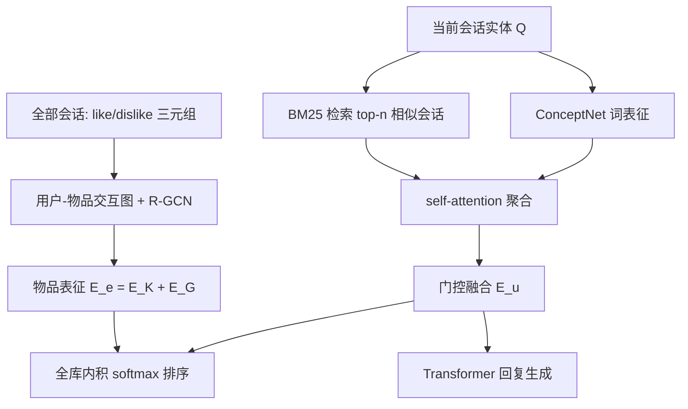
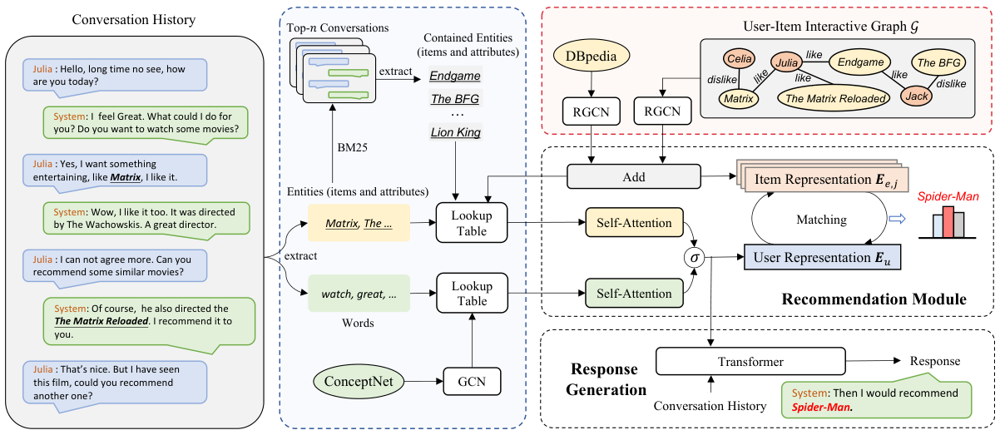

# COLA: Improving Conversational Recommender Systems by Collaborative Augmentation (协同增强的对话推荐系统)

- **会议/期刊**: AAAI 2023
- **作者与机构**: Dongding Lin, Jian Wang, Wenjie Li（香港理工大学）
- **推荐链路定位**: 召回（对话内物品推荐）+ 回复生成
- **研究方向**: 对话推荐与智能体仿真 / 协同过滤
- **论文原文**: [论文原文链接](https://arxiv.org/abs/2212.07767v1)
- **开源代码**: [开源代码仓库链接](https://github.com/DongdingLin/COLA)

## TL;DR (1分钟核心速览)

CRS 的两大痛点：物品表征只从**单条会话**学习，丢失了跨会话的流行度信号；用户偏好又因单轮对话信息量太少而刻画不足。COLA 把协同过滤思想"移植"进对话推荐：用全部会话抽取 like/dislike 用户-物品对构图，R-GCN 编码后与 DBpedia KG 表征相加，注入流行度；再用当前会话 BM25 检索 top-$n$ 相似会话，取其中物品/属性经 self-attention + 门控融合进用户表征。仅此两项即插即用增强，在 REDIAL / TG-ReDial 的**全库排序**协议下把 R@50 从 0.396 推到 0.426（+7.6%），PPL 8.6 亦为最优。

## Background & Motivation (背景与核心矛盾)

- **主流范式**: 双模块框架——推荐模块用 DBpedia（物品 KG）+ ConceptNet（词 KG）做语义对齐，Transformer 生成回复；增强手段包括 RL、预训练-微调、对比学习（C²-CRS）。
- **前人局限**: ① 物品表征完全由单条会话内的实体共现驱动，无法区分"大众热门"与"小众偏好"，流行度这一最强的协同信号被丢弃；② 单条会话可反映的潜在兴趣面极窄，且 CRS 场景中根本没有现成的 user-item 交互矩阵。
- **核心洞察 (Key Insight)**: 对话文本本身就是隐式反馈源——用户口中的 "like/enjoy" 与 "dislike/hate" 天然构成带符号的 user-item 边；同时，说相似话的用户倾向喜欢相似物品，**会话相似度 ≈ 用户相似度**。
- **本文切入点**: 以"会话挖掘"替代"日志挖掘"，双向增强：外部协同信息进物品，他人的物品/属性进来增强当前用户。

## Method (核心方法设计)

### 1. 整体框架 (Overall Architecture)

离线阶段：从全部训练会话抽取 like/dislike 三元组构建用户-物品交互图 $\mathcal{G}$，与物品 KG 分别用 R-GCN 编码；在线阶段：当前会话的实体集合作为 BM25 query 检索 top-$n$相似会话，其物品与属性表征和会话内已提及物品拼接后经 self-attention 聚合，再与 ConceptNet 词表征经门控融合成用户向量$\mathbf{E}_u$。推荐用$\mathbf{E}_u$ 与全物品表征做内积 softmax，回复生成复用同一组增强表征作为 Transformer decoder 的额外输入，两模块联合训练。

<figure class="paper-figure" markdown="span">
  <figcaption>图 1：我们提出的用于 CRS 的协同增强（COLA）方法概述。</figcaption>
</figure>

### 2. 关键设计拆解 (Key Designs)

1. **流行度感知的物品表征增强**：痛点是把物品当作孤立实体。构造 $\mathcal{G}=\langle u,r,e\rangle,\ r\in\{\text{like},\text{dislike}\}$，用带符号 R-GCN 在用户节点与物品节点间双向消息传递：$\mathbf{v}^{l+1}_{G,e}=\text{ReLU}\big(\sum_{r}\sum_{u\in\mathcal{G}^r_e}\tfrac{1}{Z_{e,r}}\mathbf{W}^l_{G,r}\mathbf{v}^l_u+\mathbf{W}^l_G\mathbf{v}^l_{G,e}\big)$。得到图表征后与 KG 基表征逐元素相加$\mathbf{E}_{e,j}=\mathbf{k}_{e,j}+\mathbf{v}_{e,j}$。直觉：被多人 like、少人 dislike 的物品获得更高的"用户注意力质量"，且 like/dislike 双关系使冷门物品不被湮没。
2. **检索增强的用户偏好增强 + 门控融合**：痛点在于当轮会话过短。以会话中出现的物品/属性为 query，BM25 在训练语料检索 top-$n$会话，取其实体集$\mathcal{E}^{(r)}$的表征，与会话内实体$\mathbf{E}^{(m)}$拼接后做 attention 池化$\boldsymbol{\alpha}=\text{softmax}(\mathbf{b}_1^\top\tanh(\mathbf{W}_1\mathbf{E}^{(mr)}))$；词级分支对$\mathbf{C}^{(m)}$做同构池化得$\tilde{\mathbf{v}}_w$；最后门控$\gamma=\sigma(\mathbf{W}_3[\tilde{\mathbf{v}}_e;\tilde{\mathbf{v}}_w])$，$\mathbf{E}_u=\gamma\odot\tilde{\mathbf{v}}_e+(1-\gamma)\odot\tilde{\mathbf{v}}_w$。门控而非固定权重，是因为不同会话中"提及物品"与"描述性词语"的信息量极不均衡。
3. **训练目标、负采样与推理效率**：推荐侧 $P_{rec}(j)=\text{softmax}(\mathbf{E}_u^\top\mathbf{E}_{e,j})$在**整个物品集**上做 softmax 交叉熵，等价于全库 softmax、不使用负采样；生成侧为逐词 NLL；总损失$\mathcal{L}=\mathcal{L}_{rec}+\mathcal{L}_{gen}$联合优化。推理时全库排序一次内积即可，额外开销仅为一次 BM25 检索（$n=1$），几乎不影响延迟。

## Experimental Setup & Evaluation Protocol (实验设置与评估协议)

- **数据集与预处理**: 构建交互图时，REDIAL 直接用人工标注的 like/dislike；TG-ReDial 用关键词集（love/fear 等）自动抽取，并以"会话末被接受/拒绝"补标。

| 数据集 | #Users | #Items | #Conversations | #Utterances | 特征/场景说明 |
| :--- | :---: | :---: | :---: | :---: | :--- |
| REDIAL | 956 | 64,362 | 10,006 | 182,150 | 英文电影，15.0 turns/会话 |
| TG-ReDial | 1,482 | 33,834 | 10,000 | 129,392 | 中文电影，话题引导，12.0 turns/会话 |

- **数据划分与防穿越**: 按会话 `8:1:1 比例划分`；BM25 检索语料严格限定在训练集内，避免信息泄漏。
- **排名评测协议**: 无偏 `Full-Ranking`——对全部 64,362 / 33,834 个物品打分排序，指标 R@{1,10,50} 与 MRR@{1,10,50}；无负采样。
- **对比基线与超参设置**: 基线含 ReDial、KBRD、TG-ReDial、KECRS、KGSF、NTRD、CR-Walker、RevCore，统一用 CRSLab 复现以保证公平；推荐侧隐层 $d=128$（生成 300），R-GCN/GCN 均 2 层，$n=1$，历史长度上限 256，学习率 1e-3，batch 256；$t$-test 显著性$p<0.05$。

## Key Experimental Results (实验关键数据)

### 1. 主实验对比 (Main Results)

| Model | REDIAL R@10 | R@50 | MRR@50 | TG-ReDial R@10 | R@50 | MRR@50 |
| :--- | :---: | :---: | :---: | :---: | :---: | :---: |
| ReDial | 0.140 | 0.320 | 0.075 | 0.002 | 0.013 | 0.004 |
| KBRD | 0.150 | 0.336 | 0.078 | 0.032 | 0.077 | 0.006 |
| TG-ReDial | 0.169 | 0.380 | 0.082 | 0.017 | 0.051 | 0.008 |
| NTRD | 0.197 | 0.381 | 0.085 | 0.025 | 0.072 | 0.007 |
| KGSF | 0.183 | 0.378 | 0.091 | 0.030 | 0.074 | 0.008 |
| RevCore | 0.211 | 0.396 | 0.092 | 0.029 | 0.075 | 0.008 |
| **COLA** | **0.221** | **0.426** | **0.096** | **0.034** | **0.079** | **0.010** |
| Improv. | +4.7% | +7.6% | +4.3% | +13.3% | +5.3% | +25.0% |

生成侧同样受益：PPL 由 RevCore 的 10.2/15.4 降至 **8.6/12.8**，BLEU-3 0.012/0.008、DIST-4 0.625/0.313 全面最优；人工评测 Fluency 1.91、Informativeness 1.70（$\kappa\in[0.4,0.6]$）。

### 2. 消融实验 (Ablation Study)

| 变体 | REDIAL R@10 | R@50 | MRR@10 | TG R@10 | R@50 |
| :--- | :---: | :---: | :---: | :---: | :---: |
| COLA 全量 | **0.221** | **0.426** | **0.086** | **0.021** | **0.060** |
| w/o IG（交互图） | 0.211 | 0.415 | 0.083 | 0.019 | 0.058 |
| w/o RT（检索增强） | 0.215 | 0.417 | 0.084 | 0.020 | 0.058 |
| w/o DB（DBpedia KG） | 0.145 | 0.327 | 0.073 | 0.014 | 0.049 |
| w/o CN（ConceptNet） | 0.218 | 0.420 | 0.084 | 0.020 | 0.059 |

### 3. 关键实验发现 (Key Findings)

1. **协同增强是"增益项"而非"地基"**：去掉 DBpedia 使 REDIAL R@10 从 0.221 崩至 0.145（−34%），而去掉交互图仅降 4.5%、去掉检索仅降 2.7%——说明本文贡献的绝对量级有限（约 0.03–0.04 R@50），其价值在于低成本叠加于任一 KG-CRS 基座之上。
2. **两组增强互补而非重叠**：w/o IG 与 w/o RT 的降幅分别集中在 MRR@10（0.086→0.083）与 R@50（0.426→0.417），即交互图主要改善**头部排序精度**（流行度帮助锁定高概率物品），检索增强主要拓宽**长尾召回覆盖**。
3. **稀疏场景收益更大**：TG-ReDial 物品更稀疏（3.0 items/会话 vs 4.2），所有模型 R@10 绝对值仅为 REDIAL 的 1/6，但 COLA 的相对提升反而翻倍（R@10 +13.3%、MRR@50 +25%），印证"从其他会话借信息"在会话内证据不足时最有效。

## Highlights & Limitations (亮点、对比与审稿批判)

- **与代表作对比 (vs. Prior Work)**: 相比 KGSF/RevCore 在**KG 语义侧**做加料（词-实体对齐、评论检索），COLA 首次把 CRS 的增强方向转到**协同信号侧**（用户-物品图 + 会话近邻）；相比 C²-CRS 的对比学习增广，COLA 是显式的检索式数据增广，可解释且不需构造正负视图；相比 NTRD 的两阶段解耦，COLA 保持端到端联合训练。
- **可迁移亮点**: ① 用带符号 R-GCN 在"文本挖掘出的弱交互图"上做嵌入，可迁移到任何缺少显式日志的对话式场景（客服、导购、问诊）；② BM25 top-$n$ 会话 + 门控融合是一种极轻量的"检索增强推荐"范式，易于与 LLM 检索模块对接。
- **审稿级局限批判**: ① **数值一致性存疑**——表 3 中 COLA 在 TG-ReDial 的 R@10/R@50 记为 0.021/0.060，与主表 2 的 0.034/0.079 冲突，削弱消融结论的可信度；② 超参 $n=1$ 未做敏感性分析，且 BM25 依赖词面匹配，对中文/改写表述（TG-ReDial）的检索质量天然弱于英文；③ 交互图直接从会话述及抽取 like/dislike，存在"提及即喜欢"的假阳性风险，论文未做噪声鲁棒性验证。

## Rating (四维评分)

- **方法创新性 (Novelty)**: ⭐⭐⭐⭐ （把 CF 的 user-item 图与检索近邻引入 CRS，思路清晰实用，但组件（R-GCN/BM25/门控）均为成熟模块的重新组合）
- **评估协议与实验扎实度 (Protocol & Experiments)**: ⭐⭐⭐⭐ （全库排序 + 8 个强基线 + 自动/人工双评测齐全，但消融表与主表数值不一致，且缺 $n$ 与图噪声的敏感性实验）
- **写作与数学规范度 (Clarity & Rigor)**: ⭐⭐⭐⭐ （公式与符号定义完整、模块动机交代清楚，但未给出总损失权重与复杂度/延迟分析）
- **工业落地与复现价值 (Industrial & Practical Value)**: ⭐⭐⭐⭐⭐ （代码开源，仅需一次 BM25 检索与全库内积，$d=128$、2 层图网络，可低成本挂载到现有 CRS 管线）

