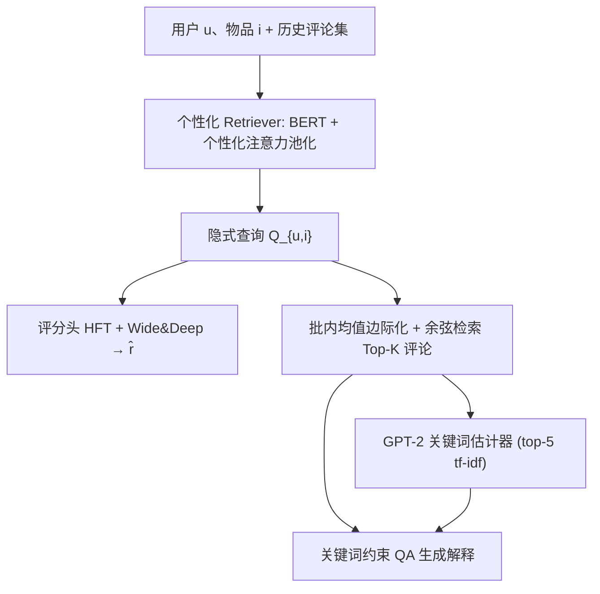

# Factual and Informative Review Generation for Explainable Recommendation (面向可解释推荐的事实性与信息性评论生成)

- **会议/期刊**: AAAI 2023（原文脚注年份笔误为 2023→2022，作者已更正）
- **作者与机构**: Zhouhang Xie, Sameer Singh, Julian McAuley, Bodhisattwa Prasad Majumder（UCSD / UC Irvine）
- **推荐链路定位**: 重排后解释生成（端到端生成式解释 / NLE）
- **研究方向**: 对话推荐与智能体仿真 / 大语言模型推荐
- **论文原文**: [https://arxiv.org/abs/2209.12613v2](https://arxiv.org/abs/2209.12613v2)
- **开源代码**: [https://github.com/allenai/uni](https://github.com/allenai/uni)（仅复用 UnifiedQA 权重，PRAG 本体暂未开源）

## TL;DR (1分钟核心速览)

现有"评论即解释"式可解释推荐存在两大病灶：生成内容**通用化**（对谁都说"这家店不错"）与**事实幻觉**（编造产品并不具备的属性）。PRAG 将解释生成重构为**检索增强的问答任务**：个性化 Retriever 先产出隐式评论向量 $\boldsymbol{Q}_{u,i}$，经"边际化"后检索真实历史评论作为证据，再由 GPT-2 预测用户关心的 tf-idf 关键词，最终以关键词约束的 QA 模型抽象生成解释。在 Yelp/TripAdvisor/Amazon Movie 三域上，Entail（蕴含率）相对最强基线 PETER+ 提升 45.1%–145.7%，MAUVE 提升 79%–810%，评分预测 RMSE 与 NRT 持平（0.79/0.95/1.01）。

## Background & Motivation (背景与核心矛盾)

- **主流范式**: Att2Seq/NRT/PETER/PEPLER 直接把用户-物品向量映射为一段评论，并将该评论视为评分的"自然语言理由"。
- **前人局限**: ① 生成高度模板化、句级多样性低，Distinct-N 与 USR 均偏低；② 训练目标为对含噪真值评论的极大似然拟合，真值评论本身不蕴含同产品的其他评论，模型因此**学会了编造**，Entail 仅 10%–44%。
- **核心洞察 (Key Insight)**: 作者用 RoBERTa-MNLI 蕴含模型量化发现——幻觉的根因不是模型容量，而是**"用噪声数据直接监督生成器"这一训练范式**；同时发现 PETER+ 这类依赖真值评论中话题词的方法在推理时根本拿不到该输入。
- **本文切入点**: 借用 RAG 思想，把"已存在的真实评论"当作外部知识库，让生成器只做**证据摘要**而非自由发挥。

## Method (核心方法设计)

### 1. 整体框架 (Overall Architecture)

输入用户 $u$、物品$i$及其历史评论集合（用户写过的 + 该物品收到的），Retriever 将每条评论编码为一个 token 级向量（不含位置编码，改用以"用户侧/物品侧"两种角色嵌入$\boldsymbol{c}$标识来源），经 2 层 Transformer 与个性化注意力池化得隐式查询$\boldsymbol{Q}_{u,i}$。该查询一路接 HFT+Wide&Deep 评分头输出$\hat{r}_{u,i}$，一路用于检索证据评论，一路作为 GPT-2 的输入预测关键词；证据 + 关键词 + 极性化问题共同驱动冻结/微调的 UnifiedQA 生成最终解释。

<figure class="paper-figure" markdown="span">
  <figcaption>图 1：所提出的框架 PRAG。给定输入用户和物品，我们的模型产生评分估计（第 4.5 节）以及潜在查询 Q（第 4.4 节）。然后我们使用该查询检索已有评论作为推荐证据，并探测问答模型以生成自然语言解释（第 5 节）。</figcaption>
</figure>

### 2. 关键设计拆解 (Key Designs)

1. **个性化注意力与评论嵌入预测（解决"谁的历史评论有用"）**：并非每条历史评论都相关，故用未平滑的 ReLU 线性打分直接加权池化（借鉴 DIN 的直觉：softmax 会把无关项的概率质量摊平，导致通用评论被强行纳入）：
   $\alpha_k = \mathrm{ReLU}(\boldsymbol{W}[\boldsymbol{h}_k;\boldsymbol{v}_u;\boldsymbol{v}_i]),\quad \boldsymbol{Q}_{u,i}=\mathrm{MLP}(\textstyle\sum_k \alpha_k \boldsymbol{h}_k)$训练时以 L2 拉近$\boldsymbol{Q}_{u,i}$与真值评论的 MPNet 句向量$\Phi(e_{u,i})$，使"查询向量"天然落在可检索的语义空间内。

2. **边际化去通用化检索（解决"检索结果千篇一律"）**：直接用 $\boldsymbol{Q}_{u,i}$ 检索会捞出对所有人都适用的泛泛评论。作者在推理时采样一批用户（或物品），估计"普适解释"并将其减掉，再改用余弦距离排序（因减法改变了向量模长）：
   $\tilde{\boldsymbol{Q}}_{u,i}=\boldsymbol{Q}_{u,i}-\frac{1}{|\mathcal{B}|}\sum_{u'\in\mathcal{B}}\boldsymbol{Q}_{u',i}$物理直觉即"去掉物品公共因子，只留用户残差偏好"。表 5 的对偶验证（绑$\gamma_u$与绑$\gamma_i$ 的两个检索器在 agreement@5 上达 2.87/2.44/2.50，远高于随机的 0.54/0.61/0.27）说明残差确实是用户/物品特征而非噪声。

3. **关键词引导的 QA 式生成 + 训练目标**：把解释生成改写为"回答'what was great/what was not good'"（依 $\gamma_{ui}$ 符号选问题），并用 constrained decoding 强制输出含至少一个关键词，再人工改写 100 条样本得到"无幻觉"训练集微调 QA 模型（≤10 epoch），从而绕开噪声监督。总损失：
   $\mathcal{L}=\underbrace{\|\boldsymbol{Q}_{u,i}-\Phi(e_{u,i})\|_2^2}_{\mathcal{L}_{\text{retrieve}}}+\underbrace{(\hat{r}_{u,i}-r_{u,i})^2}_{\mathcal{L}_{\text{rating}}}$评分头为$\hat{r}_{u,i}=\mathrm{MLP}(\boldsymbol{Q})^{\top}\gamma_i+\mathrm{wide}(\boldsymbol{Q})+\beta_u+\beta_i+\mu$。推理仅需一次 MPNet 编码（评论向量离线预计算）+ Top-K 余弦检索 + 单次前向生成，**无需负采样、无需解码期搜索**。

## Experimental Setup & Evaluation Protocol (实验设置与评估协议)

- **数据集与预处理**（沿用 Li et al. 2020 公开划分；原文未给统计表，仅声明"测试集物品必在训练集出现"，即**非严格冷启动**）：

| 数据集 | 领域 | #Users/#Items | 划分保证 | 评测角色 |
| :--- | :---: | :---: | :---: | :--- |
| Amazon Movies&TV | 电影 | 原文未报告 | 测试物品 ∈ 训练集 | 主域 |
| TripAdvisor | 酒店 | 原文未报告 | 同上 | 主域 |
| Yelp | 餐厅 | 原文未报告 | 同上 | 主域 |

- **数据划分与防穿越**: 沿用公开 split（用户-物品级划分）；评论向量离线预计算，检索库仅取自**训练集**评论，杜绝测试评论泄漏。
- **排名/生成评测协议**: 非排序任务。生成侧每模型采样 **10,000 条**解释，指标为 Entail（生成解释能否被同产品任一训练评论蕴含，RoBERTa-large-MNLI 判定）、D-1/D-2、ENTR、USR、MAUVE；推荐侧在**全测试集**上报 RMSE（非采样排序）。
- **对比基线与超参**: Att2Seq、NRT（LSTM）、PETER（Transformer）、PEPLER（GPT-2 提示微调）、PETER+（推理期喂真值话题词，非公平强基线）、PRAG-Optimus、PRAG-SUM（检索增强摘要器）；句编码器默认 MPNet，$d$ 与显著性检验原文未明示。

## Key Experimental Results (实验关键数据)

### 1. 主实验对比 (Main Results)

| 方法 | Entail (M/T/Y) | ENTR (M/T/Y) | D-2 (M/T/Y) | MAUVE (M/T/Y) |
| :--- | :---: | :---: | :---: | :---: |
| Att2Seq | 25.6/12.2/35.9 | 75.9/75.4/78.1 | 39.9/34.6/43.1 | 41.7/21.0/39.9 |
| NRT | 36.1/10.0/31.4 | 77.8/72.8/76.6 | 44.0/32.4/41.0 | 36.1/46.3/44.4 |
| PETER | 29.0/17.5/44.5 | 58.6/60.7/60.4 | 27.7/26.8/29.5 | 60.7/57.2/58.2 |
| PEPLER | 17.9/11.0/16.0 | 51.5/52.2/52.5 | 23.2/23.0/25.5 | 52.6/41.7/49.1 |
| PETER+ | 40.0/32.6/59.4 | 78.4/81.9/83.1 | 43.9/**42.6**/47.0 | 60.6/31.5/52.8 |
| SUM | 49.0/29.5/30.8 | 67.1/61.0/63.7 | 22.1/18.7/20.0 | 95.3/94.7/94.8 |
| **PRAG** | **88.8/80.1/86.2** | **84.3/82.2/84.7** | **45.6**/39.9/**47.1** | **71.8/76.5/70.4** |
| **Improv.%** | +122.0/+145.7/+45.1 (vs PETER+) | +7.5/+0.4/+1.9 | +3.9/+6.4/+0.2 | +18.4/+136.9/+21.1 (vs 次优) |

RMSE（Movie/Trip/Yelp）：NRT 0.79/0.95/1.01，PETER 0.80/0.95/1.01，PEPLER 1.71/1.25/1.69，**PRAG 0.79/0.95/1.01**。

### 2. 消融与变体分析 (Ablation)

| 配置 | 关键指标 | 说明 |
| :--- | :---: | :--- |
| PRAG 完整 (MPNet + 绑 $\gamma_i$) | Entail 88.8/80.1/86.2；RMSE 0.79/0.95/1.01 | 全量 |
| 去掉检索（退化为 PEPLER 纯参数生成） | Entail 17.9/11.0/16.0；MAUVE 1.1/0.4/0.4 | 检索是事实性的必要条件 |
| 仍有检索但不做边际化 | agreement@5 降至随机 0.54/0.61/0.27 | 检索结果退化为通用评论 |
| 换句编码器 T5 (PRAG-T5) | RMSE 0.80/0.96/1.00 | 对编码器不敏感 |
| 改为绑定 $\gamma_u$ (PRAG-u) | RMSE 0.80/0.95/1.01 | 用户/物品绑定是超参 |

### 3. 关键实验发现 (Key Findings)

1. **幻觉的主因是训练目标而非架构**：同为检索增强，T5 摘要器 SUM 的 Entail 仅 49.0/29.5/30.8，远低于 PRAG 的 88.8/80.1/86.2——二者检索器相同，差距全部来自"是否用无幻觉的 QA 任务做监督"，直接证实作者关于噪声监督导致幻觉的诊断。
2. **事实性与多样性/忠实度并非零和**：PRAG 在 Entail 与 MAUVE 上同时登顶（Movie MAUVE 23.1 vs 次优 12.9），而基线中 Att2Seq 的 D-2 虽高（39.9）但 Entail 仅 25.6，属典型"多样但胡说"。
3. **检索增强对"忠实度"的收益远大于对"发散度"的收益**：SUM 的 USR 反而最高（95.3/94.7/94.8），说明单纯摘要会收敛到固定句式；PRAG 通过关键词约束把发散度找回来（ENTR 84.3/82.2/84.7 全网最高），但 USR 仍低于 SUM，提示关键词多样性上限受 top-5 tf-idf 限制。

## Highlights & Limitations (亮点、对比与审稿批判)

- **与代表作对比**: 相较 PETER/PEPLER 的"参数化记忆直接吐评论"，PRAG 把生成变成**有据可查的摘要+关键词重写**；相较 Geng et al. 用网络图片做多样化信号（不可保证真实性、且推理需真值方面词），PRAG 只用站内真实评论，且推理期不依赖任何真值信息；相较 ReXPlug 需解码期搜索，PRAG 一次前向即可。
- **可迁移亮点**: ① "批内均值减除"这一**免训练去通用化**技巧可零成本移植到任何双塔召回/解释生成，抑制"人人都一样"的检索坍缩；② 用 constrained decoding 自动构造"无幻觉"训练集再微调，是把噪声监督改造为可信监督的通用配方。
- **审稿级局限批判**: ① **推荐精度几乎未提升**：RMSE 0.79/0.95/1.01 与 NRT 完全持平，解释增益未反哺排序，且缺 NDCG/HR 等排名指标；② 评测存在结构性偏置——Entail 用"同产品任一训练评论蕴含"即算事实，标准偏松，且测试集物品必在训练集内，**冷启动物品完全未覆盖**；③ 关键词生成依赖人工改写 100 条样本与 top-5 tf-idf 阈值，跨域迁移时该超参需重调，且生成链路含 Retriever+GPT-2+QA 三段串行，时延约为单模型基线的 3 倍。

## Rating (四维评分)

- **方法创新性 (Novelty)**: ⭐⭐⭐⭐ （首个系统性量化 NLE 事实性幻觉，并提出"边际化去通用检索 + QA 重构"的组合解法，机制清晰但各部件均为已有技术拼装）
- **评估协议与实验扎实度 (Protocol & Experiments)**: ⭐⭐⭐ （三域 + 自动/人工双轨、Entail 与 MAUVE 互补，但缺排名指标、缺数据集统计、缺显著性检验，人工评测样本仅 150）
- **写作与数学规范度 (Clarity & Rigor)**: ⭐⭐⭐⭐ （动机—诊断—方案逻辑闭环，公式精炼；但 marginalization 的批大小敏感性、$\mathcal{L}$ 权重均未讨论）
- **工业落地与复现价值 (Industrial & Practical Value)**: ⭐⭐⭐ （评论向量可离线预计算、推理免搜索，工程友好；但本体代码未开源、三段式链路时延高、依赖外部 QA 模型）

