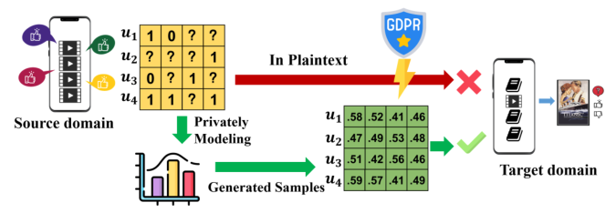
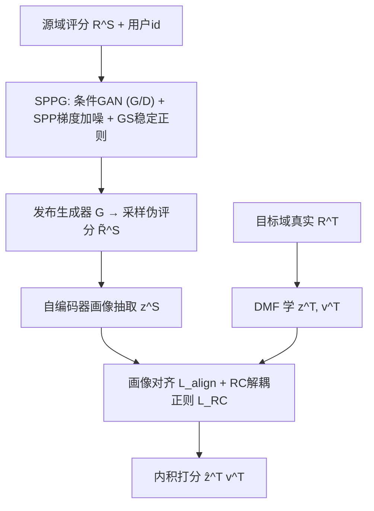
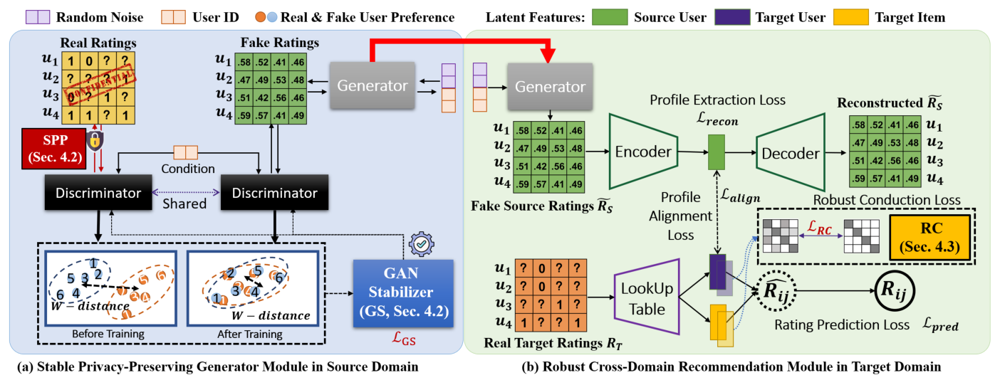

# PPGenCDR: A Stable and Robust Framework for Privacy-Preserving Cross-Domain Recommendation（面向隐私保护跨域推荐的稳定鲁棒生成框架）

- **会议/期刊**: AAAI 2023
- **作者与机构**: Xinting Liao, Weiming Liu, Xiaolin Zheng, Binhui Yao, Chaochao Chen（浙江大学、美的集团）
- **推荐链路定位**: 精排（目标域打分）/ 跨域端到端
- **研究方向**: 跨域与多场景推荐 / 去偏公平、可信隐私与工业架构
- **论文原文**: [https://arxiv.org/abs/2305.16163v1](https://arxiv.org/abs/2305.16163v1)
- **开源代码**: 暂未开源

## TL;DR (1分钟核心速览)

跨域推荐（CDR）普遍默认源域交互明文可迁移，忽略隐私合规。本文提出 PPGenCDR：在源域用**条件 GAN** 拟合用户偏好分布，并**只对判别器首层梯度施加 Rényi DP 裁剪+高斯噪声**（SPP），再用**控制论闭环正则**（GS）稳住 min-max 训练；目标域把发布生成器采样的"伪评分"经自编码器抽取画像、与 DMF 用户画像对齐，并用**批内跨维相关矩阵去冗余正则**（RC）抵抗噪声。在 Douban/Amazon 三组跨域任务、Leave-One-Out + 99 负采样协议下，较 SOTA 隐私保护基线 PriCDR 的 HR@5 提升 **6.67%–20.40%**，且与明文 CDR 模型（ETL）持平或更优。

## Background & Motivation (背景与核心矛盾)

- **主流范式**: CDR 通过跨连接（CoNet）、对偶学习（DDTCDR）、等价变换（ETL）在重叠用户上迁移源域知识，缓解目标域稀疏。
- **前人局限**: ① 这些模型默认跨域交互**明文共享**，与法规冲突；② 唯一的隐私基线 PriCDR 直接把中心 DP 施加于评分矩阵，隐私预算界更松（DP 而非 RDP），且扰动后目标域模型**不鲁棒**，性能随噪声显著退化。
- **核心洞察 (Key Insight)**: 直接发布扰动数据是一次性、不可查询的；若改为发布**训练好的生成器**，隐私预算在训练结束后固定，目标域可无限次采样且不再触碰原始数据，实现"数据隔离 + 稠密增广"双重收益。
- **本文切入点**: 把 PPCDR 重构成"隐私数据发布（源域）+ 鲁棒利用（目标域）"两段式框架，用 RDP 的**后处理不变性 + 链式法则**论证只扰动判别器即可保证全局隐私。
- **三大挑战**: CH1 隐私预算的经济性；CH2 RDP 噪声下 GAN min-max 训练更不稳定；CH3 如何低成本让现成 CDR 模型抗噪。

<figure class="paper-figure" markdown="span">
  <figcaption>图1：PPGenCDR 必要性的示例。</figcaption>
</figure>

## Method (核心方法设计)

### 1. 整体框架 (Overall Architecture)

左半部分 SPPG 位于源域：以用户 id $u$为条件，生成器$G$从噪声$\sigma_g\sim\mathcal{N}(0,I)$生成伪偏好$\tilde{r}^S=G(\sigma_g,u)$，判别器$D$以 Wasserstein 距离分辨真假，梯度经 SPP 选择性加噪；GS 以额外正则把训练动力学拉回稳定域。训练完成后**仅发布$G$**。右半部分 RCDR 位于目标域：采样$\tilde{r}^S$，经编码-解码抽取源域画像$z^S$；DMF 从真实$R^T$学得$z^T$与物品特征$v^T$；$z^S$与$z^T$做对齐，RC 对$Z^T,V^T$施加跨维解耦正则，最终内积$z^{T\top}v^T$ 输出评分。

<figure class="paper-figure" markdown="span">
  <figcaption>图2：PPGenCDR 的框架。</figcaption>
</figure>

### 2. 关键设计拆解 (Key Designs)

1. **SPP 选择性隐私保护（只扰动 $D$的首层梯度）**：DP-SGD 逐层加噪会"既掉点又不增益"。由链式法则$g_D=\nabla_D L_D\cdot J_{\theta_D}$，隐私泄露完全发生在直接接触真实评分的$D$上，故只需对首层梯度做裁边+高斯机制：$\hat{g}_D = \mathrm{SPP}(\nabla_D L_D)\cdot J_{\theta_D}$，其中$\mathrm{SPP}(\cdot)=\mathrm{clip}(\cdot)+\mathcal{N}(0,\sigma_p^2B^2 I)$。$G$仅通过$D$的反馈间接获知数据，依 RDP 后处理性质无需加噪，从而保住可用性。每步隐私界（Theorem 1）为$(\alpha,2N\alpha/\sigma_p^2)$-RDP，等价于$(\tfrac{2N\alpha}{\sigma_p^2}+\tfrac{\log 1/\delta}{\alpha-1},\delta)$-DP。

2. **GS 控制论稳定器**：噪声使"真值分布"随时间漂移 $m(t)=c-(1-2\phi)\sigma_{gr}$，Dirac GAN 的传递函数$s/(s^2+1)$极点落在虚轴，系统临界不稳定。引入反馈项$-\tau\theta_D(t)$后特征方程变为$s^2+\tau s+1$（$\tau>0$），极点具负实部。对应到损失即为对判别器输出的**二次惩罚**：
$$\mathcal{L}_{GS}=-\frac{\tau}{2}\left(\mathbb{E}_{r\sim p_{r^S}}\left[D^2(r,u)\right]+\mathbb{E}_{\tilde{r}\sim p_{\tilde{r}^S}}\left[D^2(\tilde{r},u)\right]\right)$$
直觉：压制 $D$ 的突变输出，使真假分布在更紧致的隐空间中比对，抑制噪声诱发的振荡。

3. **RC 鲁棒导体（Barlow-Twins 式解耦）**：伪评分使批内隐特征冗余相关。对批内 $Z^T$逐列 Z-score 得$\bar Z^T$，计算跨维相关矩阵$C_{\bar Z^T,ij}=\langle \bar z_i,\bar z_j\rangle/(\|\bar z_i\|\|\bar z_j\|)$，强制对角趋 1、非对角趋 0：
$$\mathcal{L}_{RC}=\|C_{\bar Z^T}-I\|_F^2+\|C_{\bar V^T}-I\|_F^2$$

**训练目标与开销**：$\mathcal{L}_{RCDR}=\mathcal{L}_{recon}+\mathcal{L}_{pred}+\lambda_A\mathcal{L}_{align}+\lambda_R\mathcal{L}_{RC}$，源域最大化$\mathcal{L}_G$与$\mathcal{L}_D+\mathcal{L}_{GS}$。RCDR 负采样沿用隐式反馈构造（每用户 99 负例）；隐私成本在生成器训练完成后**冻结**，目标域推理只需一次前向生成 + 编码，与常规 DMF 同阶。

## Experimental Setup & Evaluation Protocol (实验设置与评估协议)

- **数据集与预处理**: 评分 $\ge 3$置为正、其余为负；过滤交互数$<5$ 的用户与物品（`5-core`）。

| 数据集 | #Users | #Items | #Interactions | 稀疏度/密度 | 特征/场景说明 |
| :--- | :---: | :---: | :---: | :---: | :--- |
| Douban Book | 924 | 3,916 | 50,429 | 1.39% | 迁移至 Music |
| Douban Movie | 1,574 | 9,471 | 744,983 | 4.99% | 迁移至 Book |
| Douban Movie | 1,055 | 9,386 | 557,989 | 5.63% | 迁移至 Music |
| Amazon Movie | 26,704 | 24,091 | 562,249 | 0.09% | 迁移至 Book |
| Amazon Movie | 14,904 | 19,794 | 407,161 | 0.14% | 迁移至 Music |
| Amazon Music | 13,460 | 18,467 | 218,346 | 0.088% | 迁移至 Book |

- **数据划分与防穿越**: `Leave-One-Out`——每用户随机取 2 条已评分物品分别作验证/测试，其余训练。
- **排名评测协议**: `Sampled Ranking`，每用户配 **99 个未交互负例**（1:99），报告 HR/NDCG/MRR@{5,10}；**未使用 Full-Ranking**，属可复现但与全库排序不可直接横比的口径。
- **对比基线与超参**: 单域 BPR/NeuMF/DMF/CFGAN/GANMF；明文 CDR CoNet/DDTCDR/ETL/DARec；隐私基线 PriCDR。隐维度 $K=200$，batch$N=128$，$\eta=0.01$（Douban）/$0.0005$（Amazon），裁边常数$B=1$；最优超参$\lambda_A=1,\tau=2,\lambda_R=0.5$；提升均通过配对样本$t$检验$p<0.01$。

## Key Experimental Results (实验关键数据)

### 1. 主实验对比 (Main Results)

| 模型 | Douban Book→Music HR@5 | NDCG@5 | HR@10 | Amazon Movie→Book HR@5 | NDCG@5 | HR@10 |
| :--- | :---: | :---: | :---: | :---: | :---: | :---: |
| BPR | .1284 | .0984 | .2364 | .2642 | .1981 | .3837 |
| DMF | .1678 | .1143 | .2533 | .3035 | .2144 | .4116 |
| CoNet | .2042 | .1325 | .3128 | .3611 | .2571 | .4366 |
| DDTCDR | .2100 | .1446 | .3315 | .4393 | .3434 | .4838 |
| ETL（明文 SOTA） | .2781 | .1974 | .4048 | .5436 | .4288 | .6626 |
| DARec | .2056 | .1346 | .3149 | .3665 | .2736 | .4950 |
| PriCDR（PPCDR SOTA） | .3074 | .2107 | .4448 | .5862 | .4868 | .6889 |
| **PPGenCDR** | **.3701** | **.2691** | **.5097** | **.6253** | **.5218** | **.7181** |
| Improv.% vs PriCDR | +20.40% | +27.72% | +14.59% | +6.67% | +7.19% | +4.24% |

其余三组任务提升：Douban Movie→Book HR@5 +18.48%、NDCG@5 +25.31%；Douban Movie→Music HR@5 +13.03%、NDCG@5 +18.31%；Amazon Movie→Music HR@5 +6.05%、NDCG@5 +6.47%。

### 2. 消融与隐私分析 (Ablation & Privacy)

| 变体 | Douban B→M HR@5 | NDCG@5 | Amazon M→B HR@5 | NDCG@5 |
| :--- | :---: | :---: | :---: | :---: |
| PPGenCDR-GS（去稳定器） | .2944 | .1958 | .5976 | .4970 |
| PPGenCDR-RC（去鲁棒导体） | .3084 | .2123 | .3614 | .2641 |
| **PPGenCDR（全模型）** | **.3701** | **.2691** | **.6253** | **.5218** |

| 源域生成器质量（top@10） | Douban Movie HR | NDCG | MRR | Amazon Movie HR | NDCG | MRR |
| :--- | :---: | :---: | :---: | :---: | :---: | :---: |
| PPGenCDR（含 SPP） | .0882 | .0258 | .0403 | .0945 | .0401 | .0522 |
| PPGenCDR-SPP（全模型加噪） | .0872 | .0201 | .0353 | .1098 | .0324 | .0500 |

### 3. 关键实验发现 (Key Findings)

1. **隐私保护不再是"性能折扣品"**：PPGenCDR 在 Douban Book→Music 上不仅超过 PriCDR 20.40%，还反超明文 SOTA ETL 的 HR@5（.3701 vs .2781），说明源域生成增广的稠密伪评分比稀疏明文迁移更有效；Amazon 上提升收窄至 6% 量级，因该域密度仅 0.05–0.14%，生成器可学信号本就稀薄。
2. **RC 是承重墙，GS 是增益件**：移除 RC 在 Amazon Movie→Book 上 HR@5 从 .6253 崩到 .3614（−42%），甚至低于 PriCDR；移除 GS 仅降至 .5976（−4.4%）。即噪声数据的**维度冗余**才是主要退化源，稳定性问题在干净大域上反而次要。
3. **SPP 的"少扰动"是划算的**：全模型加噪（PPGenCDR-SPP）虽在源域 HR 上未必更低（Amazon .1098 > .0945，泄露更多），但 NDCG/MRR 全面变差；随 $\varepsilon$ 从 0.04 增至 72，PPGenCDR 在目标域 HR@10 始终高于 PPGenCDR-SPP，验证"只扰动接触原始数据的判别器首层"在效用-隐私曲线上严格占优。

## Highlights & Limitations (亮点、对比与审稿批判)

- **与代表作对比**: vs **PriCDR**——后者一次性发布中心 DP 扰动矩阵、预算界松、下游不抗噪；本文发布生成器实现"可查询的隐私发布"，并用 RCDR 抗噪。vs **ETL/DDTCDR**——同为跨域迁移，但假设明文共享，无隐私语义。vs **CFGAN/GANMF**——同为 GAN 增强推荐，但缺少隐私机制与训练稳定性保证。
- **可迁移亮点**: ①"只对首层梯度加噪 + 链式法则 + 后处理"可套用到任意编码器-解码器的跨机构隐私迁移；② RC 的批内跨维相关惩罚是即插即用的抗噪插件，几乎零额外参数，可迁移到含噪特征的精排网络。
- **审稿级局限批判**: ①评测仅用 1:99 采样的 Sampled Ranking，未做 Full-Ranking，且负例采样方式与 PriCDR 一致性未给出敏感性分析，绝对数值说服力受限；②RCDR 依赖对齐损失而非解耦表征，在两域用户重叠率下降（非重叠 CDR）时 $L_{align}$前提失效；③$\tau$、$\lambda_R$曲线呈明显钟形，最优值集中在窄区间，工业上线需重调；④生成器发布后若被恶意高频查询，成员推断风险仅在$\varepsilon$ 层面受控，缺乏对 query 行为的审计。

## Rating (四维评分)

- **方法创新性 (Novelty)**: ⭐⭐⭐⭐ （首次把"隐私生成数据发布"落到 CDR，用控制论传递函数极点论证 GAN 稳定性并反解出正则项，推导链条完整且有物理直觉）
- **评估协议与实验扎实度 (Protocol & Experiments)**: ⭐⭐⭐ （3 组跨域任务 × 10 基线 + $p<0.01$ 检验较完整，但仅采样式排序、缺 Full-Ranking 与真实隐私攻击实验）
- **写作与数学规范度 (Clarity & Rigor)**: ⭐⭐⭐⭐ （RDP 组合与 Laplace 变换证明清晰，Theorem 1/3/4 与模块一一对应，附录补充充分）
- **工业落地与复现价值 (Industrial & Practical Value)**: ⭐⭐⭐ （生成器发布范式契合跨机构数据合作的合规诉求，推理开销与 DMF 同阶；但未开源、超参敏感且生成器查询需额外风控）

