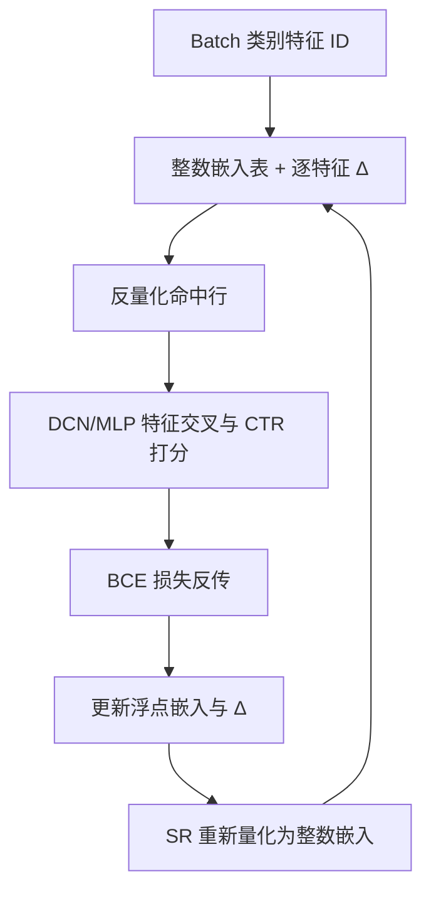
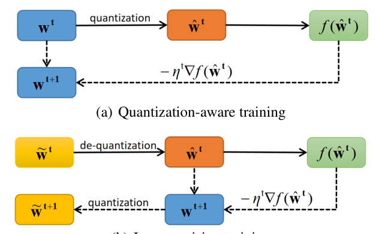

# Adaptive Low-Precision Training for Embeddings in Click-Through Rate Prediction (面向点击率预测嵌入表的自适应低精度训练)

- **会议/期刊**: AAAI 2023
- **作者与机构**: Shiwei Li, Huifeng Guo, Lu Hou, Wei Zhang, Xing Tang, Ruiming Tang, Rui Zhang, Ruixuan Li；华中科技大学、华为诺亚方舟实验室等
- **推荐链路定位**: 精排（CTR 预估模型嵌入表训练与部署压缩）
- **研究方向**: CTR/CVR 预估与特征交叉
- **论文原文**: [论文原文链接](https://arxiv.org/abs/2212.05735v1)
- **开源代码**: [开源代码仓库链接](https://gitee.com/mindspore/models)

## TL;DR (1分钟核心速览)

针对 CTR 超大嵌入表训练开销高、LPT 低位宽精度骤降，本文证明随机舍入（SR）优于确定性舍入（DR），并提出 ALPT：交替更新低精度嵌入与逐特征步长。Avazu/Criteo 的 8:1:1 点式评测中，8-bit ALPT 与 FP 持平，AUC 0.7951/0.8144，训练压缩 3.2×。

## Background & Motivation (背景与核心矛盾)

- **主流范式**: CTR 模型采用“嵌入表 + DCN/MLP”范式，嵌入表常达 TB 级；压缩路线包括 NAS 搜维、剪枝、哈希与量化。
- **前人局限**: QAT 仍保留全精度权重副本，只能压缩推理阶段；LPT 直接更新低精度权重，但低位宽精度退化严重，Xu 仅敢用 16-bit，Yang 的 8-bit 需全精度 cache。
- **核心洞察**: DR 在梯度更新小于半步长时会“抹掉”更新并累积偏差；SR 无偏，故在 LPT 中收敛更快、误差更小。
- **本文切入点**: 先用收敛理论选定 SR，再把量化步长从超参改为逐特征可学习参数。

## Method (核心方法设计)

### 1. 整体框架 (Overall Architecture)

模型输入一批类别特征 ID，嵌入表以整数 $\tilde{\boldsymbol{w}}$加逐特征步长$\Delta$存储；前向只反量化 batch 命中的少量行，$\hat{\boldsymbol{w}}=\Delta\tilde{\boldsymbol{w}}$，再经 DCN/MLP 做特征交叉与 CTR 打分。反向更新被命中的浮点嵌入与其他网络参数；随后以旧步长 DR 伪量化取得$\Delta$ 梯度，更新步长，最后用新步长与 SR 将嵌入写回整数。推理时仍以整数表存储，命中行反量化后计算。

<figure class="paper-figure" markdown="span">
  <figcaption>图2：量化感知训练（QAT）和低精度训练（LPT）的训练过程。</figcaption>
</figure>
*图 2：QAT 与 LPT 的训练流程对比；LPT 不保留全精度权重副本。*

### 2. 关键设计拆解 (Key Designs)

1. **随机舍入替代确定性舍入**：DR 有偏且会抹掉小梯度更新，导致收敛停滞；SR 以概率在相邻整数间舍入，$R_S(x)=\lfloor x\rfloor$以概率$\lfloor x\rfloor+1-x$，否则为$\lfloor x\rfloor+1$。LPT 更新为$\hat{\boldsymbol{w}}_{t+1}=Q_S(\hat{\boldsymbol{w}}_t-\eta_t\nabla f(\hat{\boldsymbol{w}}_t))$。理论界表明 DR 多出与步长、维度和$T_0$ 相关的偏置项，故 SR 收敛误差更小。

2. **逐特征可学习步长 ALPT**：全局步长难以兼顾表示范围与分辨率，且更新后需重量化全表。ALPT 为每个特征维护 $\Delta_b$，交替执行：
$\hat{\boldsymbol{w}}_b^t=\Delta_b^t\tilde{\boldsymbol{w}}_b^t$，
$\boldsymbol{w}_b^{t+1}=\hat{\boldsymbol{w}}_b^t-\eta_t\nabla f(\hat{\boldsymbol{w}}_b^t,\boldsymbol{w}_o^t)$，
$\Delta_b^{t+1}=\Delta_b^t-\eta_t\frac{\partial f(Q_D(\boldsymbol{w}_b^{t+1},\Delta_b^t),\boldsymbol{w}_o^{t+1})}{\partial\Delta_b^t}$，
$\tilde{\boldsymbol{w}}_b^{t+1}=\tilde{Q}_S(\boldsymbol{w}_b^{t+1},\Delta_b^{t+1})$。
步长梯度经 LSQ 式 DR 伪量化获得，最终写回用 SR；缩放因子 $g=1/\sqrt{bdq}$，$q=2^{m-1}-1$。

3. **训练目标、负采样与推理效率**：CTR 采用点式 BCE，$\mathcal{L}=-\frac{1}{N}\sum_i[y_i\log\hat{y}_i+(1-y_i)\log(1-\hat{y}_i)]+\lambda\|\boldsymbol{w}\|_2^2$，无额外负采样。8-bit 理论压缩 4×，计入逐特征步长后为 3.2×；每 epoch 仅比 FP 多 1–2 分钟，推理时间与 FP 接近。

## Experimental Setup & Evaluation Protocol (实验设置与评估协议)

- **数据集与预处理**: CTR 无用户/物品 5-core 过滤；类别特征低频替换为 OOV。

| 数据集 | #特征域 | #过滤后特征数 | 划分 | 预处理/场景说明 |
| :--- | :---: | :---: | :---: | :--- |
| Avazu | 24 | 4,428,293 | 8:1:1 | 出现 <2 次类别→OOV；timestamp 拆为 hour/weekday/is weekend |
| Criteo | 39（26 类别+13 数值） | 1,086,895 | 8:1:1 | 数值取 $\lfloor\log_2(x)\rfloor$；出现 <10 次类别→OOV |

- **数据划分与防穿越 (Splitting Strategy)**: 随机 8:1:1 划分，非全局时间戳切分；随机切分可能引入未来样本泄漏，是评估局限之一。
- **排名评测协议 (Ranking Protocol)**: 点式 CTR 评估，报告 AUC 与 LogLoss；使用全量曝光样本，无额外负采样或采样排序。
- **对比基线与超参设置**: DCN backbone，$d=16$，Adam lr$10^{-3}$，15 epochs，第 6/9 epoch 学习率十折衰减；步长 lr$2e^{-5}$；每个实验至少重复 5 次，按 CTR 惯例 AUC 提升 0.001 视为显著，未报告 p 值。

## Key Experimental Results (实验关键数据)

### 1. 主实验对比 (Main Results)

| 方法 | Avazu AUC↑ | Avazu LogLoss↓ | Criteo AUC↑ | Criteo LogLoss↓ | 压缩（训练/推理） |
| :--- | :---: | :---: | :---: | :---: | :---: |
| FP | 0.7949 | 0.37069 | 0.8144 | 0.43764 | 1×/1× |
| Hashing | 0.7928 | 0.37203 | 0.8119 | 0.44130 | 2×/2× |
| Pruning | 0.7926 | 0.37202 | 0.8123 | 0.44049 | 1×/2× |
| PACT | 0.7948 | 0.37074 | 0.8144 | 0.43765 | 1×/4× |
| LSQ | 0.7949 | 0.37073 | 0.8144 | 0.43764 | 1×/4× |
| LPT(DR) | 0.7654 | 0.38844 | 0.7966 | 0.45306 | 4×/4× |
| LPT(SR) | 0.7927 | 0.37205 | 0.8123 | 0.43945 | 4×/4× |
| ALPT(DR) | 0.7928 | 0.37216 | 0.8096 | 0.44198 | 3.2×/3.2× |
| **ALPT(SR)** | **0.7951** | **0.37062** | **0.8144** | **0.43763** | 3.2×/3.2× |

注：ALPT(SR) 相对 LPT(SR) 的 AUC 提升为 Avazu +0.30%、Criteo +0.26%；Criteo 上 ALPT 与 FP/LSQ/PACT 的 AUC 持平。

### 2. 消融实验 (Ablation Study)

| 设置 | Avazu AUC | Criteo AUC | 说明 |
| :--- | :---: | :---: | :--- |
| LPT(SR), 8-bit | 0.7927 | 0.8123 | 固定步长 + SR |
| ALPT(SR), 8-bit | 0.7951 | 0.8144 | 逐特征可学习步长 |
| LPT(DR), 8-bit | 0.7654 | 0.7966 | 固定步长 + DR |
| ALPT(DR), 8-bit | 0.7928 | 0.8096 | DR 下学习步长可大幅恢复 |
| LPT(SR), 4-bit | 0.7906 | 0.8079 | 低位宽退化 |
| ALPT(SR), 4-bit | 0.7919 | 0.8111 | 步长学习缓解退化 |
| LPT(SR), 2-bit | 0.7829 | 0.8009 | 极低位宽 |
| ALPT(SR), 2-bit | 0.7851 | 0.8033 | 仍优于 LPT，但低于 LSQ |

### 3. 关键实验发现 (Key Findings)

1. **SR 的理论优势被实验验证**：LPT(DR) 在 Avazu 仅 0.7654，比 LPT(SR) 低 0.0273 AUC；Criteo 低 0.0157。即使 ALPT 学习步长后 DR 回升至 0.7928/0.8096，仍不及 SR，说明舍入偏差不是单靠步长可完全补偿。
2. **8-bit 首次无损，但压缩换来了少量训练开销**：ALPT(SR) 在 Avazu 达 0.7951，略高于 FP 的 0.7949；Criteo 与 FP 同为 0.8144，LogLoss 更低 0.00001。压缩 3.2× 而非 LPT 的 4×，每 epoch 多 1–2 分钟，属于可接受折中。
3. **低位宽仍逊于 QAT**：2-bit 时 ALPT 为 0.7851/0.8033，虽高于 LPT 的 0.7829/0.8009，却低于 LSQ 的 0.7912/0.8089；说明 ALPT 的强项是“训练阶段压缩 + 8-bit 无损”，而非极低位宽绝对精度。

## Highlights & Limitations (亮点、对比与审稿批判)

- **与代表作对比 (vs. Prior Work)**: 相比 LSQ/PACT，ALPT 把量化用于训练内存压缩而非仅推理，不需全精度权重副本；相比 Xu 的 LPT，补上收敛理论并实现 8-bit 无损；相比哈希/剪枝，无需重训练或非结构化稀疏访问。
- **可迁移亮点**: SR + 逐特征步长可直接迁移到其他稀疏嵌入表训练；整数存储 + 命中行反量化适合大规模 ID 特征内存优化。
- **审稿级局限批判**: 2/4-bit 下仍落后 LSQ，极低位宽优势有限；仅两个公开数据集、随机切分且无线上 A/B 或分布式通信实测；步长学习引入额外 lr/weight decay 敏感度，理论分析依赖凸性与固定步长假设。

## Rating (四维评分)

- **方法创新性 (Novelty)**: ⭐⭐⭐⭐ （首次系统分析 LPT 中 SR/DR 收敛差异，并提出逐特征步长交替学习）
- **评估协议与实验扎实度 (Protocol & Experiments)**: ⭐⭐⭐ （Criteo/Avazu 重复 5 次且基线充分，但随机切分、无时间切分/线上验证）
- **写作与数学规范度 (Clarity & Rigor)**: ⭐⭐⭐⭐ （收敛定理、算法与复杂度叙述清晰，但自适应步长本身缺少完整收敛证明）
- **工业落地与复现价值 (Industrial & Practical Value)**: ⭐⭐⭐⭐ （开源代码、3.2× 训练压缩、8-bit 无损，对精排嵌入表降本有直接价值）

