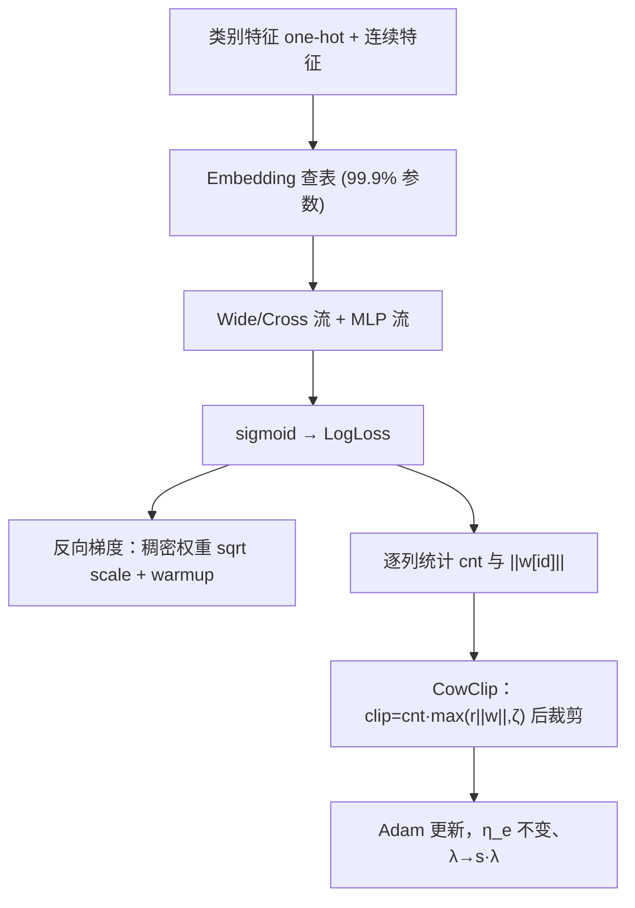
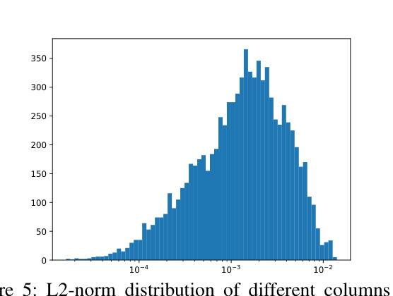

# CowClip: Reducing CTR Prediction Model Training Time from 12 hours to 10 minutes on 1 GPU (CowClip：在单卡上把 CTR 模型训练从 12 小时压缩到 10 分钟)

- **会议/期刊**: AAAI 2023
- **作者与机构**: Zangwei Zheng, Pengtai Xu, Xuan Zou, Da Tang, Zhen Li 等（新加坡国立大学 / 字节跳动）
- **推荐链路定位**: 精排（CTR 预估模型的训练加速，模型无关的优化器层改造）
- **研究方向**: CTR/CVR 预估与特征交叉 / 工业级全链路架构与训练系统
- **论文原文**: [https://arxiv.org/abs/2204.06240v3](https://arxiv.org/abs/2204.06240v3)
- **开源代码**: [https://github.com/bytedance/LargeBatchCTR](https://github.com/bytedance/LargeBatchCTR)

## TL;DR (1分钟核心速览)

CTR 模型参数量 99.9% 集中在超大 Embedding 表，工业样本日增数十亿，重训耗时成为时效性瓶颈；而直接放大 batch 会让 CV/NLP 的 linear/sqrt 缩放规则彻底失效（8K 时 AUC 掉 3.2%）。本文从理论上证明：ID 频次差异导致低频 ID 的期望梯度被 $P(id\in B)$缩放，因而 embedding 学习率不应随 batch 缩放、而 L2 需按$s^2$ 放大；进而提出按列自适应裁剪 CowClip。在 Criteo/Avazu 上以 Full-Ranking 评估、四种模型统一放大 128× batch 无精度损失，DeepFM 单 V100 训练 768 分钟→9 分钟（76.8×），AUC 反升 0.1%+。

## Background & Motivation (背景与核心矛盾)

- **主流范式**: Wide&Deep / DeepFM / DCN / DCNv2 等「宽或交叉流 + MLP」双塔式 CTR 网络，配合 Adam + Embedding L2 正则训练；CTR 输入是一 hot 编码后的高维稀疏特征，单条样本仅数百非零位。
- **前人局限**: (1) CV/NLP 的 linear scaling（$\eta\to s\eta$）与 sqrt scaling（$\eta\to\sqrt{s}\eta$）在 Criteo 上 4K/8K 时分别掉 0.11%/0.20%，甚至 1.35%/3.21%；(2) LARS/LAMB 类逐层优化器对只有 3–4 层的 CTR 网络意义有限，逐层自适应粒度太粗，无法区分同一 field 内不同 ID 的梯度量级差异。
- **核心洞察 (Key Insight)**: 把 Criteo 每个 field 只保留 Top-3 高频 ID、其余坍缩为一个 ID 后，linear/sqrt 缩放立刻恢复有效——说明失效根因不是网络结构而是 **ID 频次的长尾分布**（图 4 显示近指数衰减）。稀疏 ID 只在极少 batch 中出现，其期望梯度天然带 $P(id\in B)$ 系数，而稠密权重与高频 ID 的该系数恒为 1。
- **本文切入点**: 既然不同 ID 的出现概率不同，就不该用统一的全局学习率/全局裁剪阈值，而应 **在 embedding 列粒度上做与频次相关的自适应梯度裁剪**，把「缩放规则」从超参调整问题转化为「梯度范数上界」问题。

## Method (核心方法设计)

### 1. 整体框架 (Overall Architecture)

模型主体沿用 Wide/Cross-and-Deep 结构（图 2）：类别特征 one-hot 后过 Embedding 表得到稠密向量，与连续特征拼接后分别送入 wide/cross 流与 MLP 流，最后 sigmoid 输出点击概率并计算 LogLoss。本文的增量全部发生在 **反向传播后的参数更新环节**：稠密权重（MLP/cross）按 sqrt scaling 更新并配 one-epoch warmup；Embedding 层则先按列统计该 ID 在 batch 内出现次数 `cnt`，用其权重范数构造自适应裁剪阈值，逐列裁剪梯度后再用 Adam 更新，学习率保持与 1K batch 完全一致，仅把 L2 权重线性放大 $s$ 倍。

### 2. 关键设计拆解 (Key Designs)

1. **频次感知的缩放规则推导（为什么 embedding 不放大学习率）**：设 ID 出现概率 $p$，则$P(id\in B)=1-(1-p)^b$；对低频 ID 有$P(id\in B)\approx b\cdot p$。由$P(id\in B')\approx s\cdot P(id\in B)$，大 batch 的期望更新已自动被放大$s$倍，故$\eta_e$无需缩放。至于 L2，因期望梯度被$P$缩放，在 Adam 下等价于$\lambda_{\text{eff}}=\lambda/(b\cdot p)$，需放大$\lambda$补偿；又因大 batch 每 epoch 施加 L2 的步数少$s$倍（$\eta'\lambda'\approx s\eta\lambda$），最终得 **n²–λ 规则**：$\eta_e\to\eta_e,\ \lambda_e\to s^2\lambda_e$，可无额外技巧撑到 4K。

2. **CowClip 列级自适应裁剪（核心算子）**：全局范数裁剪会被少数大梯度列主导，误伤正常列（图 5 显示同一步内不同列梯度 L2 范数跨越数个量级）。CowClip 改为给每个 ID 向量独立阈值并与出现次数绑定：
$$\text{clip}_t=\text{cnt}(id)\cdot\max\{r\cdot\|\boldsymbol{w}_t[id]\|,\ \zeta\},\qquad \boldsymbol{g}_c=\min\Big\{1,\frac{\text{clip}_t}{\|\boldsymbol{g}_t[id]\|}\Big\}\cdot\boldsymbol{g}_t[id]$$
   乘 `cnt` 是为把 reduce-mean 后的梯度还原到单样本量级 $\nabla L(w,x)$；阈值正比于权重范数使裁剪随训练自适应收紧/放松（借鉴 LAMB）；下界$\zeta$ 防止长期未出现的 ID 权重被 L2 压到过小后被过度裁剪。

3. **训练目标、负采样与推理开销**：优化目标即标准 LogLoss + Embedding L2：$\mathcal{L}=\text{BCE}(y,f(x))+\frac{\lambda}{2}\|\boldsymbol{w}_e\|_2^2$，稠密权重不加 L2；CTR 场景无负采样概念（样本天然含未点击负例）。实现上用张量化 scatter 代替 for 循环，裁剪开销相对前反向可忽略；推理阶段完全不引入任何额外模块，零延迟成本。

<figure class="paper-figure" markdown="span">
  <figcaption>图5：DeepFM 在 Criteo 数据集上第 1000 步时不同列梯度的 L2 范数分布。仅展示批次中存在 id 的列。x 轴为 L2 范数值，y 轴为列数。</figcaption>
</figure>

## Experimental Setup & Evaluation Protocol (实验设置与评估协议)

- **数据集与预处理**（CTR 无 user/item 交互过滤，按原始划分）：

| 数据集 | #样本 | #Fields | 类别/连续 | 划分方式 | 场景说明 |
| :--- | :---: | :---: | :---: | :---: | :--- |
| Criteo | 45M | 39 | 26 / 13 | 随机 90%:10% | 广告曝光点击，Embedding 参数 372M |
| Criteo-seq | 同 Criteo | 39 | 26 / 13 | 按天：前 6 天训练 / 第 7 天测试 | 序列式时序切分，防穿越 |
| Avazu | 32M 训练 | 24 | 24 / 0 | 随机 80%:20% | 移动广告点击，Embedding 104M |

- **数据划分与防穿越**: Criteo/Avazu 为随机比例划分；Criteo-seq 采用**全局时间戳（按天）切分**，检验时序分布漂移下的稳定性。
- **排名评测协议**: 二分类打分任务，采用 **全量测试集 AUC 与 LogLoss**（不涉及负采样排序），报告 3 个随机种子（1234/1235/1236）结果，AUC 标准差 < 0.012%；作者指出 Criteo 上 0.02% AUC 即视为显著。
- **对比基线与超参**: 模型基线 W&D / DeepFM / DCN / DCNv2；缩放基线 No Scaling、Sqrt Scaling、Sqrt Scaling*（不缩放 L2）、LR Scaling、n²–λ Scaling；系统基线 XDL、FAE、DLRM、Hotline。Embedding 维度 $d=10$，MLP 3 层×400，10 epochs，Adam，1K batch 基学习率$10^{-4}$、L2$10^{-5}$；CowClip 取$r=1$、$\zeta\in\{10^{-5},10^{-4}\}$。

## Key Experimental Results (实验关键数据)

### 1. 主实验对比 (Main Results)

| 模型 / 数据集 | 1K 基线 AUC | 传统缩放 8K 最好 | CowClip 8K | CowClip 128K | 训练时间 1K→128K |
| :--- | :---: | :---: | :---: | :---: | :---: |
| DeepFM / Criteo | 80.76 | 80.55 | **80.97** | 80.90 | 768 → **9 min (76.8×)** |
| W&D / Criteo | 80.75 | – | **80.96** | 80.89 | 768 → 10 min |
| DCN / Criteo | 80.76 | – | 80.96 | **80.91** | 768 → 11 min |
| DCNv2 / Criteo | 80.78 | – | **80.97** | 80.89 | 822 → 30 min |
| DeepFM / Avazu | 78.84 | 76.69 | **79.06** (16K) | 78.80 | 210 → **4.8 min (43.7×)** |
| XDL / Hotline (系统类) | 80.2 / 79.8 | 仅支持 ≤4K | – | – | 需 2–4 卡 |

关键对照：128K 时传统缩放**无法收敛**；CowClip 在 Criteo 上比 1K 基线 AUC **+0.14**（相对 +0.17%），Avazu 上 16K 达 79.06（+0.22）。

### 2. 消融实验 (Ablation Study)

| 变体（DeepFM / Criteo） | 8K AUC | 128K AUC | 说明 |
| :--- | :---: | :---: | :--- |
| 全局 Gradient Clipping | 80.63 | 77.24 | 大 batch 直接崩 |
| Field-wise GC | 80.63 | 80.62 | 粒度到 field 仍不足 |
| Column-wise GC（固定阈值） | 80.65 | 80.75 | 到列粒度有效但弱 |
| Adaptive Field-wise GC | 80.62 | 77.90 | 自适应但粒度粗 → 失效 |
| **Adaptive Column-wise GC (CowClip)** | **80.97** | **80.90** | 全指标最优 |
| w/o 下界 $\zeta$ | 80.96 | 80.88 | 128K 下略掉 |
| w/o warmup | 80.97 | 80.52 | 大 batch 必需 |
| w/o 大初始化权重 | 80.92 | 80.90 | 8K 下欠拟合 |
| No / Sqrt / LR / n²–λ Scaling @8K | 80.31 / 80.28 / 80.46 / 80.73 | 均不收敛 | 均显著低于 CowClip 80.97 |

### 3. 关键实验发现 (Key Findings)

1. **失效根因是频次而非架构**：把每个 field 压缩成 4 个高频 ID 后，linear/sqrt 缩放在 8K 上误差仅 $-0.01$（原数据为$-0.20$），直接验证「低频 ID 是唯一元凶」；同时 CowClip 在四种模型上一致有效，证明其模型无关性。
2. **大 batch 不是精度折衷而是精度红利**：Criteo 上 AUC 从 1K 的 80.76 单调升至 8K 的 80.97（+0.21），128K 仍保 80.90；这来自 $s^2$ 级 L2 强化与列级裁剪带来的隐式正则，等效于更强的稀疏 ID 泛化。
3. **加速近线性且单卡即可**：≤16K 加速比与 batch 近似线性（16K 达 16.0×），128K 仍有 76.8× 次线性加速；对比 Hotline/XDL 靠多卡+内存分层把 1K 训练压到 53 分钟但 AUC 仅 79.8–80.2 且最多 4K batch，CowClip 单卡 9 分钟即得 80.87，GPU-hours 低一个量级。

## Highlights & Limitations (亮点、对比与审稿批判)

- **与代表作对比 (vs. Prior Work)**: 相对 LARS/LAMB 的逐层自适应，本文把粒度下沉到 embedding **列**并与 ID 频次耦合，解决了「浅层网络逐层优化失效」的问题；相对 FAE/Hotline 等系统侧工作（缓存高频 embedding、优化访存），本文是纯算法侧改造，可与前者正交叠加，且不受多卡通信瓶颈限制。
- **可迁移亮点**: (1) 「阈值 = 频次 × max(r‖w‖, ζ)」这一列级裁剪范式可平移到任何超大 Embedding 表场景（NLP 中文词表、多模态 ID 表）；(2) 参数更新与 batch 缩放的等价分析框架，可直接复用于判断某模块在当前数据分布下是否需要缩放学习率。
- **审稿级局限批判**: (1) 仅在单卡验证，未给出多机 all-reduce 下 embedding 梯度交换与 CowClip 的联合开销，工业落地仍需系统层补齐；(2) batch ≥256K 时 AUC 开始下降，作者归因于「多数 ID 低频」假设失效，但未给 id-wise 缩放方案；(3) 全部实验为 10 epochs，而工业实践多为单 epoch 在线重训，文中自承首 epoch AUC 反而低于小 batch，与「时效性」的核心动机存在张力；(4) 未考虑 lazy Adam/Adagrad + 稀疏更新的主流工业优化器设定。

## Rating (四维评分)

- **方法创新性 (Novelty)**: ⭐⭐⭐⭐ （把大 batch 缩放失效归因到 ID 频次的期望梯度系数，理论推导干净，列级频次感知裁剪有明确物理直觉）
- **评估协议与实验扎实度 (Protocol & Experiments)**: ⭐⭐⭐⭐ （2 数据集 4 模型 3 种子，AUC 标准差 <0.012%，消融覆盖裁剪粒度/各组件，但仅离线全量 AUC、缺线上 A/B）
- **写作与数学规范度 (Clarity & Rigor)**: ⭐⭐⭐⭐ （从 $P(id\in B)$ 出发逐步推到 n²–λ 与 CowClip，附录给出 sqrt 缩放协方差与收敛性证明，符号统一）
- **工业落地与复现价值 (Industrial & Practical Value)**: ⭐⭐⭐⭐⭐ （代码开源、模型无关、推理零开销，单卡 76.8× 加速对日更重训场景收益极直接）

