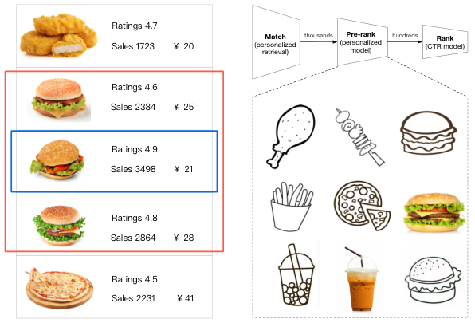
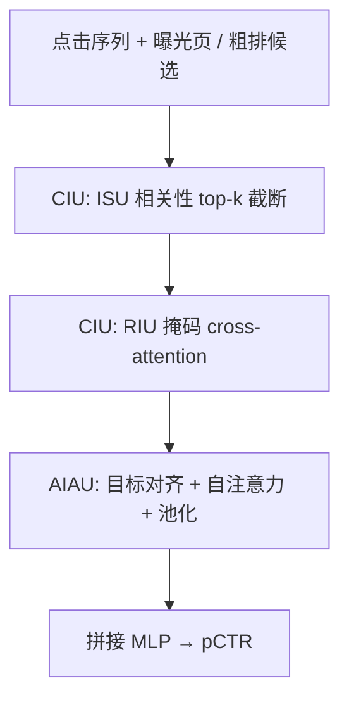
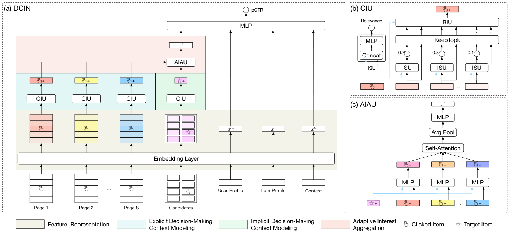

# Decision-Making Context Interaction Network for Click-Through Rate Prediction (决策上下文交互网络)

- **会议/期刊**: AAAI 2023
- **作者与机构**: Xiang Li, Shuwei Chen, Jian Dong, Jin Zhang, Yongkang Wang, Xingxing Wang, Dong Wang（美团）
- **推荐链路定位**: 精排（CTR 预估），复用粗排候选作为输入
- **研究方向**: CTR/CVR 预估与特征交叉 / 序列推荐
- **论文原文**: [https://arxiv.org/abs/2301.12402v1](https://arxiv.org/abs/2301.12402v1)
- **开源代码**: 暂未开源

## TL;DR (1分钟核心速览)

现有 CTR 模型只把"用户点过的物品"当作兴趣证据，丢弃了用户做点击决策时真正在看的**上下文**：同一曝光页内被横向比价的兄弟物品（显式上下文），以及粗排因为"猜你喜欢"才召回的同类候选（隐式上下文）。本文提出 DCIN，用一个可复用的 Context Interaction Unit（相关性打分 + top-$k$ 硬截断 + 带掩码的 cross-attention）分别增强行为兴趣与目标表征，再用 AIAU 做目标感知的兴趣聚合。在构造的 Avito† 与工业 MeituanAds 上，AUC 相对最强基线 RACP 提升 +0.0041/+0.0042 绝对值（约 +0.5%~0.6% 相对），线上 A/B 取得 CTR +2.9%、CPM +2.1%、GMV +1.5%。

## Background & Motivation (背景与核心矛盾)

- **主流范式**: 以 DIN/DIEN/DSIN/SIM 为代表的用户行为建模：对点击序列做 target-attention 提取"被目标激活的兴趣"，再与画像、物品、上下文特征拼接进 MLP。
- **前人局限**: ① 行为建模是 pointwise 的——只判断"某次点击是否与目标相关"，而点击序列本身含噪，兴趣提取不稳；② 系统内大量**结构性信息**（页内共现、粗排候选的同类聚集）未被利用，而这些恰恰是用户决策时的"比较对象"。
- **核心洞察 (Key Insight)**: 作者观察到两类被忽略的决策上下文。显式上下文：用户在蓝色物品点击前，会先在红色局部范围内比较价格/评分/销量（页内共现关系）；隐式上下文：粗排是个性化的，候选集里出现多个汉堡本身就"泄露"了用户偏好快餐（见图 1）。二者与点击行为互补。
- **本文切入点**: 用同一个"先筛相关、再做交互"的单元（CIU）把两类上下文都注入表征，避免 RACP 的"整页无差别建模"与 CIM 的"300 候选平均池化导致特征平滑"。

<figure class="paper-figure" markdown="span">
  <figcaption>图1：显式和隐式决策上下文的示意图。(a) 用户在做蓝色标示的点击决策前，会主动在红色标示的局部范围内比较高度相关物品的属性。(b) 可以推断用户非常喜欢快餐，以至于预排序阶段为其生成这些候选。</figcaption>
</figure>

## Method (核心方法设计)

### 1. 整体框架 (Overall Architecture)

输入分为四路：用户/物品/上下文特征 $\mathbf{x}_u,\mathbf{x}_i,\mathbf{x}_c$；点击序列$\mathbf{x}_c=\{\mathbf{x}_{c_1},\dots,\mathbf{x}_{c_S}\}$及每个点击物品对应的曝光页$\mathbf{p}_i=\{\mathbf{p}_{i,1},\dots,\mathbf{p}_{i,P}\}$；粗排候选集$\mathbf{x}_s=\{\mathbf{x}_{s_1},\dots,\mathbf{x}_{s_C}\}$（目标$\mathbf{x}_t$是其中之一）。显式分支对每个$(\mathbf{x}_{c_i},\mathbf{p}_i)$跑一次 CIU 得到增强行为兴趣$\mathbf{x}^{aug}_{c_i}$；隐式分支把 CIU 复用一次，以目标为 query、候选为 key/value 得到精炼目标$\mathbf{x}^{re}_t$；AIAU 将二者对齐、自注意力交互后池化出最终兴趣$\mathbf{x}_s$，与$\mathbf{x}_u,\mathbf{x}_i,\mathbf{x}_c$ 拼接经两层 MLP 输出 pCTR。训练为端到端 pointwise logloss，推理时一次前向即可，无额外检索开销。

<figure class="paper-figure" markdown="span">
  <figcaption>图2：网络架构。(a) 是我们提出的 DCIN，其模块用不同颜色绘制。(b) 展示 CIU 的细节，CIU 用于建模显式和隐式决策上下文。(c) 展示 AIAU 的结构，AIAU 用于自适应聚合与目标物品相关的行为兴趣。</figcaption>
</figure>

### 2. 关键设计拆解 (Key Designs)

1. **CIU = ISU（无关抑制）+ RIU（相关交互）**：痛点是"并非每个曝光页都发生了比价"，含杂项的页面会污染兴趣。ISU 先算页内物品与点击物品的四路交互相关性（差值、逐元素积显式刻画"比较"语义）：
$\;f_{i,j}=\mathrm{MLP}([\mathbf{x}_{c_i},\mathbf{p}_{i,j},\mathbf{x}_{c_i}-\mathbf{p}_{i,j},\mathbf{x}_{c_i}\odot\mathbf{p}_{i,j}])\;$，再保留 top-$k_1$、其余置$-\infty$；RIU 把该掩码直接加进注意力 logits：$\;\mathbf{x}^{aug}_{c_i}=\mathrm{softmax}(\mathbf{Q}_i\mathbf{K}_i^{\top}/\sqrt{D_s}+\mathbf{f}_i)\mathbf{V}_i\mathbf{W}^O+\mathbf{x}_{c_i}\;$。直觉：$-\infty$ 使无关项权重严格归零，相当于"可微的硬筛选 + 残差保底"，比 softmax 软加权更抗噪。
2. **CIU 复用做隐式上下文**：把目标当 query、候选当 key/value，同一套算子产出 $\mathbf{x}^{re}_t$，把"候选集里同类的共现"压缩进目标表征，使目标中可能激活兴趣的属性被放大（$k_2$ 控制保留候选数）。一个模块两用，参数与工程成本几乎不增。
3. **AIAU 与训练目标**：显式/隐式分支独立建模后存在两个缺陷——所有目标共享同一份增强兴趣、且各行为兴趣等权。AIAU 先用 $\mathbf{x}^{ca}_i=\mathrm{MLP}([\mathbf{x}^{re}_t,\mathbf{x}^{aug}_{c_i}])$把两路不同分布的表征对齐，再自注意力捕捉兴趣间互影响，平均池化 + MLP 得$\mathbf{x}_s$；最终$\hat{y}=\sigma(\mathrm{MLP}([\mathbf{x}_s,\mathbf{x}_u,\mathbf{x}_i,\mathbf{x}_c]))$，损失为$\mathcal{L}=-\frac{1}{N}\sum_k[y_k\log\hat{y}_k+(1-y_k)\log(1-\hat{y}_k)]$。负样本即真实曝光未点击日志，无额外采样；复杂度为$O(SPD_s + CD_t)$，$S{=}20,P{=}10,C{=}60$ 时可在线服务。

## Experimental Setup & Evaluation Protocol (实验设置与评估协议)

- **数据集与预处理**: Avito† 由公开 Avito 广告日志构造（按搜索页切分行为页，候选按同页共现规则采样，并先按用户划分以避免候选构造泄漏）；MeituanAds 为美团外卖展示广告真实日志。

| 数据集 | #Users | #Items | #Interactions | 稀疏度/密度 | 特征/场景说明 |
| :--- | :---: | :---: | :---: | :---: | :--- |
| Avito† | 0.54 M | — | 0.88 M | 平均 1.9 个行为页 | 搜索广告，候选 20，含页内广告位 |
| MeituanAds | 0.2 B | — | 5.3 B | 平均 7.3 个行为页 | 外卖展示广告，候选 60，含价格/销量/评分 |

- **数据划分与防穿越 (Splitting Strategy)**: 均为**全局时间戳切分**。Avito†：20150428–20150518 训练 / 20150519 验证 / 20150520 测试；MeituanAds：20220525–20220610 训练 / 20220611 验证 / 20220612 测试。
- **排名评测协议 (Ranking Protocol)**: 本质为 pointwise CTR 预估，采用 **LogLoss + AUC**（全量曝光样本，非采样负例），AUC 为随机正负样本对的排序正确率，与线上一致性较好。
- **对比基线与超参设置**: DNN、DIN、DIEN、DFN、DSIN、CIM、RACP；所有方法共享同一特征；末层 MLP 为 256-128，AdaGrad 优化；Avito† 取 $S{=}5,P{=}5,C{=}20$，MeituanAds 取$S{=}20,P{=}10,C{=}60$；$k_1{=}3,k_2{=}10$；结果重复 5 次取均值。

## Key Experimental Results (实验关键数据)

### 1. 主实验对比 (Main Results)

| Model | Avito† LogLoss | Avito† AUC | MeituanAds LogLoss | MeituanAds AUC |
| :--- | :---: | :---: | :---: | :---: |
| DNN | 0.5587 | 0.7756 | 0.1842 | 0.6891 |
| DIN | 0.5496 | 0.7834 | 0.1837 | 0.6936 |
| DIEN | 0.5490 | 0.7830 | 0.1833 | 0.6949 |
| DFN | 0.5473 | 0.7841 | 0.1833 | 0.6961 |
| DSIN | 0.5475 | 0.7847 | 0.1832 | 0.6963 |
| CIM | 0.5459 | 0.7852 | 0.1839 | 0.6960 |
| RACP | 0.5452 | 0.7863 | 0.1830 | 0.6972 |
| **DCIN** | **0.5445** | **0.7904** | **0.1825** | **0.7014** |
| Improv. (vs best baseline) | -0.13% | **+0.52%** | -0.27% | **+0.60%** |

线上 A/B（10% 流量，20220705–20220711）：CTR **+2.9%**、CPM **+2.1%**、GMV **+1.5%**，已承接主流量。

### 2. 消融实验 (Ablation Study)

| 变体 (MeituanAds) | AUC | Δ |
| :--- | :---: | :---: |
| DCIN 完整 | **0.7014** | — |
| w/o explicit CIU（改 sum pooling） | 0.6986 | -0.0028 |
| w/o implicit CIU（改 sum pooling） | 0.6991 | -0.0023 |
| w/o AIAU（兴趣直接求和） | 0.6993 | -0.0021 |

### 3. 关键实验发现 (Key Findings)

1. **两类上下文各自独立有效且近似可加**：单独去掉显式/隐式 CIU 分别掉 0.0028/0.0023，去掉 AIAU 掉 0.0021，三者之和（0.0072）略高于完整模型与最弱变体的差，说明增益来源互不重叠——显式页内比价略强于隐式候选线索，这与外卖场景"同页多同类商家"的强比价行为一致。
2. **$k$的"先升后降"曲线证明抑制机制而非参数量是收益来源**：$k_1$从 0 增至 3 时 AUC 单调上升，超过 3 后因杂项页内物品引入噪声而下降；$k_2$在 10 处最优，继续增大候选则被多样化候选稀释（图 4/图 5）。这与"top-$k$+$-\infty$ 掩码"的设计动机直接互证。
3. **相对页面/会话级建模仍有稳定增量**：RACP 已建模整页、DSIN 已建模 session，DCIN 仍取得 +0.0041（Avito†）/+0.0042（MeituanAds）绝对 AUC；按工业经验 0.001 AUC 即显著，此幅度在线上兑现为 CTR +2.9%。案例研究（图 3）显示汉堡的页内相关项被正确识别为披萨/炸鸡，候选侧薯条套餐激活炸鸡块与另一汉堡，验证语义合理性。

## Highlights & Limitations (亮点、对比与审稿批判)

- **与代表作对比 (vs. Prior Work)**: 相比 RACP 的"每页无差别建模 + GRU 跨页演化"，DCIN 增加了页内相关/无关的显式判别；相比 CIM 对约 300 个候选做 impression 概率平均（易特征平滑），DCIN 用 top-$k_2$ 硬截断把候选压缩到 10 个高相关项；相比 DIN/DIEN 只用点击序列，DCIN 引入了系统侧结构信号。
- **可迁移亮点**: ① "相关性 MLP + top-$k$ 掩码注入 attention logits"是一个即插即用的抗噪交互块，可直接替换 DIN 的 soft activation；② 同一单元复用于"序列侧增强"与"目标侧精炼"，在工业代码里可共享参数与算子。
- **审稿级局限批判**: ① top-$k$截断不可微，$k_1,k_2$需逐数据集网格搜索，缺乏自适应$k$或软-硬混合机制；② 强依赖上游保留曝光页与粗排候选日志，且候选集规模$C$ 与粗排策略耦合，上游换模型即需重训，论文未给出推理延迟与线上 QPS 数据；③ Avito† 的候选由同页共现规则采样构造，与真实粗排分布存在偏差，可能高估隐式上下文收益；实验仅报 5 次均值，未做显著性检验。

## Rating (四维评分)

- **方法创新性 (Novelty)**: ⭐⭐⭐⭐ （首次在精排阶段同时建模显式页内比较与隐式粗排候选上下文，模块复用设计巧妙，但本质仍是 attention + 门控筛选的组合式创新）
- **评估协议与实验扎实度 (Protocol & Experiments)**: ⭐⭐⭐⭐ （公开+工业双数据集、时间切分、7 个强基线、5 次重复、消融与 $k$ 敏感性完整，且有线上 A/B；扣分在无显著性检验与自构造数据集的分布偏差）
- **写作与数学规范度 (Clarity & Rigor)**: ⭐⭐⭐⭐ （CIU/AIAU 公式与图示对应清晰、动机图直观；但 top-$k$ 掩码的可微性、复杂度与超参选择代价未展开讨论）
- **工业落地与复现价值 (Industrial & Practical Value)**: ⭐⭐⭐⭐⭐ （已承接美团外卖广告主流量并给出 CTR/CPM/GMV 三指标提升，模块轻量易插入现有 DIN 类精排，唯一遗憾是未开源）

