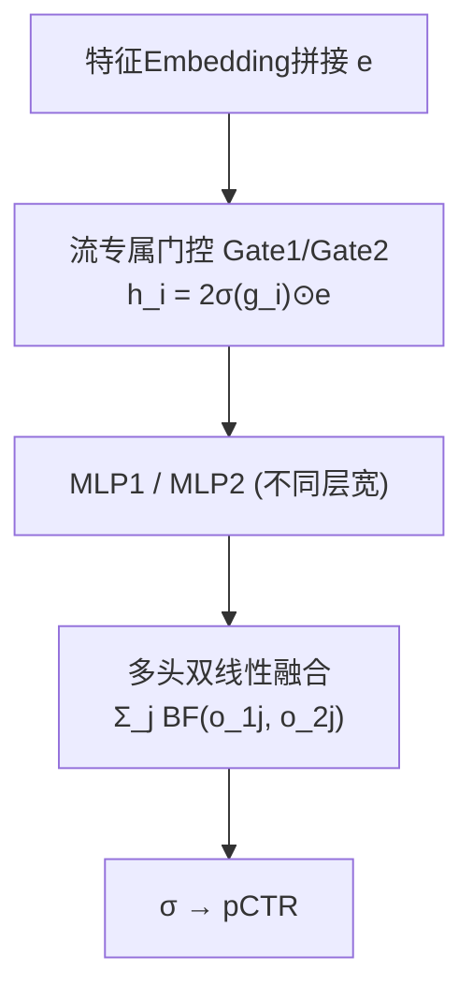
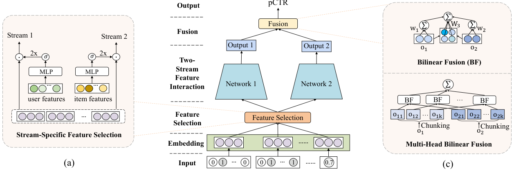

# FinalMLP: An Enhanced Two-Stream MLP Model for CTR Prediction (增强双流 MLP 的点击率预估模型)

- **会议/期刊**: AAAI 2023
- **作者与机构**: Kelong Mao (人大高瓴)、Jieming Zhu (华为诺亚方舟实验室)、Liangcai Su (清华) 等
- **推荐链路定位**: 精排 (CTR 预估)
- **研究方向**: CTR/CVR 预估与特征交叉
- **论文原文**: [论文原文链接](https://arxiv.org/abs/2304.00902v4)
- **开源代码**: [开源代码仓库链接](https://reczoo.github.io/FinalMLP)

## TL;DR (1分钟核心速览)

本文质疑"MLP 学不好乘性特征交叉、必须设计 CrossNet/CIN 类显式交叉流"这一主流共识：作者实证发现**两个纯 MLP 并联**（DualMLP）调好超参后已能比肩甚至超过 DCNv2、xDeepFM 等精细两流模型。为此提出 FinalMLP，插入**流专属特征门控**（差异化两流输入）与**多头双线性融合**（显式建模流级二阶交互）。在 Criteo/Avazu/MovieLens/Frappe 四个基准上 AUC 分别达 81.49/76.66/97.20/98.61，全线 SOTA，Avazu 超 DCNv2 0.12 个点，线上 A/B 平均 CTR +1.6%。

## Background & Motivation (背景与核心矛盾)

- **主流范式**: 两流结构（DeepFM、DCN、xDeepFM、AutoInt+、AFN+、MaskNet、EDCN）成为工业标配：一流做显式交叉、另一流用 MLP 做隐式交叉，最后用求和/拼接融合两流输出。
- **前人局限**: ① 几乎所有工作只对比"两流变体 vs. 单 MLP"，**从未与"两条 MLP 并联"做过公平对比**，因此 MLP 隐式交互的表达力被系统性低估；② 融合层仅做一阶线性组合，$\hat{y}=\sigma(\mathbf{w}^\top F(o_1,o_2))$，白白丢弃流级交互。
- **核心洞察 (Key Insight)**: 重跑实验（表 3）显示，单 MLP 在 Criteo/MovieLens/Frappe 上已是所有显式交叉网络中的最优或次优；两流模型的收益本质来自**流间差异性 (diversity)**，而非特有交叉算子本身。
- **本文切入点**: 既然 MLP 足够强，就沿"加大流差异 + 强化流级融合"两个方向把 DualMLP 做深，而不必再设计新交叉结构。

## Method (核心方法设计)

### 1. 整体框架 (Overall Architecture)

输入多域特征经 Embedding 拼接为 $\mathbf{e}$；两条 MLP 共享同一嵌入但接收**经各自门控重加权**的特征$h_1,h_2$，得到流输出$o_1,o_2$；融合层不再拼接求和，而用 k 组子空间的双线性融合并行打分再池化，经 sigmoid 输出 pCTR；端到端以 BCE 训练。两个模块均可即插即用于任意两流模型的输入端与输出端。

<figure class="paper-figure" markdown="span">
  <figcaption>图1：(a) 流特定特征选择的示意图。(b) 双流CTR模型的通用框架。(c) 多头双线性融合。</figcaption>
</figure>

### 2. 关键设计拆解 (Key Designs)

1. **流专属特征门控 (Stream-Specific Feature Gating)**：痛点在于两流输入相同 $h_1=h_2=\mathbf{e}$，两条 MLP 会退化为同质学习。借鉴 MMoE 的门控，用条件特征$x_i$（可学习参数 / 用户特征 / 物品特征）生成逐元素权重并乘 2 使均值落在 1：$g_i=\mathrm{Gate}_i(x_i),\ h_i=2\sigma(g_i)\odot\mathbf{e}$。以"用户视角 vs 物品视角"分别调制两流，即得到软特征选择与输入差异化，同时抑制噪声特征。

2. **多头双线性融合 (Multi-Head Bilinear Fusion)**：痛点在于求和/拼接融合无流级二阶交互。先引入完整双线性项 $\hat{y}=\sigma\big(b+\mathbf{w}_1^\top o_1+\mathbf{w}_2^\top o_2+o_1^\top\mathbf{W}_3 o_2\big)$（$o_1=o_2$时退化为 FM，$\mathbf{W}_3=\mathbf{I}$时为点积，$\mathbf{W}_3=\mathbf{0}$时退化为拼接）。为免$O(d_1d_2)$参数爆炸，将$o_1,o_2$各切 k 段子空间分别双线性再求和：$\hat{y}=\sigma\big(\sum_{j=1}^{k}\mathrm{BF}(o_{1j},o_{2j})\big)$，复杂度降至$O(d_1d_2/k)$，兼具多头多视角与 GPU 并行效率。

3. **训练目标、负采样与推理效率**：损失为常规 BCE $\mathcal{L}=-\frac{1}{N}\sum[y\log\hat{y}+(1-y)\log(1-\hat{y})]$；CTR 场景样本自带真实曝光负例，**不做负采样**。线上实测 k=8 时端到端时延 47ms，与部署基线 45ms 基本持平（k=1 则升至 70ms），说明多头切分是"降参又降延迟"的关键。

## Experimental Setup & Evaluation Protocol (实验设置与评估协议)

| 数据集 | #Instances | #Fields | #Features | 场景说明 |
| :--- | :---: | :---: | :---: | :--- |
| Criteo | 45,840,617 | 39 | 2,086,936 | 广告展示，高维稀疏 |
| Avazu | 40,428,967 | 22 | 1,544,250 | 移动广告点击 |
| MovieLens | 2,006,859 | 3 | 90,445 | 标签化用户-电影 |
| Frappe | 288,609 | 10 | 5,382 | App 使用上下文 |

- **数据划分与防穿越**: 复用 AFN 的预处理与**随机比例划分**（约 8:1:1），非时间切分；由于样本本身带真实曝光标签，不涉及采样穿越问题。
- **排名评测协议**: CTR 排序指标 **AUC**（非 Full-Ranking / Sampled Ranking 的 Top-N 协议），以 0.1 点 AUC 提升视为显著；报表为多次运行均值 + 标准差。
- **对比基线与超参**: 基线含单流（LR/FM/FFM/FwFM/HOFM/CrossNet/CIN/AutoInt/AFN/SAM）与两流（Wide&Deep、DeepFM、DCN、xDeepFM、AutoInt+、AFN+、DeepIM、MaskNet、DCNv2、EDCN）；嵌入维度 $d=10$，batch 4096，默认 MLP$[400,400,400]$，双流各设为 1~3 层以制造差异，学习率$1e^{-3}$或$5e^{-4}$，每模型约 30 次网格搜索，基于 FuxiCTR 复现并全部开源。

## Key Experimental Results (实验关键数据)

### 1. 主实验对比 (Main Results)

| Dataset | DeepFM | DCN | xDeepFM | AutoInt+ | MaskNet | DCNv2 | EDCN | DualMLP | **FinalMLP** | Improv. |
| :--- | :---: | :---: | :---: | :---: | :---: | :---: | :---: | :---: | :---: | :---: |
| Criteo | 81.38 | 81.39 | 81.39 | 81.39 | 81.39 | 81.42 | 81.47 | 81.42 | **81.49** | +0.02 |
| Avazu | 76.48 | 76.47 | 76.49 | 76.45 | 76.49 | 76.54 | 76.52 | 76.57 | **76.66** | +0.12 |
| MovieLens | 96.85 | 96.87 | 96.97 | 96.92 | 96.87 | 96.91 | 96.71 | 96.98 | **97.20** | +0.23 |
| Frappe | 98.42 | 98.39 | 98.45 | 98.48 | 98.43 | 98.45 | 98.50 | 98.47 | **98.61** | +0.11 |

### 2. 消融实验 (Ablation Study)

| 变体 | Avazu | MovieLens | Frappe | 说明 |
| :--- | :---: | :---: | :---: | :--- |
| DualMLP | 76.57 | 96.98 | 98.47 | 无任何插件 |
| w/o FS | 76.63 | 97.03 | 98.56 | 去掉流专属门控 |
| Sum | 76.58 | 96.95 | 98.51 | 融合换求和 |
| Concat | 76.61 | 96.92 | 98.52 | 融合换拼接 |
| EWP | 76.65 | 97.02 | 98.47 | 融合换逐元素积 |
| **FinalMLP** | **76.66** | **97.20** | **98.61** | 完整模型 |

多头数 k 敏感性：Criteo 上 $k=1$直接 **OOM**，$k=5/10/50$分别为 81.41/81.44/81.48；Avazu 以$k=10$最优 76.69，MovieLens 亦在$k=10$达 97.24，Frappe 则$k=1$ 最好 98.62。

### 3. 关键实验发现 (Key Findings)

1. **纯 MLP 被长期低估**：表 3 中单 MLP 在 Criteo(81.37)、MovieLens(96.78)、Frappe(98.33) 上均优于 SAM、CIN、AutoInt 等显式交叉网络，仅 Avazu 落后 SAM 0.02 点——显式交叉算子的必要性需要重新审视。
2. **融合模块比特征门控更关键**：去掉门控在 Avazu 掉 0.03、Frappe 掉 0.05，而换成 Sum/Concat 在 MovieLens 最多掉 0.28（97.20→96.92），说明流级二阶交互是主要增益来源；EWP 虽接近但仍不及多头双线性。
3. **k 不是越小越好**：完整双线性（$k=1$）在 Criteo 上因$1000\times1000$参数量直接 OOM，而中等$k$ 在多个数据集同时取得最优精度与最低时延（工业上 k=8 相比 k=1 时延 70ms→47ms，AUC 反而 72.83→72.93），即"多头切分"是精度与效率的双赢而非折中。

## Highlights & Limitations (亮点、对比与审稿批判)

- **与代表作对比 (vs. Prior Work)**: 相比 DCNv2/EDCN 继续深挖显式交叉或跨层桥接，本文反其道强调"两流只要够不一样 + 融合够二阶"即可；相比 AutoInt+ 用自注意力做高阶交叉，本文用零额外交叉算子换取更低的实现与部署成本；相比 DualMLP，增益全部来自输入差异化与融合算子两处轻量插件。
- **可迁移亮点**: ① 门控条件可选用户/物品/可学习参数，等价于"视角级软特征选择"，可低成本移植到多场景或多任务模型的专家输入端；② 多头双线性融合可作为通用"两塔输出融合层"，替代拼接用于双塔召回/粗排的向量交互打分。
- **审稿级局限批判**: ① 数据集划分沿用随机切分而非全局时间戳切分，存在特征分布穿越风险，AUC 增益（Criteo 仅 +0.02）在严格时序协议下可能不稳健；② 线上验证仅报告 5 天 CTR 均值 +1.6%，未给出 AUC/延迟分布与置信区间，且未讨论门控条件特征的在线可得性与特征漂移。

## Rating (四维评分)

- **方法创新性 (Novelty)**: ⭐⭐⭐ （两个插件均为成熟机制的巧妙移植——MMoE 门控 + CV 双线性池化，创新在"问题重定义"而非新算子）
- **评估协议与实验扎实度 (Protocol & Experiments)**: ⭐⭐⭐⭐ （四基准 + 30 次网格搜索 + 全基线开源复现 + 线上 A/B，但随机划分与 Criteo 增益微弱略减分）
- **写作与数学规范度 (Clarity & Rigor)**: ⭐⭐⭐⭐⭐ （双线性到 FM/点积/拼接的退化关系、复杂度 $O(d_1d_2/k)$ 推导清晰，插件式表述极利于复现）
- **工业落地与复现价值 (Industrial & Practical Value)**: ⭐⭐⭐⭐⭐ （代码与运行日志全开源，k=8 时延与基线持平且精度更高，属"零成本可上线"的强基线）

