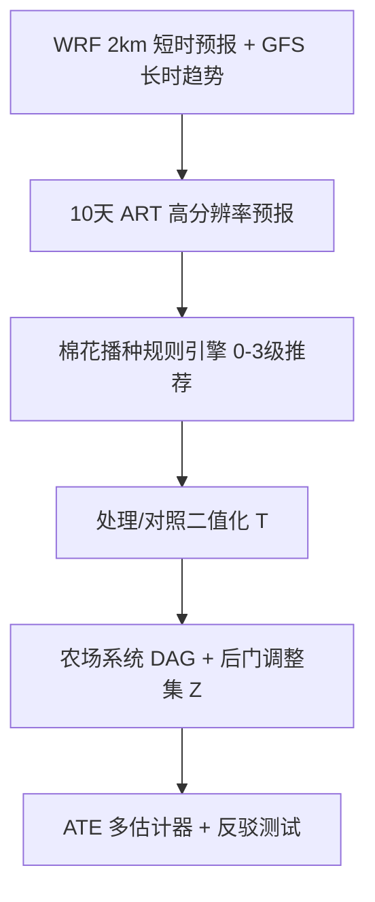
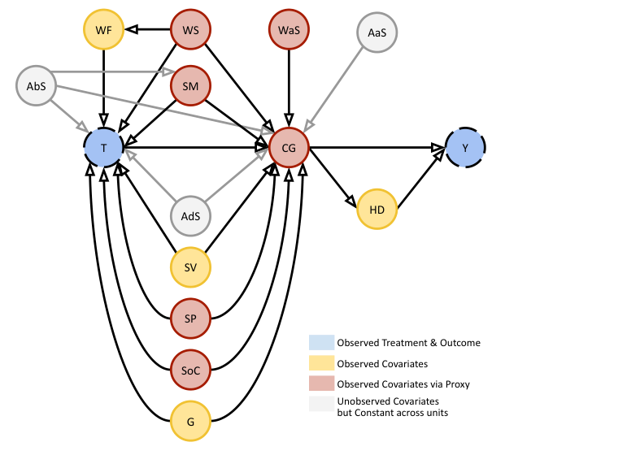

# Evaluating Digital Agriculture Recommendations with Causal Inference (基于因果推断的数字农业推荐评估)

- **会议/期刊**: AAAI 2023 (AI for Social Impact Track)
- **作者与机构**: Ilias Tsoumas, Georgios Giannarakis 等；BEYOND Centre / Athens Observatory、Wageningen University、ELGO DIMITRA
- **推荐链路定位**: 端到端决策支持与推荐影响评估（非电商排序链路）
- **研究方向**: 去偏公平、可信隐私与工业架构 / 因果推荐评估
- **论文原文**: [https://arxiv.org/abs/2211.16938v1](https://arxiv.org/abs/2211.16938v1)
- **开源代码**: 暂未开源

## TL;DR (1分钟核心速览)

针对数字农业推荐工具“只报预测精度、缺少对农民真实收益证据”的痛点，本文提出观测性因果推断评估框架，并以棉花最优播种推荐为案例：用 WRF/GFS 混合天气预报生成田块级播种建议，构建农场系统 DAG 与后门调整集，再用线性回归、匹配、IPS、T/X-learner 估计 ATE。171 块田实测显示，遵循推荐可显著增产约 12%–17%，且四类反驳测试均通过。

## Background & Motivation (背景与核心矛盾)

- **主流范式**: 数字农业工具多以遥感、IoT 与 AI 预测为核心，评估停留在预测/分类精度；推荐系统评估也常只看离线排序指标。
- **前人局限**: 田间随机试验昂贵、耗时且可能损害作物，导致数字农业推荐缺乏可量化收益证据；直接比较“遵循/未遵循推荐”的田块又会混入土壤、品种、水分等混杂偏差。
- **核心洞察 (Key Insight)**: 农业已有丰富领域知识，可把播种决策、天气、土壤、作物生长与产量编码为因果图；若调整集满足后门准则，就能用观测数据“模拟”随机试验。
- **本文切入点**: 以知识规则+高分辨率天气预报构建播种推荐，并用因果图、后门识别、多估计器与反驳测试评估其对产量的因果效应。

## Method (核心方法设计)

### 1. 整体框架 (Overall Architecture)

系统输入包括田块边界、品种、土壤属性、卫星 NDVI/NDWI、气象站观测与 WRF/GFS 数值天气预报。核心闭环为：先将 2 km WRF 短时预报与 GFS 长时趋势融合为 10 天 ART 预报；再按棉花播种温度规则输出 0–3 级推荐；将“推荐=3”的播种日记为处理组 $T=1$，其余为对照组$T=0$；随后依据农场系统 DAG 选后门调整集$Z$，用五类估计器计算产量 ATE，并以 Placebo、RCC、UCC、RSR 四类反驳测试检验稳健性。推理侧是每日推荐地图服务，主要开销在气象预报而非排序模型。

### 2. 关键设计拆解 (Key Designs)

1. **ART 高分辨率 10 天预报融合**：痛点在于 2 km 高分辨率预报通常只有 2–3 天，难以覆盖播种后 5–10 天窗口。本文用 GFS 计算趋势因子 $a_i=GFS_{day=i}/GFS_{day=1}$，再生成$ART_j=WRF_j$（$j\in\{1,2\}$），否则$ART_j=WRF_1\cdot a_j$。直觉是保留 WRF 局地高分辨率结构，同时用 GFS 延伸天气趋势，从而把建议细化到田块级；实测最高气温 MAE 为 ART 1.48℃、GFS 2.39℃，但最低气温 ART 1.74℃略差于 GFS 1.52℃。
2. **因果图与后门识别**：痛点是农民是否遵循推荐受土壤水分、土壤质地、品种、田块几何、播种日天气等共同影响。本文将处理 $T$、产量$Y$与混杂变量建成 DAG，按后门准则选$Z$，并用$P(y|do(t))=\sum_z P(y|t,z)P(z)$ 将干预分布转为可观测统计量。其有效性来自显式领域知识：把“推荐→产量”之外的主要共同原因纳入调整，减少选择偏差。
3. **多估计器与反驳测试**：痛点是无真实反事实，单一模型结论不可信。本文估计 $\text{ATE}=E[Y|do(T=1)]-E[Y|do(T=0)]$，同时用线性回归、距离匹配、IPS、T-learner、X-learner；倾向模型用逻辑回归，剔除$<0.2$或$>0.8$ 的极端得分以改善重叠。非排序任务，无负采样；T/X-learner 用随机森林，置信区间与 p 值用 1000 次 bootstrap。

<figure class="paper-figure" markdown="span">
  <figcaption>图 2：农场系统图，编码相关农业环境主体之间的因果关系。</figcaption>
</figure>

## Experimental Setup & Evaluation Protocol (实验设置与评估协议)

- **数据集与预处理**: 2021 年棉花生长季真实合作社数据；无 5-core 过滤，剔除极端倾向得分后剩 48 处理/37 对照。

| 数据集 | #Fields(单元) | #Treated | #Control | #Records/变量 | 特征/场景说明 |
| :--- | :---: | :---: | :---: | :---: | :--- |
| Cotton-2021 | 171 | 51 | 120 | 171 条产量 + 13 类品种 + 气象/卫星/土壤 | 单季观测；产量 1,250–6,960 kg/ha；均值 3,145 kg/ha |

- **数据划分与防穿越 (Splitting Strategy)**: 非 `Leave-One-Out`、非比例切分；采用单季观测队列，处理按推荐等级二值化，并用倾向得分裁剪保证重叠，不存在训练/测试时间切分。
- **排名评测协议 (Ranking Protocol)**: 不适用 `Full-Ranking` 或 `Sampled Ranking`；评价指标为 ATE（kg/ha）、95% CI 与 p 值，显著性标准 $p<0.05$。
- **对比基线与超参设置**: 线性回归、匹配、IPS、T-learner、X-learner；倾向模型为逻辑回归（accuracy 0.81、F1 0.64、ROC-AUC 0.88）；元学习器用随机森林；无 embedding 维度设定。

## Key Experimental Results (实验关键数据)

### 1. 主实验对比 (Main Results)

| 方法 | ATE (kg/ha) | 95% CI | p-value | Improv.% vs 均值 |
| :--- | ---: | :---: | ---: | ---: |
| Linear Regression | **546** | (211, 880) | 0.0015 | **+17.4%** |
| Matching | 448 | (186, 760) | 0.0060 | +14.2% |
| IPS weighting | 471 | (138, 816) | 0.0010 | +15.0% |
| T-Learner (RF) | 372 | (215, 528) | 0.0240 | +11.8% |
| X-Learner (RF) | 437 | (300, 574) | 0.0050 | +13.9% |

### 2. 消融/鲁棒性实验 (Ablation & Refutation)

本文无常规模块消融；以四类反驳测试检验因果估计稳健性。表中 Effect* 为反驳后新 ATE，p>0.05 表示未显著偏离原估计或 0。

| 方法 | Placebo Effect*(p) | RCC Effect*(p) | UCC 均值 | RSR Effect*(p) |
| :--- | :---: | :---: | :---: | :---: |
| Linear Regression | -25.74 (0.39) | 546 (0.49) | 85 | 543 (0.45) |
| Matching | 50.82 (0.39) | 432 (0.40) | 116 | 438 (0.48) |
| IPS weighting | 38.82 (0.40) | 470 (0.40) | 113 | 462 (0.45) |
| T-Learner (RF) | 9.26 (0.49) | 373 (0.46) | - | 353 (0.42) |
| X-Learner (RF) | 5.10 (0.50) | 430 (0.37) | - | 409 (0.36) |

### 3. 关键实验发现 (Key Findings)

1. **增产效应跨方法一致为正**：五种估计器 ATE 落在 372–546 kg/ha，对应均值产量提升约 11.8%–17.4%；线性回归点估计最高，T-learner 最保守，说明结论不依赖单一模型假设。
2. **反驳测试全部通过**：Placebo 估计接近 0 且 p≈0.39–0.50；RCC/RSR 与原 ATE 无显著差异；UCC 下均值仍为正（85–116 kg/ha），说明中等强度未观测混杂会衰减但不反转效应。
3. **推荐质量与数据重叠共同支撑结论**：ART 最高温 MAE 优于 GFS，倾向裁剪后处理/对照分布仍有良好重叠；但单合作社、同质化农艺实践使估计更接近“该场景内部有效”，外推需谨慎。

## Highlights & Limitations (亮点、对比与审稿批判)

- **与代表作对比 (vs. Prior Work)**: 相较仅做技术精度评估的农业决策支持系统，本文首次把“推荐对产量的经验影响”作为一等评估目标；相较传统田间 RCT，它以因果图+后门准则低成本模拟实验；相较普通推荐离线评测，它直接估计真实收益而非点击/排序指标。
- **可迁移亮点**: “DAG+后门调整集+多估计器+反驳测试”可迁移到医疗、金融、教育等决策支持推荐；WRF/GFS 趋势融合也可用于其他高分辨率长时气象-dependent 推荐。
- **审稿级局限批判**: ① 非随机试验，仍依赖无未观测混杂、变量代理有效等强假设，且单季单合作社导致外部效度有限；② 将 0–3 级推荐二值化丢失序数信息，且未报告推荐覆盖度、农民遵从成本等；③ 无开源代码，复现依赖合作社数据与高分辨率气象预报。

## Rating (四维评分)

- **方法创新性 (Novelty)**: ⭐⭐⭐⭐ （首次将因果图、多估计器与反驳测试用于数字农业推荐影响评估，但因果工具本身多为已有方法组合）
- **评估协议与实验扎实度 (Protocol & Experiments)**: ⭐⭐⭐⭐ （真实 171 块田、5 类估计器、4 类反驳与倾向裁剪较完整；但缺少 RCT 与跨区域外部验证）
- **写作与数学规范度 (Clarity & Rigor)**: ⭐⭐⭐⭐ （DAG、调整集、变量来源与 ATE 定义清晰，公式简洁；部分代理变量与恒定实践假设需领域专家背书）
- **工业落地与复现价值 (Industrial & Practical Value)**: ⭐⭐⭐⭐ （系统已在合作社业务部署，框架可复用；但无开源代码且依赖高分辨率气象与高质量田块记录）

