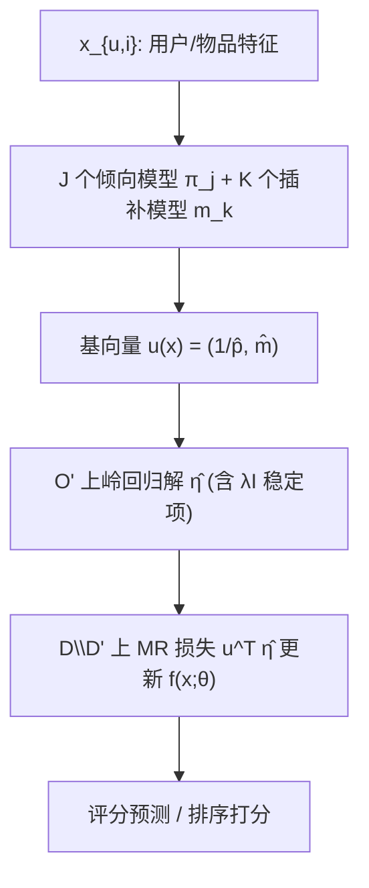

# Multiple Robust Learning for Recommendation (推荐中的多重稳健学习)

- **会议/期刊**: AAAI 2023
- **作者与机构**: Haoxuan Li, Quanyu Dai, Yuru Li, Yan Lyu, Zhenhua Dong, Xiao-Hua Zhou, Peng Wu（北京大学 / 华为诺亚方舟实验室 / 北京工商大学）
- **推荐链路定位**: 精排（评分预测与排序的无偏训练目标）
- **研究方向**: 去偏公平、可信隐私与工业架构 / 协同过滤
- **论文原文**: [https://arxiv.org/abs/2207.10796v4](https://arxiv.org/abs/2207.10796v4)
- **开源代码**: [https://gitee.com/mindspore/models](https://gitee.com/mindspore/models)

## TL;DR (1分钟核心速览)

针对 MNAR 数据下 IPS 依赖单一倾向模型、EIB 依赖单一插补模型、DR 在两者同时轻度错设时偏差反被放大这一痛点，本文提出多重稳健（MR）估计器：把 $J$个逆倾向与$K$个插补误差拼成基向量$\mathbf{u}(x)$，在观测样本上岭回归求组合系数$\hat{\eta}$，使估计在"任一模型或其线性组合正确"时无偏。在 Coat / Yahoo 的 MNAR 训练-MAR 全库测试协议下，MF 与 NCF 两种骨干上 MSE、AUC、nDCG@10 全面超越 IPS/SNIPS/DR/DR-JL/MRDR-JL/CVIB/DIB，Yahoo+NCF 的 nDCG@10 由 0.7864 提升至 0.8112（+3.2%）。

## Background & Motivation (背景与核心矛盾)

- **主流范式**: 以 IPS/SNIPS 做倾向加权、以 EIB 做误差插补，再用 DR 把二者乘性组合，实现"二者之一正确即无偏"的双重稳健；后续 MRDR-JL、CVIB、DIB 均为 DR 的增强变体。
- **前人局限**: ① 插补模型在**曝光事件**上训练却用于**未曝光事件**，分布差异大时插补误差极大；② 未观测混淆因子导致倾向分数估计不准。Tan (2007) 已指出：当两个模型同时轻度错设时，DR 的偏差甚至可能比单一估计器更严重。
- **核心洞察 (Key Insight)**: 工业场景里天然存在大量候选倾向/插补模型，与其赌"哪一个是正确的"，不如把它们线性组合起来——只要真实倾向或真实误差落在候选模型张成的空间内即可无偏，这是一个远比 DR 宽松的可识别条件。
- **本文切入点**: 将"选模型"转成"估组合系数"，把 DR 的插补项 $\hat{m}_{u,i}$替换为数据自适应的$\mathbf{u}^T\hat{\eta}$，并从推广误差界反推出正则化稳定化训练。

## Method (核心方法设计)

### 1. 整体框架 (Overall Architecture)

输入用户-物品特征 $x_{u,i}$，并行训练$J$个倾向模型$\pi_j(x;\hat{\alpha}_j)$（NB / NB-Uni / User 等）与$K$个误差插补模型$m_k(x;\hat{\beta}_k)$（MF / NCF），拼成基向量$\mathbf{u}(x)=(1/\hat{p}^1,\dots,1/\hat{p}^J,\hat{m}^1,\dots,\hat{m}^K)^T$。在一个采样批次$D'$的观测子集$O'$上用岭回归解出$\hat{\eta}$（此时$\hat{\eta}$视为常量、不参与反传），再在**另一**批次$D\backslash D'$上以$\mathbf{u}^T\hat{\eta}$作为 MR 损失更新预测模型$f(x;\theta)$与各插补模型，交替迭代至收敛。推理阶段仅保留$f(\cdot;\theta)$，额外开销为零。

### 2. 关键设计拆解 (Key Designs)

1. **多重稳健估计器 (MR Estimator)**：痛点是把无偏性押在单个模型规格上。MR 把理想损失的替代量写成可学习的线性泛函 $E_{\text{MR}}=|\mathcal{D}|^{-1}\sum_{(u,i)\in\mathcal{D}}\mathbf{u}^T(x_{u,i})\cdot\hat{\eta}$，其中$\hat{\eta}$由最小化$\sum_{(u,i)}o_{u,i}\{e_{u,i}-\mathbf{u}^T\hat{\eta}\}^2$得到。由一阶条件可推出对任意$j$有$E_{\text{MR}}=|\mathcal{D}|^{-1}\sum o_{u,i}e_{u,i}/\hat{p}^j_{u,i}+|\mathcal{D}|^{-1}\sum(1-o_{u,i}/\hat{p}^j_{u,i})\mathbf{u}^T\hat{\eta}$；只要某个倾向正确，末项依概率收敛到 0，即得$E_O[E_{\text{MR}}]\to E_{\text{ideal}}$。直觉上，MR 用**观测数据自己学出**误差的最优线性预测，而不是相信某个固定插补器。
2. **增强的双重稳健性与偏差收缩**：Theorem 2 证明当 $J=K=1$时 MR 即 DR 的严格改进版——若$e_{u,i}$可由$\hat{m}_{u,i}$与$1/\hat{p}_{u,i}$线性表示，MR 无偏而 DR 有偏；若插补完全正确则二者等价（$\hat{m}=\mathbf{u}^T\hat{\eta}$）。Theorem 3 给出偏差形式$\text{Bias}\propto\left|\sum(1-p_{u,i}\sum_j w_j/\hat{p}^j_{u,i})(e_{u,i}-\mathbf{u}^T E_O[\hat{\eta}])\right|$，两个因子分别由**最优线性组合**逼近$1/p$与$e$，而 DR 只能用单一模型逼近，故 MR 偏差更小。
3. **稳定化交替学习与训练目标**：Theorem 4/5 的尾界与推广误差界均正比于 $\max(\Gamma-1,M)\cdot\|\hat{\eta}\|_1$，故采用岭回归替代 OLS：$\hat{\eta}=\big[\sum_{O'}\mathbf{u}\mathbf{u}^T+\lambda\mathbf{I}\big]^{-1}\big[\sum_{O'}\mathbf{u}e\big]$（式 6），$\lambda$同时抑制$\|\hat{\eta}\|_1$并避免$\sum\mathbf{u}\mathbf{u}^T$奇异。预测模型损失为$\mathcal{L}_{\text{MR}}(\theta;\hat{\alpha},\hat{\beta})=\sum_{(u,i)\in\mathcal{D}\backslash\mathcal{D}'}\mathbf{u}^T\hat{\eta}(\theta)$，各插补模型用$\mathcal{L}_{e_k}=L^{-1}\sum_l (m_k(x;\beta_k)-e_{u,i})^2/\hat{p}^j_{u,i}$加权拟合；**样本分裂**（$\hat{\eta}$ 与 MR 损失用互斥批次）是严格无偏的必要条件。负采样方面无 BPR/InfoNCE 式负样本，全部为全库评分回归。

## Experimental Setup & Evaluation Protocol (实验设置与评估协议)

- **数据集与预处理**:

| 数据集 | #Users | #Items | #Interactions | 稀疏度/密度 | 特征/场景说明 |
| :--- | :---: | :---: | :---: | :---: | :--- |
| Coat | 290 | 300 | 6,960 训练 / 4,640 测试 | 8.0% / — | 五星评分；训练集 MNAR、测试集 MAR（16 件随机抽样） |
| Yahoo | 15,400 | 1,000 | 311,704 训练 / 54,000 测试 | 2.0% / — | 歌曲评分；训练 MNAR、测试 MAR（每人 10 首随机） |
| ML-100k (半合成×3) | 943 | 1,682 | 100,000 | 6.3% | 由 ML-100k 注入递增曝光偏置生成 -1/-2/-3 |

- **数据划分与防穿越**: 采用"**偏置训练集 + 无偏 MAR 测试集**"的双集协议（Coat/Yahoo 官方划分），而非 Leave-One-Out；半合成数据按递增曝光偏置重加权生成，用于测量随偏置强度的性能衰减。
- **排名评测协议**: 测试集为独立采样的 MAR 评分矩阵，指标 AUC 与 nDCG@5/10 在**完整测试物品集**上计算（相当于 Full-Ranking 无偏排序），MSE 衡量评分精度；不存在负采样候选集。
- **对比基线与超参设置**: 骨干为 MF 与 NCF；基线 8 个——Naïve、IPS、SNIPS、DR、DR-JL、MRDR-JL、CVIB、DIB；Adam 优化，超参（含 $\lambda$）在训练集切出的验证集上网格搜索。

## Key Experimental Results (实验关键数据)

### 1. 主实验对比 (Main Results)

| 方法 | Coat-MF MSE↓ | Coat-MF AUC↑ | Coat-MF nDCG@10↑ | Coat-NCF MSE↓ | Coat-NCF AUC↑ | Yahoo-NCF MSE↓ | Yahoo-NCF AUC↑ | Yahoo-NCF nDCG@10↑ |
| :--- | :---: | :---: | :---: | :---: | :---: | :---: | :---: | :---: |
| Backbone | 0.2405 | 0.7028 | 0.6858 | 0.2116 | 0.7661 | 0.3318 | 0.6771 | 0.7722 |
| +IPS | 0.2251 | 0.7152 | 0.6934 | 0.2002 | 0.7692 | 0.1706 | 0.6882 | 0.7776 |
| +SNIPS | 0.2262 | 0.7082 | 0.6861 | 0.1920 | 0.7700 | 0.1697 | 0.6893 | 0.7810 |
| +DR | 0.2325 | 0.7121 | 0.6938 | 0.2146 | 0.7523 | 0.1702 | 0.6890 | 0.7779 |
| +DR-JL | 0.2312 | 0.7110 | 0.6907 | 0.2071 | 0.7612 | 0.2396 | 0.6811 | 0.7653 |
| +MRDR-JL | 0.2301 | 0.7157 | 0.6970 | 0.2036 | 0.7629 | 0.2340 | 0.6834 | 0.7681 |
| +CVIB | 0.2201 | 0.7247 | 0.7030 | 0.2060 | 0.7661 | 0.3055 | 0.6748 | 0.7817 |
| +DIB | 0.2334 | 0.7104 | 0.6986 | 0.2030 | 0.7681 | 0.2849 | 0.7007 | 0.7864 |
| **+MR (Ours)** | **0.2106** | **0.7356** | **0.7343** | **0.1945** | **0.7737** | **0.1676** | **0.7026** | **0.8112** |
| Improv.% | +4.3% | +1.5% | **+4.4%** | +1.3% | +0.5% | +1.2% | +0.3% | **+3.2%** |

（Coat-MF 上相对最强基线 CVIB，Coat-NCF 相对 SNIPS，Yahoo-NCF 相对 DIB 计算提升幅度。）

### 2. 消融实验 (Ablation Study)

Coat 数据集、MF 骨干下候选模型数量/类型的影响：

| 配置 | MSE↓ | AUC↑ | nDCG@10↑ |
| :--- | :---: | :---: | :---: |
| 1×MF 插补 | 0.2295 | 0.7209 | 0.7206 |
| 3×MF 插补 | 0.2232 | 0.7332 | 0.7343 |
| **4×MF 插补** | 0.2223 | **0.7435** | **0.7563** |
| 5×MF 插补 | 0.2228 | 0.7421 | 0.7494 |
| **2×NCF 插补** | **0.2093** | 0.7381 | 0.7445 |
| MF+NCF 混合 | 0.2143 | 0.7332 | 0.7325 |
| 单 NB 倾向 | 0.2291 | 0.7219 | 0.7204 |
| **NB+NB-Uni+User** | 0.2228 | **0.7370** | **0.7347** |
| NB+NB（同类型冗余） | 0.2293 | 0.7216 | 0.7195 |

### 3. 关键实验发现 (Key Findings)

1. **收益集中在头部排序而非全局精度**：Yahoo+NCF 上 AUC 仅由 0.7007 升到 0.7026（+0.3%），但 nDCG@10 从 0.7864 跃至 0.8112（+3.2%）、MSE 从 0.2849 降到 0.1676；说明 MR 主要修正的是高曝光位物品的偏置打分，对整体排序序关系改善有限。
2. **对偏置强度更鲁棒**：半合成数据上偏置由 ML-100k-1 增至 -3 时，MR 的 nDCG@10 仅衰减 8.4% 与 14.4%，而 IPS 衰减 17.9%/36.7%、SNIPS 18.7%/35.3%、DR-JL 19.7%；即 MR 把强偏置下的性能损失压缩到同行的 40%–50%，这正是"多重稳健"的直接经验证据。
3. **候选模型的多样性比数量更关键**：同类插补从 4 增到 5 时 AUC 反降（0.7435→0.7421），而换上 2 个 NCF 插补使 MSE 从 0.2295 降到 0.2093；倾向侧同理，NB+NB 与单 NB 几乎无差异（0.7216 vs 0.7219），换成 NB+NB-Uni+User 才升到 0.7370——冗余同类模型只贡献噪声，异构模型才补足张成空间。

## Highlights & Limitations (亮点、对比与审稿批判)

- **与代表作对比 (vs. Prior Work)**: 相比 IPS/SNIPS（单倾向模型），MR 不依赖倾向完全正确；相比 DR/DR-JL（单倾向+单插补），MR 在两者同时轻度错设时仍可无偏（Theorem 2a），并把插补项交给数据自适应组合；相比 CVIB/DIB（信息瓶颈式正则），MR 是**估计器层面**的重构，模型无关、可直接套在任意骨干上。
- **可迁移亮点**: ① "多候选模型 + 岭回归组合系数"可迁移到 CTR/CVR 延迟反馈纠偏、跨域样本重加权等任何需要倾向分数的场景；② 用推广误差界 $\propto\|\hat{\eta}\|_1$ 反推正则项，是"理论界指导工程超参"的漂亮范例。
- **审稿级局限批判**: ① 无偏性依赖真实倾向/误差落在候选模型**线性张成空间**内，若全部候选严重错设，MR 与 DR 同样有偏（Theorem 3 只说明偏差更小而非消失）；② $\hat{\eta}(\theta)$依赖当前预测模型$e_{u,i}=y_{u,i}-f_\theta(x_{u,i})$，交替迭代下$\hat{\eta}$ 非平稳，收敛性未给证明，且样本分裂削弱了有效训练数据量；③ 实验仅覆盖 Coat/Yahoo/ML-100k 三个**评分预测**小数据集（Coat 仅 290 用户），未做工业级隐式反馈 CTR 或线上 A/B，AUC 提升幅度部分已在置信区间边缘。

## Rating (四维评分)

- **方法创新性 (Novelty)**: ⭐⭐⭐⭐ （把"多重稳健"从统计学的总体均值估计迁移到 RS 损失替代，Theorem 2 严格刻画了 MR 对 DR 的包含关系，理论增量清晰）
- **评估协议与实验扎实度 (Protocol & Experiments)**: ⭐⭐⭐⭐ （MNAR 训练/MAR 全库测试协议规范、MF+NCF 双骨干、半合成三档偏置，但缺少显著性检验与大规模隐式反馈验证）
- **写作与数学规范度 (Clarity & Rigor)**: ⭐⭐⭐⭐ （四条定理覆盖无偏性、DR 关系、偏差与推广界，推导完整；但 $\hat{\eta}(\theta)$ 的符号约定与交替训练中的梯度处理说明偏简）
- **工业落地与复现价值 (Industrial & Practical Value)**: ⭐⭐⭐ （MindSpore 官方仓库开源、推理零额外开销、天然复用线上多路候选模型；但需维护 $J+K$ 个辅助模型与样本分裂流程，工程改造成本不低）

