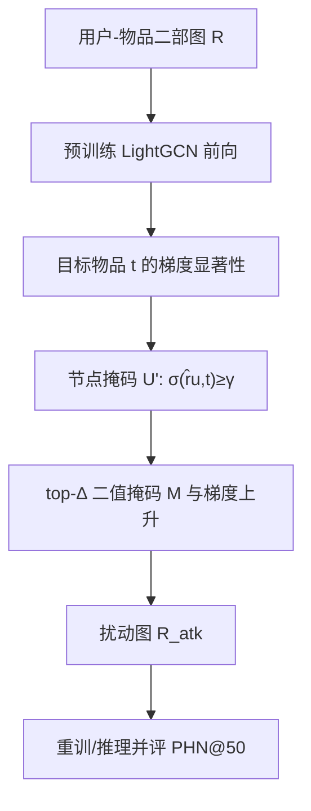

# Revisiting Item Promotion in GNN-based Collaborative Filtering: A Masked Targeted Topological Attack Perspective (重访基于GNN协同过滤的物品推广：掩码定向拓扑攻击视角)

- **会议/期刊**: AAAI 2023（目录标识；arXiv 2022）
- **作者与机构**: Yongwei Wang, Yong Liu, Zhiqi Shen；Nanyang Technological University
- **推荐链路定位**: 精排/排序（top-50 推荐列表攻击评估）
- **研究方向**: 去偏公平、可信隐私与工业架构 / 图神经网络与知识图谱推荐
- **论文原文**: [论文原文链接](https://arxiv.org/abs/2208.09979v1)
- **开源代码**: 暂未开源

## TL;DR (1分钟核心速览)

本文针对 GNN 协同过滤（LightGCN）在物品推广场景下的鲁棒性评估缺口，首次将“提升某低流行物品曝光”重述为白盒定向拓扑攻击：只改动少量已有用户-物品边，以梯度显著性选边，并用节点掩码抑制离散图梯度噪声。在 Gowalla/Yelp2018 的全库 top-50 排序协议下，$Q_{10}$目标物品、$\Delta_1$ 预算时 PHN@50 分别达 41.4/60.6，较最佳启发式基线提升约 4.5×/8.2×。

## Background & Motivation (背景与核心矛盾)

- **主流范式**: GNN-based CF 以 LightGCN 等在用户-物品二部图上传播嵌入，按内积排序推荐；物品推广攻击多沿用 shilling/data poisoning，通过注入伪用户提升目标物品。
- **前人局限**: 伪用户注入需大量假交互，且真实/虚假用户统计差异易被检测；更关键的是，现有模型特定攻击多针对 MF，难以评估 GNN-CF 的排序脆弱性。GNN 分类攻击也难直接迁移：推荐需同时操纵多物品排序、图更大且仅有二部交互边。
- **核心洞察**: 目标物品曝光可由少量“关键已有用户”的边扰动撬动；离散图导致梯度估计有噪，应只保留对目标物品高置信的用户节点；且梯度主要集中于目标物品列。
- **本文切入点**: 以定向拓扑攻击替代伪用户注入，叠加节点掩码与目标列梯度，实现小预算、可扩展的白盒攻击评估。

## Method (核心方法设计)

### 1. 整体框架 (Overall Architecture)

给定预训练 LightGCN 与二部图 $\mathbf{R}$，攻击者先前向得到用户/物品嵌入及目标物品得分；再对可扰动边求攻击损失梯度，按梯度显著性取 top-$\Delta$边并二值化，形成扰动图$\mathbf{R}^{atk}$；最后在扰动图上直接推理或重训后评 PHN@50。节点掩码在求梯度前筛掉低置信用户，目标列梯度把显存从$O(MN)$降到$O(M)$。

### 2. 关键设计拆解 (Key Designs)

1. **定向拓扑攻击目标**：把“最大化目标物品流行度”写成带 $\ell_0$预算的排序攻击，$\max_{\mathbf{R}^{atk}}\mathcal{L}_{atk}(f_\theta(\mathbf{R}^{atk})_t)$s.t.$\|\mathbf{R}^{atk}-\mathbf{R}\|_0\le\Delta$。损失同时拉高目标得分、压低用户 top-$K$中非目标物品：$\mathcal{L}_{atk}=\frac{1}{M}\sum_u[\lambda\log\sigma(\hat r_{u,t})-(1-\lambda)\sum_{j\in\Omega_K^u,j\ne t}\log\sigma(\hat r_{u,j})]$。这使攻击直接作用于排序竞争项，而非仅拟合目标边。
2. **节点掩码降噪**：离散图梯度含噪，先以 $\mathcal{U}'=\{u\mid\sigma(\hat r_{u,t})\ge\gamma\}$保留最可能被目标物品进入 top-$K$的用户，再在$\mathcal{U}'$上重算$\mathcal{L}_{mask}$；$\gamma=0$ 退化为原目标。直觉是只让“一步梯度上升后真能进榜”的用户贡献梯度，减少无关用户带来的方差。
3. **掩码选边与可扩展推理**：用 $\mathbf{R}^{atk}=\mathcal{P}(\mathbf{R}+\mathbf{M}\odot\mathrm{sign}(\nabla_{\mathbf{R}}\mathcal{L}_{mask}))$梯度上升，$\mathbf{M}$仅在正梯度且属于 top-$\Delta$的$(u,i)$上为 1。大图只对目标列$\mathbf{R}_{:,t}$反传，内存由$O(MN)$降至$O(M)$；攻击无额外负采样，开销为一次预训练模型前向+目标列反传。

## Experimental Setup & Evaluation Protocol (实验设置与评估协议)

- **数据集与预处理**:

| 数据集 | #Users | #Items | #Interactions | 密度 | 场景 |
| :--- | :---: | :---: | :---: | :---: | :--- |
| Gowalla | 29,858 | 40,981 | 1,027,370 | 0.084% | 位置社交签到 |
| Yelp2018 | 31,667 | 38,047 | 1,561,406 | 0.130% | 本地商户评论 |

- **数据划分与防穿越**: 沿用 LightGCN 官方预处理与 train/test 划分；攻击仅改训练图边，评估在固定测试用户上做 top-50 推荐，避免使用测试交互选边。
- **排名评测协议**: 全库排序 top-50（非采样），指标为 PHN@50——剔除新增用户后的目标物品命中频次；每个低流行集合随机取 30 个目标物品平均，固定 $\lambda=0.5,\gamma=0.95$。预算$\Delta_1^s=\deg(Q_{65})-\deg(Q_s)$，$\Delta_2^s=\bar d-\deg(Q_s)$。
- **对比基线与超参**: LightGCN 默认 BPR 训练，主模型 $L=3,d=64$、1000 epochs、seed=2020；基线为 RandFilter、IUFilter、RUFilter（原文可用基线仅 3 个，MF 专用攻击不适用于 GNN-CF）；未报告显著性检验。

## Key Experimental Results (实验关键数据)

### 1. 主实验对比 (Main Results)

| 方法 | Gowalla Q10 Δ1 | Gowalla Q10 Δ2 | Gowalla Q30 Δ1 | Yelp Q10 Δ1 | Yelp Q10 Δ2 | Yelp Q30 Δ1 |
| :--- | :---: | :---: | :---: | :---: | :---: | :---: |
| RandFilter | 0.7 | 0.5 | 2.2 | 0 | 0 | 0.2 |
| IUFilter | 0.5 | 0.3 | 1.9 | 0 | 0 | 0.2 |
| RUFilter | 9.1 | 15.6 | 14.2 | 7.4 | 19.1 | 4.8 |
| **Proposed** | **41.4** | **117.6** | **39.1** | **60.6** | **140.8** | **32.6** |
| Improv. vs best baseline | 4.5× | 7.5× | 2.8× | 8.2× | 7.4× | 6.8× |

### 2. 消融/鲁棒性验证 (Ablation & Robustness)

原文无标准 `w/o` 数值消融表；Fig.4 仅以曲线报告节点掩码 $\gamma$ 从 0 增至 0.95 时 PHN@50 显著上升。下表用重训练场景检验所选攻击边的稳定性（Δ1 预算，PHN@50）：

| 方法 | Gowalla Q10 | Gowalla Q30 | Yelp Q10 | Yelp Q30 |
| :--- | :---: | :---: | :---: | :---: |
| RandFilter | 8.8 | 12.4 | 5.0 | 6.4 |
| IUFilter | 1.9 | 5.0 | 1.2 | 1.7 |
| RUFilter | 5.2 | 11.3 | 5.1 | 3.6 |
| **Proposed** | **23.4** | **23.3** | **23.1** | **16.7** |

### 3. 关键实验发现 (Key Findings)

1. 小预算白盒攻击已很显著：Gowalla Q10 Δ1 下 Proposed 41.4 vs RUFilter 9.1（4.5×）；Yelp Q10 Δ1 为 60.6 vs 7.4（8.2×），说明仅改少量已有边即可撬动 top-50 排序。
2. 预算增大优势扩大：Gowalla Q10 Δ2 达 117.6 vs 15.6（7.5×），Yelp 为 140.8 vs 19.1（7.4×）；与图2趋势一致，GNN-CF 对大预算拓扑扰动更脆弱。
3. 重训练后仍有效：Gowalla/Yelp Q10 分别 23.4/23.1 vs 最佳基线 5.2/5.1（约 4.5×），且 Fig.4 显示 $\gamma$提高明显优于$\gamma=0$；扰动 12 个用户仅占 Gowalla 用户约 0.04%，整体推荐指标几乎不变，攻击隐蔽性高。

## Highlights & Limitations (亮点、对比与审稿批判)

- **与代表作对比 (vs. Prior Work)**: 不同于 shilling/数据投毒注入伪用户，本文首次以“已有用户边”的定向拓扑扰动做物品推广；相比 MF 专用攻击，直接适配 GNN-CF 的排序目标；相比 GNN 分类攻击，处理二部图多物品排序与大规模显存问题。
- **可迁移亮点**: 节点掩码按预测置信度筛子集可迁移到图对抗训练/鲁棒性评估；只回传目标列梯度的技巧可用于大规模推荐图的高效影响函数估计。
- **审稿级局限批判**: 一是白盒假设较强，黑盒虽用替代模型验证，但真实场景攻击者难获完整图与梯度；二是仅评估 LightGCN 类模型、固定 $\gamma=0.95$，对 SGL/NGCF 及自适应阈值、防御检测的覆盖不足，且未开源复现。

## Rating (四维评分)

- **方法创新性 (Novelty)**: ⭐⭐⭐⭐ （首次把 GNN-CF 物品推广重述为定向拓扑攻击，节点掩码降噪与目标列梯度有明确增量）
- **评估协议与实验扎实度 (Protocol & Experiments)**: ⭐⭐⭐ （两真实数据集与全库 top-50 协议合理，但基线仅 3 个、无显著性检验，消融以曲线为主）
- **写作与数学规范度 (Clarity & Rigor)**: ⭐⭐⭐⭐ （攻击目标、掩码与复杂度命题清晰，公式与算法闭环较好）
- **工业落地与复现价值 (Industrial & Practical Value)**: ⭐⭐⭐ （小预算与 O(M) 显存有部署评估价值，但白盒假设、无开源与防御讨论限制落地）

