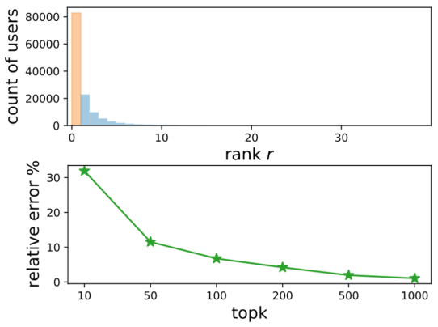
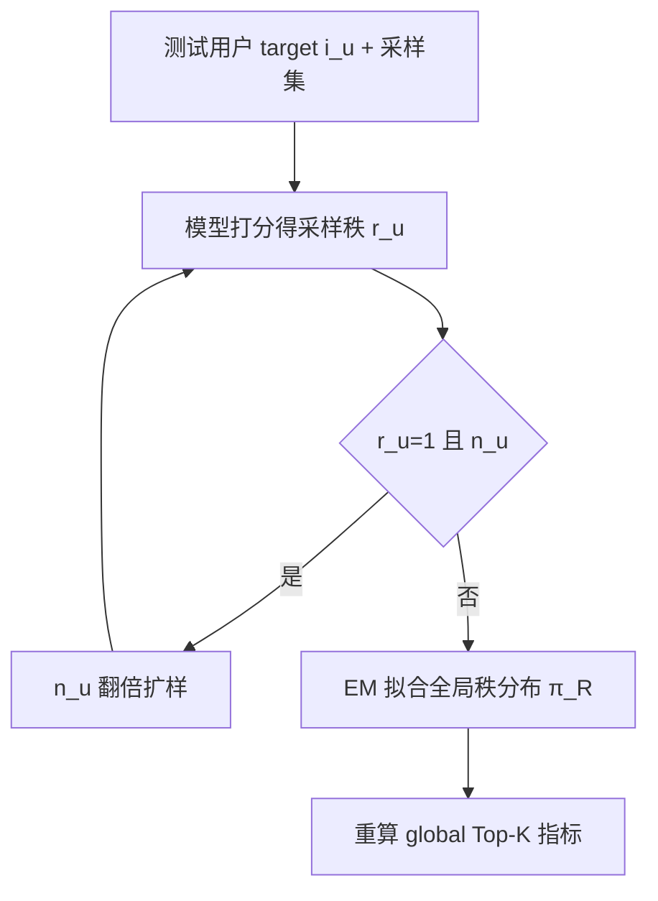
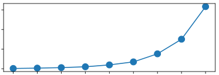

# Towards Reliable Item Sampling for Recommendation Evaluation (面向可靠物品采样的推荐评估)

- **会议/期刊**: AAAI 2023
- **作者与机构**: Dong Li, Ruoming Jin, Zhenming Liu, Bin Ren, Jing Gao, Zhi Liu; Kent State University, William & Mary, iLambda
- **推荐链路定位**: 离线评估（服务召回/精排的Top-K评测）
- **研究方向**: 去偏公平、可信隐私与工业架构 / 评测基准
- **论文原文**: [论文原文链接](https://arxiv.org/abs/2211.15743v3)
- **开源代码**: [开源代码仓库链接](https://github.com/dli12/AAAI23-)

## TL;DR (1分钟核心速览)

针对item-sampling评估与全库Top-K指标不一致、小$K$存在“盲区”的痛点，本文提出直接最小化MSE的估计器（MN-MLE/MN-MES），并用自适应加倍采样+EM处理不等样本量。在pinterest-20、yelp、ml-20m上，Recall@K相对误差由基础估计器的5%–18%降至约1%–6%，且自适应方法用200–300样本优于500/1000固定采样。

## Background & Motivation (背景与核心矛盾)

- **主流范式**: 用采样集内秩$r_u$替代全库秩$R_u$，直接算Recall/NDCG/AP@K，以降低全库排序开销。
- **前人局限**: Krichene与Rendle指出采样指标与全局指标不一致；BV估计器的bias-variance目标含启发式$\gamma$，且方差项未关联用户数$M$；Jin等用MLE/ME学秩分布，但小$K$仍受采样粒度限制。
- **核心洞察 (Key Insight)**: $n=100,N=10k$时估计粒度仅约$1\%$，$r_u=1$只说明目标在采样集靠前，其全局期望秩可能在100附近；$K$越小，盲区越严重。
- **本文切入点**: 直接对估计误差建模得到闭式估计器；对$r_u=1$用户自适应扩样，再用EM拟合混合二项分布恢复全局秩分布。

图1：采样集$n=100$时目标物品的样本秩分布（上）与MLE相对误差（下），小$K$盲区显著。
<figure class="paper-figure" markdown="span">
  <figcaption>图 1：上图为样本集大小 n = 100 时 ru 的分布，突出显示秩 r = 1。下图为不同 top-K 下 MLE 估计器的相对误差。结果由 EASE 模型（Steck 2019）在 ml-20m 数据集上获得。</figcaption>
</figure>

## Method (核心方法设计)

### 1. 整体框架 (Overall Architecture)

每个测试用户$u$保留目标物品$i_u$，从全库采样$n-1$个物品得采样集$\mathcal{I}_u$，推荐模型输出$i_u$在$\mathcal{I}_u$中的秩$r_u$。基础估计器先将采样秩分布映射为全局秩分布，再重算Top-K指标；自适应分支对$r_u=1$的用户反复扩样，EM在不等$n_u$下学习混合权重$\pi_R$，最终用$\hat{P}(R)$估计全局metric@K。训练不更新推荐模型，只校准评估器。

### 2. 关键设计拆解 (Key Designs)

1. **MSE最优估计器（MN-MLE/MN-MES）**：痛点是用采样秩直接替代全局秩有偏。令$\hat{T}=\sum_r\tilde{P}(r)\hat{\mathcal{M}}(r)$，对$\mathbb{E}[\hat{T}-T]^2$用Jensen上界分解为$L_1+L_2$，其中$L_2=\sum_R\frac{1}{M}\mathrm{Var}(\hat{\mathcal{M}}|R)$；闭式解为$\mathbf{x}=(\mathbf{A}^{\top}\mathbf{D}\mathbf{A}-\frac{1}{M}\mathbf{A}^{\top}\mathbf{A}+\frac{1}{M}\boldsymbol{\Lambda}_1)^{-1}\mathbf{A}^{\top}\mathbf{D}\mathbf{b}$。与BV的$L_2^{BV}=\sum_R P(R)\gamma\mathrm{Var}$不同，本文方差随用户数$M$增大自然下降，无需调$\gamma$。
2. **自适应采样破解盲区**：痛点是小$K$下$r_u=1$分辨率不足。算法在$r_u=1$时将$n_u$翻倍，直到$r_u\neq1$或达$n_{\max}$；平均成本$C_j=\frac{(M-\sum_{p<j}m_p)(n_j-n_{j-1})}{m_j}$，用于选$n_{\max}$。直觉是把采样预算集中到最可能落在头部却无法区分名次的用户。
3. **自适应EM与推理效率**：$r_u\sim\mathrm{Bin}(r_u-1;n_u-1,\theta_R)$，混合模型$p(r_u|\boldsymbol{\pi})=\sum_R\pi_R\mathrm{Bin}(\cdot)$；E步$\phi(R_{uk})=P(R_u=k|r_u;\pi^{old})$，M步$\pi_k^{new}=\frac{1}{M}\sum_u\phi(R_{uk})$。总损失即$\mathcal{L}=L_1+L_2$；无负采样；EM复杂度$O(t\sum_u n_u)$，对样本量线性。

图2：自适应采样在yelp上的样本效率随终端规模变化，约12.4%后平均成本快速上升。
<figure class="paper-figure" markdown="span">
  <figcaption>图 2：样本效率随终端规模（占总物品的比例）的变化。图示结果由 EASE 模型（Steck 2019）在 yelp 数据集上获得。</figcaption>
</figure>

## Experimental Setup & Evaluation Protocol (实验设置与评估协议)

- **数据集与预处理**: 正文未给统计，避免臆造，详见原文附录I。

| 数据集 | #Users | #Items | #Interactions | 稀疏度/密度 | 特征/场景 |
| :--- | :---: | :---: | :---: | :---: | :--- |
| pinterest-20 | 附录I | 附录I | 附录I | 未列 | 图像社交 |
| yelp | 附录I | 附录I | 附录I | 未列 | 本地商户 |
| ml-20m | 附录I | 附录I | 附录I | 未列 | 电影评分 |

- **数据划分与防穿越**: 采用“单目标物品隐藏”式测试：每个测试用户保留一个已点击target item，其余全库参与排序得$R_u$；未见时间切分细节。
- **排名评测协议**: 真值为`Full-Ranking`全库排序；估计协议为item sampling：采样$n$物品得$r_u$，100次重复，统计$K=1,\dots,50$的平均绝对相对误差，非Sampled正负比排序。
- **对比基线与超参设置**: 基线含MES、MLE、BV（$\gamma=0.01$）；推荐模型为EASE、MultiVAE、NeuMF、itemKNN、ALS；固定采样$n=100/500/1000$，$n_{\max}=3200$，自适应平均约260–310（pinterest/yelp）、700–800（ml-20m）；报告100次均值±标准差，未做$p<0.05$检验。

## Key Experimental Results (实验关键数据)

### 1. 主实验对比 (Main Results)

Recall@K平均相对误差（%，$n=100$；加粗为行内最优，末列为相对最佳基线变化）：

| 数据集/模型 | MES | MLE | BV | BV-MES | BV-MLE | MN-MES | MN-MLE | 最佳基线→本文 |
| :--- | :---: | :---: | :---: | :---: | :---: | :---: | :---: | :---: |
| pinterest/EASE | 5.86 | 5.54 | 8.11 | 5.05 | 5.14 | **5.00** | 5.10 | 5.05→5.00（-1.0%） |
| pinterest/MultiVAE | 4.17 | 3.34 | 2.75 | 2.89 | 2.88 | **2.75** | 2.75 | 2.75→2.75（0.0%） |
| pinterest/NeuMF | 5.17 | 4.28 | 4.23 | 3.83 | 3.84 | **3.60** | 3.76 | 3.83→3.60（-6.0%） |
| yelp/EASE | 8.08 | 7.89 | 18.60 | 6.10 | 6.56 | **4.84** | 5.61 | 6.10→4.84（-20.7%） |
| yelp/MultiVAE | 9.33 | 7.67 | 9.70 | 6.84 | 6.80 | **4.30** | 4.35 | 6.80→4.30（-36.8%） |
| yelp/NeuMF | 15.09 | 15.47 | 22.40 | **13.14** | 13.92 | 13.46 | 14.50 | 13.14→13.46（+2.4%） |

### 2. 消融实验 (Ablation Study)

固定采样 vs 自适应采样（NDCG@K平均相对误差，%；“最佳固定”为$n=500$下最优估计器）：

| 数据集/模型 | 最佳固定误差 | 最佳固定方法 | 自适应平均样本量 | 自适应MLE误差 | 误差变化 |
| :--- | :---: | :---: | :---: | :---: | :---: |
| pinterest/EASE | 3.87 | BV-MES | 307.74 | **1.46** | -62.3% |
| pinterest/MultiVAE | 2.66 | BV-MES | 286.46 | **1.67** | -37.2% |
| pinterest/NeuMF | 2.79 | BV-MLE | 259.77 | **1.73** | -38.0% |
| yelp/EASE | 4.03 | MN-MES | 340.79 | **3.55** | -11.9% |
| yelp/MultiVAE | 5.64 | MN-MLE | 288.70 | **5.09** | -9.8% |
| yelp/NeuMF | 8.43 | MN-MES | 290.62 | **4.43** | -47.4% |

### 3. 关键实验发现 (Key Findings)

- MN-MES/MN-MLE在多数行达到最优或次优：pinterest/EASE的Recall误差5.00%对BV 8.11%降约38%，yelp/EASE 4.84%对BV 18.60%降约74%，验证MSE闭式估计器优于启发式BV。
- 自适应MLE以约260–310样本达到NDCG误差1.46%（pinterest/EASE），而500固定样本最佳为3.87%，样本少约40%且误差降约62%，说明扩样预算集中在$r_u=1$用户可有效破解盲区。
- 模型选择可靠性同步提升：pinterest-20、$K=10$、NDCG下自适应MLE命中真实winner 84/100次，固定最佳MN-MLE为60/100次，小$K$估计精度直接转化为选模准确性。

## Highlights & Limitations (亮点、对比与审稿批判)

- **与代表作对比 (vs. Prior Work)**: 与BV同为bias-variance框架，但本文$L_2$含$\frac{1}{M}$且由MSE推导，去掉$\gamma$调参；与Jin等MLE/ME相比，EM推广到不等$n_u$，并新增自适应采样；与Li等Recall线性映射相比，不限于单一指标。
- **可迁移亮点**: “$r_u=1$则加倍”的自适应预算分配可迁移到任何Top-K采样估计；MSE闭式校准可用于NDCG/AP等指标的后处理。
- **审稿级局限批判**: 依赖先验$P(R)$的准确估计，$n_{\max}$仍需按数据集调参；仅讨论item sampling，未与user sampling结合，且正文缺少数据集统计与部分结果，复现需重查附录。

## Rating (四维评分)

- **方法创新性 (Novelty)**: ⭐⭐⭐⭐ （首次显式优化采样估计MSE，并给出与BV的方差项差异，理论增量清晰）
- **评估协议与实验扎实度 (Protocol & Experiments)**: ⭐⭐⭐⭐ （100次重复、三数据集五模型、相对误差与winner命中双协议，但缺显著性检验）
- **写作与数学规范度 (Clarity & Rigor)**: ⭐⭐⭐⭐ （MSE分解与EM推导完整，闭式解矩阵表达清楚；符号较多需附录辅助）
- **工业落地与复现价值 (Industrial & Practical Value)**: ⭐⭐⭐⭐ （开源代码，自适应采样显著降评估成本，但大规模EM与$n_{\max}$调参仍需工程权衡）

