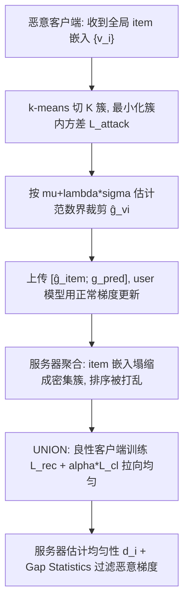
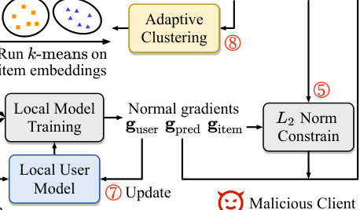

# Untargeted Attack against Federated Recommendation Systems via Poisonous Item Embeddings and the Defense (基于毒化物品嵌入的联邦推荐无目标攻击及其防御)

- **会议/期刊**: AAAI 2023
- **作者与机构**: Yang Yu, Qi Liu, Likang Wu, Runlong Yu, Sanshi Lei Yu, Zaixi Zhang（中国科学技术大学大数据分析与应用安徽省重点实验室 / 认知智能国家重点实验室）
- **推荐链路定位**: 召回（联邦 MF / SASRec 的 item 嵌入训练与服务器聚合环节）
- **研究方向**: 去偏公平、可信隐私与工业架构 / 自监督对比学习与交互去噪
- **论文原文**: [https://arxiv.org/abs/2212.05399v1](https://arxiv.org/abs/2212.05399v1)
- **开源代码**: [https://github.com/yflyl613/FedRec](https://github.com/yflyl613/FedRec)

## TL;DR (1分钟核心速览)

联邦推荐（FedRec）的分布式聚合使其易受投毒攻击，而已有无目标攻击要么依赖全量数据（集中式）要么需 20% 恶意客户端（通用 FL 攻击），在客户端高度 non-IID 下均失效。本文提出 ClusterAttack：恶意客户端上传使 item 嵌入向若干密集簇塌缩的梯度，并以正常梯度估计的范数界伪装；再提出 UNION，用客户端 InfoNCE 对比任务把 item 嵌入拉向均匀分布，服务器按更新后嵌入的均匀性做 Gap Statistics 双簇过滤。在 ML-1M / Gowalla 的 Leave-One-Out + Full-Ranking 协议下，仅 1% 恶意客户端即使 MF 的 HR@5 相对下降 30.94%/34.05%，SASRec 下降 39.44%/31.62%，且绕过 Krum/TrimmedMean/NormBound 等防御。

## Background & Motivation (背景与核心矛盾)

- **主流范式**: 以 FedAvg 聚合各客户端用 BPR 训练出的 item/predictor 梯度，user 嵌入留在本地不上传，形成"隐私保护但不透明"的推荐训练闭环。
- **前人局限**: (i) 集中式投毒（如生成假用户画像、扰动评分矩阵）要求攻击者掌握全量交互数据，FL 下不可行；(ii) 通用 FL 无目标攻击 LIE / Fang 需约 20% 恶意客户端才能造成显著退化，对百万级用户的系统不现实；(iii) 唯一面向 FedRec 的无目标工作 FedAttack 只做数据投毒（把最相似 item 当负样本），不改本地训练算法，攻击力受限。
- **核心洞察 (Key Insight)**: 排序分数由用户嵌入与 item 嵌入的内积决定，因此**无需针对具体目标 item**——只要把 item 嵌入空间的几何结构压成若干密集簇，簇内 item 分数趋同，全局排序即被破坏；反过来，"嵌入应尽量均匀铺开"是良性训练的自然不变量，可作为检测异常梯度的抓手。
- **本文切入点**: 攻击侧优化簇内方差并以范数裁剪隐藏自身；防御侧用对比学习强化均匀性，把该不变量变成可计算的过滤器。

## Method (核心方法设计)

### 1. 整体框架 (Overall Architecture)

恶意客户端在每轮收到全局 item 嵌入后，先用 k-means 切分为 $K$簇并计算簇内方差损失，对其求导得到恶意 item 梯度；再用本地数据算出的正常梯度范数分布估计范数上界，逐 item 裁剪伪装，只上传$[\hat{g}_{\text{item}}; g_{\text{pred}}]$，user 模型仍用正常梯度更新（避免自身行为异常）。良性客户端在 UNION 下把$L_{\text{rec}}+\alpha L_{\text{cl}}$一起训练，使 item 嵌入趋于均匀分布。服务器收到梯度后，对每个梯度做一次虚拟更新并抽样估计嵌入均匀性$d_i$，若 Gap Statistics 判定存在两个簇，则丢弃少数簇对应梯度，再交给 MultiKrum / NormBound 聚合。

<figure class="paper-figure" markdown="span">
  <figcaption>图1：我们的ClusterAttack流程。</figcaption>
</figure>

### 2. 关键设计拆解 (Key Designs)

1. **簇内方差最小化投毒（ClusterAttack 的核心算子）**: 前人加噪式攻击只做"整体平移"，对 BPR 的 pairwise 排序影响有限。本文转向嵌入几何：对每轮全局 item 嵌入做 k-means 得质心 $\{c_i\}_{i=1}^{K}$，令

$$L_{\text{attack}}=\sum_{i=1}^{K}\sum_{v_j\in C_i}\lVert v_j-c_i\rVert_2^2,\qquad \tilde{g}_{v_i}=\partial L_{\text{attack}}/\partial v_i$$

簇内方差下降意味着同簇 item 与任意用户的相似度趋同，排序区分度被抹平——这正是"无目标"退化的物理直觉：不需要抬高或压低某个 item，只需让模型失去分辨能力。为控制 $K$，作者用偏差修正 EMA$\hat{L}_{\text{attack}}$跟踪攻击损失，配$n_{\text{inc}}/n_{\text{dec}}$计数与阈值$R$，损失不降则增$K$（$\lfloor K+\sqrt{K_{\max}-K}\rfloor$），持续下降则减$K$，从而在不同数据集/模型上自适应用最优簇数。

2. **范数界伪装（stealthiness）**: 直接上传大幅值梯度会被 NormBound/MultiKrum 轻易识别。恶意客户端先用本地数据按 $L_{\text{rec}}$算出正常 item 梯度，统计其 L2 范数的均值$\mu$与标准差$\sigma$，采样$\lambda_i^{(j)}\sim U[0,3]$得个性化上界$b_i^{(j)}=\mu+\lambda_i^{(j)}\sigma$，再裁剪

$$\hat{g}_{v_i}^{(j)}=\tilde{g}_{v_i}\big/\max\!\left(1,\ \lVert \tilde{g}_{v_i}\rVert_2/b_i^{(j)}\right)$$

即把恶意梯度"伪装"成正常梯度的幅值分布内样本，规避基于范数/距离的拜占庭鲁棒聚合。

3. **UNION：客户端均匀性正则 + 服务器均匀性过滤**: 客户端对本地交互集 $\mathcal{I}_u$中每个$v_i$随机取同集另一 item 为正样本、从$\mathcal{I}\setminus\mathcal{I}_u$采$P$ 个负样本，加 InfoNCE

$$L_{\text{cl}}=-\sum_{i=1}^{L}\log\frac{e^{f(v_i)^{\top}f(v_i^{+})}}{e^{f(v_i)^{\top}f(v_i^{+})}+\sum_{j=1}^{P}e^{f(v_i)^{\top}f(v_j^{-})}}$$

依 Wang & Isola 的均匀性-对齐性分解，$L_{\text{cl}}$渐近优化$L_{\text{uniform}}=\mathbb{E}\,e^{-t\lVert f(x)-f(y)\rVert_2^2}$，与攻击目标方向相反。服务器端对第$i$个梯度先虚拟更新$\Theta^{(i)\prime}_{\text{item}}$，抽样$T$个 item 估计$d_i=\frac{2}{T(T-1)}\sum_{j<k}\lVert f(v_j)-f(v_k)\rVert_2^2$，用 Gap Statistics 判断$\{d_i\}$是否多簇：是则 k-means 二分并保留大簇，否则全保留。总损失$\mathcal{L}=L_{\text{rec}}+\alpha L_{\text{cl}}$，$\alpha=1$，$P=15$，$T=500$，$B=50$。训练负采样为 in-batch 随机负采样（免额外难负样本挖掘）；推理零额外开销（$L_{\text{cl}}$ 只作用于训练，攻击态只需一次 k-means 与一次求导）。

## Experimental Setup & Evaluation Protocol (实验设置与评估协议)

- **数据集与预处理**: 均采用 `10-core` 过滤（保留交互数 $\ge 10$ 的用户与 item）。

| 数据集 | #Users | #Items | #Interactions | 稀疏度/密度 | 特征/场景说明 |
| :--- | :---: | :---: | :---: | :---: | :--- |
| ML-1M | 6,040 | 3,706 | 1,000,209 | 4.47% | 电影评分，稠密，长序列 |
| Gowalla | 29,858 | 40,981 | 1,585,043 | 0.13% | 签到 POI，极稀疏 |

- **数据划分与防穿越 (Splitting Strategy)**: `Leave-One-Out`——每个用户最后一条交互作测试、倒数第二条作验证、其余作训练；每个用户视为一个客户端（天然 non-IID）。
- **排名评测协议 (Ranking Protocol)**: 无偏 `Full-Ranking`（全库未交互 item 作候选），指标 HR@5 / NDCG@5，且**只在良性客户端上统计**（恶意客户端指标不计入，避免攻击者自评污染）。
- **对比基线与超参设置**: 推荐模型 MF / SASRec（$d=64$，dropout 0.2，SASRec 最大序列长 200/100）；FedAvg + Adam，每轮随机选$n=50$客户端，最多 6000 轮；恶意比例默认$m=1\%$（另测 0.5%/5%）。攻击基线：数据投毒 LabelFlip、FedAttack；模型投毒 Gaussian、LIE、Fang。防御基线：TrimmedMean、Krum、MultiKrum、NormBound、FL-WBC，及本文 MultiKrum+UNION / NormBound+UNION。每组实验重复 5 次取均值，超参在验证集上调。

## Key Experimental Results (实验关键数据)

### 1. 主实验对比 (Main Results)

无防御下各无目标攻击的性能（括号为相对无攻击的相对下降，加粗为最优攻击）：

| 攻击方法 | MF/ML-1M HR@5 | MF/ML-1M NDCG@5 | MF/Gowalla HR@5 | MF/Gowalla NDCG@5 | SASRec/ML-1M HR@5 | SASRec/Gowalla HR@5 |
| :--- | :---: | :---: | :---: | :---: | :---: | :---: |
| No Attack | 0.03549 | 0.02226 | 0.02523 | 0.01697 | 0.10810 | 0.03251 |
| LabelFlip | 0.03561 (-0.34%) | 0.02238 (-0.54%) | 0.02541 (-0.71%) | 0.01711 (-0.82%) | 0.10857 (-0.43%) | 0.03270 (-0.58%) |
| FedAttack | 0.03358 (5.38%) | 0.02118 (4.85%) | 0.02371 (6.02%) | 0.01585 (6.60%) | 0.10013 (7.37%) | 0.03054 (6.06%) |
| Gaussian | 0.03555 (-0.17%) | 0.02224 (0.09%) | 0.02528 (-0.20%) | 0.01701 (-0.24%) | 0.10769 (0.38%) | 0.03226 (0.77%) |
| LIE | 0.03259 (8.17%) | 0.02062 (7.37%) | 0.02316 (8.20%) | 0.01571 (7.42%) | 0.09677 (10.48%) | 0.03008 (7.47%) |
| Fang | 0.03038 (14.40%) | 0.01897 (14.78%) | 0.02131 (15.54%) | 0.01448 (14.67%) | 0.08964 (17.08%) | 0.02797 (13.96%) |
| **ClusterAttack** | **0.02451 (30.94%)** | **0.01545 (30.59%)** | **0.01664 (34.05%)** | **0.01117 (34.18%)** | **0.06547 (39.44%)** | **0.02223 (31.62%)** |

`Improv.`（相对最强基线 Fang 的额外降幅）：MF/ML-1M +14.4pp、MF/Gowalla +17.5pp、SASRec/ML-1M +22.4pp、SASRec/Gowalla +17.0pp。

### 2. 消融实验 (Ablation Study)

以 MF/ML-1M 的 HR@5 为度量（5% 恶意客户端，No Attack 上限 0.03549）：

| 配置 | HR@5 | 说明 |
| :--- | :---: | :--- |
| No Attack（上限） | 0.03549 | 无攻击无防御 |
| ClusterAttack + No Defense | 0.01950 | 攻击下性能塌陷 45.0% |
| ClusterAttack + MultiKrum（无 UNION） | 0.01933 | 防御几乎无效 |
| ClusterAttack + NormBound（无 UNION） | 0.01950 | 防御几乎无效（范数已伪装） |
| ClusterAttack + MultiKrum **+ UNION** | 0.03291 | 距上限仅 7.3% |
| ClusterAttack + NormBound **+ UNION** | 0.03351 | 距上限仅 5.6% |
| ClusterAttack+CL + MultiKrum+UNION | 0.03378 | 攻击者模仿 CL 仍仅 4.82% 残余杀伤 |
| ClusterAttack+CL + NormBound+UNION | 0.03449 | 残余 -0.48%（几乎无害） |

补充：恶意比例 0.5% 时 ClusterAttack 仍降 15.49%（0.03549→0.03001），而 FedAttack/LIE/Fang 仅 1.6%/2.4%/3.5%；移除自适应聚类后攻击效果随初始 $K$剧烈波动，K 过小时$L_{\text{attack}}$ 在有限恶意客户端下无法收敛。

### 3. 关键实验发现 (Key Findings)

1. **攻击效率的量级差异来自"扰动方向"而非"扰动强度"**: 同类加噪式 FL 攻击在 1% 恶意比例下最多降 17.08%，ClusterAttack 达 39.44%（SASRec/ML-1M）；即使比例压到 0.5%，仍保持 15.49% 降幅，说明簇塌缩是一种与模型结构（MF 与 SASRec 同向受益）无关的通用退化机制。
2. **范数伪装使传统拜占庭鲁棒聚合完全失效**: ClusterAttack 的梯度在 PCA 空间与多数良性梯度同向，Krum/TrimmedMean 在**无攻击时**就因客户端 non-IID 误杀良性梯度而损伤性能；单独 MultiKrum/NormBound 面对攻击仍是 0.0193/0.0195（≈无防御）。接入 UNION 后回升至 0.03291/0.03351，恢复至无攻击上限的 92.7%/94.4%——说明"分布不变量"比"梯度距离"更可靠。
3. **均匀性正则同时是"加固"与"检测器"**: 撤掉客户端 $L_{\text{cl}}$时正常梯度与恶意梯度更新后的均匀性$d_i$分布重叠、无法二分；加上后$d_i$呈清晰双峰，Gap Statistics 才能判定并剔除少数簇。反之，让攻击者把$L_{\text{cl}}$ 混入攻击目标（ClusterAttack+CL），两个目标相互抵消，攻击降幅被压到 4.82%（NormBound+UNION 下甚至 -0.48%）。

## Highlights & Limitations (亮点、对比与审稿批判)

- **与代表作对比 (vs. Prior Work)**: 相对 FedAttack（仅数据投毒、不改本地算法、1% 下仅 5.38%），本文直接改梯度并用簇几何放大杠杆；相对 LIE / Fang 等通用 FL 攻击（需 ~20% 恶意客户端、只做均值方向偏移），本文只需 0.5–1% 且绕过范数类防御；相对 Krum/TrimmedMean 这类"距离离群"防御，本文指出其在 FedRec 的强 non-IID 下先误伤良性客户端，转而用嵌入分布均匀性作为判别维度。
- **可迁移亮点**: (i) 把"表征均匀性 (uniformity)"做成联邦聚合的健康度指标 + Gap Statistics 自适应阈值，可移植到任何上传嵌入类参数的联邦系统做异常客户端筛查；(ii) 用"本地正常梯度范数的 $\mu+k\sigma$ 采样"构造自适应裁剪上界，是一套通用且低成本的梯度伪装/水印式隐蔽化技巧。
- **审稿级局限批判**: (i) UNION 需修改全体良性客户端的训练目标（引入 $P=15$的 InfoNCE），在百万级客户端上带来额外本地算力与通信轮次成本，论文未给出收敛轮次与墙钟时间对比，也未讨论$\alpha$的敏感度；(ii) 威胁模型假设"攻击者不知聚合规则"，但攻击一旦被公开（含自适应$K$的反馈信号依赖服务器聚合结果的稳定性），攻击者可利用多轮$L_{\text{attack}}$反馈做探测；且服务器端$d_i$仅由$T=500$ 次采样估计，在 40k item 的 Gowalla 上估计方差偏大，极端稀疏场景下双簇可分性存疑；(iii) 实验仅覆盖 MF / SASRec 与两个公开集，未验证 LightGCN、序列 Transformer 变体或大规模工业数据，也未给出 5% 恶意比例以上（如 10%/20%）的退化曲线，泛化性与鲁棒性论证仍不完整。

## Rating (四维评分)

- **方法创新性 (Novelty)**: ⭐⭐⭐⭐ （用嵌入空间簇塌缩重新定义"无目标"攻击，并把对比学习的均匀性性质反向用作检测依据，攻防一体的对称设计颇为新颖）
- **评估协议与实验扎实度 (Protocol & Experiments)**: ⭐⭐⭐⭐ （Leave-One-Out + Full-Ranking 且只在良性客户端统计，5 次重复取均值，攻击/防御/比例/自适应四组消融齐全；扣分于缺少显著性检验与更大恶意比例扫描）
- **写作与数学规范度 (Clarity & Rigor)**: ⭐⭐⭐⭐ （攻击损失、裁剪公式、InfoNCE 与均匀性下界链条清晰，算法伪代码完整；服务器端 Gap Statistics 的判别阈值与失败率分析偏简）
- **工业落地与复现价值 (Industrial & Practical Value)**: ⭐⭐⭐⭐ （代码已开源，防御仅需客户端加一个对比任务 + 服务器抽样打分，可与 MultiKrum/NormBound 叠加；但大规模客户端的本地开销与采样估计成本仍需工程验证）

