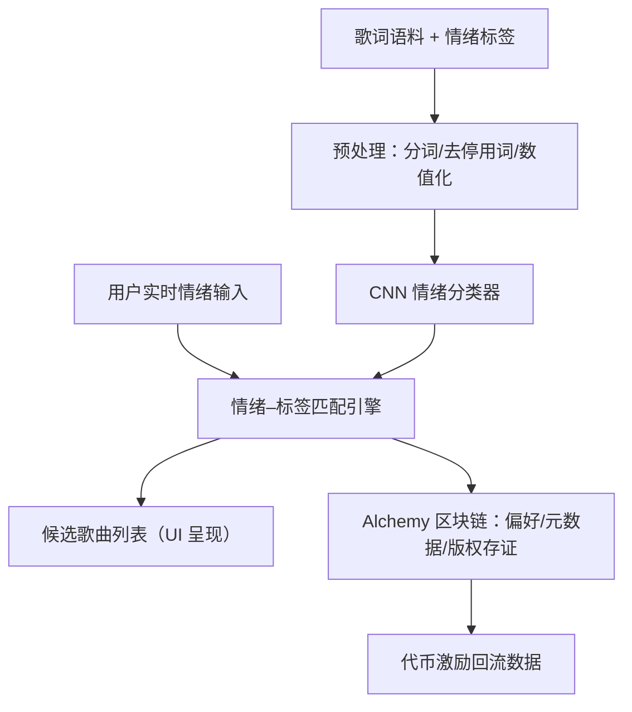

# Emotion-Aware Music Recommendation System: Enhancing User Experience Through Real-Time Emotional Context (情感感知音乐推荐系统：以实时情绪上下文提升用户体验)

- **会议/期刊**: AAAI 2023（作者自述为 6 页短文，arXiv preprint 2311.10796v1）
- **作者与机构**: Tina Babu、Rekha R Nair、Geetha A（Alliance University, Bengaluru, 计算机科学与工程系）
- **推荐链路定位**: 应用层端到端（情绪采集 → 内容侧情绪标签匹配 → 应用内呈现），不涉及召回/精排的排序模型设计
- **研究方向**: 多模态推荐 / 可信隐私与工业架构
- **论文原文**: [https://arxiv.org/abs/2311.10796v1](https://arxiv.org/abs/2311.10796v1)
- **开源代码**: 暂未开源

## TL;DR (1分钟核心速览)

论文针对传统音乐推荐只看历史收听行为、忽略用户"当下情绪"这一动态信号的痛点，提出一个以实时情绪为查询键的应用层推荐方案：用户在前端选择/表达情绪，CNN 对歌词文本做情绪分类得到歌曲的情绪标签，再由推荐引擎把"当前情绪"与"情绪标签一致的歌曲"对齐，同时用 Alchemy Blockchain API 加密存证偏好、元数据与版权归属。原文未披露数据集规模、划分方式与任何指标数值，验证仅为 5 张界面截图（happy/surprise/disgust/neutral/happy+sad）与"用户满意度调查反馈良好"的定性陈述，因此不存在可复现的相对提升数字。

## Background & Motivation (背景与核心矛盾)

- **主流范式**: 传统系统以协同过滤（CF）与内容过滤（CBF）为主，输入是历史收听序列与显式评分，情绪被完全排除在特征空间之外。
- **前人局限 1**: 情绪是快变状态而非慢变偏好，纯历史行为建模无法响应"此刻想听什么"，产生情绪–推荐错配。
- **前人局限 2**: 缺少情绪维度后，标签化程度低的冷门/未发现歌曲（long-tail）难以进入候选，而其情绪共鸣价值可能最高。
- **核心洞察 (Key Insight)**: 歌词文本本身携带稳定的情绪语义，可作为歌曲侧的情绪代理标签；把情绪当作"实时查询条件"而非"长期画像"，即可把推荐问题转化为条件匹配。
- **本文切入点**: 引入 Affect Emotion Recognition 思路（静态分类器 vs. HMM/DBN 动态分类器），以 CNN 静态文本分类器产出情绪标签，并将该标签作为推荐匹配的硬条件。

## Method (核心方法设计)

### 1. 整体框架 (Overall Architecture)

整体是一个五段式流水线而非单一可训练模型：先构建带情绪标签（mood tags）的歌词数据集并做分词、去停用词与数值化；再用 Keras/TensorFlow 搭建 CNN（卷积层–池化层–全连接层）训练歌词情绪分类器，输出情绪标签；用户在前端（neomorphic UI）输入或由系统实时识别当前情绪；推荐引擎按"用户情绪 vs. 歌曲情绪标签"做匹配，并按原文表述辅以协同过滤或内容过滤完成最终选歌；全过程的用户偏好、歌曲元数据与情绪标签通过 Alchemy Blockchain API 加密存证，并配合 Spotify API 拉取歌曲数据。推理阶段无向量检索与打分学习，匹配是一次标签等值查询，延迟由外部 API 调用主导。

### 2. 关键设计拆解 (Key Designs)

原文未给出任何显式数学表述，以下公式为按其文字描述所做的机制重构，用于对齐符号。

1. **歌词情绪分类器（歌曲侧情绪标签生成）**：痛点是歌曲没有情绪标注，无法与新用户的即时情绪对齐。做法是把歌词词序列嵌入为 $\mathbf{H}\in\mathbb{R}^{L\times d}$，经卷积核$\mathbf{W}_c$与最大池化得到句级表示，再经全连接输出$K$ 类情绪后验：

$\hat{\mathbf{y}}=\mathrm{softmax}\big(\mathbf{W}_o\,\mathrm{ReLU}(\mathbf{W}_c * \mathbf{H}+\mathbf{b}_c)+\mathbf{b}_o\big)$

直觉上，卷积核充当情绪词与否定/强化搭配的局部 n-gram 探测器，最大池化保留最强情绪证据，使短句情绪不被冗长叙事稀释。

2. **情绪条件匹配（Emotion-Conditioned Matching）**：痛点是 CF/CBF 的打分函数中没有情绪变量。原文用情绪标签做硬过滤后再接 CF/CBF，可抽象为：

$s(u,i\mid e)=\underbrace{\mathbb{I}\big[\mathrm{tag}_i=e\big]}_{\text{情绪门控}}\cdot\big(\alpha\,\mathrm{sim}(\mathbf{p}_u,\mathbf{q}_i)+(1-\alpha)\,\mathrm{sim}(\mathbf{p}_u,\mathbf{c}_i)\big)$其中$\mathbf{p}_u$为用户偏好向量，$\mathbf{q}_i$为行为协同向量，$\mathbf{c}_i$ 为内容（歌词/音频）向量。该门控把候选集从全库收缩为同情绪子集，代价是情绪误分类会直接造成召回空洞。

3. **训练目标、负采样与推理效率**：分类器用标准多类交叉熵 $\mathcal{L}=-\sum_{k=1}^{K}y_k\log\hat{y}_k$，训练无负采样概念（单标签多分类）；推荐侧未定义可学习损失，属规则/过滤式匹配，因此无负采样策略可讨论。推理开销主要在两条外部链路（Spotify API 拉取 + Alchemy 链上写入），原文称系统"可处理大量并发请求而不牺牲响应速度与准确率"，但未给出 QPS、P99 延迟或链上确认耗时的任何测量。

## Experimental Setup & Evaluation Protocol (实验设置与评估协议)

- **数据集与预处理**: 原文仅称"收集并精炼了带情绪标签/情绪标签的歌曲数据集"，未给出名称、来源、规模、类别分布与 5-core 之类过滤规则：

| 数据集 | #Users | #Items | #Interactions | 稀疏度/密度 | 特征/场景说明 |
| :--- | :---: | :---: | :---: | :---: | :--- |
| 未命名的歌词–情绪标注集 | 未报告 | 未报告 | 未报告 | 未报告 | 歌词文本 + 情绪标签；类别含 happy / sad / surprise / disgust / neutral 及 happy+sad 混合 |
| 用户情绪输入记录 | 未报告 | — | 未报告 | 未报告 | 前端交互采集，仅用于截图演示 |

- **数据划分与防穿越 (Splitting Strategy)**: 未说明。全文未提及训练/验证/测试比例、是否 `Leave-One-Out`、是否按 `全局时间戳切分`；由于分类任务与推荐任务共用同一情绪标签，存在标签泄漏风险且无法从文中排除。
- **排名评测协议 (Ranking Protocol)**: 未采用任何排名评测。既无 `Full-Ranking (全库未交互排序)`，也无 `Sampled Ranking`，未报告 HR@K、NDCG@K、Recall@K、MRR 等任一排序指标。所谓"评估"为图 2–图 6 的五张界面截图，展示系统对 happy、surprise、disgust、neutral、happy+sad 的识别结果，属单例定性演示，无统计效力。
- **对比基线与超参设置**: 只与"conventional recommendation techniques like collaborative and content-based filtering"做定性对比，未指名具体算法、未给参数；CNN 的卷积核数、窗口大小、Embedding 维度 $d$、学习率、epoch 全部未披露；无显著性检验（未做$p<0.05$ 或配对 t 检验）。

## Key Experimental Results (实验关键数据)

### 1. 主实验对比 (Main Results)

原文声称 CNN 用 accuracy、precision、recall、F1-score 四项指标评估，但正文与图表中未出现任何一项的具体数值。下表如实记录可核查状态（无可用数值，故无法加粗最优值或计算 `Improv.%`）：

| 系统 / 方法 | Accuracy | Precision | Recall | F1-score | 原文表述 |
| :--- | :---: | :---: | :---: | :---: | :--- |
| CNN 歌词情绪分类（本文） | 未报告 | 未报告 | 未报告 | 未报告 | 仅称"encouraging outcomes"、"valuable insights" |
| Collaborative Filtering | 未报告 | 未报告 | 未报告 | 未报告 | 定性称本文"precision 与个性化更优" |
| Content-based Filtering | 未报告 | 未报告 | 未报告 | 未报告 | 同上，无量化依据 |
| 情绪感知推荐引擎（整体） | 未报告 | 未报告 | 未报告 | 未报告 | 称用户满意度调查"affirmative reactions"，未给样本量与量表 |
| 区块链存证模块 | — | — | — | — | 仅图 7(a)(b) 展示 Alchemy 部署界面与"每日请求数"曲线，无吞吐/延迟数值 |

### 2. 消融实验 (Ablation Study)

原文不含消融实验。下表为对"关键组件是否存在可验证证据"的核查，而非性能消融：

| 配置 | 情绪门控 | 区块链存证 | 量化指标 | 结论 |
| :--- | :---: | :---: | :---: | :--- |
| Full system（原文） | ✓ | ✓ | ✗ | 仅界面截图，无法归因任一组件贡献 |
| w/o emotion（等价于传统 CF/CBF） | ✗ | ✓ | ✗ | 仅定性断言更差，无数字 |
| w/o blockchain | ✓ | ✗ | ✗ | 未讨论，隐私收益无度量 |
| w/o CNN（人工标签） | ✗ | ✓ | ✗ | 未讨论，分类器必要性未被检验 |

### 3. 关键实验发现 (Key Findings)

- **可量化的只有"缺失"本身**：全文 6 页、0 张数据表、0 个指标数值、0 组消融，主实验全部由 5 张界面截图（图 2–图 6）承载，故任何"精度提升"论断均无统计支撑。
- **情绪类别覆盖与演示不一致**：截图覆盖 happy/surprise/disgust/neutral/happy+sad 五类，其中 happy+sad 为混合情绪，说明分类器输出空间与评估口径未统一；若 $K$ 类设定含混合类，则交叉熵标签体系本身需重新定义。
- **系统收益被归因于交互而非算法**：作者把留存提升归因于"实时情绪捕获 + neomorphic UI + 代币激励"，三者同时变更且无 A/B 分流，无法排除 UI 与激励对留存的主要贡献，属典型混淆归因。

## Highlights & Limitations (亮点、对比与审稿批判)

- **与代表作对比 (vs. Prior Work)**: 相较矩阵分解/双塔类 CF 与纯内容过滤，本文唯一实质增量是把"情绪"提升为一等查询条件并落到可运行原型；但对比情感计算领域的标准做法（音频声学特征 + 动态分类器 HMM/DBN），本文退化为纯歌词文本的单模态静态 CNN，未融合声学/节拍等强情绪信号，多模态性名不副实。
- **可迁移亮点**: (1) 用"内容侧情绪标签 × 用户即时状态"做硬门控的两阶段过滤，可作为冷启动场景的低成本兜底召回；(2) 链上存证偏好与版权元数据，对 UGC 音乐平台的版权结算与偏好数据确权有借鉴意义。
- **审稿级局限批判**: (1) 评估完全不成立——无数据划分、无全库排序、无基线数值、无显著性检验，5 张截图不足以支撑任何推荐质量结论，且情绪分类与推荐匹配共用标签，存在标签泄漏；(2) 工程与隐私主张空转——区块链写入的确认延迟与吞吐与"实时"推荐目标天然冲突，原文未给任何延迟测量，且把用户情绪这一敏感数据上链的合规性（可删除权）未被讨论；此外混合情绪、情绪强度（valence-arousal 连续空间）与多情绪共存均未建模。

## Rating (四维评分)

- **方法创新性 (Novelty)**: ⭐⭐ （把情绪作为推荐查询条件的方向正确，但技术栈是 CNN 文本分类 + 标签过滤 + 区块链存证的拼接，无新算子、无理论或谱分析支撑）
- **评估协议与实验扎实度 (Protocol & Experiments)**: ⭐ （无数据集统计、无划分方式、无 Full-Ranking/Sampled Ranking、无基线数值、无消融、无显著性检验，证据仅 5 张界面截图）
- **写作与数学规范度 (Clarity & Rigor)**: ⭐⭐ （全文零公式、零符号定义、零复杂度分析，模块间数据流与匹配规则仅有文字描述，分类器超参与训练细节全缺）
- **工业落地与复现价值 (Industrial & Practical Value)**: ⭐⭐ （提供了可运行原型与 UI/链上集成的工程路径，但无开源代码、无数据、无超参，外部 API 依赖重，复现与线上部署价值受限）

