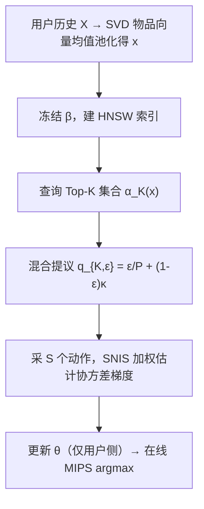
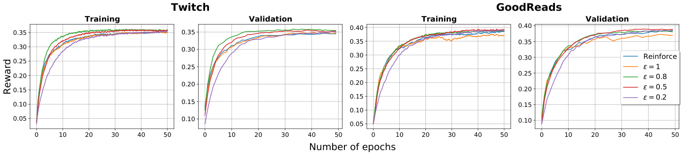

# Fast Offline Policy Optimization for Large Scale Recommendation (大规模推荐的高效离线策略优化)

- **会议/期刊**: AAAI 2023
- **作者与机构**: Otmane Sakhi, David Rohde, Alexandre Gilotte（Criteo AI Lab / CREST-ENSAE）
- **推荐链路定位**: 召回（softmax 策略的离线训练 + MIPS 在线检索）
- **研究方向**: 强化学习与动态探索推荐 / 协同过滤与双塔召回
- **论文原文**: [https://arxiv.org/abs/2208.05327v4](https://arxiv.org/abs/2208.05327v4)
- **开源代码**: [https://github.com/criteo-research/fopo](https://github.com/criteo-research/fopo)

## TL;DR (1分钟核心速览)

大规模推荐把推荐建模为离线 contextual bandit 的策略学习，但 softmax 策略梯度中的归一化常数 $Z_\theta(x)$与期望求和都需遍历全库$P$个物品，单步 SGD 复杂度$O(P)$，百万级目录下不可行。本文提出 FOPO：以协方差形式重写策略梯度消除$Z_\theta$，用自归一化重要性采样（SNIS）配合「均匀分布 + MIPS 检索 Top-$K$」的混合提议分布估计梯度，训练期即复用 HNSW 索引，复杂度降为$O(\log P)$。在 Twitch（79 万物品）与 GoodReads（233 万物品）的全库排序会话补全任务上，训练提速 5–25×（CPU 最多约 25×），策略平均奖励持平甚至更优。

## Background & Motivation (背景与核心矛盾)

- **主流范式**: 将推荐视为离线策略学习，目标 $\hat{R}(\pi_\theta)=\frac{1}{N}\sum_i \sum_{a}\pi_\theta(a|x_i)\hat{r}(a,x_i)$，奖励估计器可实例化为 IPS / DR / 裁剪变体，在线用$\arg\max_a f_\theta(a,x)$ + MIPS 毫秒级检索。
- **前人局限**: ①$\nabla_\theta\log\pi_\theta$含$Z_\theta(x)=\sum_b e^{f_\theta(b,x)}$，需全库求和；②REINFORCE 虽可用采样估计期望，但「从$\pi_\theta$采样」本身（含 Gumbel 技巧）同样是$O(P)$。二者叠加使每步梯度严格线性于目录规模。
- **核心洞察 (Key Insight)**: 策略梯度的归一化项可通过协方差恒等式彻底消去（Masrani et al. 2019 的 thermodynamic variational objective 思路）；而「采样」这一步可以用不依赖 $Z_\theta$的提议分布替代——只要该提议好采样、好评测、且贴近$\pi_\theta$。
- **本文切入点**: 固定物品 embedding（Assumption 1），使训练期即可建静态 HNSW 索引，用 Top-$K$近似 MIPS 构造混合提议$q_{K,\epsilon}$，把梯度估计的两次求和都限制在$K\ll P$与$S$ 个样本内。

## Method (核心方法设计)

### 1. 整体框架 (Overall Architecture)

输入为用户历史交互经 SVD 物品向量均值池化得到的上下文 $x$；物品侧 embedding$\beta$由协同过滤 SVD 预训练并**冻结**，仅学习用户侧变换$h_\theta(x)=\theta^\top x$。训练时先用$\beta$建 HNSW 近似 MIPS 索引，每步查询$h_\theta(x)$取 Top-$K$集合$\alpha_K(x)$，混合均匀分布构造提议$q_{K,\epsilon}$，从中采$S$个候选动作，用 SNIS 权重重加权后估计「奖励—打分梯度」的协方差，反传更新$\theta$。推理时同一索引做$\arg\max$ 检索，保证训练与部署打分路径一致。

### 2. 关键设计拆解 (Key Designs)

1. **协方差梯度：把归一化常数从梯度中消掉**：痛点是不论 IPS 还是 DR，$\nabla_\theta\log\pi_\theta$都要$Z_\theta(x)$。作者将$\nabla_\theta\log\pi_\theta(a|x)=\nabla_\theta f_\theta(a,x)-\mathbb{E}_{b\sim\pi_\theta}[\nabla_\theta f_\theta(b,x)]$代回对数技巧，得到对单一随机变量$a$ 的协方差形式：
$$\nabla_\theta\hat{R}_i(\pi_\theta)=\mathrm{Cov}_{a\sim\pi_\theta(\cdot|x_i)}\big[\hat{r}(a,x_i),\ \nabla_\theta f_\theta(a,x_i)\big]$$
直觉上，梯度只沿「奖励与相关性打分同向变动」的方向走，$Z_\theta$ 被差分自然抵消；但代价是期望变成双层期望，需多个样本，采样成本问题仍未解决。

2. **混合提议 + SNIS：把采样也做到 $O(\log P)$**：既然不能从$\pi_\theta$采样，就用可快速采样的提议$q$做自归一化重要性采样，$\mathbb{E}_{\pi_\theta}[g]\approx\sum_{s}\bar{\omega}_s g(a_s)$，$\omega_s=\frac{e^{f(a_s,x)}}{q(a_s|x)}$，$\bar\omega_s=\omega_s/\sum_{s'}\omega_{s'}$，从而绕开$Z_\theta$（代价是引入随$q$与$\pi_\theta$距离下降的偏差）。提议取「Top-$K$ softmax + 均匀」混合：
$$q_{K,\epsilon}(a|x)=\begin{cases}\frac{\epsilon}{P}+(1-\epsilon)\kappa(a|x), & a\in\alpha_K(x)\\ \frac{\epsilon}{P}, & \text{otherwise}\end{cases}$$
其中 $\kappa$是$\alpha_K(x)$上的重归一化 softmax。该设计三点契合要求：Top-$K$由近似 MIPS 给出故采样$O(\log P)$；评测只需$K$项求和；$\epsilon$使提议在训练早期（$\pi_\theta$近均匀）与后期（$\pi_\theta$ 集中在头部）都贴近目标策略，控制偏差与方差。

3. **训练目标、负采样与推理效率**：无显式负采样——由提议分布承担「负例供给」，SNIS 权重自动完成纠偏，最终更新量为
$$\text{grad}_\theta=\sum_{s=1}^{S}\bar{\omega}_s\big[\hat{r}_s-\bar r\big]\big[\nabla f_s-\overline{\nabla f}\big]$$
总损失即最大化 $\hat R(\pi_\theta)$（奖励估计器可插拔 IPS/DR）。单步复杂度$O(\log P + S\cdot L^2)$，与目录规模仅成对数关系；推理仍是一次近似 MIPS，$O(\log P)$。关键前提是 Assumption 1（冻结$\beta$）——索引只建一次，避免每步重建。

## Experimental Setup & Evaluation Protocol (实验设置与评估协议)

- **数据集与预处理**: 将用户-物品交互矩阵按会话切分；论文未采用 5-core 过滤，仅做会话对半划分。

| 数据集 | #Users | #Items（目录规模 P） | #Interactions | 稀疏度/密度 | 特征/场景说明 |
| :--- | :---: | :---: | :---: | :---: | :--- |
| Twitch | 500K | 790K | 未报告（用户-主播交互） | 未报告 | 直播平台会话补全 |
| GoodReads | 300K | 2.33M | 未报告（用户-书籍交互） | 未报告 | 图书推荐会话补全 |

- **数据划分与防穿越 (Splitting Strategy)**: **比例划分 + 会话内对半切分**。每个用户的交互会话随机等分为观测部分 $X$与补全部分$Y$；再整体划分 train/test。$X_{\text{train}}$用于 SVD 求$\beta$（维度$L\in\{10,100,1000\}$）与构造上下文，$Y$ 仅作奖励，测试集上下文与标签严格分离。
- **排名评测协议 (Ranking Protocol)**: **Full-Ranking（全库未交互排序）**，无采样：$R_{\text{test}}=\frac{1}{N_{\text{test}}}\sum_j \mathbb{I}[\arg\max_a f_\theta(a,x_j)\in Y_j]$，即 MIPS 检索 Top-1 的命中率（平均奖励），未做负采样近似。
- **对比基线与超参设置**: 基线为 REINFORCE（从真策略采样、精确 $O(P)$梯度）、$\epsilon=1$（纯均匀提议，最快但偏差大）及$\epsilon\in\{0.2,0.5,0.8\}$混合变体；另设「$\beta$可训练 vs 冻结」的对照。Adam，batch 32，lr$10^{-4}$（Twitch）/$5\times10^{-5}$（GoodReads），$K=256$，$S=1000$，跑 50 epoch；索引用 FAISS 的 HNSW。论文未报告显著性检验。

## Key Experimental Results (实验关键数据)

### 1. 主实验对比 (Main Results)

| 方法 | Twitch 奖励（50 epoch，$L{=}1000$） | GoodReads 奖励（50 epoch） | 单步复杂度 | 相对训练耗时 |
| :--- | :---: | :---: | :---: | :---: |
| REINFORCE（精确 $O(P)$） | ~0.31 | ~0.39 |$O(P)$ | 1×（基准） |
| 均匀提议 $\epsilon=1$| ~0.33 | ~0.38 |$O(\log P)$ | **最快** |
| 混合 $\epsilon=0.8$| **~0.35（最优）** | ~0.39 |$O(\log P)$| 与$\epsilon{=}1$ 同量级 |
| 混合 $\epsilon=0.5$| ~0.34 | **~0.40（最优）** |$O(\log P)$ | 同上 |
| 混合 $\epsilon=0.2$| ~0.32 | ~0.39 |$O(\log P)$ | 同上 |

（数值为原文图 2/3 上的近似读值，趋势与论文结论一致。）加速比：CPU 上 5–25×，GPU 上 5–10×，$L$越小（矩阵向量乘$O(L^2)$ 不占主导）加速越显著；固定时间预算下 REINFORCE 表现最差，精心选择的混合提议始终略优于纯均匀提议。

### 2. 消融实验 (Ablation Study)

| 消融项 | 设置 | 指标 | 结果 |
| :--- | :--- | :--- | :--- |
| 冻结 $\beta$（Assumption 1） | Twitch$L{=}10$/$L{=}100$|$r_P=R_{\text{trained}}/R_{\text{fixed}}$ | 0.54 / 0.40（可训练反而更差） |
| 同上 | GoodReads $L{=}10$/$L{=}100$|$r_P$ | 0.83 / 0.71 |
| 同上 | 两数据集 | 耗时比 $r_S$ | 1.00–1.01（几乎不省时） |
| 混合项 $\epsilon$ | 1 → 0.8/0.5 | 奖励 | 纯均匀非最优，混合更优 |
| Top-$K$ | 32→512 | 奖励曲线 | 只要覆盖头部候选即鲁棒 |
| 样本数 $S$| 50→1000 | 奖励 | 随$S$ 增大单调改善，耗时仅微增 |
| 提议类型 | 均匀 vs 混合 | 每秒奖励 | 混合在固定预算下领先 |

### 3. 关键实验发现 (Key Findings)

1. **冻结物品 embedding 不是妥协而是正则**：可训练 $\beta$的训练耗时几乎不变（$r_S\approx1.01$），但奖励显著下降（Twitch$L{=}100$时仅为冻结版的 40%），且$L$ 越大退化越严重——额外参数带来的方差破坏了 REINFORCE 的估计质量，这直接为 MIPS 静态索引的合法性背书。
2. **速度优势来自「避开 $Z_\theta$+ 避开从$\pi_\theta$采样」，而非并行**：CPU 上加速最大（25×）、GPU 上仍有 5–10×，说明增益源于复杂度阶数（$O(P)\to O(\log P)$），而非硬件吞吐；固定时间预算实验中 REINFORCE 因单步$O(P)$ 几乎无法推进。
3. **$\epsilon$是「速度—精度」唯一需要调的旋钮，且最优点不在端点**：$\epsilon=1$最快但非最优，Twitch 最优$\epsilon=0.8$、GoodReads 最优$\epsilon=0.5$；$K\ge128$后性能对$K$不敏感、$S$增大稳定降方差，二者都远小于$P$，故超参选择成本低。

<figure class="paper-figure" markdown="span">
  <figcaption>图2：在 Twitch 和 GoodReads 数据集上改变混合参数 ϵ 时算法的性能。</figcaption>
</figure>

## Highlights & Limitations (亮点、对比与审稿批判)

- **与代表作对比 (vs. Prior Work)**: 相对 Swaminathan & Joachims 的 CRM / IPS 系列与 Dudík 的 DR，本文不改奖励估计器（正交贡献），只解决「大动作空间下优化不可行」；相对 Chen et al. WSDM'19 的 Top-$K$off-policy correction（面向生产系统、修正 REINFORCE 梯度但未解决$O(P)$），本文把训练复杂度真正降到对数级；相对 Dulac-Arnold et al. 的在线 RL + Fast KNN 候选生成，本文是离线学习且用 MIPS 构造**提议分布**而非候选集。另需强调：本文优化的是策略学习目标$\mathbb{E}_\pi[\hat r]$，与 softmax 最大似然的 sampled-softmax 类方法（Bengio & Senecal、Blanc & Rendle）数学形式不同，不能直接照搬。
- **可迁移亮点**: ①「协方差梯度 + SNIS + ANN 提议」这套模板可迁移到任何大词表/大候选集的策略优化（如生成式推荐的自回归解码打分、多任务精排的 softmax 蒸馏）；②训练期即建索引、与线上检索共用同一索引，天然缓解训练—服务打分不一致（train-serving skew）。
- **审稿级局限批判**: ①证据基础偏窄：仅 2 个协同过滤数据集、单一会话补全任务、无标准 Top-N 指标（HR@K/NDCG@K）与多随机种子显著性检验，奖励读值主要来自曲线图；②SNIS 引入的偏差使 SGD 收敛性缺乏理论保证（作者自认），且 $\epsilon$需按数据集手调；③Assumption 1 冻结$\beta$与端到端双塔训练范式相悖，若物品侧需随任务更新（如内容冷启动物品），索引需重建，$O(\log P)$ 优势会被削弱；④在线检索仍依赖近似 MIPS 的召回率，Top-1 命中受索引精度影响。

## Rating (四维评分)

- **方法创新性 (Novelty)**: ⭐⭐⭐⭐ （三个已有工具——协方差梯度、SNIS、HNSW——的组合极具针对性，把 $O(P)$真正降到$O(\log P)$，但单点技术均非首创）
- **评估协议与实验扎实度 (Protocol & Experiments)**: ⭐⭐⭐ （采用无偏 Full-Ranking 且目录规模真实达百万级，值得肯定；但仅 2 个数据集、无标准 Top-N 指标、无显著性检验，结论主要靠图曲线支撑）
- **写作与数学规范度 (Clarity & Rigor)**: ⭐⭐⭐⭐ （从 $O(P)$ 瓶颈到协方差推导再到提议设计层层递进，复杂度与偏差来源交代清楚；对 SNIS 偏差下收敛性的处理略显回避）
- **工业落地与复现价值 (Industrial & Practical Value)**: ⭐⭐⭐⭐⭐ （代码开源、FAISS/PyTorch 实现直接可用，训练与线上共用 MIPS 索引，Criteo 工业背景，低算力机器即可跑大规模离线策略学习）

